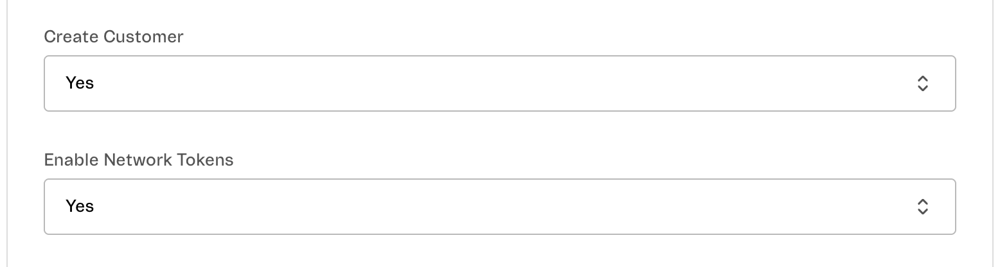
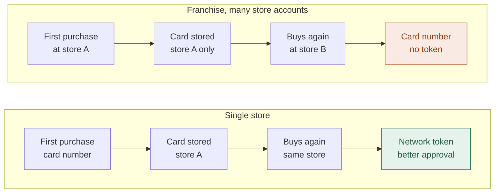

## Multiafiliación {#multi-affiliation}

Una sola cuenta de VTEX puede conectarse a **más de una integración de Yuno** cuando necesitas procesar distintos métodos de pago a través de distintas cuentas de Yuno. Por ejemplo, puedes asignar una cuenta de Yuno a las tarjetas de crédito y otra distinta a las wallets.

Para configurarlo, repite el Paso 1 una vez por integración, dándole a cada una un **Affiliation Name** distinto. Luego, al activar los métodos de pago, usa el campo **Process with affiliation** para elegir qué cuenta debe procesarlo.

## Multicuenta {#multi-account}

Si tu negocio opera **varias cuentas de VTEX** (un modelo de franquicias, un marketplace con afiliados o tiendas independientes que comparten un checkout), el plugin de Yuno necesita saber qué cuenta es la propietaria de los pedidos. Los campos **Main Account** de la configuración del proveedor le indican dónde buscar. La regla que se aplica a todas las filas siguientes: *Main Account Name es la cuenta cuyo OMS es propietario del pedido.* No es necesariamente la cuenta donde se ejecuta la Payment App ni la cuenta que crea el pago.

### Cuándo necesitas los campos {#when-you-need-the-fields}

| Tu configuración | Campos Main Account |
| :--- | :--- |
| **Cuenta única**: una tienda, un administrador | No son obligatorios. Deja los tres campos vacíos. |
| **Franchise fan-in**: muchas cuentas de tienda (franquiciados) bajo una cuenta principal que es propietaria del catálogo y de los pedidos | Obligatorios en **cada afiliación de franquicia**. Define Main Account Name como la cuenta principal. |
| **Afiliado de marketplace**: una tienda cuyos pedidos se pagan a través del checkout de otra cuenta, donde los vendedores procesan el pago | Obligatorios en la afiliación de la **cuenta del vendedor** (la cuenta que autoriza y procesa el pago). Main Account Name es la cuenta del marketplace, que es propietaria del pedido. Debe ser una **afiliación dedicada para la política comercial del marketplace**, no la afiliación habitual de la tienda del vendedor: la consulta de un solo pedido, la consulta por ID de pago y la cancelación de pedidos siempre apuntan a la cuenta principal. Compartir los campos en una afiliación habitual interrumpe el tráfico de la propia tienda del vendedor. |
| **Satélite 1 a 1**: dos cuentas donde una autoriza y la otra completa el pago (por ejemplo, una tienda B2B con una cuenta de pago independiente) | Obligatorios en la afiliación de la cuenta que autoriza. Main Account Name es la cuenta cuyo OMS es propietario del pedido. |

### Qué hace cada campo {#what-each-field-does}

**Main Account Name:** la cuenta de VTEX que es propietaria de los datos del pedido en OMS. El plugin lee los pedidos y los grupos de pedidos de esta cuenta, y le envía las credenciales de Yuno para que los eventos de fulfillment se emitan desde el OMS correcto. La resolución de la política comercial usa las credenciales de la cuenta actual.

**Main Account App key** y **Main Account App token:** credenciales de aplicación de esa cuenta principal. El plugin las usa para llamar a las APIs de VTEX en nombre de la cuenta principal.

<Warning>
  **Los tres campos deben configurarse juntos.** Si defines Main Account Name pero dejas vacío el App key o el App token, el plugin trata la afiliación como si no se hubiera configurado ningún campo Main Account: lee los datos del catálogo y de los pedidos de la cuenta actual, igual que en una configuración de cuenta única. Un valor de `NA` (una convención heredada en algunas afiliaciones) también se trata como vacío. Los tres campos están todos activos o todos ausentes; no existe un estado intermedio.
</Warning>

### Cómo obtener las credenciales de la cuenta principal {#how-to-obtain-the-main-account-credentials}

En el **VTEX License Manager** de la cuenta principal, crea una application key. La key se usa para estas llamadas a la API en la cuenta principal:

*   **OMS**: leer pedidos y grupos de pedidos (incluida la consulta por ID de pago); cancelar pedidos denegados (`POST /api/oms/pvt/orders/{id}/cancel`).
*   **Catalog**: leer el registro del vendedor (`GET /api/catalog_system/pvt/seller/{sellerId}`).
*   **Subscriptions**: leer los ciclos de suscripción (`GET /api/rns/pub/cycles`), para tiendas que usan VTEX Subscriptions.

La key debe crearse en la cuenta principal, no en la cuenta de la franquicia ni en la cuenta satélite. Una key creada en la cuenta equivocada no puede leer los datos que el plugin necesita. Para obtener detalles sobre cómo crear keys y asignar permisos, consulta [VTEX License Manager](https://help.vtex.com/en/tutorial/license-manager-resources--3q6ztrC8YynQf6rdc6euk3).

### Síntomas de una configuración incorrecta de Multicuenta {#symptoms-of-a-misconfigured-multi-account}

Cuando los campos Main Account **faltan o apuntan a la cuenta equivocada**, la falla puede ser silenciosa: no aparece ningún error en el panel de VTEX ni en el checkout. Sin embargo, unas credenciales incorrectas o un nombre de cuenta incorrecto producen errores visibles de API en los logs del plugin (respuestas 401, 403 o 404 en las llamadas a OMS).

| Síntoma | Qué está ocurriendo |
| :--- | :--- |
| Los pedidos nunca se marcan como cumplidos | Las credenciales de Yuno se guardaron en una cuenta distinta de la que emite los eventos de estado del pedido, por lo que el manejador de eventos no encuentra nada y se detiene. |
| El fulfillment funciona, pero los reintentos de autorización o las cancelaciones de pedidos fallan después del pago | Las credenciales de la cuenta principal no son válidas o el nombre de la cuenta no coincide. Revisa los logs del plugin para ver errores de la API de VTEX en las llamadas a OMS. |
| La política comercial o el nombre del canal de ventas enviado a Yuno es incorrecto | La política comercial se resuelve con las credenciales de la cuenta actual, pero los datos del pedido se leen de la cuenta principal. Una discrepancia entre ambas produce datos de enrutamiento y de reportes incorrectos del lado de Yuno. |
| Los pedidos divididos no se detectan | El plugin consulta el OMS equivocado para obtener los subpedidos relacionados. No se comparte una sesión antifraude; cada subpedido obtiene la suya. |
| Pago rechazado o creado sin datos de la tienda (canal de ventas o sitio web del vendedor vacíos) | El pedido no existe en la cuenta que el plugin consultó en el momento de la autorización. Revisa los datos adicionales del pago en el Dashboard de Yuno. |

### Cómo verificar la configuración {#how-to-verify-the-setup}

**Para el comercio:**

Realiza un pedido de prueba en la tienda y luego revisa el Dashboard de Yuno:

*   El pago incluye el **canal de ventas** esperado en sus datos adicionales.
*   Aparece una **actualización de fulfillment** una vez que el pedido se envía en VTEX (esto confirma que las credenciales llegaron a la cuenta cuyo OMS emite los eventos de estado).

<Accordion title="Verificación de la configuración (para los TAMs de Yuno)">
  Toma el ID de pedido de VTEX de la orden de prueba (es el atributo `application_session` en los logs de auditoría del plugin) y búscalo en Datadog (`service:sdk-event-log-audit-ms`):

  1.  Confirma que `organization_name` en los pasos de autorización coincide con la **cuenta de origen** (la franquicia o el satélite), y que el salto `saveYunoKeys` apunta a la cuenta principal.
  2.  Si `saveYunoKeys` apunta a la propia cuenta de origen, o a una cuenta distinta de la principal esperada, los campos Main Account están mal configurados: verifica que los tres campos estén completos y que Main Account Name coincida con la cuenta que pretendes usar.
  3.  Confirma que no aparece ningún log `sendFulfillment` para un pedido que sí se envió: su ausencia significa que las credenciales llegaron a la cuenta equivocada y el manejador de eventos de fulfillment no encontró nada.
</Accordion>

<Note>
  Las funciones que dependen del estado por cuenta (el vault de tarjetas para network tokens, las modificaciones de pedidos y los datos de comprador corporativo) deben habilitarse en **cada** afiliación de franquicia de forma individual. Habilitarlas solo en la cuenta principal no es suficiente, porque el plugin lee estas configuraciones de la afiliación que autoriza cada pedido. Consulta [Network tokens](#network-tokens-repeat-card-purchases), [Modificaciones de pedidos](#order-modifications-changed-order-totals) y [Compras corporativas](#corporate-purchases-brazil) para ver las instrucciones de configuración de cada función.
</Note>

## Pedidos divididos (varios vendedores) {#split-orders-multiple-sellers}

Cuando el carrito de un comprador contiene productos de **distintos vendedores o franquicias**, VTEX divide la compra en varios subpedidos y autoriza cada uno de forma independiente. La integración de Yuno lo detecta y procesa **cada** subpedido, de modo que se paga el pedido completo y no solo la primera parte. Se comparte una única sesión antifraude entre todos ellos.

Esto funciona de forma automática; no se requiere configuración adicional. Si quieres controlar qué proveedores antifraude reciben la sesión compartida, usa el campo **Antifraud Providers for Split Orders** en la configuración del proveedor (consulta la referencia de campos en el Paso 1). Los valores válidos son `RISKIFIED`, `CYBERSOURCE`, `SIGNIFYD` y `CIELO_CYBERSOURCE_FRAUD`. En el plugin **4.2.362 o posterior**, los cuatro proveedores reciben la sesión compartida cuando el campo se deja vacío; en versiones anteriores, el valor predeterminado es `RISKIFIED` + `CYBERSOURCE`. Si lo completas, solo los proveedores que indiques la reciben, así que asegúrate de que la lista incluya a todos los proveedores antifraude que usa tu tienda. Un proveedor que falte en la lista no recibe ninguna sesión para el segundo subpedido ni los siguientes, por lo que su evaluación de esos pagos puede fallar y dejarlos pendientes. Por ejemplo, si usas Cielo CyberSource, incluye `CIELO_CYBERSOURCE_FRAUD`.

## Sesión antifraude (huellas de dispositivo) {#antifraud-session-device-fingerprints}

Los proveedores antifraude (Riskified, Signifyd, CyberSource, Cielo CyberSource) puntúan un pago comparando los datos del dispositivo recopilados en el navegador del comprador con el ID de sesión que Yuno envía en el pago. Para que esa coincidencia funcione, el navegador y el servidor deben usar el **mismo** ID de sesión.

La Payment App de Yuno se encarga de esto por ti: en la página de checkout lee el ID del carrito de VTEX (`window.vtexjs.checkout.orderFormId`) y lo reporta como el ID de sesión antifraude para `RISKIFIED`, `SIGNIFYD`, `CYBERSOURCE` y `CIELO_CYBERSOURCE_FRAUD`. El Payment Connector de Yuno envía el mismo `orderFormId` del lado del servidor, de modo que la sesión es consistente entre el navegador, cada subpedido de un pedido dividido y el propio pago. No se necesita configuración; si el ID del carrito no está disponible, cada proveedor recurre a su propio ID de sesión generado y el pago no se bloquea.

<Accordion title="Cielo CyberSource: prefijo del merchant ID">
  Cielo CyberSource requiere que el ID de sesión antifraude comience con el prefijo de tu merchant ID (MID) de Cielo. Mientras este prefijo no se pueda configurar en el Dashboard de Yuno, defínelo en el JavaScript personalizado de tu checkout de VTEX **antes** de que cargue el checkout:

  ```javascript
  window.yunoFingerprintPrefix = 'YOUR_MID_PREFIX_'
  ```

  La Payment App lo antepone únicamente al ID de sesión de `CIELO_CYBERSOURCE_FRAUD` (`YOUR_MID_PREFIX_<orderFormId>`); los demás proveedores no se ven afectados. Cuando la variable no está definida, no se aplica ningún prefijo.

  <Note>
    Esta variable global es un mecanismo provisional. Cuando el prefijo de la huella se pueda configurar en el Dashboard de Yuno, ya no será necesaria.
  </Note>
</Accordion>

Si integras el SDK directamente en lugar de usar la Payment App, pasa tú mismo los IDs de sesión mediante la opción de montaje `deviceFingerprints`. Consulta [Integración directa del SDK](/es/docs/plugins/vtex/direct-sdk-integration).

## Modificaciones de pedidos (totales de pedido modificados) {#order-modifications-changed-order-totals}

VTEX te permite **modificar un pedido después del checkout**, cuando el total final resulta distinto del monto que se autorizó. Esto aplica, por ejemplo, si vendes productos **por peso**, donde el total exacto solo se conoce una vez que el pedido se selecciona y se empaca.

*   Si el total final es **igual o menor**, VTEX captura solo el monto final. No se requiere configuración adicional.
*   Si el total final es **mayor**, VTEX cobra la diferencia como un **cargo independiente y automático**. Como el comprador ya no está presente y no vuelve a ingresar su tarjeta, Yuno cobra la diferencia a la tarjeta que ya usó en el pedido original.

Para habilitar los cargos automáticos cuando el total de un pedido **aumenta**, configura lo siguiente en los ajustes de tu proveedor **antes** de que se realicen los pedidos que esperas modificar:

| Campo | Valor |
| :--- | :--- |
| **Vault Card for Order Modification** | **Yes**: almacena la tarjeta en el pedido original para poder cobrarla de nuevo por la diferencia. |
| **Create Customer** | **Yes**: obligatorio, para que la tarjeta se almacene asociada a un cliente de Yuno. Ambos campos deben estar habilitados juntos. |
| **Automatic Settlement** | **Disabled** (recomendado). El pago original se autoriza en el checkout y se captura al facturar. Si el total final es **menor** que el monto autorizado, solo se captura ese monto menor (una captura parcial). Si es mayor, la diferencia se cobra como un cargo adicional independiente. |

<Note>
  Los **aumentos** del total del pedido se admiten **solo con tarjetas de crédito** (una restricción de VTEX). La tarjeta se almacena en el momento del pago original, por lo que **Vault Card for Order Modification** y **Create Customer** deben habilitarse **antes** de realizar el pedido. Activarlos más tarde no se aplica a los pedidos que ya existen.
</Note>

<Note>
  **Franquicias / varias cuentas:** habilita **Vault Card for Order Modification** y **Create Customer** en **cada** afiliación que uses (cada franquicia o subcuenta), y configura los campos **Main Account** como se describe en [Multicuenta](#multi-account).
</Note>

## Network tokens (compras repetidas con tarjeta) {#network-tokens-repeat-card-purchases}

Los [network tokens](/es/docs/security-and-compliance/network-tokens) reemplazan el número de tarjeta por un token emitido por la red de tarjetas (Visa, Mastercard, American Express). Pagar con un network token en lugar del número de tarjeta mejora las tasas de aprobación para los compradores recurrentes y sigue funcionando cuando la tarjeta se reemite, porque la red actualiza el token automáticamente.

Yuno solo puede asociar un network token a una tarjeta que haya almacenado de forma segura. Cuando **Enable Network Tokens** está activado, el plugin almacena cada tarjeta la primera vez que un cliente paga con ella y reutiliza esa referencia almacenada en cada compra posterior de la misma tarjeta por el mismo cliente. No se necesita ningún cambio en la tienda ni en la Payment App; todo ocurre del lado de Yuno en la integración.

### Qué debe estar activado {#what-has-to-be-switched-on}

| Requisito | Dónde |
| :--- | :--- |
| **Enable Network Tokens** | Configuración del proveedor en VTEX (Paso 1), establecido en **Yes**. No tiene efecto por sí solo. |
| **Create Customer** | En el mismo lugar, establecido en **Yes**. La tarjeta almacenada se asocia a un cliente de Yuno, por lo que ambos campos son obligatorios juntos. |
| **Plugin 4.2.347+** | Cada cuenta de VTEX que ejecuta el plugin, incluida la cuenta que autoriza en lugar de cobrar (consulta [Varias cuentas](#multiple-accounts-and-franchises)). |
| **Activación de rutas** | La realiza Yuno en las rutas que usa tu tienda. No es algo que puedas configurar tú mismo: contacta a tu KAM de Yuno o a [soporte](/es/docs/security-and-compliance/network-tokens#1-let-yuno-provision-and-collect-network-tokens). La activación es por ruta, y las rutas pertenecen a un Account ID de Yuno, por lo que cada cuenta con la que proceses necesita su propia activación. |

<Warning>
  **Se requieren ambas partes.** Hasta que Yuno active los network tokens en tus rutas, el plugin almacena las tarjetas pero cada pago se sigue procesando con el número de tarjeta y no se emite ningún network token. También se cumple lo inverso: si los network tokens están activos en tus rutas pero **Enable Network Tokens** y **Create Customer** no están configurados en VTEX, no se almacena ninguna tarjeta y cada pago sigue siendo una transacción normal con número de tarjeta. Confirma la activación con tu KAM o con soporte antes de esperar cualquier cambio en las tasas de aprobación.
</Warning>

### Cómo activarlo {#enable-it}

En la configuración de tu proveedor (Paso 1), define los siguientes dos campos y guarda:

| Campo | Valor |
| :--- | :--- |
| **Create Customer** | **Yes**: obligatorio, porque la tarjeta almacenada se asocia a un cliente de Yuno. Ambos campos deben estar habilitados juntos; **Enable Network Tokens** no tiene efecto por sí solo. |
| **Enable Network Tokens** | **Yes**. No tiene efecto hasta que Yuno active los network tokens en tus rutas (consulta más arriba). |

<Frame>
  
</Frame>

### Qué esperar {#what-to-expect}

*   **Primera compra con una tarjeta**: se procesa con el número de tarjeta, como hasta ahora. La tarjeta se almacena al final de esa compra.
*   **Compras posteriores de la misma tarjeta por el mismo cliente**: se procesan con el network token.
*   **Aumento gradual**: como la primera compra de cada tarjeta sigue usando el número de tarjeta, verás casi ningún network token el primer día. El beneficio crece a medida que los clientes regresan con una tarjeta que ya usaron en tu tienda.
*   **Tarjetas reemitidas** (por ejemplo, una nueva fecha de vencimiento después de una renovación) se siguen reconociendo, por lo que el network token continúa usándose.
*   **Alternativa**: si la referencia almacenada no está disponible por cualquier motivo, el pago continúa con el número de tarjeta exactamente como ocurre hoy. Habilitar esta función nunca provoca que un pago falle.
*   **Las suscripciones de VTEX** no se ven afectadas. Los cobros recurrentes tienen su propio flujo de credenciales almacenadas, que sigue funcionando como se describe en las [preguntas frecuentes](/es/docs/plugins/vtex/faqs).
*   Aplica a todos los pagos con tarjeta procesados a través del plugin, incluidos los pagos con defensa contra el fraude y los [pedidos divididos](#split-orders-multiple-sellers).

<Note>
  **Las modificaciones de pedidos no se ven afectadas.** Almacenar una tarjeta para network tokens no permite por sí solo que el plugin la cobre de nuevo. Los [cargos adicionales cuando aumenta el total de un pedido](#order-modifications-changed-order-totals) siguen controlados únicamente por **Vault Card for Order Modification**: con ese campo en **No**, un aumento del total del pedido se rechaza aunque la tarjeta esté almacenada.
</Note>



La tienda B no tiene registro de la tarjeta, por lo que se trata como una primera compra. El pago igualmente es exitoso; recurre al número de tarjeta.

### Varias cuentas y franquicias {#multiple-accounts-and-franchises}

La tarjeta se almacena en la cuenta de VTEX que **autoriza** el pago y se asocia al **Account ID** de Yuno de esa cuenta. Ten esto en cuenta en las siguientes configuraciones:

*   **Autorización y pago en distintas cuentas de VTEX** (por ejemplo, una tienda B2B que completa el pago en una segunda cuenta): habilita ambos campos en la afiliación de la cuenta que **autoriza** el pedido, y no solo en la cuenta que completa el pago. Ambas cuentas deben ejecutar la versión del plugin **4.2.347 o posterior**.
*   **Franquicias / varias cuentas de tienda** (muchas cuentas de tienda que comparten una cuenta principal): habilita ambos campos en **cada** afiliación de franquicia. Una tarjeta almacenada por una cuenta de tienda no se comparte con otra, y una tarjeta almacenada bajo un Account ID de Yuno no es visible para otro, por lo que cada tienda construye su propio historial de tarjetas. **Por lo tanto, el beneficio se acumula por tienda**: una cadena cuyos clientes compran en varias tiendas obtiene considerablemente menos pagos tokenizados que un comercio de una sola tienda, porque cada tienda solo reconoce las tarjetas usadas por primera vez en esa misma tienda. La activación de rutas también es por Account ID de Yuno, por lo que Yuno debe activar los network tokens en las rutas de **cada** cuenta de franquicia, no solo en la principal.

<Accordion title="Verificación de la configuración (para los TAMs de Yuno)">
  Realiza dos pedidos con la misma tarjeta y el mismo cliente en la tienda, luego busca los logs del plugin de cada pedido en Datadog y filtra por el atributo `step_function`:

  | Pedido | Step functions esperadas |
  | :--- | :--- |
  | Primera compra | `cardVaultLookup` que indica que no hay tarjeta almacenada, seguido de `cardVaultWrite` una vez que se crea el pago (la tarjeta se almacena). |
  | Compra repetida | `cardVaultLookup` que indica una coincidencia, seguido de `cardVaultTokenPassed` (la referencia almacenada se envió con el pago). |

  Una compra repetida que muestra `cardVaultLookup` sin coincidencia normalmente significa que los dos pedidos no compartieron el mismo cliente de Yuno (revisa **Create Customer**), se realizaron desde distintas cuentas de tienda o usaron una tarjeta diferente. Si la referencia almacenada se pasa pero el pago aún muestra un número de tarjeta del lado de Yuno, los network tokens todavía no están habilitados en la ruta.
</Accordion>

## Compras corporativas (Brasil) {#corporate-purchases-brazil}

En Brasil, las compras realizadas en nombre de una empresa deben pagarse y facturarse con el **CNPJ** de la empresa, no con el CPF personal de la persona que realiza el pedido. Cuando un comprador hace el checkout como empresa (*pessoa jurídica*), VTEX envía ambas identidades al plugin: el nombre y el CPF del comprador, y la razón social (*razão social*), el nombre comercial (*nome fantasia*) y el CNPJ de la empresa.

De forma predeterminada, el plugin usa la identidad personal del comprador. Con **Use Corporate Buyer Data** establecido en **Yes**, los pedidos corporativos se pagan en cambio a nombre de la empresa: el boleto se emite al CNPJ, y cualquier otro método de pago (tarjetas, PIX, wallets) lleva a la empresa como pagador en Yuno.

### Cómo activarlo {#enable-it-1}

En la configuración de tu proveedor (Paso 1), establece **Use Corporate Buyer Data** en **Yes** y guarda. No se necesita ningún cambio en la tienda ni en la Payment App.

| Campo | Valor |
| :--- | :--- |
| **Use Corporate Buyer Data** | **Yes**. Requiere el plugin **4.2.350 o posterior**; el campo solo aparece en la configuración del proveedor una vez que la tienda ejecuta esa versión. |

### Qué esperar {#what-to-expect-1}

| Pedido | Pagador enviado a Yuno |
| :--- | :--- |
| El comprador hace el checkout como empresa, dirección de facturación en Brasil | Razón social, nombre comercial y CNPJ de la empresa (tipo de documento `CNPJ`). |
| El comprador hace el checkout como persona física | Nombre y CPF del comprador, exactamente como hasta ahora. |
| Checkout corporativo con una dirección de facturación fuera de Brasil | Identidad personal del comprador. El mapeo corporativo se limita a Brasil, donde se sabe que el tipo de documento es un CNPJ. |

*   **El mismo comprador, distintos roles.** Un comprador puede realizar un pedido como empresa y el siguiente como persona física; cada pedido lleva la identidad usada en el checkout, sin importar lo que enviaron los pedidos anteriores.
*   **A prueba de fallas.** Si los datos de la empresa están incompletos (por ejemplo, falta el CNPJ), el pedido recurre a la identidad personal del comprador y el pago continúa.
*   **Wallets creadas antes del pedido.** Los pagos con Apple Pay, Google Pay y Click to Pay que se crean durante la carga de la página, antes de que exista el pedido, conservan la identidad recopilada por la tienda.

<Note>
  **Franquicias / varias cuentas:** habilita el campo en **cada** afiliación cuyos pedidos deban usar la identidad de la empresa y, en configuraciones donde una cuenta autoriza y otra completa el pago, en la afiliación de la cuenta que **autoriza**.
</Note>

<Accordion title="Verificación de la configuración (para los TAMs de Yuno)">
  Realiza un pedido corporativo en la tienda y abre el pago creado en el Dashboard de Yuno, o busca los logs del plugin en Datadog (`step_name:"After get payment"`) y revisa la solicitud de pago:

  | Campo | Esperado |
  | :--- | :--- |
  | `customer_payer.first_name` / `last_name` | Razón social / nombre comercial (el nombre comercial se omite cuando es igual a la razón social). |
  | `customer_payer.document` | `{ "document_number": "<CNPJ>", "document_type": "CNPJ" }` |
  | `metadata.customer_document` | El CNPJ. |

  Si la solicitud aún lleva el CPF, confirma que **Use Corporate Buyer Data** aparece en la configuración guardada de la afiliación (la afiliación debe guardarse de nuevo después de actualizar el plugin a 4.2.350) y que la dirección de facturación del pedido está en Brasil.
</Accordion>
