La experiencia mejorada de billeteras es un complemento opcional para las tiendas que ya usan el plugin de Yuno para VTEX. Mejora la experiencia de checkout de los compradores al eliminar una pantalla intermedia entre el checkout de VTEX y la hoja nativa de la billetera del dispositivo, que se sabe que reduce la conversión en los pagos con billeteras.

<div className="grid grid-cols-2 gap-4">
  <Frame caption="Experiencia predeterminada (con pantalla intermedia)">
    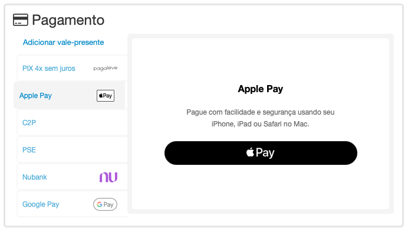
  </Frame>
  <Frame caption="Experiencia mejorada (hoja nativa directa)">
    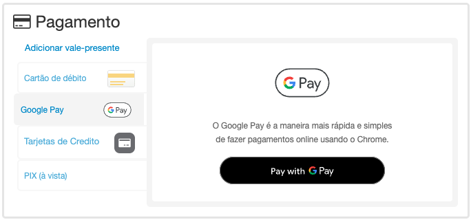
  </Frame>
</div>

## Qué es {#what-it-is}

De forma predeterminada, cuando un comprador selecciona un pago con billetera (Apple Pay, Google Pay o Samsung Pay), la Yuno Payment App abre una pantalla intermedia dentro del checkout de VTEX antes de que aparezca la hoja nativa de confirmación del dispositivo (Face ID, fingerprint o PIN).

La **experiencia mejorada** elimina esa pantalla intermedia: los botones de las billeteras aparecen **directamente dentro del paso de pago del checkout de VTEX**, y al tocar un botón se abre de inmediato la hoja nativa del dispositivo.

Esta integración también desbloquea **cuotas** opcionales **para Apple Pay, Google Pay y Samsung Pay**.

## Cómo funciona {#how-it-works}

Cuando un comprador llega al checkout, el Yuno SDK prepara una sesión de pago de forma silenciosa en segundo plano. Cuando llega al paso de pago, los botones de las billeteras aparecen al instante.

*   **Confirmación rápida**: al tocar un botón, se abre de inmediato la hoja nativa de la billetera.
*   **Recálculo automático**: si el comprador cambia su carrito (agrega un artículo, aplica un cupón, cambia el envío), el SDK recalcula la sesión automáticamente.
*   **Manejo de errores**: si un pago falla, el comprador puede intentarlo de nuevo sin volver a cargar la página.

---

## Guía de integración {#integration-guide}

Configurar la experiencia mejorada implica agregar un pequeño fragmento de JavaScript al checkout de VTEX y encontrar los valores con los que completarlo.

<Steps>
  <Step title="Agrega el fragmento al checkout de VTEX">
    El fragmento se agrega al archivo `checkout6-custom.js` de tu tienda desde el VTEX dashboard.

    1.  En el **VTEX dashboard**, busca **Checkout** en la barra superior.

    <Frame>
      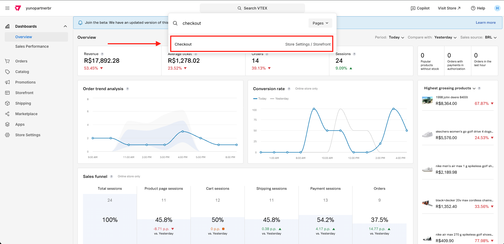
    </Frame>

    2.  Selecciona el sitio web que usa tu tienda (normalmente **Default**).

    <Frame>
      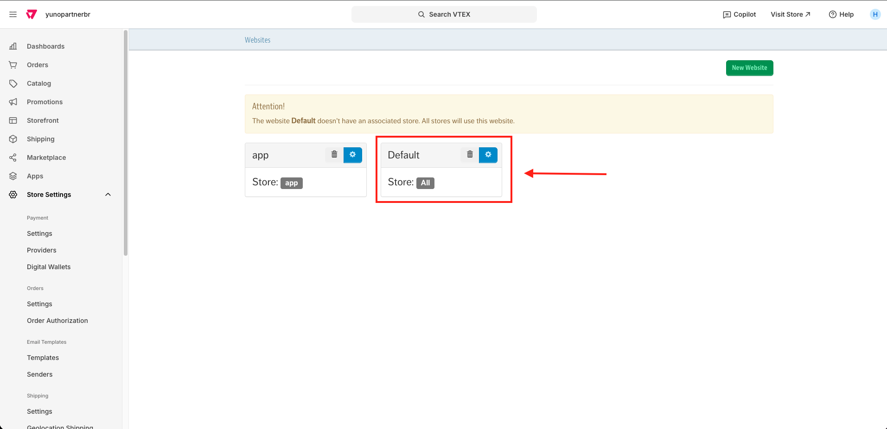
    </Frame>

    3.  Abre la pestaña **Code** y selecciona `checkout6-custom.js` en la lista de archivos de la derecha.

    <Frame>
      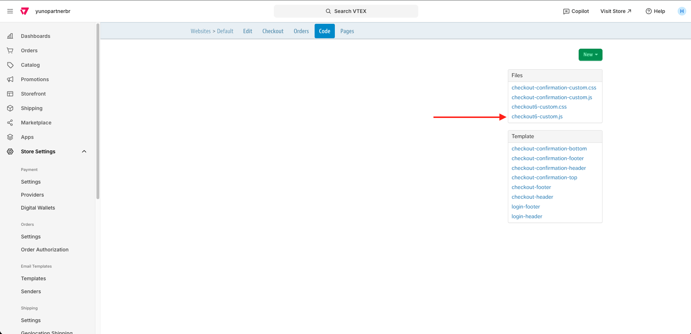
    </Frame>

    4.  Agrega el siguiente fragmento al final del archivo y luego haz clic en **Save**.

    <Frame>
      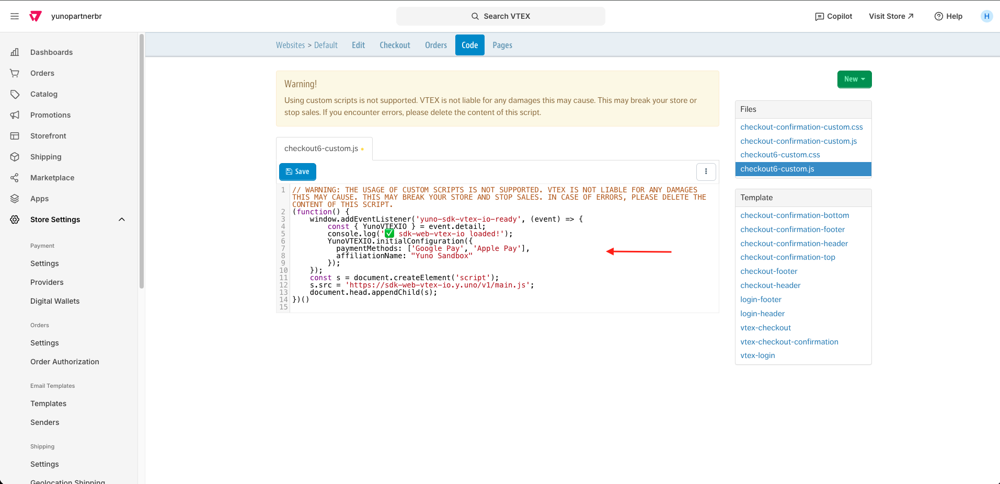
    </Frame>

    ```javascript
    (function () {
      window.addEventListener('yuno-sdk-vtex-io-ready', function (event) {
        var YunoVTEXIO = event.detail.YunoVTEXIO;
        YunoVTEXIO.initialConfiguration({
          paymentMethods: ['Apple Pay', 'Google Pay', 'Samsung Pay'],
          affiliationName: 'YOUR_AFFILIATION_NAME'
        });
      });

      var script = document.createElement('script');
      script.src = 'https://sdk-web-vtex-io.y.uno/v1/main.js';
      document.head.appendChild(script);
    })();
    ```

    <Note>
      Reemplaza `YOUR_AFFILIATION_NAME` por el nombre de afiliación de la configuración de tu proveedor de Yuno. En `paymentMethods`, enumera las billeteras que quieres habilitar: `'Apple Pay'`, `'Google Pay'`, `'Samsung Pay'` o cualquier combinación.
    </Note>
  </Step>

  <Step title="Encuentra el nombre de afiliación">
    El valor `affiliationName` es el mismo que definiste al configurar Yuno como proveedor de pago.

    1.  En la barra de búsqueda del **VTEX dashboard**, escribe `providers` y selecciona el resultado **Providers**.

    <Frame>
      
    </Frame>

    2.  Busca el proveedor de Yuno configurado para esta tienda y ábrelo.

    <Frame>
      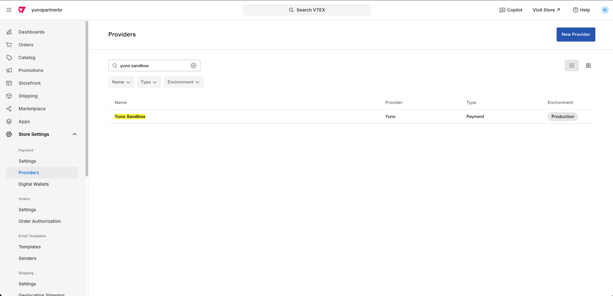
    </Frame>

    3.  En la vista de detalle del proveedor, copia el valor del campo **Affiliation Name** y úsalo en el fragmento.

    <Frame>
      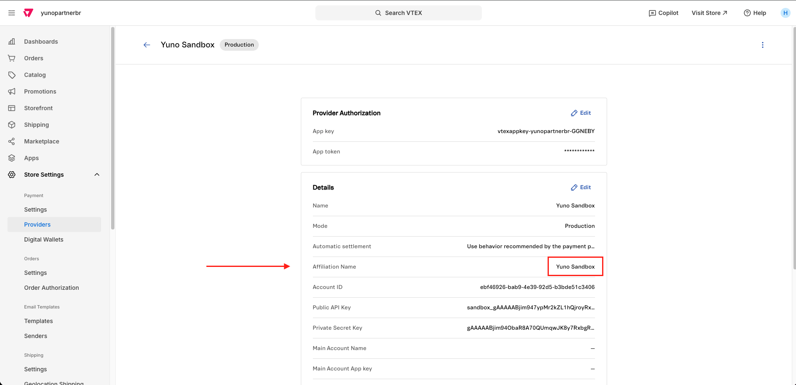
    </Frame>
  </Step>
</Steps>

Después de guardar el fragmento, la experiencia mejorada queda activa. Los botones de las billeteras que configuraste
aparecerán directamente dentro del paso de pago del checkout de VTEX.

---

## Cuotas con Apple Pay {#apple-pay-installments}

Las cuotas con Apple Pay son una función opcional dentro de la experiencia mejorada que permite a los compradores dividir su compra en cuotas.

### Qué ven los compradores {#what-shoppers-see}

Una vez habilitada, aparece un selector **Installments** sobre el botón de Apple Pay. Al tocarlo, se abre un panel con todas las opciones de cuotas.

<div className="grid grid-cols-2 gap-4">
  <Frame caption="Selector de cuotas">
    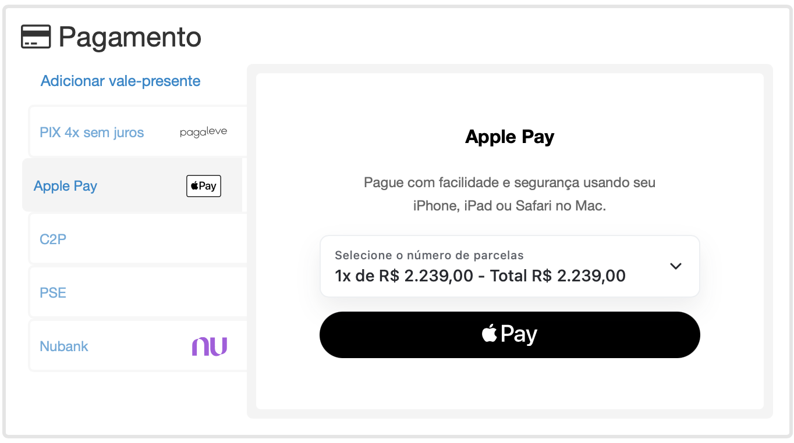
  </Frame>
  <Frame caption="Panel de opciones de cuotas">
    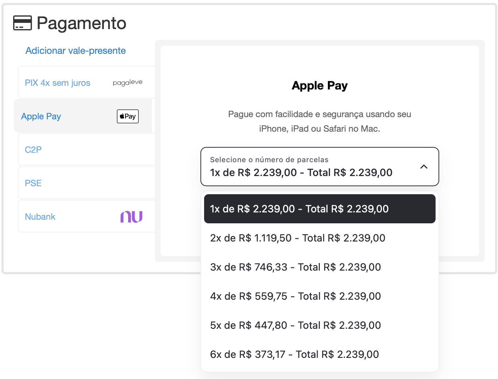
  </Frame>
</div>

Si el plan incluye intereses, debajo aparece un panel **Payment details** con el desglose (número de cuotas, costo de financiamiento, etc.).

<Frame width="300">
  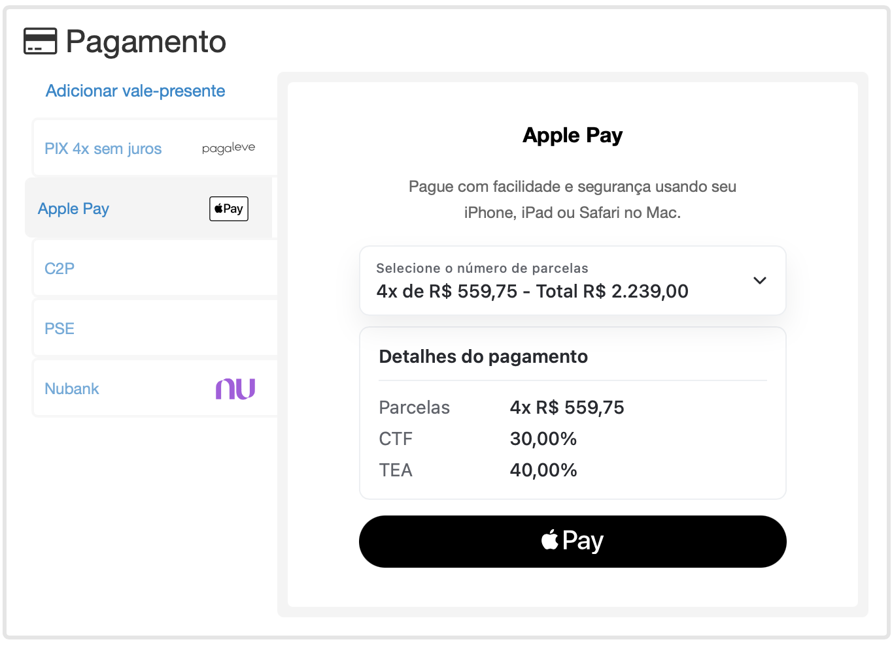
</Frame>

### Cómo habilitarlas {#how-to-enable}

Las cuotas con Apple Pay se habilitan desde el Yuno dashboard, creando planes de cuotas para el
método de pago Apple Pay. **El fragmento no cambia**: una tienda que ejecuta la experiencia mejorada con
`'Apple Pay'` en `paymentMethods` ya solicita a Yuno los planes disponibles en cada orden.

<Steps>
  <Step title="Crea un plan de cuotas para Apple Pay">
    1.  En el **Yuno dashboard**, ve a **Installments** y haz clic en **Create installment**.
    2.  En **Payment method type**, selecciona **Apple Pay**.
    3.  Define el número de cuotas, la tasa, el rango de montos y la ventana de disponibilidad.

    <Frame>
      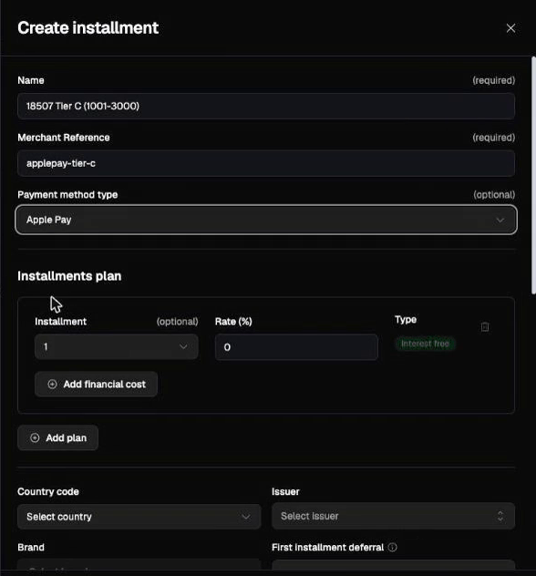
    </Frame>

    <Warning>
      Los planes de tarjeta no se reutilizan. Apple Pay solo ve los planes creados para el método de pago Apple Pay, por lo que
      una tienda que ya tiene planes de cuotas configurados para tarjetas aún necesita sus propios planes de Apple Pay.
    </Warning>
  </Step>
  <Step title="Revisa el plan en la lista">
    El plan aparece con **Apple Pay** en la columna **Payment method**. Crea un plan por cada rango de
    montos si quieres ofrecer opciones distintas según el tamaño del carrito.

    <Frame>
      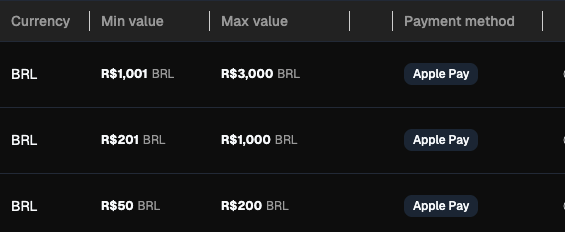
    </Frame>
  </Step>
  <Step title="Confírmalo en tu checkout">
    Abre el paso de pago con un carrito dentro del rango de montos del plan y selecciona Apple Pay. El selector
    **Installments** aparece sobre el botón.
  </Step>
</Steps>

También puedes crear planes con el endpoint [Crear plan de cuotas](/es/reference/installments/create-installments-plan),
enviando `payment_method_type: APPLE_PAY`.

### Reglas de elegibilidad {#eligibility-rules}

Yuno determina el plan de cada orden a partir del total del carrito, por lo que el comprador siempre ve las opciones que
corresponden a lo que hay en su carrito. Si el carrito cambia, las opciones se recalculan.

Cada plan que creas define:

*   **Payment method type**: debe ser Apple Pay.
*   **Moneda y país**: deben coincidir con la orden.
*   **Rango de montos**: total mínimo y máximo de la orden que cubre el plan.
*   **Ventana de disponibilidad**: fecha de inicio y de fin del plan.

El selector muestra una entrada por cada número de cuotas. Si dos planes cubren la misma orden y ambas
ofrecen la misma cantidad, solo se usa uno de ellos, así que mantén separados los rangos de montos si quieres un
resultado predecible.

Si ningún plan cubre la orden, el selector se oculta y Apple Pay se muestra como un botón simple; el
pago se procesa igualmente, en una sola cuota.

<Warning>
  Compara el monto mínimo de tu plan más bajo con el total típico de tus órdenes. Si el plan empieza
  por encima de ese total, la mayoría de los compradores nunca ve el selector, y la función parece rota cuando solo está fuera del
  rango.
</Warning>

---

## Cuotas con Google Pay {#google-pay-installments}

Las cuotas con Google Pay funcionan igual que las de Apple Pay: los compradores dividen su compra
en cuotas directamente desde la opción de pago de Google Pay. Cada billetera resuelve sus propios planes,
así que puedes ofrecer cuotas en una billetera, en la otra o en ambas.

### Qué ven los compradores {#what-shoppers-see-1}

Una vez habilitada, aparece un selector **Installments** sobre el botón de Google Pay. Al tocarlo, se abre un
panel con todas las opciones de cuotas.

<div className="grid grid-cols-2 gap-4">
  <Frame caption="Selector de cuotas">
    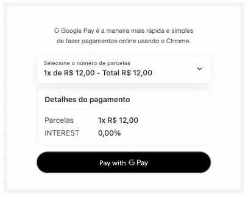
  </Frame>
  <Frame caption="Panel de opciones de cuotas">
    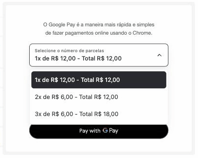
  </Frame>
</div>

Si el plan incluye intereses, debajo aparece un panel **Payment details** con el desglose
(número de cuotas, costo de financiamiento, etc.), exactamente igual que con Apple Pay.

### Cómo habilitarlas {#how-to-enable-1}

Las cuotas con Google Pay se habilitan desde el Yuno dashboard, creando planes de cuotas para el
método de pago Google Pay. **El fragmento no cambia**: una tienda que ejecuta la experiencia mejorada
con `'Google Pay'` en `paymentMethods` ya solicita a Yuno los planes disponibles en cada orden.

<Steps>
  <Step title="Crea un plan de cuotas para Google Pay">
    1.  En el **Yuno dashboard**, ve a **Installments** y haz clic en **Create installment**.
    2.  En **Payment method type**, selecciona **Google Pay**.
    3.  Define el número de cuotas, la tasa, el rango de montos y la ventana de disponibilidad.

    <Frame>
      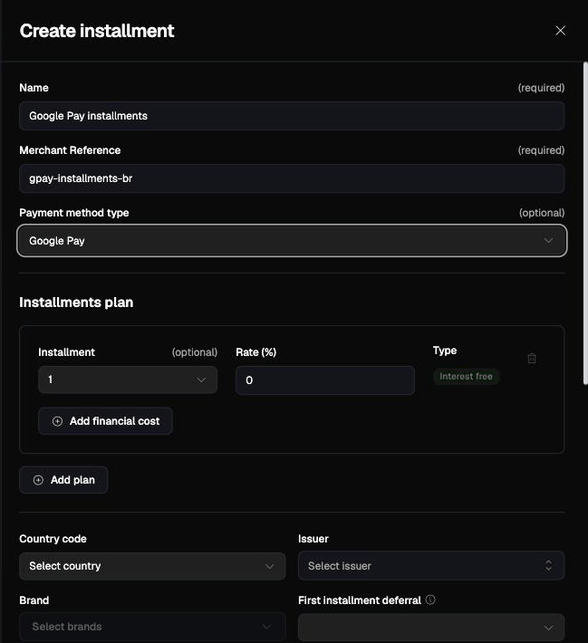
    </Frame>

    <Warning>
      Los planes son estrictamente por método de pago. Google Pay solo ve los planes creados para el
      método de pago Google Pay; no se reutilizan ni los planes de tarjeta ni los de Apple Pay. Una tienda que ofrece
      cuotas en dos o más billeteras necesita un conjunto de planes por cada billetera.
    </Warning>
  </Step>
  <Step title="Revisa el plan en la lista">
    El plan aparece con **Google Pay** en la columna **Payment method**. Crea un plan por cada rango de
    montos si quieres ofrecer opciones distintas según el tamaño del carrito.

    <Frame>
      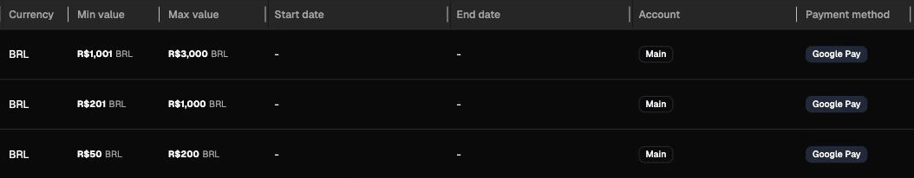
    </Frame>
  </Step>
  <Step title="Confírmalo en tu checkout">
    Abre el paso de pago con un carrito dentro del rango de montos del plan y selecciona Google Pay. El selector
    **Installments** aparece sobre el botón.
  </Step>
</Steps>

También puedes crear planes con el endpoint [Crear plan de cuotas](/es/reference/installments/create-installments-plan),
enviando `payment_method_type: GOOGLE_PAY`.

### Reglas de elegibilidad {#eligibility-rules-1}

Google Pay sigue las mismas [reglas de elegibilidad que Apple Pay](#eligibility-rules): Yuno determina el
plan de cada orden a partir del total del carrito, lo recalcula cuando el carrito cambia y asocia los planes según
moneda, país, rango de montos y ventana de disponibilidad. La única diferencia es el tipo de método de
pago: un plan solo se aplica a Google Pay cuando su **Payment method type** es **Google Pay**.

Si ningún plan cubre la orden, el selector se oculta y Google Pay se muestra como un botón simple; el
pago se procesa igualmente, en una sola cuota.

---

## Cuotas con Samsung Pay {#samsung-pay-installments}

Las cuotas con Samsung Pay funcionan igual que las de Apple Pay y Google Pay: los compradores dividen
su compra en cuotas directamente desde la opción de pago de Samsung Pay.

### Qué ven los compradores {#what-shoppers-see-2}

Una vez habilitada, aparece un selector **Installments** sobre el botón de Samsung Pay. Al tocarlo, se abre un panel con todas las opciones de cuotas, con un desglose completo del financiamiento debajo.

<Frame caption="Checkout de Samsung Pay con cuotas">
  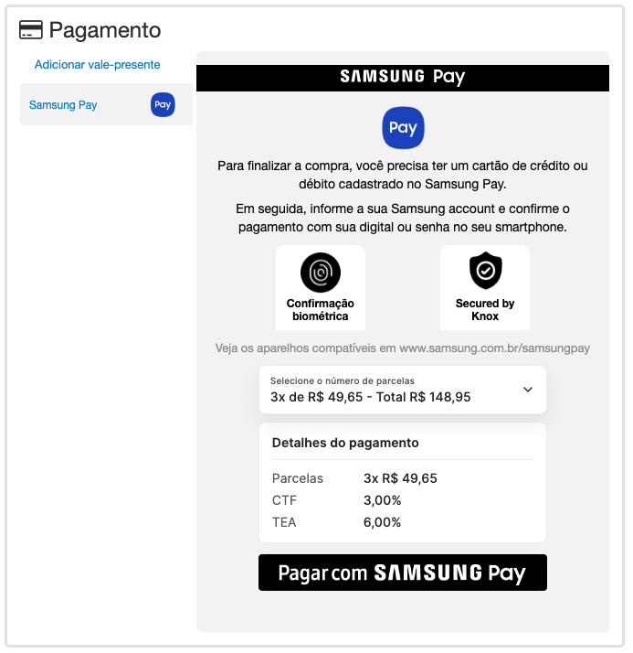
</Frame>

### Cómo habilitarlas {#how-to-enable-2}

Las cuotas con Samsung Pay se habilitan desde el Yuno dashboard, creando planes de cuotas para el
método de pago Samsung Pay. **El fragmento no cambia**: una tienda que ejecuta la experiencia mejorada
con `'Samsung Pay'` en `paymentMethods` ya solicita a Yuno los planes disponibles en cada orden.

<Steps>
  <Step title="Crea un plan de cuotas para Samsung Pay">
    1.  En el **Yuno dashboard**, ve a **Installments** y haz clic en **Create installment**.
    2.  En **Payment method type**, selecciona **Samsung Pay**.
    3.  Define el número de cuotas, la tasa, el rango de montos y la ventana de disponibilidad.

    <Frame>
      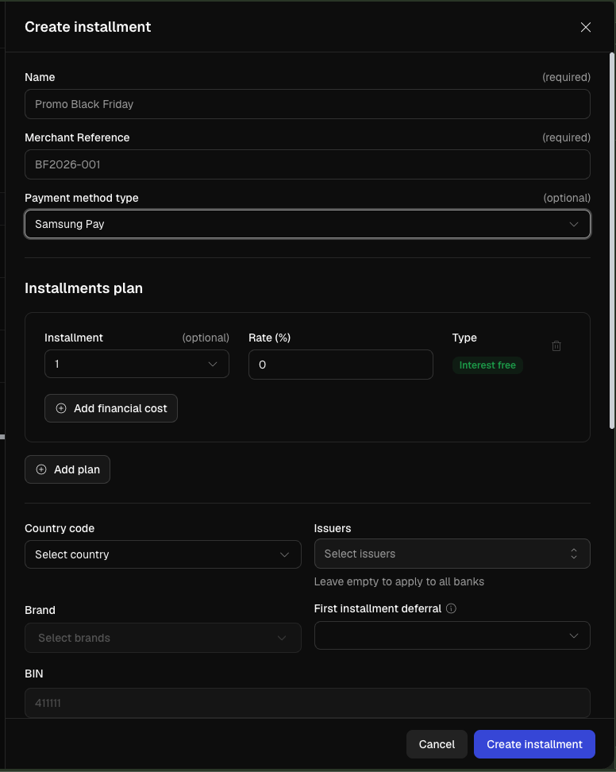
    </Frame>

    <Warning>
      Los planes son estrictamente por método de pago. Samsung Pay solo ve los planes creados para el
      método de pago Samsung Pay; no se reutilizan ni los planes de tarjeta ni los de Apple Pay o Google Pay. Una tienda que ofrece
      cuotas en varias billeteras necesita un conjunto de planes por cada billetera.
    </Warning>
  </Step>
  <Step title="Revisa el plan en la lista">
    El plan aparece con **Samsung Pay** en la columna **Payment method**. Crea un plan por cada rango de
    montos si quieres ofrecer opciones distintas según el tamaño del carrito.

    <Frame>
      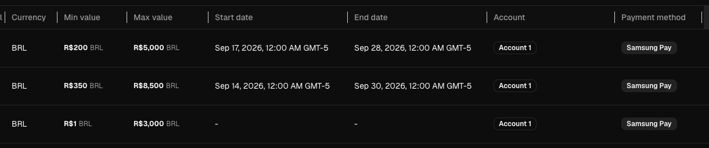
    </Frame>
  </Step>
  <Step title="Confírmalo en tu checkout">
    Abre el paso de pago con un carrito dentro del rango de montos del plan y selecciona Samsung Pay. El selector
    **Installments** aparece sobre el botón.
  </Step>
</Steps>

También puedes crear planes con el endpoint [Crear plan de cuotas](/es/reference/installments/create-installments-plan),
enviando `payment_method_type: SAMSUNG_PAY`.

### Reglas de elegibilidad {#eligibility-rules-2}

Samsung Pay sigue las mismas [reglas de elegibilidad que Apple Pay](#eligibility-rules): Yuno determina el
plan de cada orden a partir del total del carrito, lo recalcula cuando el carrito cambia y asocia los planes según
moneda, país, rango de montos y ventana de disponibilidad. La única diferencia es el tipo de método de
pago: un plan solo se aplica a Samsung Pay cuando su **Payment method type** es **Samsung Pay**.

Si ningún plan cubre la orden, el selector se oculta y Samsung Pay se muestra como un botón simple; el
pago se procesa igualmente, en una sola cuota.

### Visualización de órdenes en VTEX {#vtex-order-display}

<Warning>
  Actualmente VTEX muestra las órdenes de Samsung Pay como un **pago único completo** en el resumen de la orden y en los
  paneles de administración. En VTEX aún no existe una configuración nativa de cuotas para Samsung Pay; el ticket 1453437 de VTEX
  lo registra como una mejora futura.

  *Yuno es la fuente de verdad* del desglose de cuotas: el número correcto de cuotas,
  el monto por cuota y los intereses, si los hay, se pueden ver en el Yuno dashboard y en los
  detalles de la transacción. La visualización de VTEX es solo estética y no afecta cómo se procesa
  ni se liquida el pago.
</Warning>