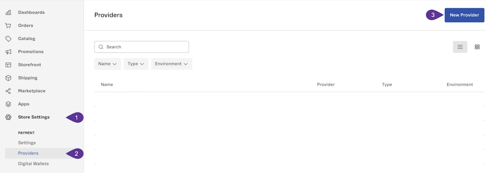
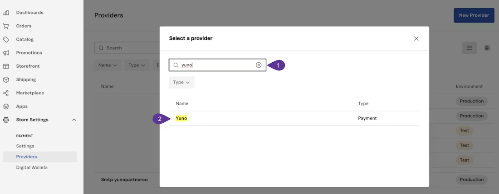
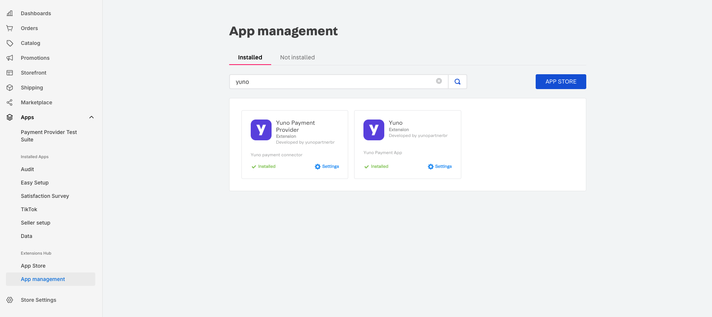
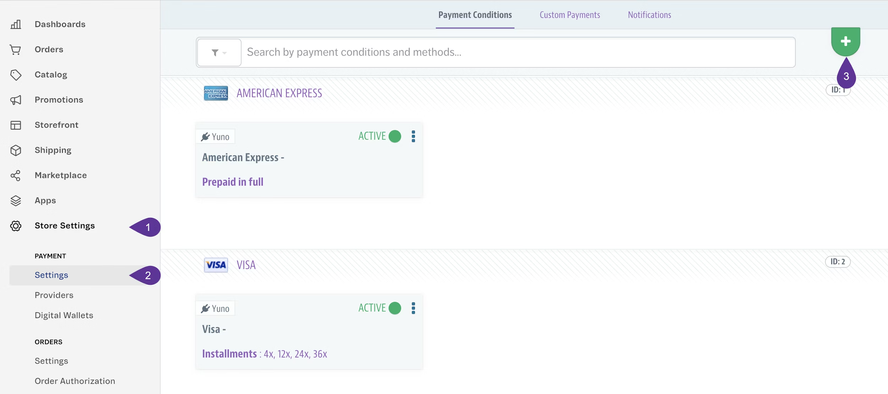
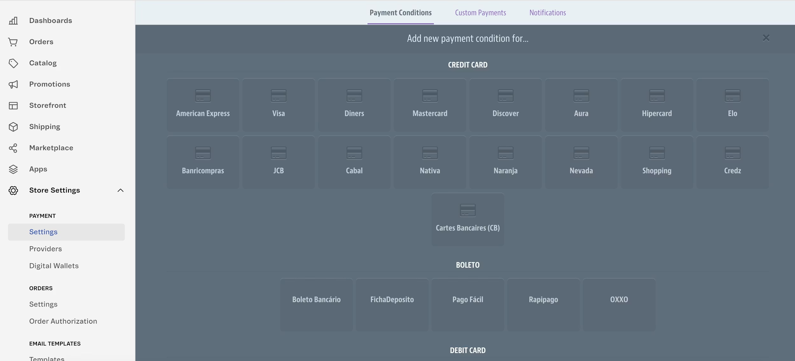
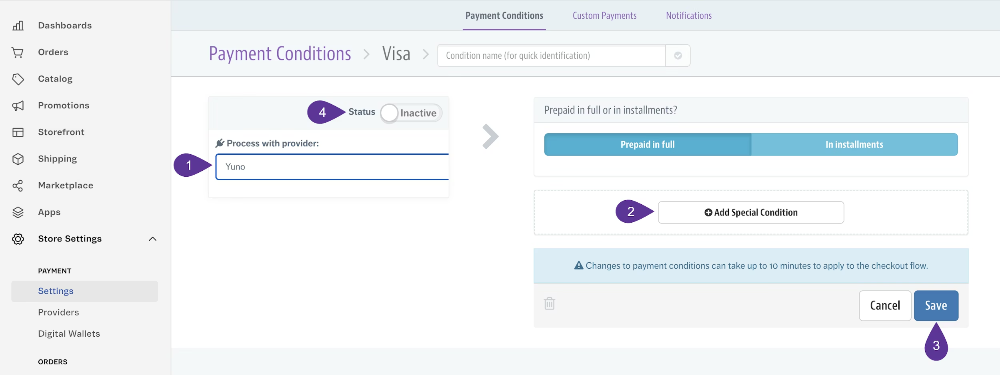

Esta página te guía por cada paso necesario para comenzar a aceptar pagos con Yuno en tu tienda VTEX. La configuración se realiza en dos lugares. Tu **VTEX dashboard** es donde registras Yuno como proveedor de pago, instalas la Payment App y activas los métodos de pago. Tu **Yuno dashboard** es donde configuras el webhook que mantiene sincronizado el estado de los pedidos.

### Antes de comenzar {#before-you-start}

Ten lo siguiente a mano:
*   Un usuario con acceso de administrador a tu VTEX dashboard.
*   Tus credenciales de Yuno, que puedes encontrar en tu Yuno dashboard en **Developers → API Credentials**: **Account ID**, **Public API Key** y **Private Secret Key**.

---

<Steps>
  <Step title="Configura Yuno como proveedor de pago">
    1.  En el **VTEX dashboard**, abre el menú de la izquierda y ve a **Store Settings → Payment → Providers**, y luego haz clic en **New Provider** en la parte superior derecha.

    <Frame>
      
    </Frame>

    2.  En el cuadro de diálogo **Select a provider**, escribe `Yuno` en el cuadro de búsqueda y selecciona **Yuno** en los resultados.

    <Frame>
      
    </Frame>

    3.  Completa el formulario de configuración del proveedor y guarda. Una vez guardado, el proveedor queda registrado, pero todavía no hay métodos de pago activos.

    <Accordion title="Referencia de campos">
      Cada campo se explica en detalle, con ejemplos, en la [referencia de campos de afiliación](/es/docs/plugins/vtex/affiliation-fields).

      | Campo | Obligatorio | Qué hace |
      | :--- | :--- | :--- |
      | **Application Key / Application Token** | Sí | Credenciales de administrador de VTEX que el plugin usa para actuar en tu nombre. Consulta la guía de VTEX sobre [cómo generar Application Keys](https://help.vtex.com/docs/tutorials/api-keys#generating-internal-application-keys). |
      | **Automatic Settlement** | Sí | Cuándo se capturan los pagos con tarjeta y billetera. Consulta **Settlement Options** más abajo. |
      | **Affiliation Name** | Sí | Un nombre para esta integración de Yuno. [Detalles](/es/docs/plugins/vtex/affiliation-fields#affiliation-name) |
      | **Account ID** | Sí | Tu Account ID de Yuno. [Detalles](/es/docs/plugins/vtex/affiliation-fields#account-id) |
      | **Public API Key** | Sí | Tu Public API Key de Yuno; su prefijo define el entorno. [Detalles](/es/docs/plugins/vtex/affiliation-fields#public-api-key) |
      | **Private Secret Key** | Sí | Tu Private Secret Key de Yuno. [Detalles](/es/docs/plugins/vtex/affiliation-fields#private-secret-key) |
      | **Main Account Name** | Opcional | La cuenta de VTEX propietaria de los pedidos en configuraciones con varias cuentas. [Detalles](/es/docs/plugins/vtex/affiliation-fields#main-account-name) |
      | **Main Account App key** | Opcional | Application Key de la cuenta principal de VTEX. [Detalles](/es/docs/plugins/vtex/affiliation-fields#main-account-app-key) |
      | **Main Account App token** | Opcional | Application Token de la cuenta principal de VTEX. [Detalles](/es/docs/plugins/vtex/affiliation-fields#main-account-app-token) |
      | **Soft Descriptor** | Opcional | Texto que se muestra en el resumen de la tarjeta del comprador. [Detalles](/es/docs/plugins/vtex/affiliation-fields#soft-descriptor) |
      | **Create Customer** | Opcional | Crea un registro de cliente en Yuno por cada comprador. [Detalles](/es/docs/plugins/vtex/affiliation-fields#create-customer) |
      | **VTEX IO orderPlaced page URL** | Opcional | Dónde se redirige a los compradores después del pago. [Detalles](/es/docs/plugins/vtex/affiliation-fields#vtex-io-orderplaced-page-url) |
      | **Payment Mode** | Opcional | Payment App dentro del checkout, o redirección Legacy. [Detalles](/es/docs/plugins/vtex/affiliation-fields#payment-mode) |
      | **Transaction Identification From** | Opcional | Muestra el ID de transacción de Yuno o del proveedor. [Detalles](/es/docs/plugins/vtex/affiliation-fields#transaction-identification-from) |
      | **Antifraud Providers for Split Orders** | Opcional | Proveedores antifraude que reciben la sesión compartida en pedidos divididos. [Detalles](/es/docs/plugins/vtex/affiliation-fields#antifraud-providers-for-split-orders) |
      | **Vault Card for Order Modification** | Opcional | Cobra la diferencia cuando aumenta el total de un pedido. [Detalles](/es/docs/plugins/vtex/affiliation-fields#vault-card-for-order-modification) |
      | **Enable Network Tokens** | Opcional | Almacena tarjetas para que las compras repetidas puedan usar un network token. [Detalles](/es/docs/plugins/vtex/affiliation-fields#enable-network-tokens) |
      | **Use Corporate Buyer Data** | Opcional | Paga los pedidos de empresas con el nombre y el CNPJ de la empresa (Brasil). [Detalles](/es/docs/plugins/vtex/affiliation-fields#use-corporate-buyer-data) |
      | **Headless Payment Handoff** | Opcional | Para marketplaces cuyo propio checkout headless crea el pago. [Detalles](/es/docs/plugins/vtex/affiliation-fields#headless-payment-handoff) |
      | **Store Base Path** | Opcional | Prefijo de ruta de URL de una tienda que no se sirve desde la raíz del dominio. [Detalles](/es/docs/plugins/vtex/affiliation-fields#store-base-path) |
      | **Send Order Sequence as Merchant Reference** | Opcional | Envía la secuencia de pedido de VTEX como referencia del pago. [Detalles](/es/docs/plugins/vtex/affiliation-fields#send-order-sequence-as-merchant-reference) |
      | **Sales Channel Domains** | Opcional | Asigna cada canal de venta al dominio de su tienda. [Detalles](/es/docs/plugins/vtex/affiliation-fields#sales-channel-domains) |
      | **Delay To Cancel** | Opcional | Cuánto tiempo espera VTEX un pago pendiente, por método. [Detalles](/es/docs/plugins/vtex/affiliation-fields#delay-to-cancel) |
    </Accordion>

    <Accordion title="Settlement Options">
      El campo **Automatic Settlement** determina el momento de la captura de los pagos con tarjeta y billetera. 

      | Opción | Comportamiento práctico |
      | :--- | :--- |
      | **Use behavior recommended by payment processor** | **Immediate Capture**: La transacción se captura inmediatamente después de la autorización. (Predeterminado) |
      | **Automatic capture immediately after payment authorization** | **Immediate Capture**: La transacción se captura inmediatamente después de la autorización. Igual que el predeterminado. |
      | **Automatic capture immediately after anti-fraud analysis** | **Immediate Capture**: La transacción se captura inmediatamente después de la autorización. |
      | **Disabled** | **Authorize Only**: La transacción solo se autoriza. La captura ocurre más tarde, cuando se **factura** el pedido. |
    </Accordion>

    <Note>
      **Entornos**: El entorno de Yuno se determina por el prefijo de tu **Public API Key**: `dev_`, `staging_`, `sandbox_` o `prod_`.
    </Note>

    <Tip>
      Te sugerimos usar **Use behavior recommended by payment processor**, a menos que tu negocio requiera específicamente la captura después de la facturación.
    </Tip>
  </Step>

  <Step title="Instala la Yuno Payment App">
    Después de guardar la configuración del proveedor, instala la Yuno Payment App desde tu VTEX dashboard.

    1.  En el **VTEX dashboard**, ve a **Apps → App Management**.
    2.  Busca **Yuno**, selecciona la **Yuno Payment App** en la lista de apps disponibles y abre su **Settings**.

    <Frame>
      
    </Frame>

    3.  Haz clic en **Install** para completar la configuración.

    Una vez instalada, la Payment App se encarga de mostrar la experiencia de checkout de Yuno dentro de tu checkout de VTEX.
  </Step>

  <Step title="Activa los métodos de pago">
    Ahora elige qué métodos de pago quieres ofrecer a tus compradores y enrútalos a través de Yuno.

    1.  En el **VTEX dashboard**, ve a **Store Settings → Payment → Settings → Payment Conditions**. Haz clic en el botón **+** para agregar una condición de pago.

    <Frame>
      
    </Frame>

    2.  Selecciona el método de pago que quieres activar (por ejemplo, Visa, Mastercard, Pix, Apple Pay, Samsung Pay o cualquiera de los métodos genéricos de **Yuno**, como Yuno Card o Yuno Wallet).

    <Frame>
      
    </Frame>

    3.  En el campo **Process with provider**, selecciona la afiliación de Yuno que configuraste en el Paso 1. Establece el **Status** en **Active** y guarda.

    <Frame>
      
    </Frame>

    <Note>
      Repite el proceso para cada método que quieras ofrecer. Puedes consultar la lista completa de métodos disponibles en la página [Overview](/docs/plugins/vtex).
    </Note>
  </Step>

  <Step title="Configura el webhook en tu Yuno dashboard">
    El webhook mantiene sincronizados tus pedidos de VTEX con las actualizaciones de estado de los pagos de Yuno. 

    1.  En el **Yuno dashboard**, abre **Developers → Webhooks** y haz clic en **Add webhook**.
    2.  Completa el formulario:
        *   **Name**: Por ejemplo, `VTEX webhook`.
        *   **Endpoint URL**: `https://{store_name}.myvtex.com/_v/yunopartnerbr.yuno/v4/webhook`, reemplazando `{store_name}` por el nombre de tu cuenta de VTEX.
        *   **x-api-key** y **x-secret**: Ingresa cualquier valor de relleno (por ejemplo, `VTEX`).
    3.  Selecciona todos los eventos y haz clic en **Add**.
  </Step>
</Steps>

---

## Escenarios avanzados {#advanced-scenarios}

Los escenarios que van más allá de la configuración básica (multiafiliación, varias cuentas, pedidos divididos, sesiones antifraude, modificaciones de pedidos, network tokens y compras corporativas) se tratan en su propia página.

<CardGroup cols={1}>
  <Card title="Advanced Features" icon="list" href="/es/docs/plugins/vtex/advanced-features">
    Multiafiliación, varias cuentas, pedidos divididos, sesiones antifraude, modificaciones de pedidos, network tokens y compras corporativas.
  </Card>
</CardGroup>
