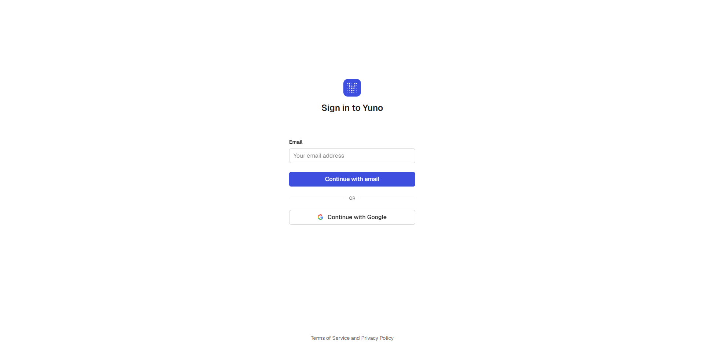

import { ExplainerVideo } from "/snippets/ExplainerVideo.jsx";

<div className="yd-page"><div className="yd-qs">

<div className="yd-eyebrow">
  <span className="yd-eyebrow-accent">Primeros pasos</span>
  <span className="yd-eyebrow-rule" />
  <span className="yd-eyebrow-muted">Tutorial · unos 10 minutos</span>
</div>

<p className="yd-lead" style={{marginTop: '18px', maxWidth: 'none'}}>Yuno es el sistema operativo de IA para pagos, y un pago es lo primero que se ejecuta en él. El primer pago en sandbox se envía en unos 10 minutos una vez que se cuenta con las credenciales de sandbox.</p>

<div className="yd-chips" style={{margin: '20px 0 8px'}}>
  <span className="yd-chip">Crear una conexión</span>
  <span className="yd-chip">Enviar un pago con tarjeta de prueba</span>
  <span className="yd-chip">Verlo en el dashboard</span>
</div>

<ExplainerVideo src="/videos/explainers/first-payment.mp4" poster="/videos/explainers/first-payment.jpg" title="Tu primer pago" duration="66 s" />

## Antes de empezar

Estos son los datos necesarios para cada llamada de esta página.

| Dato | Valor |
|---|---|
| Código de cuenta | `account_id` en el dashboard, dentro de **Developers** |
| Claves | `public-api-key` y `private-secret-key`, ambas empiezan con `sandbox_` |
| URL base | `https://api-sandbox.y.uno/v1` (sin quitar el `/v1`) |
| Montos | `amount.value` es un número junto a una `currency`. Esta página envía `25` con `USD` |
| Herramientas | Node 18 o superior, o `curl` |

<Steps>

<Step titleSize="h3" title="Obtener las credenciales de sandbox">

Iniciar sesión en el [dashboard de Yuno](https://dashboard.y.uno/) y abrir **Developers** para encontrar tres valores:

* **Código de cuenta**, que aparece como `account_id` en el dashboard
* **`public-api-key`**
* **`private-secret-key`**

Las claves de sandbox empiezan con `sandbox_`. Las claves de producción son distintas y empiezan con `prod_`.

<Frame></Frame>

Si todavía no existe una cuenta, consultar al contacto de Yuno o escribir a [sales@y.uno](mailto:sales@y.uno). Hoy no existe un alta autogestionada.

Configurar las credenciales como variables de entorno:

```bash Shell
export YUNO_PUBLIC_API_KEY="sandbox_..."
export YUNO_PRIVATE_SECRET_KEY="sandbox_..."
export YUNO_ACCOUNT_ID="your-account-code"
```

Probar las claves creando un cliente. La URL base es `https://api-sandbox.y.uno/v1`.

<CodeGroup>

```bash cURL
curl --request POST \
  --url https://api-sandbox.y.uno/v1/customers \
  --header "public-api-key: $YUNO_PUBLIC_API_KEY" \
  --header "private-secret-key: $YUNO_PRIVATE_SECRET_KEY" \
  --header "content-type: application/json" \
  --data '{
    "merchant_customer_id": "customer-0001",
    "first_name": "John",
    "last_name": "Doe",
    "email": "john.doe@example.com"
  }'
```

```javascript Node.js
const res = await fetch("https://api-sandbox.y.uno/v1/customers", {
  method: "POST",
  headers: {
    "public-api-key": process.env.YUNO_PUBLIC_API_KEY,
    "private-secret-key": process.env.YUNO_PRIVATE_SECRET_KEY,
    "content-type": "application/json",
  },
  body: JSON.stringify({
    merchant_customer_id: "customer-0001",
    first_name: "John",
    last_name: "Doe",
    email: "john.doe@example.com",
  }),
});
const customer = await res.json();
console.log(customer.id);
```

```python Python
import os
import requests

res = requests.post(
    "https://api-sandbox.y.uno/v1/customers",
    headers={
        "public-api-key": os.environ["YUNO_PUBLIC_API_KEY"],
        "private-secret-key": os.environ["YUNO_PRIVATE_SECRET_KEY"],
    },
    json={
        "merchant_customer_id": "customer-0001",
        "first_name": "John",
        "last_name": "Doe",
        "email": "john.doe@example.com",
    },
)
print(res.json()["id"])
```

</CodeGroup>

La respuesta incluye un `id`. Guardarlo como `YUNO_CUSTOMER_ID`, los pasos de pago lo usan.

<Check>
**El paso se supera cuando** `POST /v1/customers` responde `201`.

* `401` significa que el par de claves es incorrecto. Volver a copiar ambas claves de sandbox desde **Developers**.
* `404` con un cuerpo vacío significa que falta el `/v1` en la URL base.
</Check>


</Step>

<Step titleSize="h3" title="Conectar el Yuno Test Payment Gateway y publicar una ruta">

El Yuno Test Payment Gateway simula un proveedor de tarjetas. Funciona solo en sandbox y no necesita credenciales.

1. Abrir [Connections](https://dashboard.y.uno/connections), buscar **Yuno Test Payment Gateway**, hacer clic en **Connect**, nombrar la conexión y hacer clic en **Save**.
2. Abrir [Routing](https://dashboard.y.uno/routing), abrir la pestaña **Not published**, buscar **Card** y hacer clic en **Set Up**.
3. Hacer clic en **+ Create new route**, nombrarla y hacer clic en **Save**.
4. Hacer clic en la flecha, elegir **Add step**, seleccionar **Yuno Test Payment Gateway** y hacer clic en **Publish**.
5. Abrir [Checkout builder](https://dashboard.y.uno/checkout-builder), activar **Card** y publicar la configuración.

<Check>
**El paso se supera cuando** una sesión de checkout nueva lista `CARD`. Crear una sesión como en el paso 4 y guardar su `checkout_session` como `YUNO_CHECKOUT_SESSION`. Luego llamar a [`GET /v1/checkout/sessions/{checkout_session}/payment-methods`](/reference/checkout-sessions/retrieve-payment-methods-for-checkout) y buscar `"type": "CARD"` en la lista.

Si falta `CARD`, revisar los tres puntos: que el Test Payment Gateway esté conectado, que la ruta de Card esté en **Published**, y que Card esté activo en el Checkout builder.
</Check>


</Step>

<Step titleSize="h3" title="Elegir cómo se crea el pago">

El campo `workflow` le indica a Yuno quién crea el pago. Elegir uno, y usar la pestaña correspondiente en el paso 4.

| Workflow | Quién crea el pago | Cuándo usarlo |
|---|---|---|
| `SDK_SEAMLESS` | El SDK crea el pago | Cuando se buscan la menor cantidad de piezas móviles. Recomendado |
| `SDK_CHECKOUT` más un callback `createPayment` | El backend lo crea, a partir del token de un solo uso que entrega el SDK | Cuando se agregan datos de la orden, controles de fraude o idempotencia en el servidor |
| `DIRECT` | El backend envía los datos de tarjeta sin procesar | Cuando se tiene alcance PCI DSS. En otro caso, usarlo solo para pruebas en sandbox |

Una sesión y una integración que no coincidan terminan en `INTERNAL_ERROR`. Ver [Primeros pasos con el SDK de Yuno](/docs/yuno-sdk/get-started) y [Flujo directo](/docs/direct-integration-use-cases/direct-flow) para cada camino completo.

<Check>
**El paso se supera cuando** puede nombrarse el workflow que va a enviarse: `SDK_SEAMLESS`, `SDK_CHECKOUT` o `DIRECT`. La sesión de checkout (caminos con SDK) o el pago (`DIRECT`) lo llevan en el campo `workflow`.
</Check>

</Step>

<Step titleSize="h3" title="Enviar el pago">

<Tabs>
<Tab title="DIRECT">

<Warning>
Enviar números de tarjeta sin procesar desde el servidor es solo para pruebas en sandbox. En producción requiere alcance PCI DSS. En otro caso, usar el SDK de Yuno o Secure Fields para recolectar los datos de la tarjeta.
</Warning>

El workflow `DIRECT` es un pago directo donde el servidor envía los datos de la tarjeta. Usar el `id` del cliente guardado como `YUNO_CUSTOMER_ID` en el paso 1.

Crear el pago con una tarjeta de prueba. Enviar un `X-Idempotency-Key` nuevo con cada pago.

<CodeGroup>

```bash cURL
curl --request POST \
  --url https://api-sandbox.y.uno/v1/payments \
  --header "public-api-key: $YUNO_PUBLIC_API_KEY" \
  --header "private-secret-key: $YUNO_PRIVATE_SECRET_KEY" \
  --header "X-Idempotency-Key: $(uuidgen)" \
  --header "content-type: application/json" \
  --data '{
    "account_id": "'"$YUNO_ACCOUNT_ID"'",
    "merchant_order_id": "order-0001",
    "description": "First test payment",
    "country": "US",
    "amount": { "currency": "USD", "value": 25 },
    "workflow": "DIRECT",
    "customer_payer": { "id": "'"$YUNO_CUSTOMER_ID"'" },
    "payment_method": {
      "type": "CARD",
      "detail": { "card": { "card_data": {
        "number": "4507990000000002",
        "expiration_month": 11,
        "expiration_year": 28,
        "security_code": "123",
        "holder_name": "John Doe"
      } } }
    }
  }'
```

```javascript Node.js
const res = await fetch("https://api-sandbox.y.uno/v1/payments", {
  method: "POST",
  headers: {
    "public-api-key": process.env.YUNO_PUBLIC_API_KEY,
    "private-secret-key": process.env.YUNO_PRIVATE_SECRET_KEY,
    "X-Idempotency-Key": crypto.randomUUID(),
    "content-type": "application/json",
  },
  body: JSON.stringify({
    account_id: process.env.YUNO_ACCOUNT_ID,
    merchant_order_id: "order-0001",
    description: "First test payment",
    country: "US",
    amount: { currency: "USD", value: 25 },
    workflow: "DIRECT",
    customer_payer: { id: process.env.YUNO_CUSTOMER_ID },
    payment_method: {
      type: "CARD",
      detail: { card: { card_data: {
        number: "4507990000000002",
        expiration_month: 11,
        expiration_year: 28,
        security_code: "123",
        holder_name: "John Doe",
      } } },
    },
  }),
});
const payment = await res.json();
console.log(payment.status, payment.sub_status);
```

```python Python
import os
import uuid
import requests

res = requests.post(
    "https://api-sandbox.y.uno/v1/payments",
    headers={
        "public-api-key": os.environ["YUNO_PUBLIC_API_KEY"],
        "private-secret-key": os.environ["YUNO_PRIVATE_SECRET_KEY"],
        "X-Idempotency-Key": str(uuid.uuid4()),
    },
    json={
        "account_id": os.environ["YUNO_ACCOUNT_ID"],
        "merchant_order_id": "order-0001",
        "description": "First test payment",
        "country": "US",
        "amount": {"currency": "USD", "value": 25},
        "workflow": "DIRECT",
        "customer_payer": {"id": os.environ["YUNO_CUSTOMER_ID"]},
        "payment_method": {
            "type": "CARD",
            "detail": {"card": {"card_data": {
                "number": "4507990000000002",
                "expiration_month": 11,
                "expiration_year": 28,
                "security_code": "123",
                "holder_name": "John Doe",
            }}},
        },
    },
)
payment = res.json()
print(payment["status"], payment["sub_status"])
```

</CodeGroup>

El pago se completa con éxito cuando la respuesta se ve así:

```json Respuesta (recortada)
{
  "id": "6c44ed29-cc51-4479-a5eb-108afdaadd50",
  "status": "SUCCEEDED",
  "sub_status": "APPROVED",
  "amount": { "currency": "USD", "value": 25 }
}
```

</Tab>
<Tab title="SDK_SEAMLESS">

El workflow `SDK_SEAMLESS` divide el trabajo. El servidor crea una sesión de checkout, y el navegador carga el SDK e inicia la transacción.

**En el servidor**, crear la sesión de checkout. Usar `workflow: "SDK_SEAMLESS"` para que el SDK cree el pago. Sin esto, la transacción termina en `INTERNAL_ERROR`.

<CodeGroup>

```bash cURL
curl --request POST \
  --url https://api-sandbox.y.uno/v1/checkout/sessions \
  --header "public-api-key: $YUNO_PUBLIC_API_KEY" \
  --header "private-secret-key: $YUNO_PRIVATE_SECRET_KEY" \
  --header "content-type: application/json" \
  --data '{
    "account_id": "'"$YUNO_ACCOUNT_ID"'",
    "merchant_order_id": "order-0001",
    "payment_description": "First test payment",
    "country": "US",
    "amount": { "currency": "USD", "value": 25 },
    "workflow": "SDK_SEAMLESS"
  }'
```

```javascript Node.js
const res = await fetch("https://api-sandbox.y.uno/v1/checkout/sessions", {
  method: "POST",
  headers: {
    "public-api-key": process.env.YUNO_PUBLIC_API_KEY,
    "private-secret-key": process.env.YUNO_PRIVATE_SECRET_KEY,
    "content-type": "application/json",
  },
  body: JSON.stringify({
    account_id: process.env.YUNO_ACCOUNT_ID,
    merchant_order_id: "order-0001",
    payment_description: "First test payment",
    country: "US",
    amount: { currency: "USD", value: 25 },
    workflow: "SDK_SEAMLESS",
  }),
});
const session = await res.json();
console.log(session.checkout_session);
```

```python Python
import os
import requests

res = requests.post(
    "https://api-sandbox.y.uno/v1/checkout/sessions",
    headers={
        "public-api-key": os.environ["YUNO_PUBLIC_API_KEY"],
        "private-secret-key": os.environ["YUNO_PRIVATE_SECRET_KEY"],
    },
    json={
        "account_id": os.environ["YUNO_ACCOUNT_ID"],
        "merchant_order_id": "order-0001",
        "payment_description": "First test payment",
        "country": "US",
        "amount": {"currency": "USD", "value": 25},
        "workflow": "SDK_SEAMLESS",
    },
)
print(res.json()["checkout_session"])
```

</CodeGroup>

**En el navegador**, cargar el SDK desde el CDN, y luego iniciar una transacción con el valor `checkout_session` que entregó el servidor.

```html Browser
<div id="payment-form"></div>
<script src="https://sdk-web.y.uno/v2.5.1/main.js"></script>
<script>
  async function startYuno() {
    const sdkPayments = await SdkPayments.initialize("your-public-api-key");
    const transaction = sdkPayments.transaction({
      checkoutSession: "checkout-session-from-your-server",
      countryCode: "US",
      elementSelector: "#payment-form",
      onStatus: (result) => console.log("Final status:", result.status),
    });
    await transaction.start({ paymentMethod: { type: "CARD" } });
  }

  if (window.SdkPayments) {
    startYuno();
  } else {
    window.addEventListener("sdk-payments-ready", startYuno);
  }
</script>
```

El formulario se renderiza en `#payment-form`. Ingresar la tarjeta de prueba **4507 9900 0000 0002**, vencimiento **11/28**, CVV **123**, nombre **John Doe**, y hacer clic en Pay. El resultado llega en `onStatus` con el estado `SUCCEEDED`.

Para iOS, Android y todas las opciones, ver [Primeros pasos con el SDK](/docs/yuno-sdk/get-started).

</Tab>
<Tab title="SDK_CHECKOUT">

El servidor crea la sesión de checkout con `workflow: "SDK_CHECKOUT"`. El navegador inicia la transacción y pasa un callback `createPayment`. El SDK le entrega al callback un token de un solo uso, y el backend crea el pago a partir de él.

**En el servidor**, crear la sesión de checkout con el cliente del paso 1:

```bash cURL
curl --request POST \
  --url https://api-sandbox.y.uno/v1/checkout/sessions \
  --header "public-api-key: $YUNO_PUBLIC_API_KEY" \
  --header "private-secret-key: $YUNO_PRIVATE_SECRET_KEY" \
  --header "content-type: application/json" \
  --data '{
    "account_id": "'"$YUNO_ACCOUNT_ID"'",
    "merchant_order_id": "order-0001",
    "payment_description": "First test payment",
    "country": "US",
    "customer_id": "'"$YUNO_CUSTOMER_ID"'",
    "amount": { "currency": "USD", "value": 25 },
    "workflow": "SDK_CHECKOUT"
  }'
```

**En el navegador**, iniciar la transacción y sobrescribir `createPayment`. Enviar `token.token` y `token.checkout_session` al backend:

```html Browser
<div id="payment-form"></div>
<script src="https://sdk-web.y.uno/v2.5.1/main.js"></script>
<script>
  async function startYuno() {
    const sdkPayments = await SdkPayments.initialize("your-public-api-key");
    const transaction = sdkPayments.transaction({
      checkoutSession: "checkout-session-from-your-server",
      countryCode: "US",
      elementSelector: "#payment-form",
      createPayment: async (token) => {
        await fetch("/api/pay", {
          method: "POST",
          headers: { "content-type": "application/json" },
          body: JSON.stringify({
            token: token.token,
            checkout_session: token.checkout_session,
          }),
        });
      },
      onStatus: (result) => console.log("Final status:", result.status),
    });
    await transaction.start({ paymentMethod: { type: "CARD" } });
  }

  if (window.SdkPayments) {
    startYuno();
  } else {
    window.addEventListener("sdk-payments-ready", startYuno);
  }
</script>
```

Resolver la promesa en todos los casos, incluido un fallo de red, o la transacción queda en curso. Ver [`createPayment`](/docs/yuno-sdk/controllers/create-payment).

**De nuevo en el servidor**, el handler `/api/pay` crea el pago con `POST /v1/payments`. Enviar el token en `payment_method.token` y la sesión en `checkout.session`:

```javascript Node.js
// token y checkoutSession vienen del cuerpo de la solicitud del navegador
async function createPayment({ token, checkoutSession }) {
  const res = await fetch("https://api-sandbox.y.uno/v1/payments", {
    method: "POST",
    headers: {
      "public-api-key": process.env.YUNO_PUBLIC_API_KEY,
      "private-secret-key": process.env.YUNO_PRIVATE_SECRET_KEY,
      "X-Idempotency-Key": crypto.randomUUID(),
      "content-type": "application/json",
    },
    body: JSON.stringify({
      account_id: process.env.YUNO_ACCOUNT_ID,
      merchant_order_id: "order-0001",
      description: "First test payment",
      country: "US",
      amount: { currency: "USD", value: 25 },
      customer_payer: { id: process.env.YUNO_CUSTOMER_ID },
      payment_method: { token },
      checkout: { session: checkoutSession },
    }),
  });
  return res.json();
}
```

Ingresar la tarjeta de prueba **4507 9900 0000 0002**, vencimiento **11/28**, CVV **123**, nombre **John Doe**, y hacer clic en Pay. La respuesta tiene la misma forma que la respuesta de `DIRECT` de arriba.

</Tab>
</Tabs>

<Check>
**El paso se supera cuando** el `status` del pago es `SUCCEEDED` con la tarjeta de prueba **4507 9900 0000 0002** (11/28, CVV 123, John Doe).
</Check>

</Step>

<Step titleSize="h3" title="Ver el resultado">

* Revisar `status` y `sub_status` en la respuesta. `SUCCEEDED` con `APPROVED` significa que el gateway aprobó el pago.
* Abrir [Payments](https://dashboard.y.uno/payments) en el dashboard, buscar el pago y abrirlo para ver sus detalles.
* Para recibir el resultado en el servidor, [configurar un webhook](/docs/webhooks/configure-webhooks) y [verificar su firma](/docs/webhooks/verify-webhook-signatures-hmac) (HMAC).

Los estados de pago están listados en [Estados de pago](/reference/payments/status-and-response-codes/payment).

<Check>
**El paso se supera cuando** el pago aparece como `SUCCEEDED` en la lista **Payments** del dashboard y en el campo `status` de la respuesta.
</Check>

</Step>
</Steps>

## Siguientes pasos

<Columns cols={1}>
  <Card title="Salir a producción" href="/docs/go-live" icon="rocket">
    <span className="yd-kind">Guía</span>
    <span className="yd-card-body">Claves de producción, una ruta publicada, webhooks verificados y un primer pago real.</span>
  </Card>
</Columns>

## Solución de problemas

<AccordionGroup>
<Accordion title="La API devuelve 401">
Falta el header `public-api-key` o `private-secret-key`, o está mal. Sandbox y producción usan claves distintas, así que conviene verificar haber copiado las claves de sandbox desde el dashboard en Test Mode. Ver [Autenticación](/reference/getting-started/authentication).
</Accordion>
<Accordion title="El pago termina en INTERNAL_ERROR">
El `workflow` no coincide con la integración. Usar `DIRECT` cuando el servidor envía la tarjeta, y `SDK_SEAMLESS` en la sesión de checkout cuando el Web SDK crea el pago.
</Accordion>
<Accordion title="Ningún proveedor procesa el pago">
Card no tiene una ruta publicada. Abrir [Routing](https://dashboard.y.uno/routing) y revisar que la ruta de Card con el Yuno Test Payment Gateway esté en la pestaña **Published**, y que Card esté activo en el [Checkout builder](https://dashboard.y.uno/checkout-builder).
</Accordion>
<Accordion title="La tarjeta es rechazada">
Las tarjetas de prueba son específicas de cada proveedor. Las tarjetas de este Quickstart solo funcionan cuando el sandbox enruta Card hacia el Yuno Test Payment Gateway. Otros resultados están listados en la página del [Yuno Test Payment Gateway](/docs/direct-integration-use-cases/yuno-testing-gateway).
</Accordion>
</AccordionGroup>

<p className="yd-foot">¿Un término no está claro? Ver el [Glosario](/docs/glossary). Para URLs, claves y specs ver [Developers](/docs/developers).</p>

</div></div>
