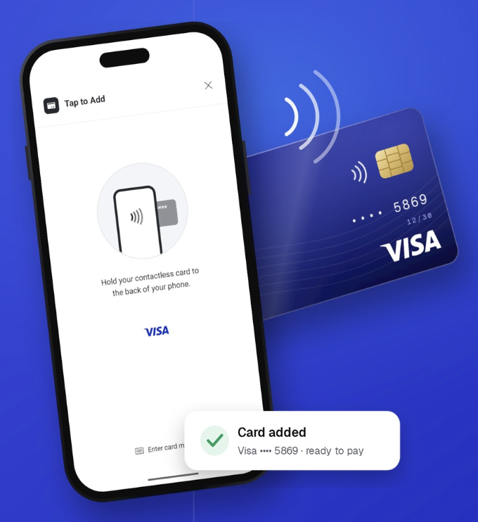
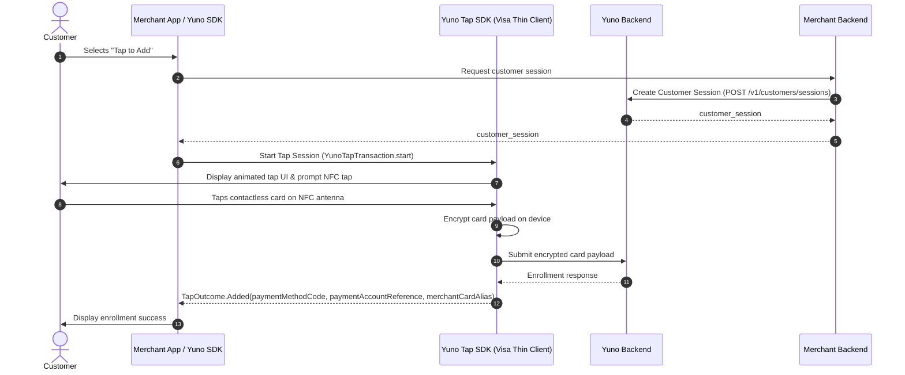
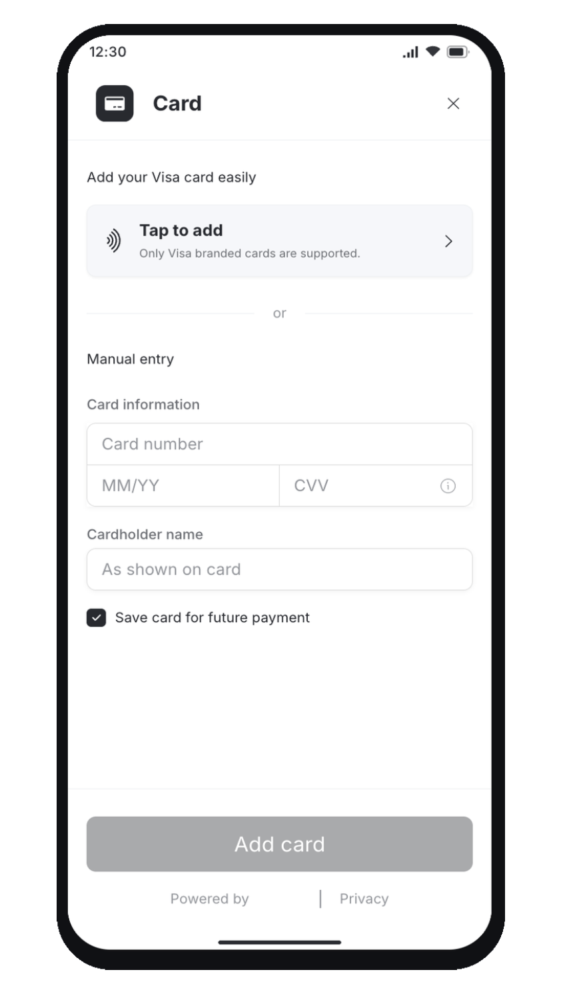
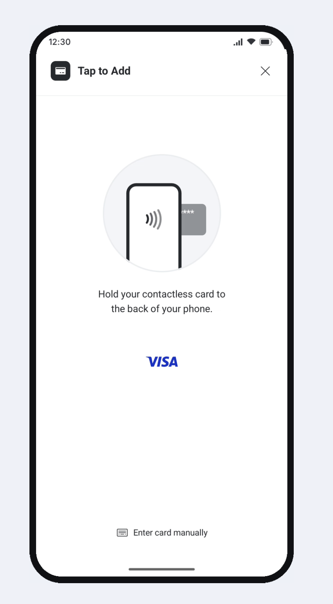
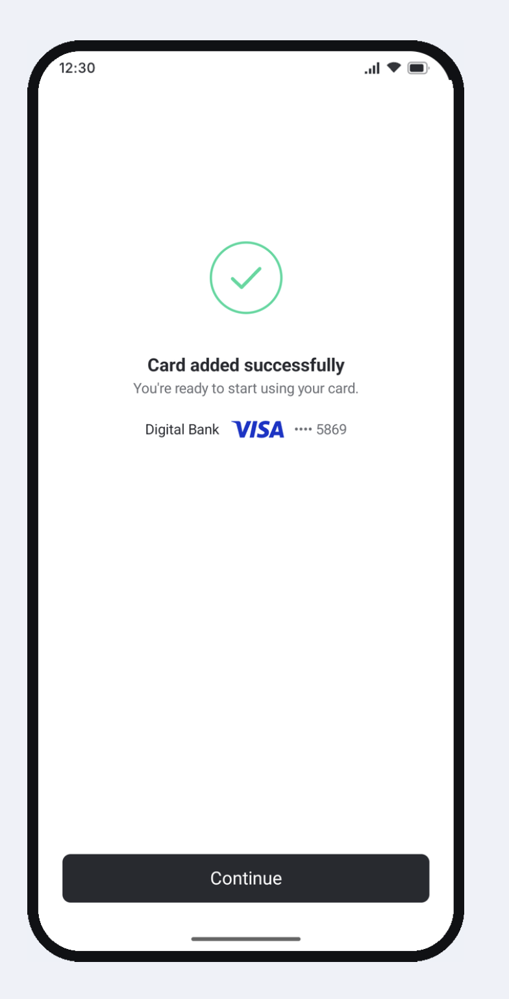

import LegacySdkNotice from '/snippets/es/LegacySdkNotice.mdx'

<LegacySdkNotice />

*Visa Tap to Add* permite a los clientes inscribir sus tarjetas contactless acercándolas a la antena NFC de su dispositivo Android.

<p align="center">
  
</p>

La interacción de tap usa internamente el Thin Client Tap SDK de Visa: los datos de la tarjeta se leen directamente por NFC, se cifran en el dispositivo y se envían de forma segura a Yuno. La aplicación del comercio nunca accede a los números de cuenta primarios (PAN) en claro ni los gestiona.



---

## Requisitos previos {#prerequisites--requirements}

Tu proyecto de Android debe cumplir los siguientes requisitos de hardware, sistema y herramientas de compilación:

* **Hardware y sistema operativo**: Android 11.0 (API level 30) o superior, con una antena NFC activa y compatibilidad con Host Card Emulation (HCE).
* **Servicios**: Google Play Services debe estar disponible en el dispositivo.
* **Arquitectura**: arquitectura ARM de 64 bits (`arm64-v8a`) o de 32 bits (`armeabi-v7a`). (Los emuladores x86 / x86_64 no son compatibles con las operaciones NFC contactless).
* **Requisitos de herramientas de compilación**:
  * **Compile SDK**: `compileSdk 35`
  * **Java**: Java 17
  * **Kotlin**: 2.1.0 o superior
  * **Android Gradle Plugin (AGP)**: 8.6.0 o superior
  * **Gradle**: 8.7 o superior
  * **Hilt**: 2.56 o superior (si usas inyección de dependencias)
  * **Room**: 2.7.0-alpha13 o superior (si usas Room en tu proyecto)

<Note>
**Marcas compatibles**: actualmente, *Tap to Add* funciona con el Tap SDK de Visa. La compatibilidad con Mastercard y otros esquemas de tarjeta se incorporará en versiones posteriores.
</Note>

---

## Rutas de integración {#integration-paths}

Puedes integrar Tap to Add de una de dos maneras:

1. **Ruta A: inscripción automática con el Yuno Android SDK 3.x (recomendada)**: si ya usas el Full Checkout SDK de Yuno para Android, al agregar la dependencia `yuno-tap` se habilita automáticamente el punto de entrada de Tap to Add en el formulario de inscripción, sin escribir código de interfaz.
2. **Ruta B: Yuno Tap SDK independiente**: si creas pantallas de inscripción personalizadas o una interfaz headless, integra `com.yuno.payments:yuno-tap` directamente, ya sea con el `YunoTapToAddButton` prediseñado o con tu propio botón que llame a `YunoTapTransaction.start`.

---

## Ruta A: inscripción automática con el checkout completo {#path-a-automatic-full-checkout-enrollment}

Al integrar el Yuno Android Universal SDK (`3.0.0` o posterior), el SDK comprueba automáticamente si `yuno-tap` está presente en el classpath de ejecución. Si lo encuentra y el dispositivo es compatible con NFC, el SDK muestra la opción **Tap to Add** directamente dentro del formulario de inscripción de tarjeta.

<Warning>
**Solo inscripción**: Tap to Add solo es compatible con la inscripción de tarjetas y con guardar métodos de pago en la cuenta de un cliente. **Nunca** se muestra durante el checkout, en flujos de pago únicos ni en pantallas de compra directa.
</Warning>

### 1. Agrega las dependencias {#1-add-dependencies}

Agrega el Yuno Android SDK y el artefacto Yuno Tap al `build.gradle.kts` de tu módulo:

```kotlin
dependencies {
    // Yuno Android SDK
    implementation("com.yuno.payments:android-sdk:3.0.0")

    // Yuno Tap SDK for Tap to Add
    implementation("com.yuno.payments:yuno-tap:0.4.0")
}
```

### 2. Configura el manifiesto para dispositivos con API inferior a 30 {#2-configure-manifest-for-devices-below-api-30}

El Yuno Tap SDK exige `minSdk = 30`. Si tu aplicación principal usa un `minSdkVersion` menor (por ejemplo, `minSdk = 24`), permite que el manifest merger continúe agregando una declaración `tools:overrideLibrary` en tu `AndroidManifest.xml`:

```xml
<manifest xmlns:android="http://schemas.android.com/apk/res/android"
    xmlns:tools="http://schemas.android.com/tools">

    <uses-sdk tools:overrideLibrary="com.yuno.payments.tap" />

    <application>
        <!-- Application components -->
    </application>
</manifest>
```

En dispositivos con Android 10 (API 29) o inferior, el Yuno SDK detecta la versión de la plataforma sin errores y oculta la opción Tap to Add, con lo que recurre a la captura manual de la tarjeta.

### Flujo visual {#visual-flow}

<Steps>
  <Step title="Punto de entrada en el formulario de inscripción">
    Cuando `yuno-tap` está incluido en el proyecto, el formulario de inscripción de tarjeta muestra el punto de entrada **Tap to add** encima de la captura manual de la tarjeta.

    <p align="center">
      
    </p>
  </Step>

  <Step title="Solicitud de NFC contactless">
    Al seleccionar **Tap to add** se abre la interfaz animada de tap por NFC, que le pide al cliente que acerque su tarjeta contactless a la parte trasera del dispositivo.

    <p align="center">
      
    </p>
  </Step>

  <Step title="Confirmación de éxito">
    Una vez que los datos de la tarjeta se leen y se cifran en el dispositivo, Yuno completa la inscripción de forma segura y devuelve una confirmación de éxito.

    <p align="center">
      
    </p>
  </Step>
</Steps>

---

## Ruta B: Yuno Tap SDK independiente {#path-b-standalone-yuno-tap-sdk}

Si administras tu propia interfaz de captura de tarjetas o quieres ubicar de forma personalizada la acción de Tap to Add, usa la biblioteca independiente `yuno-tap`.

### 1. Agrega la dependencia {#1-add-dependency}

Agrega `yuno-tap` a tu `build.gradle.kts`:

```kotlin
dependencies {
    implementation("com.yuno.payments:yuno-tap:0.4.0")
}
```

### 2. Obtén la sesión de cliente {#2-obtain-customer-session}

Antes de iniciar el flujo de tap, tu backend debe crear una sesión de cliente con la API servidor a servidor de Yuno:

```bash
curl -X POST https://api-sandbox.y.uno/v1/customers/sessions \
  -H "public-api-key: YOUR_PUBLIC_API_KEY" \
  -H "private-secret-key: YOUR_PRIVATE_SECRET_KEY" \
  -H "Content-Type: application/json" \
  -d '{
    "country": "US",
    "customer_id": "cust_12345"
  }'
```

La respuesta devuelve un ID `customer_session`. Pásalo a tu aplicación Android. El SDK no crea sesiones de cliente; solo consume una.

### 3. Implementa un YunoTapController y crea un YunoTapConfig {#3-implement-a-yunotapcontroller-and-build-a-yunotapconfig}

`YunoTapController` es la interfaz que usa el SDK para informar a tu aplicación. `onStatus` recibe el único `TapStatus` final de cada transacción. `showLoading` es opcional y refleja el calentamiento único del SDK:

```kotlin
import com.yuno.payments.tap.YunoTapConfig
import com.yuno.payments.tap.YunoTapController
import com.yuno.payments.tap.YunoTapTransaction
import com.yuno.payments.tap.model.TapStatus

val controller =
    object : YunoTapController {
        override fun onStatus(status: TapStatus) {
            handleTapStatus(status)
        }

        override fun showLoading(loading: Boolean) {
            addCardButton.isEnabled = !loading
        }
    }

val transaction =
    YunoTapTransaction(
        YunoTapConfig(
            customerSession = customerSession,
            controller = controller,
            publicApiKey = "SANDBOX_us_your_public_api_key",
        ),
    )
```

El SDK elige el entorno y la región a partir del prefijo de la clave de API pública, por lo que no hay un parámetro de entorno: `PROD_…` es producción y `SANDBOX_…` es sandbox, y el segmento posterior al prefijo es la región (por ejemplo, `PROD_us_…`).

`publicApiKey` es opcional si tu aplicación ya llamó a `YunoTap.initialize(context, publicApiKey)` antes en el proceso. Si falta y el SDK nunca se inicializó, la transacción informa `ERROR` con `NOT_INITIALIZED`.

### 4. Opción 1: YunoTapToAddButton listo para usar {#4-option-1-drop-in-yunotaptoaddbutton}

La integración independiente de interfaz más sencilla usa `YunoTapToAddButton`, un composable de Jetpack Compose que muestra la entrada de Visa Tap to Add e inicia el flujo cuando se presiona:

```kotlin
import com.yuno.payments.tap.ui.YunoTapToAddButton

YunoTapToAddButton(
    transaction = transaction,
    activity = this,
    requestCvv = false, // true only if Yuno enabled CVV2 capture for your account
    modifier = Modifier.padding(horizontal = 16.dp),
)
```

El resultado llega al mismo `YunoTapController`. De forma predeterminada, el botón no muestra nada en dispositivos que no pueden hacer tap (`hideWhenNotEligible = true`). Funciona solo con Compose: en una pantalla basada en View, aloja el botón en un `ComposeView` o usa la Opción 2.

### 4. Opción 2: inicia el flujo desde tu propio botón {#4-option-2-start-the-flow-from-your-own-button}

Para un disparador personalizado, llama a `start` en la transacción. `activity` debe ser una `ComponentActivity`:

```kotlin
import com.yuno.payments.tap.model.TapFlow

findViewById<Button>(R.id.btnCustomTap).setOnClickListener {
    transaction.start(activity = this, flow = TapFlow.Add())
}
```

`start` comprueba la elegibilidad del dispositivo, inicializa el SDK de Visa en el primer uso, muestra su propia interfaz segura, lee la tarjeta por NFC e informa el resultado mediante `onStatus`. Solo se puede ejecutar una transacción a la vez. Para cerrar una transacción en curso, llama a `transaction.cancel()`; `onStatus` recibirá entonces `CANCELED`.

---

## Manejo de resultados {#result-handling--outcomes}

`onStatus` se llama exactamente una vez por cada `start()`, en el hilo principal, con un `TapStatus`. Su `status` es un `TapStatusCode` y, según el código, incluye un `outcome` (`TapOutcome`) y/o un `error` (`YunoTapError`):

```kotlin
import com.yuno.payments.tap.model.TapOutcome
import com.yuno.payments.tap.model.TapStatus
import com.yuno.payments.tap.model.TapStatusCode

fun handleTapStatus(status: TapStatus) {
    when (status.status) {
        TapStatusCode.SUCCEEDED -> {
            val added = status.outcome as TapOutcome.Added
            val paymentMethodCode = added.paymentMethodCode
            val par = added.paymentAccountReference // May be null depending on issuer support
            val alias = added.merchantCardAlias // From yuno-tap 0.4.0; pass it to your fraud engine with paymentMethodCode
        }
        TapStatusCode.CANCELED -> {
            if (status.outcome is TapOutcome.ManualEntryRequested) openManualCardForm()
        }
        TapStatusCode.NOT_ELIGIBLE -> showManualCardEntryOnly()
        TapStatusCode.FAILED -> showMessage(status.error?.message)
        TapStatusCode.ERROR -> logTapError(status.error?.code)
    }
}
```

| `TapStatusCode` | `outcome` / `error` | Significado | Qué hacer |
| :--- | :--- | :--- | :--- |
| `SUCCEEDED` | `outcome` es `TapOutcome.Added` | La tarjeta se agregó. | Guarda `paymentMethodCode` y actualiza las tarjetas guardadas del cliente. |
| `FAILED` | `error` con un código de Visa o del backend | Un fallo de negocio de la tarjeta, de Visa o del backend, por ejemplo una tarjeta rechazada. | Muestra `error.message` y permite que el cliente lo intente de nuevo con la misma tarjeta o con otra. |
| `CANCELED` | `outcome` es `null`, o `TapOutcome.ManualEntryRequested` | El cliente cerró el flujo, tu aplicación llamó a `cancel()` o el cliente eligió **Enter card manually**. | Vuelve a la pantalla anterior; con `ManualEntryRequested`, abre tu formulario manual de tarjeta. No es un error. |
| `NOT_ELIGIBLE` | `outcome` es `TapOutcome.NotEligible(reasons)` | El dispositivo o la aplicación no puede hacer tap. No se mostró ninguna interfaz. | Oculta la opción Tap to Add y usa la captura manual de la tarjeta. |
| `ERROR` | `error.code` de `YunoTapErrorCodes` | Un error del SDK o de la integración, no un fallo de la tarjeta. | Registra `error.code`; consulta [Códigos de error](#error-codes). |

`TapOutcome.Added` incluye estas propiedades:

| Propiedad | Descripción |
| :--- | :--- |
| `paymentMethodCode: String` | El método de pago inscrito. |
| `paymentAccountReference: String?` | La Payment Account Reference (PAR) de Visa. Identifica la cuenta subyacente entre tokens y puede ser `null` según el banco emisor. |
| `last4: String?` | Últimos cuatro dígitos de la tarjeta usada en el tap, según lo informa Yuno. `null` cuando se desconocen. |
| `issuerName: String?` | Banco emisor de la tarjeta usada en el tap, según lo informa Yuno. `null` cuando se desconoce. |
| `merchantCardAlias: String?` | El alias que tu propio endpoint devolvió para esta tarjeta cuando Yuno lo llamó durante la inscripción. Este resultado es el único lugar donde llega junto con `paymentMethodCode`, porque el código aún no existe cuando se llama a tu endpoint, así que entrega ambos a tu motor de fraude aquí. `null` cuando Yuno no pudo obtener un alias, lo que sigue siendo una inscripción exitosa. |

`last4`, `issuerName` y `merchantCardAlias` están disponibles desde yuno-tap 0.4.0. `TapOutcome.Confirmed` está reservado para Tap to Confirm y `TapFlow.Add` nunca lo produce.

---

## Códigos de error {#error-codes}

Con `ERROR`, `error.code` es uno de `YunoTapErrorCodes`:

| Código de error | Significado |
| :--- | :--- |
| `NOT_INITIALIZED` | No hay `publicApiKey` en el `YunoTapConfig` y nunca se llamó a `YunoTap.initialize`. |
| `TAP_IN_PROGRESS` | Ya hay otra transacción en ejecución. Espera a que termine o llama a `cancel()` sobre ella. |
| `INIT_TIMEOUT` | El SDK de Visa no terminó de inicializarse en 30 segundos. |
| `SDK_ERROR` | El SDK de Visa generó una excepción. |
| `NETWORK_ERROR` | Falló una llamada al backend de Yuno. |
| `TRANSACTION_INTERRUPTED` | El tap se interrumpió, por ejemplo porque la aplicación pasó a segundo plano o se perdió el NFC a mitad de la lectura. |
| `UNEXPECTED_RESULT` | El SDK de Visa devolvió un resultado inesperado. |
| `NOT_AVAILABLE` | El flujo solicitado aún no está disponible. |

Un criterio razonable por defecto: permite que el cliente lo intente de nuevo con `NETWORK_ERROR`, `INIT_TIMEOUT` y `TRANSACTION_INTERRUPTED`, y recurre a la captura manual de la tarjeta con los demás.

Con `FAILED`, `error.code` lleva el código del backend o de Visa tal cual:

| Código de error | Se produce cuando | Qué hacer |
| :--- | :--- | :--- |
| `TAP_TO_ADD_CARD_VERIFICATION_FAILED` | Visa no pudo verificar los datos del chip leídos de la tarjeta. | Pide al cliente que vuelva a acercar la tarjeta. |
| `TAP_TO_ADD_CARD_DECLINED` | El emisor o Visa rechazó el aprovisionamiento de la tarjeta. | Pide otra tarjeta o usa la captura manual. |
| `TAP_TO_ADD_CARD_NOT_SUPPORTED` | La tarjeta no es elegible para el aprovisionamiento de network token. | Pide otra tarjeta o usa la captura manual. |
| `TAP_TO_ADD_SESSION_EXPIRED` | La sesión de tap expiró antes de que terminara el aprovisionamiento. | Inicia un nuevo tap. |
| `TAP_TO_ADD_PROVISIONING_FAILED` | Cualquier otro fallo del proveedor, como un error o un tiempo de espera agotado del proveedor. | Reintenta una vez y luego pide otra tarjeta. |
| `TAP_TO_ADD_CONFIGURATION_INCOMPLETE` | Tap to Add no está habilitado para esta cuenta o este país. | Contacta con el soporte de Yuno; reintentar falla de la misma manera. |
| `3009` | El NFC está desactivado en los ajustes de Android. | Pide al cliente que active el NFC. |
| `3010` | La tarjeta no es compatible, por ejemplo una tarjeta que no es Visa. | Pide una tarjeta contactless Visa o usa la captura manual. |

---

## Configuración de ProGuard y R8 {#proguard--r8-configuration}

Las reglas de conservación de ProGuard y R8 vienen dentro del artefacto `yuno-tap` y se aplican automáticamente a tu build de lanzamiento, por lo que no necesitas agregar ninguna. El Visa Tap SDK está integrado en `yuno-tap`: no agregues el AAR de Visa por separado.

---

## Próximas funciones {#upcoming-features}

* **Tap to Confirm**: la compatibilidad con la autenticación de tarjetas contactless durante las transacciones de checkout está prevista para futuras versiones del SDK. Actualmente, solo está activo **Tap to Add** (`TapFlow.Add`) para la inscripción de tarjetas.
