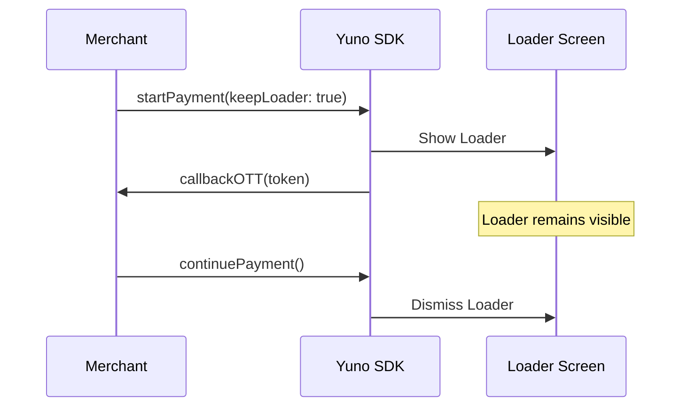

import LegacySdkNotice from '/snippets/es/LegacySdkNotice.mdx'

<LegacySdkNotice />

Parámetros, personalizaciones y funciones avanzadas para todos los flujos del SDK de Android. Configuración: [Flujos de pago (Android)](/docs/sdks/full-checkout/android-payments), [Flujos de inscripción (Android)](/es/docs/sdks/card-enrollment/android-enrollment), [modos de integración](/es/docs/sdks/overview/choose-integration).

## Parámetros clave (creación de la sesión de checkout) {#key-parameters-checkout-session-creation}

Al crear una sesión de checkout en tu backend para los flujos de pago, los siguientes parámetros se usan con frecuencia en los SDK de Android:

<div className="nowrap-col1-table dense-table">

| Parámetro            | Obligatorio | Descripción |
| -------------------- | -------- | ------------------------------------------------------------------------------------------------------------------------------------------------------------------------------------------------------------------------------------------------------------------------------------------------------------------ |
| `amount`             | Sí      | El objeto del monto principal de la transacción, que contiene `currency` (código ISO 4217) y `value` (monto numérico en esa moneda). |
| `alternative_amount` | No       | Una representación del monto de la transacción en otra moneda, con la misma estructura que `amount` (`currency` y `value`). Útil para escenarios multimoneda. Por ejemplo, puedes mostrar los precios a los clientes en su moneda preferida (por ejemplo, USD) mientras procesas el pago en la moneda local (por ejemplo, COP). |

</div>

## Parámetros de pago (referencia completa) {#payment-parameters-full-reference}

Parámetros para los flujos de pago. Todos los parámetros usados en [Flujos de pago (Android)](/docs/sdks/full-checkout/android-payments) se enumeran aquí con todo detalle.

<div className="nowrap-col1-table dense-table">

| Parámetro               | Tipo     | Obligatorio | Descripción |
| ----------------------- | -------- | -------- | --------------------------------------------------------------------------------------------------------------------------------------------------------------------------------------------------------------------------------------------------------------------------- |
| `checkoutSession`       | string   | Sí      | ID de la sesión de checkout de tu backend (API Crear sesión de checkout). Obligatorio en todos los flujos de pago. |
| `countryCode`           | string   | Sí      | Código de país ISO donde se ejecuta el pago (por ejemplo, `US`, `BR`). Determina los métodos de pago disponibles y el cumplimiento normativo. |
| `callbackPaymentState`| function | No       | `((String?, String?, StatusMessage?) -> Unit)?`. Se invoca con el estado del pago (`SUCCEEDED`, `FAIL`, `PROCESSING`, `REJECT`, `INTERNAL_ERROR`, `CANCELED_BY_USER`), su subestado y, en los resultados de error, un [`StatusMessage?`](#statusmessage-error-details). El tercer parámetro se agregó en el SDK `2.22.0`. Úsalo para actualizar la UI, para analítica o para la navegación. |
| `merchantSessionId`     | string   | No       | Identificador opcional de la sesión del comercio. Úsalo para correlacionar la sesión del SDK con tu propia sesión o con el ID de tu orden. |
| `onInstallmentSelected` | function | No       | Callback que se invoca cuando el comprador selecciona una opción de cuotas en el formulario de tarjeta (payload `InstallmentSelected?` con `installment`, `label` y `amount`). Se activa con la preselección predeterminada, con cada selección, con los recálculos del plan y una vez con `null` cuando las cuotas dejan de estar disponibles. Disponible desde el SDK `2.20.0`. Consulta [Full (Android)](/docs/sdks/full-checkout/android-payments#installment-selection-callback-oninstallmentselected). |

</div>

## Opciones de YunoConfig (inicialización) {#yunoconfig-options-initialize}

El comportamiento en tiempo de ejecución y la apariencia se configuran mediante la clase de datos `YunoConfig` al llamar a `Yuno.initialize(context, apiKey, config)`. A continuación se enumeran todos los parámetros usados en los flujos de pago e inscripción de Android. Para el estilo visual (fuentes, colores, botones), consulta [Personalizaciones del SDK (Android)](/es/docs/sdks/customization/android).

<div className="nowrap-col1-table dense-table">

| Parámetro          | Tipo    | Obligatorio | Descripción |
| ------------------ | ------- | -------- | --------------------------------------------------------------------------------------------------------------------------------------------------------------------------------------------------------------------------------------------------------------------------- |
| `saveCardEnabled`  | boolean | No       | Cuando es `true`, permite que el usuario guarde o inscriba la tarjeta durante el pago. Requiere compatibilidad del backend con el almacenamiento seguro (vaulting), por ejemplo, `payment_method.vault_on_success` en la sesión de checkout. |
| `keepLoader`       | boolean | No       | Si es `true`, el indicador de carga del SDK permanece visible desde la generación del OTT hasta que se llama a `continuePayment()`. Esto evita parpadeos en la UI. Si falla la creación del pago, llama a `hideLoader()` para ocultarlo manualmente. |
| `language`         | `YunoLanguage` | No       | Idioma de la UI del SDK, como un valor del enum `YunoLanguage` (por ejemplo, `YunoLanguage.ENGLISH`, `YunoLanguage.SPANISH`). Consulta [Idiomas compatibles](/es/docs/sdks/resources/languages-supported). |
| `styles`           | object  | No       | Estilos personalizados que se aplican a los elementos de la UI del SDK. Define los estilos en tu app y haz referencia a ellos aquí, o usa sobrescrituras del tema. Consulta [Personalizaciones del SDK (Android)](/es/docs/sdks/customization/android) para las opciones de fuente, botón y color. |

</div>

## Parámetros de inscripción (referencia completa) {#enrollment-parameters-full-reference}

Parámetros para los flujos de inscripción. Todos los parámetros usados en [Flujos de inscripción (Android)](/es/docs/sdks/card-enrollment/android-enrollment) se enumeran aquí con todo detalle.

<div className="nowrap-col1-table dense-table">

| Parámetro                | Tipo     | Obligatorio | Descripción |
| ------------------------ | -------- | -------- | --------------------------------------------------------------------------------------------------------------------------------------------------------------------------------------------------------------------------------------------------------------------------- |
| `customerSession`        | string   | Sí      | ID de la sesión de cliente de la API Crear sesión de cliente. Obligatorio. Asocia el método de pago inscrito con un cliente específico. |
| `countryCode`            | string   | Sí      | Código de país ISO (por ejemplo, `US`, `BR`). Obligatorio para la inscripción. |
| `showEnrollmentStatus`   | boolean  | No       | Cuando es `true`, muestra la pantalla de resultado de la inscripción al terminar el flujo. El valor predeterminado es `true`. Configúralo en `false` para gestionar el resultado solo mediante el callback. |
| `callbackEnrollmentState`| function | No       | `((String?, StatusMessage?) -> Unit)?`. Se invoca con el estado de la inscripción y, en `INTERNAL_ERROR`, un [`StatusMessage?`](#statusmessage-error-details). El segundo parámetro se agregó en el SDK `2.22.0`. Requiere registrar `initEnrollment` en el `onCreate` de tu Activity (o equivalente). |

</div>

## Métodos públicos {#public-methods}

Los siguientes métodos están disponibles globalmente mediante el objeto `Yuno` o como extensiones de `Activity`.

### `Activity.hideLoader()` {#activityhideloader}

Oculta el indicador de carga del SDK cuando `keepLoader` está activo. Usa este método cuando falle la creación del pago en tu backend. También es útil cuando no puedes continuar con `continuePayment()`.

```kotlin
fun Activity.hideLoader()
```

### `Yuno.continuePayment()` {#yunocontinuepayment}

Reanuda el flujo de pago para los métodos asíncronos (3ds, PIX, etc.) después de que se haya creado un pago en tu backend.

```kotlin
fun continuePayment(
    showPaymentStatus: Boolean = true,
    checkoutSession: String? = null,
    countryCode: String? = null,
    callbackPaymentState: ((String?, String?, StatusMessage?) -> Unit)? = null
)
```

## StatusMessage (detalles del error) {#statusmessage-error-details}

> **Disponible desde el SDK de Android v2.22.0**

Cada callback de resultado de pago e inscripción, y el `returnStatus` de los listeners de render, incluye un `StatusMessage?` junto al estado. Distingue un **rechazo del backend** de un **fallo interno del SDK** y te da un código sobre el cual actuar, en lugar de una cadena de estado plana.

```kotlin
package com.yuno.payments.features.payment.models

data class StatusMessage(
    val source: String,          // "backend" or "sdk"
    val code: String? = null,    // backend response_code, or an SDK error code
    val reason: String? = null,  // human-readable detail
    val raw: String? = null,     // redacted subset of the backend error body (backend only)
    val context: String? = null, // where the SDK failed (sdk only), e.g. "startPayment"
)
```

| Campo | `source = "backend"` | `source = "sdk"` |
| --- | --- | --- |
| `code` | El `response_code` de la transacción (por ejemplo, `INSUFFICIENT_FUNDS`) o el `code` del error HTTP devuelto por Yuno. | Un código de error del SDK: `UNEXPECTED_ERROR`, `LOADER_TIMEOUT` o `PAYMENT_METHOD_NOT_SELECTED` (desde `2.25.0`). |
| `reason` | El `response_message` de la transacción, con su `reason` como alternativa; para errores HTTP, la primera entrada de `messages` del backend. | Una descripción breve del fallo. |
| `raw` | Subconjunto permitido y con límite de tamaño del cuerpo del error del backend: solo `code`, `message`, `messages`, `type` y `request_id`, con un máximo de 2048 caracteres; de lo contrario, `null`. Aun así puede reflejar datos que enviaste, por lo que no lo registres tal cual en los logs. | Siempre `null`. |
| `context` | Siempre `null`. | El paso del SDK que falló, por ejemplo `startPayment`, `continuePayment` o `enrollment`. |

Cuándo se completa:

| Resultado | `message` |
| --- | --- |
| `SUCCEEDED`, `PROCESSING`, `CANCELED_BY_USER` (pagos) / `CANCELED` (inscripción), incluso cuando el comprador abandona el flujo antes de obtener un resultado | Siempre `null`. |
| `INTERNAL_ERROR` | Siempre presente. `source = "sdk"` para fallos del SDK, de render o de red; `source = "backend"` cuando Yuno respondió con un error HTTP. |
| `REJECT`, `FAIL` (pagos) | Presente con `source = "backend"` solo cuando el backend devolvió un `response_code` para la transacción; `null` en caso contrario. |
| `REJECT`, `FAIL` (inscripción) | `null`: los rechazos de inscripción no incluyen un `response_code` del backend. |

```kotlin
callbackPaymentState = { state, subState, message ->
    when (state) {
        "REJECT", "FAIL" -> showDeclined(code = message?.code, reason = message?.reason)
        "INTERNAL_ERROR" -> when (message?.source) {
            "backend" -> reportBackendError(message.code, message.raw)
            else -> reportSdkError(message?.code, message?.context)
        }
        else -> { }
    }
}
```

### Integración con render {#render-integration}

Si integras mediante la API de render, el mismo valor llega a tus listeners como el último parámetro de `returnStatus`:

```kotlin
interface YunoPaymentRenderListener {
    fun returnStatus(
        resultCode: Int,
        paymentStatus: String,
        paymentSubStatus: String? = null,
        message: StatusMessage? = null,
    )
    // showView, returnOneTimeToken, loadingListener unchanged
}

interface YunoEnrollmentRenderListener {
    fun returnStatus(resultCode: Int, paymentStatus: String, message: StatusMessage? = null)
    // showView, loadingListener unchanged
}
```

### Migración a 2.22.0 {#migrating-to-2220}

`StatusMessage` es un **cambio incompatible**: el SDK no incluye sobrecargas obsoletas de las firmas anteriores. Cuando actualices desde `2.21.x` o una versión anterior:

1. **Recompila tu app con el nuevo SDK.** Agregar el nuevo AAR a una app compilada con una versión anterior no es seguro: un listener de render compilado con la firma anterior de `returnStatus` se bloquea en tiempo de ejecución con `AbstractMethodError` en el primer resultado de error, sin ninguna advertencia en tiempo de compilación.
2. **Agrega el tercer parámetro a cada lambda de `callbackPaymentState`** (`startCheckout`, `startPayment`, `startPaymentLite`, `startPaymentSeamlessLite`, `continuePayment`, `continueCardPayment`): `{ state, subState -> }` pasa a ser `{ state, subState, message -> }`. Las lambdas de Kotlin deben coincidir en aridad, por lo que la forma anterior no compila.
3. **Agrega el segundo parámetro a cada lambda de `callbackEnrollmentState`** (`initEnrollment`, `startEnrollment`, `enrollmentStatus`, `setupEnrollmentInfo`): `{ state -> }` pasa a ser `{ state, message -> }`.
4. **Actualiza tus sobrescrituras de `returnStatus`** en `YunoPaymentRenderListener` y `YunoEnrollmentRenderListener` a las firmas anteriores.

Leer `message` es opcional: si ignoras el nuevo parámetro, tu lógica existente sigue funcionando. Notas de la versión: [Changelog de Android](/es/changelog/android).

## Inscripción de métodos de pago {#enrolling-payment-methods}

Puedes inscribir métodos de pago (almacenar tarjetas para uso futuro) durante el flujo de pago o mediante flujos de inscripción dedicados. Para los flujos de pago, habilita el guardado de tarjetas en `YunoConfig`. Además, configura `payment_method.vault_on_success` (o equivalente) al crear la sesión de checkout, donde sea compatible. Para la inscripción dedicada, consulta [Flujos de inscripción (Android)](/es/docs/sdks/card-enrollment/android-enrollment).

## Parámetro `keepLoader` {#keeploader-parameter}

> **Disponible desde el SDK de Android v2.13.0**

### Cómo funciona {#how-it-works}

El parámetro `keepLoader` te permite mantener el indicador de carga del SDK a lo largo de todo el flujo `startPayment` → `continuePayment`. Esto evita que el indicador parpadee entre los pasos.

De forma predeterminada, el SDK oculta su indicador de carga después de generar el token de un solo uso (OTT). Vuelve a mostrarlo cuando se llama a `continuePayment`. Con `keepLoader` habilitado, el indicador permanece visible de forma continua desde que el usuario envía el formulario de pago hasta que el pago se procesa por completo (o se oculta explícitamente).



### Integración {#integration}

#### 1. Habilita en YunoConfig {#1-enable-in-yunoconfig}

```kotlin
Yuno.initialize(
    applicationContext = this,
    apiKey = "YOUR_PUBLIC_API_KEY",
    config = YunoConfig(
        keepLoader = true,
    ),
)
```

#### 2. Gestiona el OTT y llama a `continuePayment` {#2-handle-ott-and-call-continuepayment}

Cuando `keepLoader` está habilitado, el callback del OTT se activa mientras el indicador de carga sigue visible. Crea tu pago en tu backend y luego llama a `continuePayment` como de costumbre:

```kotlin
activity.startCheckout(
    checkoutSession = checkoutSession,
    countryCode = countryCode,
    callbackOTT = { token ->
        // The loader is still visible at this point.
        // Create payment on your backend using the token,
        // then call continuePayment:
        activity.continuePayment(showPaymentStatus = true)
    },
    callbackPaymentState = { state, subState, message ->
        // Handle final payment state
    },
)
```

#### 3. Gestiona los errores con `hideLoader` {#3-handle-errors-with-hideloader}

Si falla la llamada a tu backend y no puedes continuar con `continuePayment`, llama a `hideLoader()`. Esto oculta el indicador de carga y finaliza el flujo de pago:

```kotlin
callbackOTT = { token ->
    try {
        val payment = createPaymentOnBackend(token)
        activity.continuePayment(showPaymentStatus = true)
    } catch (e: Exception) {
        // Dismiss the loader on failure
        activity.hideLoader()
    }
}
```

<Warning>
  **Manejo de fallos**  
  Cuando `keepLoader` está activo y falla la creación del pago, **debes** llamar a `hideLoader()`. De lo contrario, el indicador de carga permanecerá en pantalla indefinidamente (hasta que se active el tiempo de espera integrado).
</Warning>

### Compatibilidad {#compatibility}

- Funciona con los flujos de pago **Full** y **Lite** (`startPayment` y `startPaymentLite`).
- Compatible con tokens almacenados (vaulted).
- El indicador de carga respeta el tiempo de espera integrado del SDK. Si no se llama ni a `continuePayment` ni a `hideLoader`, el indicador se ocultará automáticamente después del período de espera.
- No aplica al flujo **Seamless** (`startPaymentSeamlessLite`). Este flujo no usa el patrón de dos pasos `startPayment` → `continuePayment`.
