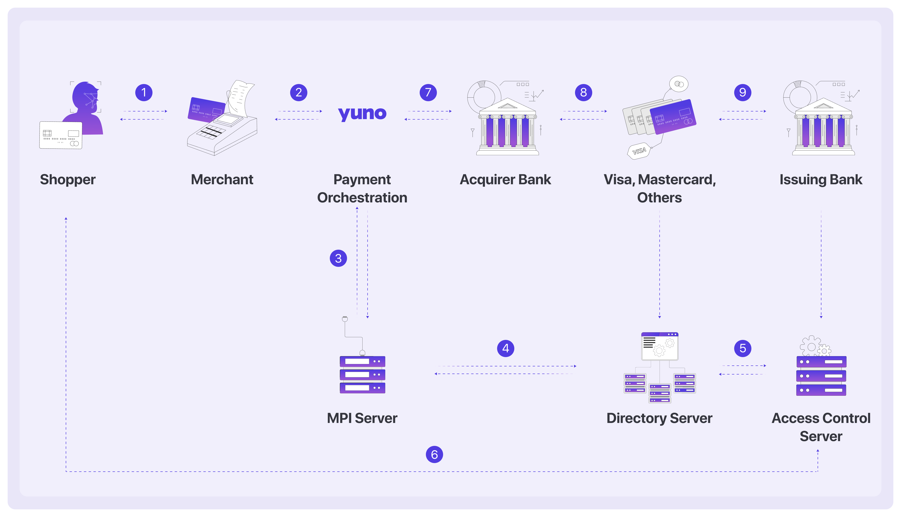
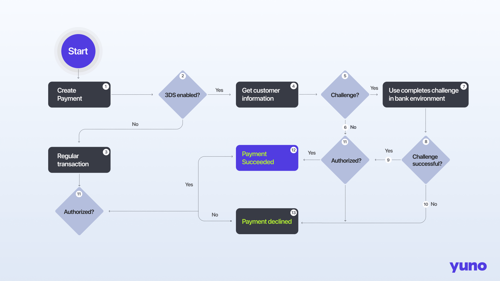

import { AuthOnceFlow } from '/snippets/three-d-secure/AuthOnceFlow.jsx';

Yuno 3DS ejecuta la autenticación 3D Secure 2 como un paso propio de tu ruta de tarjetas, antes de que el pago llegue a un proveedor de pagos. El resultado de la autenticación (ECI, criptograma e ID de transacción del Directory Server) queda guardado en el pago, por lo que cualquier proveedor de la ruta puede usarlo.

## Autentica una vez, enruta a cualquier proveedor {#authenticate-once-route-to-any-provider}

Cuando un proveedor de pagos ejecuta 3DS por ti, la autenticación normalmente se queda con ese proveedor. Si el proveedor rechaza el pago y reintentas con otro, el segundo proveedor inicia su propia autenticación y tu cliente recibe un segundo desafío.

Con Yuno 3DS, la autenticación va primero y el proveedor después. Si el proveedor A rechaza el pago y tu ruta tiene un fallback, Yuno envía los mismos datos de autenticación al proveedor B. Tu cliente no vuelve a autenticarse.

<AuthOnceFlow
  label="Comparación de dos flujos de pago. Con 3DS integrado en un proveedor: el cliente paga, completa un desafío 3DS ejecutado por el proveedor A, el proveedor A rechaza el pago, el cliente debe completar un segundo desafío 3DS para el proveedor B y luego el proveedor B intenta la autorización. Con Yuno 3DS: el cliente paga, completa un solo desafío 3DS ejecutado por Yuno, el proveedor A rechaza el pago y el proveedor B recibe la misma autenticación y aprueba."
  lanes={[
    {
      eyebrow: 'Sin Yuno',
      title: '3DS integrado en cada proveedor',
      count: '2',
      result: 'desafíos para la misma compra',
      steps: [
        { kind: 'customer', title: 'El cliente paga', body: 'Datos de la tarjeta enviados en el checkout' },
        { kind: 'auth', title: 'Desafío 3DS', body: 'Ejecutado por el proveedor A, válido para el proveedor A' },
        { kind: 'declined', title: 'Proveedor A', tag: 'Rechazado', body: 'La autenticación no puede pasar a otro proveedor' },
        { kind: 'repeat', title: 'Desafío 3DS', tag: 'Otra vez', body: 'El proveedor B inicia su propia autenticación' },
        { kind: 'provider', title: 'Proveedor B', body: 'Intento de autorización, si el cliente sigue ahí' },
      ],
    },
    {
      eyebrow: 'Con Yuno',
      title: 'Yuno 3DS como paso de la ruta',
      highlight: true,
      count: '1',
      result: 'desafío, sin importar cuántos proveedores pruebe la ruta',
      steps: [
        { kind: 'customer', title: 'El cliente paga', body: 'Datos de la tarjeta enviados en el checkout' },
        { kind: 'auth', title: 'Desafío 3DS', body: 'Ejecutado por Yuno, antes de cualquier proveedor' },
        { kind: 'declined', title: 'Proveedor A', tag: 'Rechazado', body: 'La ruta sigue su rama Declined' },
        { kind: 'approved', title: 'Proveedor B', tag: 'Aprobado', body: 'Recibe el mismo ECI y criptograma' },
      ],
    },
  ]}
/>

| Paso | 3DS integrado en cada proveedor | Yuno 3DS como paso de la ruta |
| :--- | :--- | :--- |
| Autenticación | Ejecutada por el proveedor A, ligada al proveedor A | Ejecutada por Yuno antes de cualquier proveedor |
| El proveedor A rechaza | La autenticación se pierde | La autenticación se conserva en el pago |
| Reintento en el proveedor B | El cliente completa un segundo desafío | El proveedor B recibe el mismo ECI y criptograma |
| Desafíos para una compra | Dos | Uno |

### Cómo funciona en tu ruta {#how-it-works-in-your-route}

1. Agrega el paso **3DS** a tu ruta CARD, antes del paso del proveedor. Consulta [Configurar 3D Secure para tus pagos](#configuring-3d-secure-for-your-payments).
2. Yuno autentica al cliente una sola vez. El flujo es frictionless cuando el emisor aprueba en segundo plano, o un desafío cuando el emisor lo solicita.
3. Yuno envía el pago al primer proveedor con el resultado de la autenticación adjunto.
4. Si ese proveedor rechaza el pago o devuelve un error, la ruta sigue la rama **Declined** o **Error** que configuraste. Consulta [Intentos de fallback y resultados del pago](/es/docs/using-yuno/dashboard-overview/routing#fallback-attempts-and-payment-outcomes).
5. El siguiente proveedor recibe el mismo resultado de autenticación. La respuesta del pago lo devuelve en el [objeto `three_d_secure`](#yuno-3d-secure-2-integration).

<Note>
Un intento de fallback es una autorización nueva. El emisor todavía puede rechazarla. Lee `liability_shift` en cada pago en lugar de asumirlo a partir del estado del pago.
</Note>

## Elige tu integración {#choose-your-integration}

| Integración | Quién ejecuta la autenticación | Cuándo usarla | Guía |
| :--- | :--- | :--- | :--- |
| SDK de Yuno | Yuno. El SDK recopila los datos del dispositivo y muestra el desafío | Usas Yuno Checkout en web o móvil | [Empieza con el SDK de Yuno](/es/docs/yuno-sdk/get-started) |
| API directa | Yuno. Rediriges al cliente a la `redirect_url` | Cumples con PCI y creas los pagos desde tu servidor | [Configuración y pruebas de 3DS](/es/docs/direct-integration-use-cases/3ds-configuration-and-testing) |
| 3DS Standalone | Yuno. Solo autenticación, sin proveedor y sin autorización | Quieres el ECI y el criptograma para autorizar en otro lugar | [3DS Standalone](/es/docs/payment-features/3ds-standalone) |
| 3DS externo | Tu propio servidor 3DS o MPI | Ya autenticas y solo envías el resultado a Yuno | [Crear pago](/es/reference/payments/create-payment) |

Los requisitos de cada opción están en [Integración de Yuno 3D Secure 2](#yuno-3d-secure-2-integration).

## Resultados de la autenticación {#authentication-outcomes}

| Resultado | Qué ve el cliente | Qué obtienes |
| :--- | :--- | :--- |
| Frictionless | Nada. El emisor autentica en segundo plano | ECI y criptograma |
| Desafío | Una contraseña de un solo uso o una confirmación en la app del banco | ECI y criptograma cuando el cliente supera el desafío |
| Data only | Nada. Los datos de la transacción se comparten con el emisor y no se solicita un desafío | Un registro de autenticación (`pares_status` `I`, normalmente ECI 04). No hay liability shift: conservas la responsabilidad por fraude |
| Fallida o rechazada | Un desafío fallido, o nada cuando el emisor rechaza | Un pago `DECLINED` y sin liability shift |

[3DS Standalone](/es/docs/payment-features/3ds-standalone#authentication-outcomes) muestra la respuesta completa de cada resultado. Para pedir al emisor que omita el desafío en pagos elegibles, consulta [Exenciones de SCA](/es/docs/payment-features/sca-exemptions).

## Configurar 3D Secure para tus pagos {#configuring-3d-secure-for-your-payments}

<Note>
**SDK de Yuno: 3DS se ejecuta dentro de la transacción**

Con el [SDK de Yuno](/es/docs/yuno-sdk/get-started) no hay una configuración de 3DS por separado ni una llamada adicional que debas encadenar. El SDK crea el pago, ejecuta 3DS cuando la ruta o el emisor lo piden y entrega el estado final a [`onStatus`](/es/docs/yuno-sdk/controllers/on-status). Si creas el pago desde tu propio backend con [`createPayment`](/es/docs/yuno-sdk/controllers/create-payment), el SDK igualmente ejecuta 3DS y reporta el resultado. Consulta [Cómo fluye una transacción](/es/docs/yuno-sdk/how-a-transaction-flows) para ver la secuencia completa.
</Note>

<Note>
**Experiencia de desafío en el SDK de Yuno**: el SDK presenta el desafío por sí mismo, así que no abres una URL de desafío ni gestionas una redirección. En móvil, el desafío se ejecuta por defecto en un WebView a pantalla completa. En Android, agrega el módulo de 3DS de Netcetera para ejecutarlo de forma nativa en tu app, en pagos y en enrolamiento. En iOS 3.x el módulo nativo aún no está disponible, por lo que los desafíos se ejecutan en el WebView. Consulta [Módulos nativos](/es/docs/yuno-sdk/features/native-modules) para la configuración.
</Note>

<Note>
**¿Usas un SDK legacy?** Los SDK legacy siguen soportados durante la transición, y 3DS funciona así:

- Full, Lite y Seamless: desde el SDK v1.1, `continuePayment()` gestiona 3DS sin una configuración por separado. Consulta la [guía del Web SDK legacy](/docs/sdks/full-checkout/web-payments).
- Headless web: llama a `getThreeDSecureChallenge` y abre la URL devuelta con `embedded=true` para mostrar el desafío en un iFrame en lugar de una redirección a página completa, en escritorio y en web móvil. Sin `embedded=true`, el desafío se abre en una pestaña nueva. Consulta el [Paso 6](/es/docs/sdks/headless-web/payment#step-6-get-the-3ds-challenge-url). Esto aplica solo al proveedor de 3DS web de Yuno.
- Apps móviles nativas: el desafío se ejecuta dentro de la app mediante los SDK nativos de 3DS de Netcetera. Consulta las guías de [iOS](/es/docs/sdks/external-native-modules/netcetera-3ds-ios) y [Android](/es/docs/sdks/external-native-modules/netcetera-3ds-android).
</Note>

Tú decides si tu sistema implementará 3DS2 o no. El paso de verificación 3DS2 se agrega al definir el [enrutamiento dinámico](/es/docs/using-yuno/dashboard-overview/routing#configuring-the-dynamic-routing) de tus tarjetas. Al iniciar tus rutas de tarjetas, puedes agregar el paso 3DS2 antes de definir el proveedor de pago. Cuando agregas el paso de verificación 3DS2, al iniciarse un pago con tarjeta, el sistema de Yuno analizará si la tarjeta necesita un desafío adicional. Si es necesario un desafío adicional, el usuario será redirigido al entorno del banco para completar la autorización. En caso contrario, el proceso de pago continuará con normalidad.

Para crear pagos con el flujo 3DS DIRECT, debes cumplir algunos requisitos.

### Requisitos {#requirements}

Antes de usar 3DS DIRECT, debes habilitar 3DS en tu [Yuno Dashboard](https://dashboard.y.uno/) y especificar los escenarios en los que quieres que tus clientes puedan usarlo. Esto se puede configurar en el Yuno Dashboard en: **Routing > Card Routes > 3DS Step**. Estos escenarios deben indicarse en tu ruta CARD. Además, necesitarás los siguientes datos de configuración de 3DS en la conexión con el proveedor de pago:

* **Acquirer BIN**: es el Bank Identification Number (BIN) usado para compensar y liquidar la transacción, junto con el país en el que está autorizado su uso. Este valor es específico de cada marca: solicita uno por cada marca de tarjeta que vayas a autenticar (consulta la advertencia a continuación).
* **Merchant ID**: es el número de afiliación proporcionado por el adquirente.
* **Merchant Category Code (MCC)**: el adquirente te proporcionará un código específico que representa la categoría de tu comercio.
* **Merchant's Name**: se refiere al nombre oficial o razón social de la empresa o entidad que realiza la transacción comercial.
* **Merchant URL**: el sitio web o la plataforma en línea del comercio.
* **Country Code**: el país donde se debe procesar el pago, conforme a los códigos de país estándar de [ISO 3166-1](/es/reference/country-reference).

<Warning>
**El acquirer BIN es específico de cada marca y no es el ICA ni el Seller ID**

El Directory Server de cada red de tarjetas solo acepta solicitudes de autenticación que incluyan un acquirer BIN registrado en esa red específica. Al obtener las credenciales de 3DS de tu adquirente, ten en cuenta lo siguiente:

* Solicita un acquirer BIN **por cada marca de tarjeta** que planeas autenticar (Visa, Mastercard, American Express, Discover/Diners). Un BIN registrado para una marca no funciona para otra: por ejemplo, un BIN de adquirencia de Visa (que empieza con 4) no es válido para autenticaciones de Mastercard.
* Para **Mastercard**, a veces los adquirentes comparten su número ICA (un identificador de membresía de Mastercard, a menudo con ceros al inicio) en lugar de un acquirer BIN. El Directory Server de Mastercard no acepta el ICA: las autenticaciones fallan con el error EMV 3DS `303`, "Acceso denegado, endpoint no válido / acquirerBIN no reconocido". Pide a tu adquirente específicamente el **BIN de adquirencia de Mastercard registrado para Identity Check (EMV 3DS)**, un valor dentro de los rangos de BIN de Mastercard (serie 2 o serie 5).
* Para **American Express y Discover**, el Seller ID o número SE es tu identificador de comercio en esas redes (corresponde al Acquirer Merchant ID), no es el acquirer BIN de la marca. Se requieren ambos valores.

Si una autenticación falla con el error `303` del Directory Server, el acquirer BIN configurado para esa marca es incorrecto o no está registrado para 3DS. Solicita el valor correcto a tu adquirente, por ejemplo: *"Para cada red de tarjetas (Visa, Mastercard, American Express, Discover), por favor proporcionen el acquirer BIN registrado en el Directory Server de la red para la autenticación EMV 3DS con un servidor 3DS externo, junto con nuestro Acquirer Merchant ID y el MCC registrados en la red."*
</Warning>

<Note>
**Uso de un MPI externo para la autenticación**

Si usas un MPI externo para realizar la autenticación, se requieren los siguientes parámetros para lograr una conexión exitosa con el proveedor:

* Acquirer BIN
* Acquirer country code
* Merchant ID
* MCC
</Note>

## Integración de Yuno 3D Secure 2 {#yuno-3d-secure-2-integration}

Hay diferentes formas de integrar 3DS en Yuno, según tus necesidades.

En términos generales, una integración de 3DS requiere un `setup_id`/`device_fingerprint` para la sesión de pago como primer paso del análisis de seguridad, y ese ID solo se puede obtener ejecutando un SDK/JS impulsado por un proveedor autorizado de 3DS. Al usar nuestros SDK **nos encargamos de toda la lógica por ti**, para que no tengas que preocuparte por las distintas necesidades de cada proveedor.

Por lo tanto, según tu integración con Yuno, tienes tres opciones diferentes:

1. **Integración de Checkout**: el flujo de Checkout forma parte de la solución de [Checkout](/es/docs/yuno-sdk/get-started) que ofrece Yuno. Usa nuestros SDK para que gestionemos toda la lógica relacionada con los requisitos y ejecuciones de proveedores externos para 3DS. Si quieres definir casos específicos para el análisis de 3DS, puedes definirlos en la ruta CARD de tu Yuno Dashboard.
2. **Integración externa**: usa tu propio 3DS y luego envía los campos de autorización correspondientes en la [creación del pago](/es/reference/payments/create-payment) (card\_data - eci, cryptogram, etc.). Solo disponible para comercios que cumplen con PCI.
3. **Integración directa**: el flujo Direct solo está disponible para comercios que cumplen con PCI. Ofrece una forma sencilla de crear un pago y validar la información del usuario, y requiere que el comercio realice una sola solicitud para crear el pago. Para implementar con éxito la integración Direct, sigue los pasos descritos en la [guía de integración](/es/docs/direct-integration-use-cases/direct-flow) y proporciona la información requerida según se indica. Para cada pago tendrás:
   1. Un estado/subestado `PENDING/WAITING_ADDITIONAL_STEP`.
   2. `sdk_action_required` definido como `true`.
   3. `redirect_url` definido en `payment.payment_method.payment_method_detail.card`.

Eres responsable de redirigir a tus clientes a la URL proporcionada en `redirect_url` para que podamos recopilar la información del dispositivo y presentar el desafío al cliente si es necesario. Una vez que el cliente complete con éxito el desafío 3DS, será redirigido automáticamente a la `callback_url`, que proporcionaste al crear el pago con el endpoint Create Payment.

En todos los escenarios, los [webhooks](/es/docs/webhooks/configure-webhooks) de Yuno te notificarán de inmediato el resultado del desafío 3DS y el estado final del pago. Esto garantiza que recibas actualizaciones en tiempo real sobre el avance y la finalización de la transacción de pago. Además, siempre puedes obtener la información del pago mediante nuestro [servicio de obtención de pagos](/reference/payments/retrieve-payment-by-id).

Después de ejecutar 3DS en cada escenario, recibirás toda la información necesaria en la respuesta del pago, dentro del objeto `payment_method.detail.card.card_data.three_d_secure`:

| Campo | Descripción | Ejemplo |
| :--------------------------------- | :---------------------------------------------------------------------------------------------------------------------------------------------------------------------------------------------------------------------------------------------------------------------------------------------------------------------------------------------------------------------------------------------------------------------------------------------------------------------------------------------------------------------------------------------------------------------------------------------------------------------------------------------------------------------------------------------------------------------- | :------------------------------------------------------------------------------------------- |
| version | Se refiere a la versión del protocolo de la especificación EMV 3-D Secure utilizada. 1.0, 2.0, 2.1.0, 2.2.0, 2.2.1. | 2.2.1 |
| electronic\_commerce\_indicator | Este campo debe completarse con el resultado del campo ECI proporcionado por el servicio 3d Secure. El Electronic Commerce Indicator (ECI) informa al emisor de la tarjeta si la transacción estuvo protegida por un protocolo de seguridad como VbV o MCSC. Visa y MasterCard exigen que todas las transacciones 3-D Secure tengan este valor completo en la solicitud de autorización (MAX: 2, MIN: 0). | 04 |
| cryptogram | El valor del criptograma proporcionado por el servicio 3DSecure, que prueba que el titular de la tarjeta fue autenticado (MAX: 40, MIN: 0). | BA0BB1Z3N5Q4kjkBU3c3ELGUsJY = |
| transaction\_id | Para 3DS v1: es el Unique Transaction Identifier. Lo genera automáticamente el MPI. Normalmente tiene 28 bytes de longitud y está codificado en base64. Se conoce comúnmente como XID (MAX: 40, MIN: 0). Para 3DS v2: identificador de transacción único universal asignado por el DS para identificar una sola transacción (MAX: 36, MIN:36). | Ej. para V1: “TjY0MjAxRjA4MD4987DUzMzYyNjU=” Ej. para V2: “c4e59ceb-a382-4d6a-bc87-385d591fa09d” |
| directory\_server\_transaction\_id | ID de transacción generado por el directory server de Mastercard durante la autenticación (MAX 255; MIN 3). | f38e6948-5388-41a6-bca4-b49723c19437 |
| pares\_status | Indica el resultado de la autenticación del titular de la tarjeta durante el proceso 3-D Secure. Te informa si la autenticación fue exitosa (Y), falló (N), no pudo completarse (U) o solo se intentó (A). | Y |
| acs\_id | Identificador único proporcionado por el Access Control Server (ACS) durante el proceso de autenticación 3-D Secure. | ACS-1234567890 |
| liability\_shift | Boolean que indica si la responsabilidad por fraude pasó del comercio al emisor de la tarjeta como resultado de la autenticación: `true` cuando pasó al emisor, `false` cuando el comercio la conserva. También puede ser `null`, incluso en algunos casos de autenticación exitosa. Si ves `null` de forma inesperada y dependes de este campo para la gestión de contracargos, contacta al soporte de Yuno. | true |

<Warning>
**No deduzcas el traspaso de responsabilidad (liability shift) a partir del estado del pago**

Un pago `SUCCEEDED` significa que la autorización fue aprobada. No significa que la responsabilidad por fraude se haya traspasado al emisor. Según las reglas de la red de tarjetas, una exención de SCA o un intento de autenticación (`pares_status` `A`) puede dejar la responsabilidad en tu comercio.

Lee `liability_shift` en la respuesta del pago de cada transacción. Trata `null` como "desconocido", nunca como `true`. Si dependes de este campo para la gestión de contracargos y recibes `null` después de una autenticación exitosa, contacta al soporte de Yuno.
</Warning>

En las transacciones de Visa, el `cryptogram` representa el Cardholder Authentication Verification Value (CAVV), un valor criptográfico generado por el emisor como evidencia de la autenticación del pago durante la compra en línea, que se usa para calificar para la protección contra contracargos. Las transacciones de Mastercard llevan un valor equivalente llamado Accountholder Authentication Value (AAV), o Universal Cardholder Authentication Field (UCAF). Al enviar una transacción para su autorización, el comercio debe incluir el CAVV o el AAV/UCAF para demostrar que el titular de la tarjeta fue autenticado.

```json Example
[...]
     "payment_method": {
        "vaulted_token": "",
        "type": "CARD",
        "vault_on_success": false,
        "token": "",
        "detail": {
            "card": {
                "verify": false,
                "capture": false,
                "installments": 1,
                "installments_plan_id": null,
                "first_installment_deferral": 0,
                "installments_type": "MERCHANT",
                "installment_amount": null,
                "soft_descriptor": "",
                "authorization_code": "",
                "retrieval_reference_number": "",
                "acquirer_reference_number": "",
                "voucher": null,
                "card_data": {
                    "holder_name": "John Doe",
                    "iin": "40000000",
                    "lfd": "1026",
                    "number_length": 16,
                    "security_code_length": 3,
                    "brand": "VISA",
                    "issuer_name": "",
                    "issuer_code": null,
                    "category": "STANDARD",
                    "type": "CREDIT",
                    "three_d_secure": {
                        "version": "2.1.0",
                        "electronic_commerce_indicator": null,
                        "cryptogram": null,
                        "transaction_id": null,
                        "directory_server_transaction_id": null,
                        "pares_status": null,
                        "acs_id": "z1A6ZTh7NopIhdb2R420"
                    }
                }
[...]
```

### Estado de las transacciones {#transactions-status}

Una transacción 3DS funciona de manera similar a una transacción de compra normal. Avanza por distintos estados que representan el proceso de autorización. Una vez que la transacción 3DS se marca como SUCCEEDED, Yuno continúa con el procesador y genera una transacción PURCHASE para cobrar al cliente. La siguiente tabla describe todos los estados posibles y sus descripciones.

| Estado | Descripción |
| :---------- | :--------------------------------------------------------------------- |
| CREATED | El pago se crea y espera el ID de sesión del SDK de Yuno. |
| PENDING | Se requiere el desafío y Yuno devuelve la `redirect_url`. |
| IN\_PROCESS | El usuario está completando el desafío. |
| SUCCEEDED | El desafío se completó correctamente. |
| DECLINED | El desafío se completó, pero el banco lo rechazó. |
| ERROR | Ocurrió un error al redirigir al desafío del usuario. |

Como se mencionó antes, si el pago está en PENDING/WAITING\_ADDITIONAL\_STEP, la transacción 3DS estará en PENDING cuando se requiera un desafío. Después de completar el desafío, con éxito o no, el pago y la transacción se actualizarán a los estados correspondientes (SUCCEEDED o DECLINED).

### Usar 3DS para escenarios específicos {#using-3ds-for-specific-scenarios}

Al configurar la ruta CARD en el Yuno Dashboard, puedes especificar en qué situaciones se debe ejecutar 3DS mediante las [condiciones disponibles](/es/docs/using-yuno/dashboard-overview/routing#configuring-the-dynamic-routing). Como se mencionó anteriormente, serán necesarios algunos pasos preliminares para ejecutar 3DS, según el método de integración utilizado.

## ¿Qué es 3D Secure? {#what-is-3d-secure}

3D Secure, o 3DS, es un protocolo de seguridad para pagos en línea diseñado para prevenir el uso fraudulento de tarjetas de crédito en transacciones con tarjeta no presente (CNP). El protocolo, desarrollado en 1999, exige pasos de verificación adicionales para que los clientes se autentiquen durante el proceso de compra y se reduzca el riesgo de fraude. El siguiente flujo presenta un proceso de pago con 3DS:

<Frame></Frame>

Donde:

* **Merchant Plugin Interface (MPI)** inicia el proceso de verificación al facilitar el intercambio seguro de información entre el comercio, el Directory Server de la red y el banco emisor del titular de la tarjeta.
* **Scheme Directory Server (DS)** actúa como una base de datos centralizada y facilita la identificación del banco emisor correspondiente del titular de la tarjeta y del método de autenticación que se debe usar.
* **Issuer Access Control Server (ACS)** es responsable de verificar y validar la identidad del titular de la tarjeta durante una transacción 3DS. El Issuer ACS recibe las solicitudes de autenticación y realiza evaluaciones de riesgo y comprobaciones de autenticación según las reglas y políticas predefinidas del banco.

3D Secure 2, o 3DS2, publicado en 2016, es una versión actualizada del protocolo 3DS original y usa métodos de autenticación dinámicos, como la biometría y la autenticación basada en tokens, mientras que el protocolo 3DS original depende de contraseñas estáticas. 3DS2 busca ofrecer una mejor experiencia de usuario, con un flujo más fluido para los usuarios finales durante la autenticación. EMVCo, una organización propiedad de las principales marcas de tarjetas, desarrolló y administra ambos protocolos. Todas las principales marcas de tarjetas dejaron de admitir la primera versión de 3DS en octubre de 2022. Por lo tanto, integrar el paso de verificación 3DS2 es esencial para garantizar la experiencia y la seguridad de tus clientes. Yuno ya ofrece una integración sencilla de 3DS2 para tu negocio.

<div className="company_card_wrapper">
<Columns cols={3}>
  <Card horizontal title="Visa" icon="https://icons.prod.y.uno/visa_logosimbolo.png" />

  <Card horizontal title="Mastercard" icon="https://icons.prod.y.uno/mastercard_logosimbolo.png" />

  <Card horizontal title="American Express" icon="https://icons.prod.y.uno/amex_logosimbolo.png" />

  <Card horizontal title="JCB" icon="https://icons.prod.y.uno/jcb_logosimbolo.png" />

  <Card horizontal title="Diners Club" icon="https://icons.prod.y.uno/dinnersclub_logosimbolo.png" />

  <Card horizontal title="UnionPay" icon="https://icons.prod.y.uno/unionpay_logosimbolo.png" />

  <Card horizontal title="Cartes Bancaires" icon="https://icons.prod.y.uno/cartabancaire_logosimbolo.png" />
</Columns>
</div>

## Beneficios de 3D Secure 2 {#benefits-of-3d-secure-2}

Como se mencionó, 3DS2 se desarrolló para mejorar la experiencia de usuario y adaptar el protocolo 3DS al panorama de pagos moderno.

### Preparado para nuevas tecnologías {#prepared-for-new-technologies}

3DS2 se diseñó pensando en el auge de los teléfonos inteligentes y permitió que los bancos ofrezcan experiencias de autenticación innovadoras a través de sus apps de banca móvil, como la autenticación biométrica con huellas dactilares o reconocimiento facial. Por lo tanto, los comercios pueden ofrecer varios métodos de autenticación que se ajustan a las preferencias de los consumidores y a los avances tecnológicos, lo que da como resultado un proceso de autenticación más cómodo y seguro.

### Capacidades de integración {#integration-capabilities}

En cuanto a la integración, 3DS2 incluye un componente SDK que permite la integración nativa en apps móviles. Como resultado, los comercios pueden autenticar transacciones dentro de sus propias apps. Ahora, el flujo de desafío ocurre directamente dentro de los flujos de checkout móviles, lo que elimina la necesidad de redirecciones a página completa y ofrece una experiencia de usuario más fluida.

### Cantidad de datos disponibles para la autenticación {#amount-of-data-available-for-authentication}

3DS2 permite que las empresas intercambien diez veces más datos de cada transacción con el banco del titular de la tarjeta. Esto incluye datos específicos del pago, como la dirección de envío, y datos contextuales, como el ID del dispositivo del cliente o su historial de transacciones anteriores. Esto permite que el banco evalúe el nivel de riesgo de la transacción y, potencialmente, autentique el pago sin datos adicionales del titular de la tarjeta. Por lo tanto, un pago que usa los protocolos de 3DS2 puede tener un **flujo sin fricción** o un **flujo con desafío** para completarse.

#### Flujo sin fricción {#frictionless-flow}

En un flujo sin fricción, los datos del cliente se confirman sin ninguna entrada manual de datos. Ocurre cuando el sistema reconoce y verifica el dispositivo del cliente, y los datos se intercambian en segundo plano. Como el cliente se identifica y se valida con esta información, no son necesarias solicitudes adicionales de los sistemas de pago.

#### Flujo con desafío {#challenge-flow}

El flujo con desafío ocurre cuando la información almacenada no es suficiente para validar al cliente. Como la identidad del cliente no está confirmada, el sistema requiere un paso adicional para validarlo, mediante una contraseña de un solo uso o una verificación biométrica. Según el sistema de validación, es posible que el cliente sea redirigido a la página del emisor de la tarjeta para ingresar la información necesaria.

El uso de 3DS2 da como resultado una experiencia de usuario más fluida y sin fricción. Los flujos de datos mejorados y las capacidades de toma de decisiones que habilita 3DS2 reducen la tasa de abandono del carrito y mejoran las tasas de conversión.

## Pago con 3D Secure 2 {#3d-secure-2-payment}

Agregar el paso de verificación 3DS2 al proceso de checkout cambia el flujo de trabajo habitual. A continuación encontrarás un diagrama de flujo del checkout completo y una descripción de cada paso para ayudarte a comprender mejor el proceso.

<Frame></Frame>

1. El cliente proporciona los datos de su tarjeta para iniciar el proceso de checkout del comercio.
2. El sistema del comercio verifica si admite 3DS2.
3. Si el comercio no admite 3DS2, el proceso de checkout continúa con el flujo de pago habitual, sin usar la verificación 3DS2.
4. Si el comercio admite 3DS2, Yuno envía la información de la transacción al proveedor de servicios 3DS del emisor para evaluar el riesgo de la transacción. Estos datos incluyen información del titular de la tarjeta y del dispositivo, sujeta a las restricciones legales de la región o del mercado, como el ID del dispositivo, la dirección MAC, la geolocalización, las transacciones anteriores y más.
5. El proveedor de servicios 3DS del emisor determina si la transacción es de alto riesgo y si es necesario un desafío para una verificación adicional.
6. El pago continúa al paso de autorización si no es necesario un desafío (flujo sin fricción).
7. Si se requiere un desafío (flujo con desafío), este se presenta al titular de la tarjeta para verificar su identidad. Esta verificación puede usar biometría y/o autenticación de dos factores, como una contraseña de un solo uso o una huella dactilar.
8. El sistema verifica si el titular de la tarjeta completó el desafío con éxito.
9. El pago continúa al paso de autorización si el titular de la tarjeta verifica su identidad con éxito.
10. Si el titular de la tarjeta no logra verificar su identidad, el pago se cancela.
11. El comercio consulta con el emisor de la tarjeta si la transacción está autorizada.
12. Si la transacción está autorizada, el pago se procesa con éxito.
13. Si la transacción no está autorizada, el pago se cancela o se rechaza.
