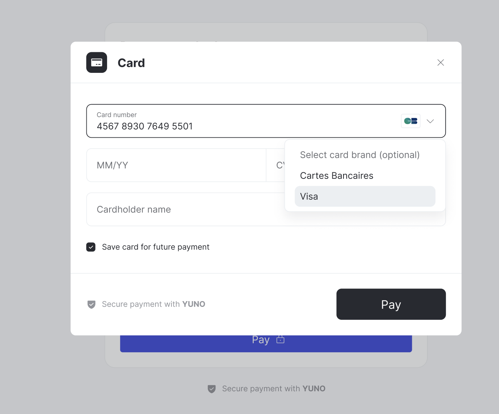

Las tarjetas co-badged son tarjetas de pago que admiten varias redes de pago (por ejemplo, una tarjeta que admite tanto Cartes Bancaires como Visa). Para cumplir con el [artículo 8 del Reglamento IFR 2015/751 de la UE](https://eur-lex.europa.eu/eli/reg/2015/751/oj), los comercios deben permitir que los clientes elijan qué red usar al procesar pagos con tarjetas co-badged.

## ¿Qué son las tarjetas co-badged? {#what-are-co-badged-cards}

Las tarjetas co-badged son tarjetas de pago que llevan los logotipos de varias redes y pueden procesarse a través de distintas redes de pago. Algunos ejemplos comunes son:

* Tarjetas que admiten tanto una red nacional (por ejemplo, Cartes Bancaires en Francia) como una red internacional (por ejemplo, Visa o Mastercard)
* Tarjetas que admiten varias redes internacionales

Cuando un comercio acepta pagos a través de varias redes admitidas por la misma tarjeta, la normativa de la UE exige que se ofrezca a los clientes la opción de elegir qué red usar.

## ¿Cuándo es obligatorio el cumplimiento? {#when-is-compliance-required}

El cumplimiento del artículo 8 del Reglamento IFR 2015/751 de la UE es obligatorio cuando:

* Un comercio acepta tanto redes nacionales como internacionales (por ejemplo, Cartes Bancaires y Visa)
* La tarjeta del cliente admite varias redes que el comercio acepta
* La transacción se procesa dentro del Espacio Económico Europeo (EEE)

Si un comercio solo acepta una red, o si la tarjeta del cliente solo admite una red que el comercio acepta, no es necesario seleccionar una red. El reglamento se aplica a las transacciones procesadas dentro del EEE; las transacciones fuera del EEE no están sujetas a este requisito.

## Artículo 8 del Reglamento IFR 2015/751 de la UE {#eu-ifr-regulation-2015751-article-8}

El [Reglamento (UE) 2015/751](https://eur-lex.europa.eu/eli/reg/2015/751/oj), también conocido como Reglamento sobre las tasas de intercambio (IFR, por sus siglas en inglés), es una norma de la Unión Europea sobre las tasas de intercambio para las operaciones de pago con tarjeta. El artículo 8 trata específicamente las tarjetas co-badged y exige que los comercios del EEE permitan a los clientes elegir la red de tarjeta que prefieran al usar tarjetas co-badged.

### Requisitos clave {#key-requirements}

El artículo 8 exige que, cuando un comercio acepta tanto redes nacionales como internacionales (por ejemplo, Cartes Bancaires y Visa), el comercio muestre a los consumidores del EEE una opción para seleccionar qué red usar. Si un comercio solo acepta una de las redes admitidas por la tarjeta, no es necesario seleccionar una red.

### Alcance y calendario del reglamento {#regulation-scope-and-timeline}

El Reglamento (UE) 2015/751 se aplica a todos los Estados miembros de la Unión Europea y del Espacio Económico Europeo (EEE). El reglamento entró en vigor el 8 de junio de 2015, y el artículo 8 y las disposiciones relacionadas se aplican desde el 9 de junio de 2016.

## Solución de Yuno {#yuno-solution}

Yuno simplifica el cumplimiento normativo de las tarjetas co-badged al ofrecer soporte integrado a través de nuestros SDK, de modo que los comercios cumplen los requisitos regulatorios sin desarrollo adicional.

<Check>
**Cumplimiento automático**

Al usar los SDK de Yuno, los comercios cumplen con la normativa de tarjetas co-badged desde el primer momento. El SDK gestiona automáticamente la detección y la selección de la red; consulta [Cómo funciona](#how-it-works) más abajo para ver qué se automatiza.
</Check>

### Versiones de SDK compatibles {#supported-sdk-versions}

El cumplimiento normativo de tarjetas co-badged está disponible en versiones específicas de cada SDK de Yuno:

* **Web SDK**: versión 1.1.0 y posteriores
* **iOS SDK**: versión 2.0.0 y posteriores
* **Android SDK**: versión 2.0.0 y posteriores
* **React Native SDK**: versión 1.0.16 y posteriores

### Cómo funciona {#how-it-works}

El SDK gestiona el cumplimiento automáticamente, sin necesidad de configuración. El cumplimiento está habilitado de forma predeterminada en cuanto un comercio acepta ambas redes de una tarjeta co-badged.

El SDK automáticamente:

* Detecta qué redes admite la tarjeta del cliente según el IIN de la tarjeta (Issuer Identification Number)
* Muestra opciones de selección de red a los clientes cuando hay varias redes disponibles
* Gestiona automáticamente la frase exigida por Mastercard "Select card brand (optional)"
* Almacena la red seleccionada para usarla en pagos recurrentes

Cuando se detecta una tarjeta co-badged, el SDK presenta automáticamente al cliente las opciones de selección de red. La interfaz no es personalizable y se muestra de forma consistente en todas las plataformas (Web, iOS, Android, React Native).

<Frame></Frame>

### Pagos recurrentes {#recurring-payments}

Cuando un cliente selecciona una red para su primer pago, el SDK almacena automáticamente esta preferencia. En todos los pagos recurrentes posteriores con la misma tarjeta, el SDK usa automáticamente la red seleccionada inicialmente, lo que garantiza el cumplimiento del requisito del reglamento de que todas las compras posteriores se procesen a través de la misma red.

El SDK registra y usa la red seleccionada automáticamente, sin intervención del comercio.

## Integración directa {#direct-integration}

Las integraciones directas por API requieren que los comercios gestionen por su cuenta el cumplimiento normativo de las tarjetas co-badged. Consulta los pasos necesarios a continuación.

<Info>
**Implementación manual obligatoria**

Para los comercios que usan integraciones directas por API (sin SDK), se requieren pasos adicionales para garantizar el cumplimiento de la normativa de tarjetas co-badged. Los comercios deben implementar por su cuenta la detección de la red, la interfaz de selección y el almacenamiento de la red.
</Info>

### Requisitos para los comercios {#merchant-requirements}

Los comercios que usan integraciones directas por API deben implementar por su cuenta las medidas de cumplimiento. Para cumplir con el artículo 8 del Reglamento IFR 2015/751 de la UE, los comercios que usan integraciones directas deben:

1. Detectar qué redes admite la tarjeta del cliente
2. Presentar opciones de selección de red a los clientes cuando haya varias redes disponibles
3. Incluir la red seleccionada en las solicitudes de pago
4. Almacenar la red seleccionada para los pagos recurrentes
5. Mostrar la frase exigida por Mastercard "Select card brand (optional)" cuando corresponda

### Detección del IIN de la tarjeta {#card-iin-detection}

Yuno ofrece métodos para detectar qué redes admite una tarjeta según el IIN de la tarjeta (Issuer Identification Number). El IIN de la tarjeta corresponde a los primeros 6 a 8 dígitos del número de la tarjeta e identifica al emisor de la tarjeta y las redes admitidas.

### Requisitos de la API {#api-requirements}

Para procesar pagos con la red seleccionada, los comercios deben incluir la selección de red en sus solicitudes de pago a la API. Al crear un pago, los comercios deben incluir la red seleccionada en la solicitud de pago. Se usan los siguientes parámetros:

```json
{
  "payment_method": {
    "detail": {
      "card": {
        "network": "selected_network_here"
      }
    }
  }
}
```

### Implementación de la interfaz de selección de red {#network-selection-ui-implementation}

Los comercios deben implementar su propia interfaz para la selección de red. La interfaz debe mostrar todas las redes disponibles para la tarjeta del cliente, permitir que los clientes seleccionen su red preferida y mostrar la frase exigida por Mastercard "Select card brand (optional)" cuando corresponda. Esta frase debe estar claramente visible y mostrarse antes de las opciones de selección de red o junto a ellas.

La interfaz de selección de red que se muestra en la sección del SDK anterior sirve como referencia de cómo debe presentarse la selección de red a los clientes.

### Pagos recurrentes (integración directa) {#recurring-payments-direct-integration}

Para los pagos recurrentes, los comercios deben asegurarse de que la red seleccionada inicialmente se use en todos los pagos posteriores con la misma tarjeta. Esto requiere:

1. Almacenar la red seleccionada la primera vez que se usa el método de pago
2. Incluir la red almacenada en todas las solicitudes de pago posteriores de ese método de pago
3. Mantener esta preferencia en todas las transacciones recurrentes

## Ejemplos {#examples}

### Ejemplo: selección de red obligatoria {#example-network-selection-required}

Un cliente francés usa una tarjeta co-badged que admite tanto Cartes Bancaires como Visa. El comercio acepta ambas redes. El sistema detecta ambas redes, presenta una selección al cliente y procesa el pago a través de la red seleccionada. En los pagos recurrentes futuros, se usa automáticamente la red seleccionada inicialmente.

### Ejemplo: selección de red no obligatoria {#example-no-selection-required}

Un comercio solo acepta Visa y un cliente usa una tarjeta co-badged que admite tanto Cartes Bancaires como Visa. Como el comercio solo acepta Visa, no es necesario seleccionar una red y el pago se procesa a través de Visa.

## Resumen {#summary}

* **Integración con SDK**: los comercios que usan los SDK de Yuno cumplen con la normativa desde el primer momento (consulta [Cómo funciona](#how-it-works)).
* **Integración directa**: los comercios deben implementar la detección de la red, la interfaz de selección y el almacenamiento de la red para los pagos recurrentes.
* **Requisito regulatorio**: el artículo 8 del Reglamento IFR 2015/751 de la UE exige la selección de red para las tarjetas co-badged en el EEE. El reglamento entró en vigor el 8 de junio de 2015, y el artículo 8 se aplica desde el 9 de junio de 2016.
* **Requisito de Mastercard**: la frase "Select card brand (optional)" debe mostrarse cuando corresponda.
* **Pagos recurrentes**: la red seleccionada inicialmente debe usarse en todos los pagos posteriores con la misma tarjeta.
