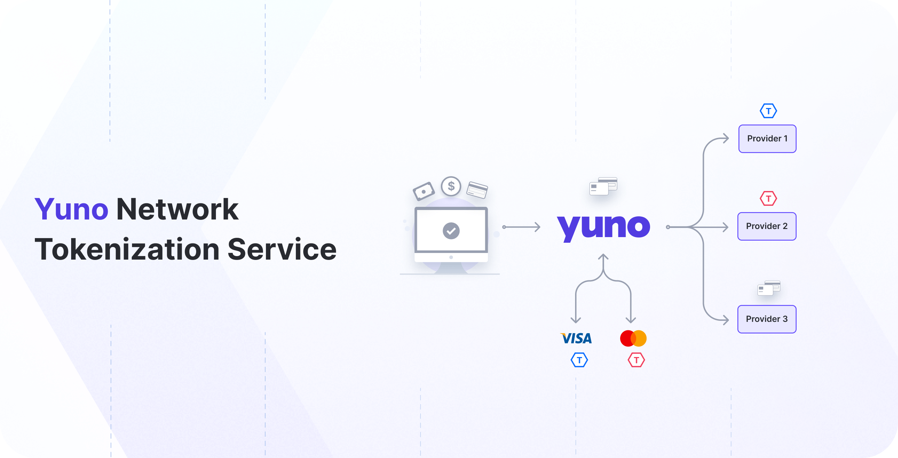
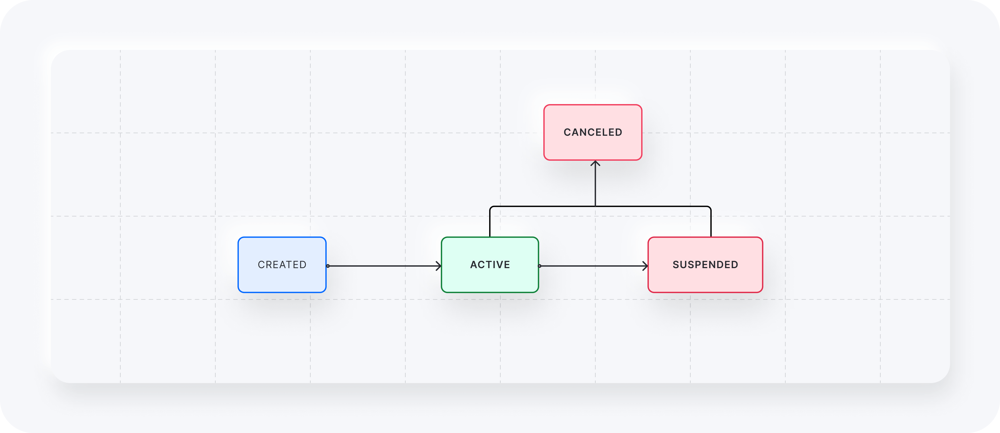

import NetworkTokenRequestFlag from '/snippets/es/network-token-request-flag.mdx';

Los network tokens representan un avance significativo en la industria del procesamiento de pagos y actúan como sustitutos digitales de los datos sensibles de las tarjetas de pago, incluidos los números de tarjeta de crédito. Emitidos por redes de pago como Visa, Mastercard y American Express, estos tokens están a la vanguardia de la mejora de la seguridad de las transacciones en nuestro panorama digital en constante evolución.

<Frame></Frame>

### Beneficios de los network tokens {#benefits-of-network-tokens}

* **Mayor seguridad**: Al reemplazar los datos reales de la tarjeta durante las transacciones, los network tokens desempeñan un papel fundamental en el fortalecimiento de las medidas de seguridad y reducen de forma significativa el riesgo de exposición a posibles casos de fraude.
* **Integración fluida**: Con un esfuerzo de integración mínimo que se ajusta a los estándares de network token de EMVCo, nuestra solución garantiza un proceso de implementación fluido y eficiente, que permite adaptarse con rapidez a diversos escenarios de pago.
* **Actualizaciones automáticas**: Los network tokens, administrados y actualizados automáticamente por las redes de tarjetas, contribuyen a reducir la fricción del comprador y los pagos rechazados. Esta adaptabilidad inherente asegura una mayor tasa de autorización en comparación con las transacciones sin network tokens.
* **Compatibilidad con autenticación**: Para mayor seguridad y tasas de aprobación más altas, puedes combinar los network tokens con [Network Token Authentication](/es/docs/payment-features/network-token-authentication), lo que habilita la autenticación del comprador respaldada por passkey directamente a través de las redes de tarjetas.

## Token de un solo uso vs token almacenado vs network token {#one-time-use-token-vs-vaulted-token-vs-network-token}

| Token de un solo uso | Token almacenado | Network token |
| :------------------------------------------------------------------------------------------------------------------------------------------------------------------------------------------------------------------------------------------------------------------------------------------------------------------------------------------------------------- | :------------------------------------------------------------------------------------------------------------------------------------------------------------------------------------------------------ | :------------------------------------------------------------------------------------------------------------------------------------------------------------------------------------------------------------------------------------------------------------------------------------------------------------------------------------------------ |
| Al usar el SDK de Yuno, recopilamos toda la información necesaria para procesar el pago y la almacenamos en un token de un solo uso, sin importar el método de pago elegido por el cliente. Usarás el token al crear el pago. Ten en cuenta que este token solo funciona una vez. Deberás generar un nuevo token de un solo uso por cada sesión de checkout creada. | Yuno crea un token almacenado cuando un método de pago se inscribe y se guarda junto con la información del cliente. Puedes usar el token almacenado creado para identificar el método de pago en pagos futuros. | Representaciones digitalizadas de información sensible de tarjetas de pago, como los números de tarjeta de crédito, emitidas por las principales redes de pago como Visa, Mastercard o American Express. Estos tokens sirven para sustituir los datos reales de la tarjeta en las transacciones y, de esta forma, mejoran la seguridad al minimizar la exposición a posibles actividades fraudulentas. |

Cuando la función de network tokens está habilitada, Yuno genera network tokens para todas las tarjetas inscritas y almacenadas de forma segura en nuestro vault. Este enfoque está plenamente alineado con el funcionamiento previsto de la tokenización de red, según lo definido por Visa y Mastercard, después de la validación de la tarjeta, lo que garantiza un mejor rendimiento, seguridad y confiabilidad en las transacciones recurrentes y futuras. Las tarjetas que no se almacenan en Yuno (como las tarjetas de un solo uso) quedan naturalmente excluidas de este proceso, ya que la tokenización de red no aplica en esos casos.

<Note>
**Inscripciones duplicadas**

Si la misma tarjeta se inscribe varias veces, cada inscripción crea un `vaulted_token` distinto. En el caso de los network tokens, Yuno usa un `network_token_fingerprint` que funciona como el fingerprint de la tarjeta y tiene alcance a nivel de tu organización y del identificador único del network token en el vault PCI. Esto significa que las inscripciones duplicadas del mismo PAN pueden corresponder al mismo network token. Usa el [Card Fingerprint](/es/docs/security-and-compliance/fingerprint) para detectar duplicados de tokens almacenados de tu lado.
</Note>

## Ciclo de vida de los network tokens {#network-tokens-lifecycle}

Los network tokens pueden tener los estados que se describen en la siguiente sección.

<Frame></Frame>

| Estado    | Descripción |
| --------- | ------------------------------------------------------------------------------------------------------------------------------- |
| Created   | El estado inicial de un network token que fue creado. |
| Active    | El network token está activo y se puede usar para realizar un pago. |
| Suspended | Los tokens pueden suspenderse si el titular de la tarjeta se comunica con el emisor y solicita que se bloqueen los pagos de un comercio en particular. |
| Canceled  | Los tokens pueden cancelarse por varios motivos, por ejemplo, porque se cerró la cuenta del titular de la tarjeta asociada al token. |

## Tipos de integración {#types-of-integration}

Para realizar pagos con network tokens, tienes dos opciones disponibles:

1. Dejar que Yuno aprovisione y recopile los network tokens.
2. Usar tus network tokens existentes.

### 1. Deja que Yuno aprovisione y recopile los network tokens {#1-let-yuno-provision-and-collect-network-tokens}

Obtenemos network tokens de las principales redes de tarjetas, incluidas Visa, Mastercard y American Express. Estos tokens se almacenan de forma segura dentro de la infraestructura de Yuno y se usan en lugar de las tarjetas reales durante el proceso de autorización.

No se necesita ninguna integración adicional para acceder a los beneficios de la tokenización de red cuando Yuno gestiona la solicitud y la acumulación de tokens en tu nombre. Solo sigue el flujo de pago estándar correspondiente a tu integración específica de pagos con tarjeta. Yuno gestiona el proceso sin fricciones, sustituye los datos de la tarjeta por un network token y logra mayores tasas de autorización.

Para activar los pagos con network tokens, comunícate con nuestro equipo de soporte para aprovisionar o solicitar las credenciales necesarias.

#### Ejemplo de respuesta {#response-example}

Durante la inscripción o la creación del pago, recibirás la información básica del network token usado en la operación correspondiente.

```json
{
    "description": "Test",
    "account_id": "{{account-code}}",
    "merchant_order_id": "0000023",
    "country": "DE",
    "merchant_reference" : "reference-{{$randomUUID}}",
    "amount": {
        "currency": "EUR",
        "value": 5000
    },
    "customer_payer": {
        "id":"967ecd18-d898-4b88-9400-dd5b01b18edc"
    },
    "workflow": "DIRECT",
    "payment_method": {
        "type":"CARD",
        "vaulted_token": "61d49d6e-7c0e-49d0-be79-7eb08871f998",
        "detail": {
           "card": {
               "network_token":{
                  "network":"MASTERCARD",
                  "status": "ACTIVE",
                  "par":"V0010014622074319305424002620",
                  "token_data":{
                    "iin":"45079900",
                    "lfd": "0010",
                    "expiration_month":"10",
                    "expiration_year":"2028",
                    "response":{
                      "code":"succeeded",
                      "message": "Transaction Succeeded"
                    }
                  }
              }
           }
        }
    }
  [...]
}
```

#### Elige por tarjeta {#choose-per-card}

<NetworkTokenRequestFlag />

El booleano `payment_method.network_token` es una opción de la solicitud. Es un campo distinto del objeto `payment_method.detail.card.network_token`, que contiene los datos del token que se muestran en el ejemplo de respuesta anterior y los network tokens que envías tú mismo (consulta la siguiente sección).

```json
{
    "payment_method": {
        "type": "CARD",
        "vaulted_token": "61d49d6e-7c0e-49d0-be79-7eb08871f998",
        "network_token": false
    }
}
```

### 2. Usa tus network tokens existentes {#2-use-your-existing-network-tokens}

Después de configurar las credenciales necesarias en tu cuenta de Yuno y de comunicarte con nuestro equipo de soporte, estarás listo para ejecutar transacciones tokenizadas sin inconvenientes.

<Danger>
  Con esta opción, Yuno actúa únicamente como intermediario de paso de la información del network token. El comercio debe proporcionar la información necesaria sobre los network tokens para que Yuno pueda compartirla con los socios de pago ascendentes.
</Danger>

Las transacciones con network tokens usan las solicitudes de API de transacción de pago existentes. Al igual que al crear un pago con los datos de una tarjeta de crédito, cuando un comercio usa la API de Yuno para finalizar un pago, puede optar por incluir el objeto "network\_token" para usar un network token en la transacción.

#### Campos de la solicitud de pago {#payment-request-fields}

Junto con el objeto `card_data`, estos campos deben agregarse al objeto `payment_method.detail.card.network_token.token_data` para enviar pagos con la API de Yuno.

| Campo                           | Tipo    | Descripción |
| ------------------------------- | ------- | ------------------------------------------------------------------------------------------------------------------------------------------------------------------------------------------------------- |
| `number`                        | number  | \[Obligatorio] - Número del token sin separadores. (MAX 19; MIN 8) - solo disponible para comercios con certificación PCI |
| `holder_name`                   | string  | Nombre completo del titular de la tarjeta tal como aparece en el token (MAX 26; MIN 2) - solo disponible para comercios con certificación PCI |
| `expiration_month`              | integer | \[Obligatorio] - Mes de vencimiento del token - MM (MAX 2; MIN 2) - solo disponible para comercios con certificación PCI |
| `expiration_year`               | integer | \[Obligatorio] - Año de vencimiento del token - YYYY (MAX 4; MIN 4) - solo disponible para comercios con certificación PCI |
| `cryptogram`                    | string  | \[Obligatorio] - El criptograma único generado por el emisor para el network token usado en la transacción. Opcional para transacciones recurrentes |
| `electronic_commerce_indicator` | string  | \[Solo obligatorio para ciertos proveedores] - Si el token fue autenticado por Mastercard, el campo debe establecerse en 02. Para Visa o tokens no autenticados, no es necesario enviar el campo. |
| `token_requestor_id`            | string  | \[Solo obligatorio para ciertos proveedores] - ID del solicitante del token del comercio |

#### Ejemplo de solicitud {#request-example}

```json
{
  "description": "Test",
    "account_id": "{{account-code}}",
    "merchant_order_id": "0000023",
    "country": "DE",
    "merchant_reference" : "reference-{{$randomUUID}}",
    "amount": {
        "currency": "EUR",
        "value": 5000
    },
    "customer_payer": {
        "id":"967ecd18-d898-4b88-9400-dd5b01b18edc"
    },
    "workflow": "DIRECT",
    "payment_method": {
        "type":"CARD",
        "detail": {
           "card": {
             "card_data": {
                "number": "4000000000001026",
                "holder_name": "John Doe",
                "expiration_month": 1,
                "expiration_year": 26,
                "security_code": "123"
              },
             "network_token":{
                  "token_data":{
                    "number":"4000000000001026",
                    "holder_name":"Jhohn Doe",
                    "expiration_month":1,
                    "expiration_year":26,
                    "cryptogram":"CCADBxYzRTBBXXXXXXXYZa0AbZD"
                  }
              }
           }
        }
    }
  [...]
}
```

#### Ejemplo de respuesta {#response-example-1}

```json
{
    "description": "Test",
    "account_id": "{{account-code}}",
    "merchant_order_id": "0000023",
    "country": "DE",
    "merchant_reference" : "reference-{{$randomUUID}}",
    "amount": {
        "currency": "EUR",
        "value": 5000
    },
    "customer_payer": {
        "id":"967ecd18-d898-4b88-9400-dd5b01b18edc"
    },
    "workflow": "DIRECT",
    "payment_method": {
        "type":"CARD",
        "detail": {
           "card": {
              "card_data": {
                        "holder_name": "John Doe",
                        "iin": "48710499",
                        "lfd": "9910",
                        "number_length": 16,
                        "security_code_length": 3,
                        "brand": "VISABANCONTACT",
                        "issuer_name": "BNP PARIBAS FORTIS NVSA",
                        "issuer_code": null,
                        "country_code": "BE",
                        "category": "CLASSIC",
                        "type": "DEBIT",
                        "expiration_month": 3,
                        "expiration_year": 30,
                        "fingerprint": "4d486017-afa0-4f2c-ba51-a09af528bd38"
                        [...]
                    }, 
              "network_token":{
                  "network":"MASTERCARD",
                  "status": "ACTIVE",
                  "par":"V0010014622074319305424002620",
                  "token_data":{
                    "iin":"45079900",
                    "lfd": "0010",
                    "holder_name":"Jhohn Doe",
                    "expiration_month":10,
                    "expiration_year":28,
                    "response":{
                      "code":"succeeded",
                      "message": "Transaction Succeeded"
                    }
                  }
              }
           }
        }
    }
  [...]
}
```