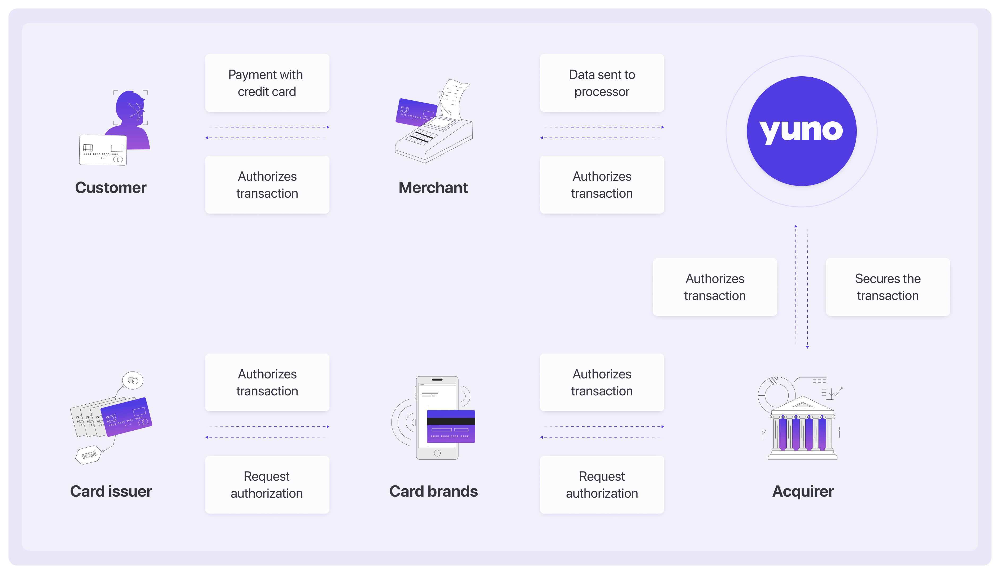
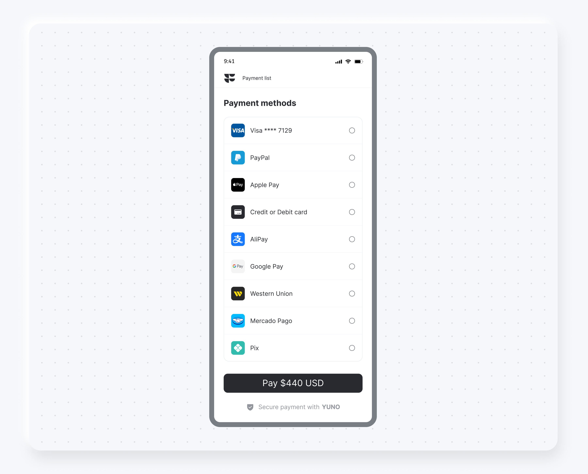

El Payment Card Industry Data Security Standard (PCI DSS) exige que toda empresa que almacene, procese o transmita datos de titulares de tarjetas cumpla con un conjunto definido de controles de seguridad. El incumplimiento puede generar multas de las marcas de tarjeta y una mayor responsabilidad en caso de una brecha de seguridad.

Al integrarte con Yuno, tus sistemas nunca almacenan ni transmiten datos de tarjeta sin procesar. La solución PCI DSS Nivel 1 de Yuno gestiona toda la información sensible de pago mediante tokenización, y reemplaza los datos de la tarjeta por un token no sensible antes de que lleguen a tu infraestructura. Esto reduce de forma significativa tu alcance de PCI y el esfuerzo de validación requerido.

<Frame></Frame>

## Cómo Yuno reduce tu alcance de PCI {#how-yuno-reduces-your-pci-scope}

Cuando te integras usando los SDK de Yuno (Full Checkout, Lite Checkout o Secure Fields), los datos sensibles de la tarjeta fluyen directamente entre el navegador o la app del cliente y el entorno seguro de Yuno. Tus servidores reciben únicamente tokens.

Esto significa que la mayoría de los comercios que usan el SDK de Yuno califican para el **SAQ A** (el cuestionario de autoevaluación de PCI más corto, compuesto por solo 22 preguntas), en lugar del SAQ D completo, que tiene 329 preguntas y se requiere cuando un comercio almacena o procesa datos de tarjeta directamente.

<Note>
**Direct Flow**

Si tu integración usa el [Direct Flow](/es/docs/direct-integration-use-cases/direct-flow), tu empresa gestiona los datos de tarjeta directamente y debe proporcionar un Attestation of Compliance (AOC) firmado por tu empresa y un auditor certificado.
</Note>

## Qué te aporta la tokenización {#what-tokenization-gives-you}

Además del cumplimiento, la tokenización de Yuno ofrece beneficios prácticos para tus operaciones de pago:

* **Checkout con un clic**: Los clientes recurrentes pagan con un solo toque usando su vaulted token almacenado
* **Facturación recurrente y de suscripción**: Los métodos de pago tokenizados se reutilizan sin problemas a lo largo de los ciclos de facturación
* **Portabilidad entre procesadores**: Un único vaulted token funciona con todos los procesadores conectados a tu cuenta de Yuno
* **Menos rechazos**: Los network tokens se actualizan automáticamente cuando las tarjetas se renuevan o se reemiten

Para ver un desglose completo de los tipos de token y cómo funcionan, consulta [Tokens](/es/docs/basic-concepts/tokens).

<Frame></Frame>

## Cómo elegir una integración de SDK {#choosing-an-sdk-integration}

Las integraciones de SDK de Yuno están disponibles para web (JavaScript) y móvil (iOS, Android, Flutter). Consulta la [guía del SDK](/es/docs/sdks/overview/quickstart) para elegir la integración adecuada para tu caso de uso.

Para más información sobre los requisitos de PCI DSS y los cuestionarios de autoevaluación, consulta el [PCI Security Standards Council](https://www.pcisecuritystandards.org/) y la [PCI Document Library](https://www.pcisecuritystandards.org/document_library/?category=saqs#results).