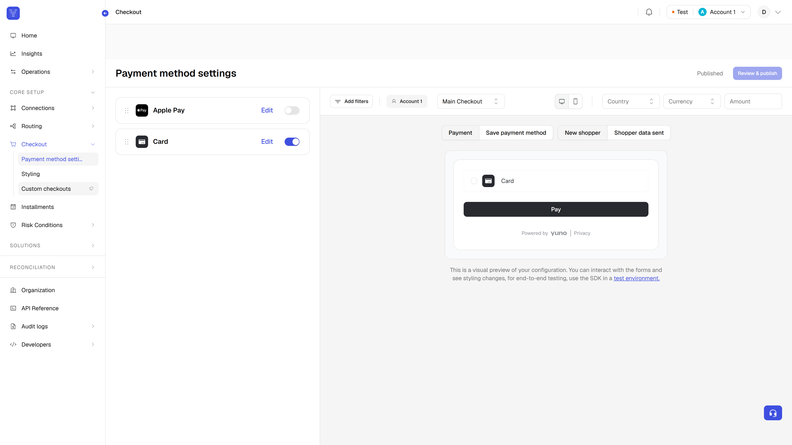
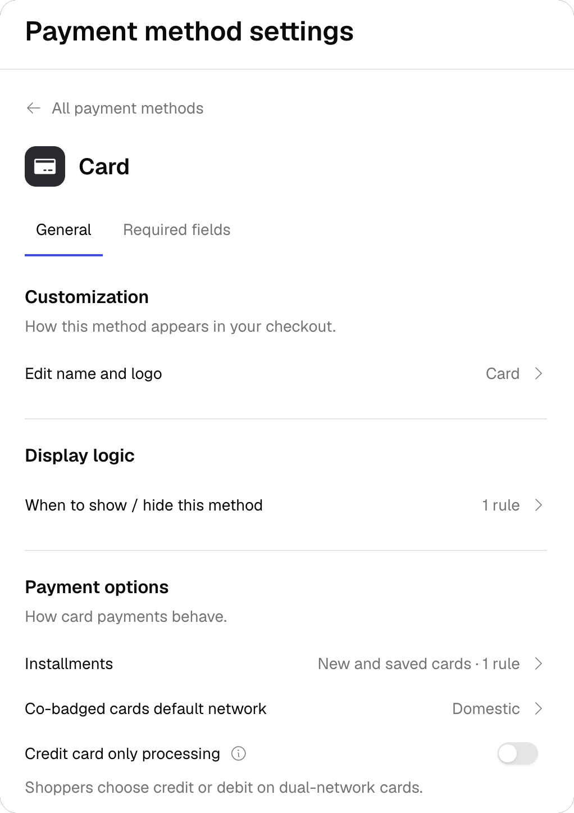
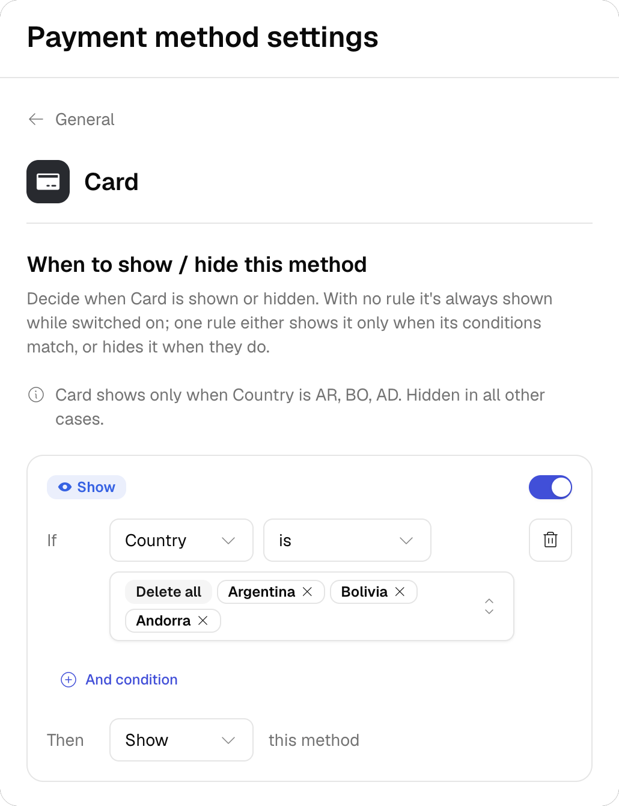
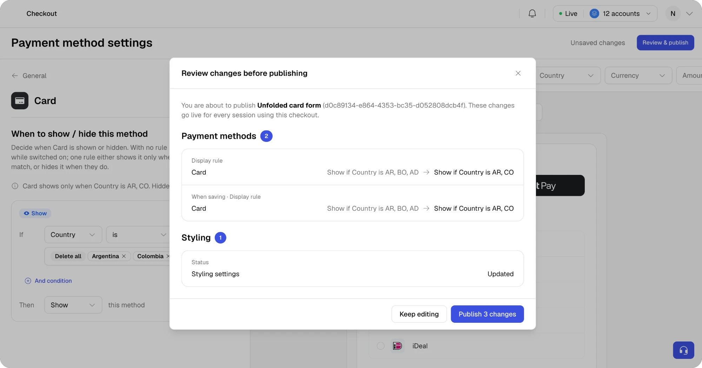
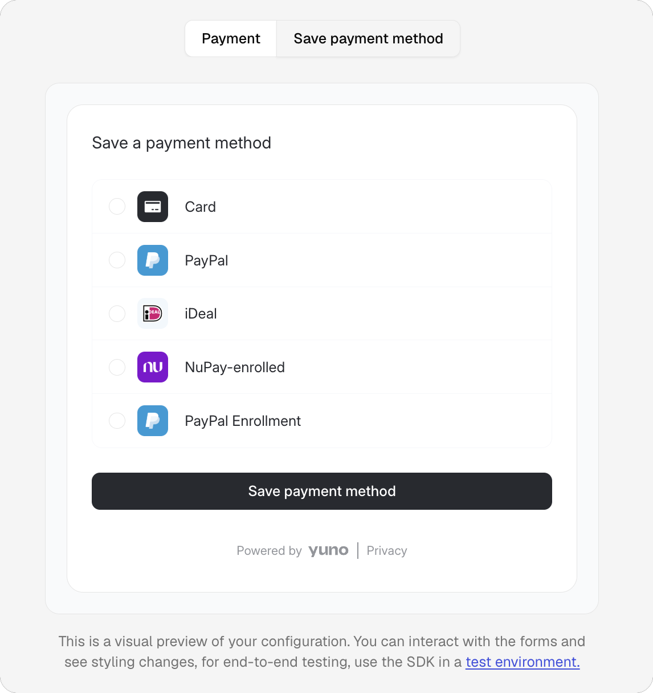

La sección **Payment method settings** del Checkout Builder se ha reconstruido. Se está implementando de forma gradual, cuenta por cuenta, por lo que durante un tiempo conviven dos versiones. Esta página describe qué cambia para ti cuando tu cuenta pasa a la nueva versión. **Styling settings** se mantiene exactamente igual, y la vista previa en vivo sigue funcionando de la misma manera, con una adición descrita más abajo.

<Note>
  **Cómo saber qué versión tienes.** La nueva versión muestra una fila por método de pago con un botón **Edit**, y el botón del encabezado dice **Review & publish**. La versión actual muestra dos listas (**Enrolled** y **Non-enrolled payment methods**), un menú de **tres puntos (⋯)** en cada fila y un botón **Publish settings**. Si ves esta última, nada de lo que aparece en esta página aplica todavía para ti: sigue usando la página de [Checkout Builder](/es/docs/using-yuno/dashboard-overview/checkout-builder).
</Note>

## Qué cambió de un vistazo {#what-changed-at-a-glance}

| Área | Antes | Ahora |
| :--- | :--- | :--- |
| Lista de métodos de pago | Dos listas, **Enrolled** y **Non-enrolled payment methods**. | Una sola lista para todos los métodos de pago. Los métodos de tarjeta y débito directo (ACH, Bacs, PAD, SEPA) son un único elemento que cubre tanto el flujo nuevo como el guardado; su flujo guardado se activa desde la página del método. |
| Edición de un método | Un menú de **tres puntos (⋯)** por fila abría un panel distinto para cada configuración: **Edit name and logo**, **Set Conditions**, **Set Required fields**. | **Edit** abre una página por método con dos pestañas, **General** y **Required fields**. |
| Condiciones de visualización | Conjuntos de condiciones con nombre creados desde una ventana emergente (**Add new condition**), varios conjuntos por método. | **Display logic** en la pestaña General: una regla por método, escrita como una oración en lenguaje sencillo. |
| Cuotas | Un interruptor dentro del panel **Required fields**. | **Payment options** en la página de Card, con su propia regla de visualización. |
| Botones exprés | Los decidían el SDK y el estilo de la lista. | Un interruptor **Render as express button** por billetera. Hasta tres, ordenados según tu lista. |
| Campos de dirección | Solo dirección de facturación, o facturación y envío. | La dirección de envío también se puede solicitar por separado. |
| Tipos de documento | Un panel al que se accedía desde cada método. | Una única ventana global **Document types** a la que se accede desde el campo Document. |
| Copia a otras cuentas | En el menú de **tres puntos (⋯)**. | **Manage [method] on other accounts** en la pestaña General. |
| Publicación | **Publish settings** aplicaba todos los cambios pendientes a la vez. | **Review & publish** lista cada cambio, antes y después, y lo confirmas desde ahí. |
| Vista previa | Mostraba solo el flujo de pago. | Un interruptor **Payment** / **Save payment method** sobre la vista previa muestra cualquiera de los dos flujos. |

## Una lista para todos los métodos de pago {#one-list-for-every-payment-method}

Los métodos inscritos y no inscritos ahora comparten una sola lista. Cada fila tiene un interruptor de activación, un control para arrastrar y un botón **Edit**.

<Frame></Frame>

- **Orden.** Arrastra las filas para reordenarlas. El orden es el que ven tus compradores, y también decide qué billeteras se convierten en botones exprés cuando hay más de tres activadas.
- **Un elemento para nuevo y guardado.** **Card** y los métodos de débito directo (**ACH**, **Bacs**, **PAD**, **SEPA**) ya no tienen una fila inscrita por separado. Cada uno es un único elemento que cubre ambos flujos, y el flujo guardado se activa o desactiva desde la página del método, con **Show shoppers their saved cards** o **Show shoppers their saved bank accounts** en la pestaña General. Otros métodos que se pueden guardar, como las billeteras, mantienen su propio elemento guardado en la lista, como antes.
- **Métodos guardados en el checkout.** Los métodos que un comprador recurrente ha guardado se siguen mostrando por encima del resto de la lista, sin importar el orden en el Builder. Esto no ha cambiado.
- **Activar o desactivar.** El interruptor de cada fila reemplaza los interruptores de las dos listas anteriores. Un método sigue necesitando una ruta publicada para aparecer aquí.

## Una página por método {#one-page-per-method}

**Edit** abre la página del método. La pestaña **General** agrupa todas las configuraciones que antes estaban en paneles separados:

<Frame></Frame>

| Sección | Qué contiene | Se muestra para |
| :--- | :--- | :--- |
| **Personalización** | **Edit name and logo**, como antes. **Card brands** en Card, consulta [Marcas de tarjeta](#card-brands). **Render as express button** para las billeteras que lo admiten. | Todos los métodos; **Card brands** solo para Card; el interruptor exprés solo para billeteras compatibles con botones exprés. |
| **Display logic** | Cuándo mostrar u ocultar este método. Consulta [Display logic](#display-logic). | Todos los métodos. |
| **Payment options** | **Installments** (movido aquí desde Required fields), **Co-badged cards default network** (Domestic o International) y procesamiento solo de crédito para tarjetas de doble red. | Card. |
| **Consent management** | El interruptor **Debit authorization text** documentado en [Authorization text](/es/docs/using-yuno/dashboard-overview/checkout-builder#authorization-text). | Métodos de débito directo. |
| **Saved cards** / **Saved bank accounts** | **Show shoppers their saved cards** (o cuentas bancarias). Los compradores recurrentes pueden pagar con lo que guardaron antes. Si se ofrece a los compradores guardar durante un pago se define en tu integración del SDK, no aquí. | Card y los métodos de débito directo (ACH, Bacs, PAD, SEPA). |
| **Accounts** | **Manage [method] on other accounts**, el antiguo **Copy to other accounts**. | Organizaciones con más de una cuenta. |

La pestaña **Required fields** mantiene los mismos campos que antes, con tres cambios:

- Los campos que un proveedor hace obligatorios muestran el logo del proveedor junto al interruptor, con un tooltip **Required by …**. No se pueden desactivar desde el Builder.
- Cada campo puede tener su propia regla de visualización. Abre el campo y haz clic en **Add condition** para mostrarlo u ocultarlo por país, moneda, monto o metadata.
- **Document** abre la ventana global **Document types**. Aplica a todos los métodos de pago del checkout, y es la única configuración global en esta versión.

<Note>
  **Card y tarjetas guardadas.** La página de Card tiene un segundo bloque, **When this method is saved**, para los campos que los compradores completan al pagar con una tarjeta guardada. Marca **Apply these settings when shoppers save this method** para reutilizar la configuración principal, o desmárcala para configurar los campos de la tarjeta guardada por separado. Las reglas de visualización de los campos requeridos de Card aplican a ambos flujos.
</Note>

## Display logic {#display-logic}

Las condiciones ahora se escriben como una oración: **If** un atributo **is** o **is not** ciertos valores, **Then** **Show** o **Hide** este método. El Builder mantiene la oración actualizada mientras editas, por ejemplo *Card shows only when Country is Brazil, Mexico. Hidden in all other cases.*

<Frame></Frame>

- **Atributos:** Country, Currency, Amount y Metadata. Country y Currency aceptan varios valores. Amount acepta mayor que, menor que, entre e igual a. Metadata recibe una clave y un valor, que se comparan solo con **is** o **is not**, y una regla puede contener varias condiciones de metadata.
- **Una regla por método y una por campo requerido.** Los atributos dentro de una regla se combinan con AND.
- **Amount necesita una sola moneda.** El atributo Amount no se ofrece mientras haya dos o más monedas seleccionadas en la misma regla.
- **Resultado.** Cada regla es **Show** o **Hide**. Un método sin regla se muestra siempre mientras esté activado.

Tus condiciones existentes se conservan. Los valores guardados como *equal* o *not equal* se leen como **is** e **is not**.

<Note>
  Las cuentas que tienen **más de un conjunto de condiciones activo en el mismo método de pago** se quedan por ahora en la versión actual, con sus configuraciones intactas.

  Lo mismo aplica a las cuentas cuyas condiciones comparan **metadata con mayor que o menor que**: la nueva versión solo ofrece **is** e **is not** para metadata, por lo que esas reglas no se pueden editar en ella. Se quedan en la versión actual hasta que se reescriban las reglas.
</Note>

## Marcas de tarjeta {#card-brands}

**Card brands**, en la pestaña General de la página de Card, define con qué marcas de tarjeta pueden pagar los compradores en este checkout y si ven los logos de esas marcas.

<Note>
  **Card brands** se está activando cuenta por cuenta. Si la página de Card no lo muestra, consulta con tu contacto de Yuno.
</Note>

- **Don't block any brand** deja el checkout como está hoy: se acepta cualquier marca.
- **Only accept some brands** acepta solo las marcas que actives. Se rechaza cualquier tarjeta de otra marca y no se ofrecen las tarjetas guardadas del comprador de esa marca. Para publicar necesitas al menos una marca.

Aceptar una marca aquí no la agrega a tu ruteo. Verifica que tus proveedores procesen todas las marcas que aceptas, o esos pagos van a fallar.

### Condiciones por país y moneda {#conditions-by-country-and-currency}

Haz clic en **Add condition** en una marca para aceptarla solo en algunos países, algunas monedas o ambos. Cada sesión de checkout se evalúa con su propio país y su propia moneda. Por ejemplo, con Visa aceptada en todos los casos y Mastercard solo en MYR, una sesión en MYR acepta Visa y Mastercard, y una sesión en THB acepta solo Visa.

Cuando no se acepta ninguna marca para el país y la moneda de una sesión, el checkout no muestra **Card** ni las tarjetas guardadas del comprador.

### Mostrar los logos de las marcas {#show-brand-logos}

**Show brand logos** muestra los logos de las marcas con las que el comprador puede pagar: junto a **Card** en la [lista de métodos de pago](/es/docs/yuno-sdk/features/payment-methods-list), o dentro del campo del número de tarjeta cuando montas el formulario de tarjeta solo con `transaction.start({ paymentMethod: { type: 'CARD' } })`. Yuno define el orden de los logos para cada país.

Nunca aparece el logo de una marca con la que el comprador no puede pagar. Apagar los logos cambia solo lo que ven los compradores, nunca qué marcas aceptas.

### Qué ven los compradores {#what-shoppers-see}

Con el Yuno SDK para Web 2.9.0 o posterior, una tarjeta de una marca que no aceptas se rechaza mientras el comprador la escribe: el campo del número de tarjeta muestra un mensaje como *Mastercard no se acepta. Usa Visa.* y **Pay** queda deshabilitado. Los logos de las marcas también necesitan esta versión.

Con otros SDK y versiones las reglas se siguen aplicando, pero el comprador solo se entera al pagar: la solicitud del token se rechaza con [`CARD_BRAND_NOT_ACCEPTED`](/es/reference/checkout-sessions/create-one-time-use-token-sdk-checkout#card-brand-not-accepted).

Un cambio que publicas aplica a los checkouts que se cargan después. Un checkout que ya está abierto mantiene las marcas que cargó. Si su comprador paga después con una marca que ya no aceptas, el token se rechaza y el Yuno SDK para Web muestra el mensaje de marca no aceptada en el formulario de tarjeta.

La configuración aplica solo a los pagos. **Save payment method** no tiene restricción: un comprador puede guardar una tarjeta de una marca que no aceptas, y esa tarjeta guardada después no se ofrece al pagar.

**Review & publish** lista las marcas agregadas y quitadas y la condición de cada marca, antes y después.

## Review & publish {#review--publish}

**Publish settings** se reemplaza por **Review & publish**. Nada se publica hasta que lo confirmes desde la revisión.

1. Mientras editas, el encabezado muestra **Unsaved changes**. Los cambios se conservan en el Builder, y el checkout en vivo no se toca.
2. Haz clic en **Review & publish**. El diálogo lista cada cambio pendiente agrupado por **Payment methods**, **Method settings**, **Required fields** y **Styling**, con el valor antes y después. Los cambios que aplican al flujo de tarjeta guardada se marcan como **When saving**.
3. Haz clic en **Publish N changes**. El encabezado cambia a **Published** con la fecha de publicación.

<Frame></Frame>

Salir del Builder con cambios sin guardar te pide confirmar, porque los cambios no publicados se descartan.

## Vista previa: pago o guardar método de pago {#preview-payment-or-save-payment-method}

La vista previa en vivo incorpora un interruptor en la parte superior con dos opciones:

- **Payment** muestra el checkout que ve un comprador al pagar: botones exprés, métodos guardados como una tarjeta que termina en 1234, y el resto de la lista, en el orden que definiste.
- **Save payment method** muestra el checkout de inscripción, titulado **Save a payment method**: solo los métodos que un comprador puede guardar, con un botón **Save payment method** en lugar de **Pay**.

<Frame></Frame>

Úsala para revisar ambos flujos mientras editas un método, en particular los campos **When this method is saved** en Card y los interruptores **Show shoppers their saved cards** y **Show shoppers their saved bank accounts**. Los filtros de Country, Currency y Amount, y el formulario interactivo, funcionan en ambos.

## Dirección de envío por separado {#shipping-address-on-its-own}

La pestaña **Required fields** te permite solicitar **Shipping address** sin **Billing address**. Antes, el envío solo se podía recopilar junto con la facturación. El Web SDK muestra el formulario de envío por sí solo en ese caso.

## Un breve recorrido la primera vez que lo abres {#a-short-tour-the-first-time-you-open-it}

La primera vez que abres la nueva versión, el Builder te guía por la lista, una página de método, los campos requeridos, la vista previa y **Review & publish**. El recorrido usa datos de demostración: no se publica nada y tu checkout en vivo se queda como está. Puedes omitirlo desde el primer paso.

## Qué no cambió {#what-did-not-change}

- **Styling settings**, incluido **Payment method list style** (visualización desplegada, método de pago preseleccionado, vista de checkout condensada, edición de la lista de métodos de pago y apilado de botones exprés), **Colors** (incluidos los colores de campo y de fondo secundario), **Typography** y **Form styles**.
- **Las herramientas de estilo de los formularios que recopilan datos**, incluida la personalización de la etiqueta **Button text**, el interruptor **Yuno Pay button** y **Display ‘Powered by Yuno’ tag**. Ten en cuenta que **Credit card only processing** se ha movido a la página del método Card, en **Payment options**, en la interfaz rediseñada.
- **La vista previa en vivo**, su formulario interactivo y los filtros de Country, Currency y Amount, salvo por el nuevo interruptor **Payment** / **Save payment method**. Los botones exprés siguen los interruptores que definas por billetera.
- **Los checkouts personalizados** y el selector de checkout sobre la vista previa.
- **Authorization text** para los métodos de débito directo, que ahora se accede desde la pestaña General.
- **Tu integración del SDK.** La nueva sección escribe la misma configuración que el SDK ya lee. No necesitas cambiar código de tu lado.
