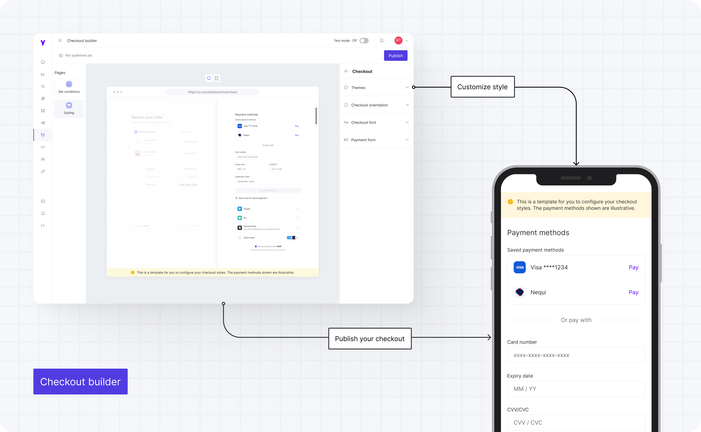
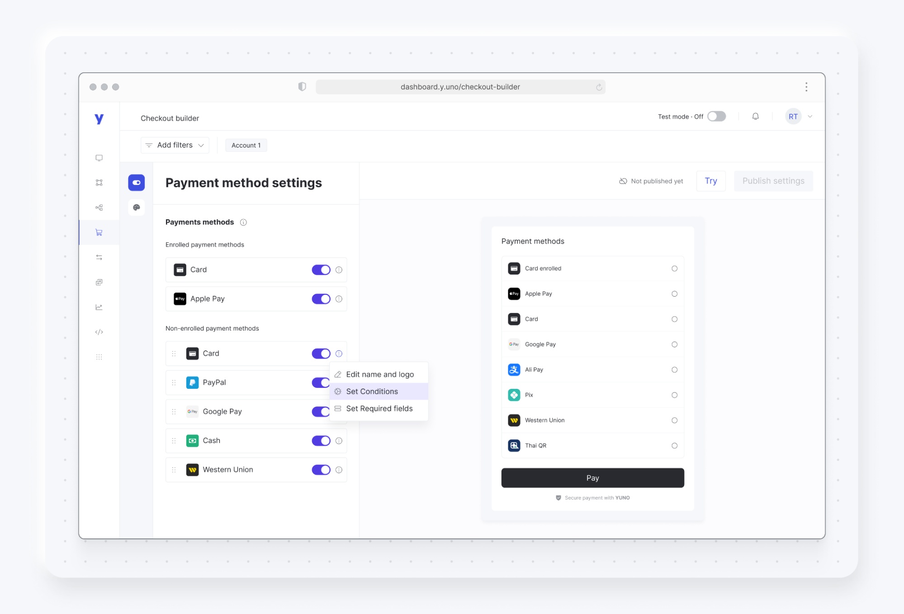
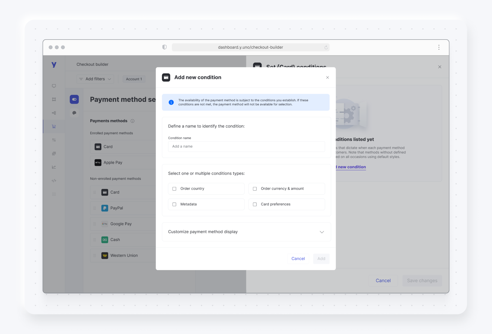
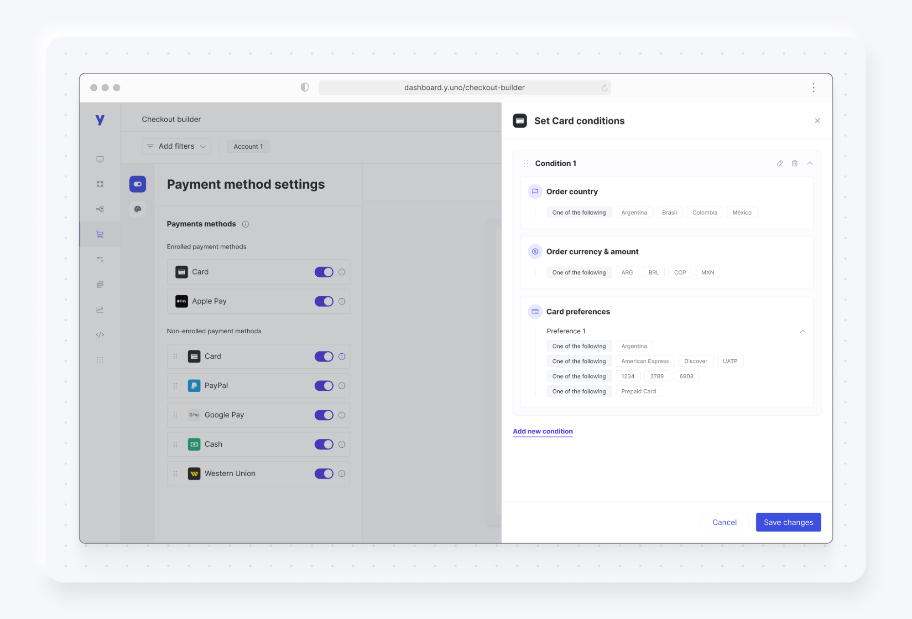
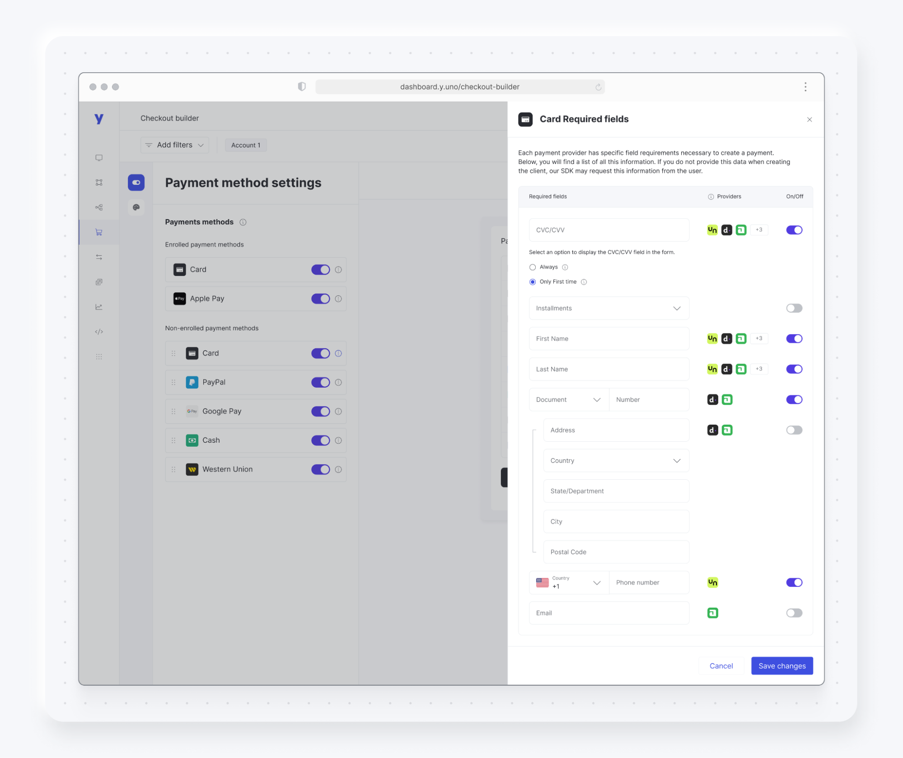
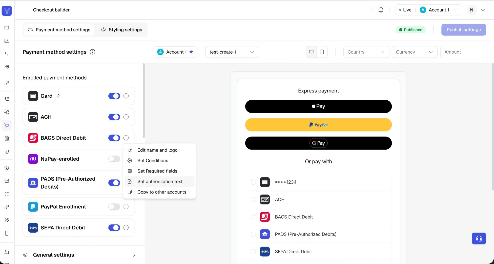
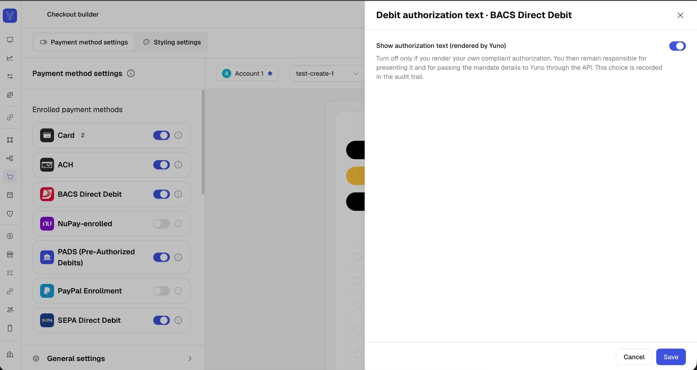
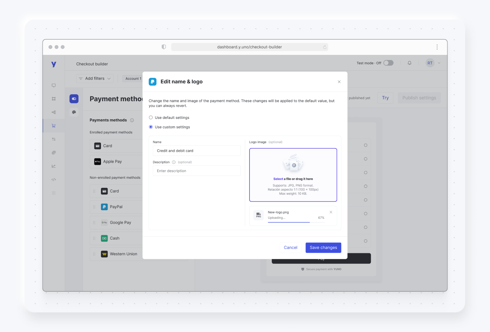

<Note>
  La sección **Payment method settings** se está rediseñando y se lanza cuenta por cuenta. Si la tuya muestra una sola lista de métodos de pago, un botón **Edit** por método y un botón **Review & publish**, tu cuenta usa la nueva versión: consulta [la nueva Payment method settings](/es/docs/using-yuno/dashboard-overview/checkout-builder-new-payment-method-settings). Todo lo demás de esta página sigue aplicando.
</Note>

El Checkout Builder es una herramienta sin código diseñada para personalizar tu experiencia de checkout. Incluye dos módulos principales:

* **Payment method settings**: Habilita los métodos de pago que tienen una ruta publicada para mostrarlos a tus clientes. Además, puedes definir en qué circunstancias se muestran métodos de pago específicos.
* **Checkout styling**: Ajusta los elementos visuales del checkout para dispositivos de escritorio y móviles, incluidos los colores y la tipografía. Así, la experiencia de checkout es coherente con tu marca.

Cualquier cambio realizado con el Checkout Builder se refleja de inmediato en el checkout que ven los usuarios, lo que ofrece una forma sencilla de gestionar y adaptar la experiencia de checkout a las necesidades de tu negocio.
<Frame></Frame>
## Ventajas de usar Checkout Builder {#advantages-of-using-checkout-builder}

* **Personalización sin código**: Disfruta de la flexibilidad de adaptar tu experiencia de checkout sin necesidad de programación compleja. Esto te permite crear un proceso de checkout alineado con tu marca y tus objetivos de negocio.
* **Flexibilidad de métodos de pago**: Habilita, organiza y muestra con facilidad los métodos de pago que mejor se ajustan a tu base de clientes y a tu mercado.
* **Interfaz intuitiva**: La interfaz de Yuno hace muy sencillo configurar métodos de pago, definir condiciones de visualización y personalizar el estilo.

## Payment method settings {#payment-method-settings}

Este módulo te permite configurar y personalizar los métodos de pago que se usan en la experiencia de checkout. Además de activar métodos de pago, puedes ajustar el orden en que se muestran, personalizar su apariencia, definir campos obligatorios y determinar las condiciones para mostrar cada método de pago. Esta amplitud de personalización asegura que la experiencia de checkout se ajuste a tu audiencia y a tu caso de uso específico.

Debes hacer clic en **Publish settings** en el Checkout Builder para aplicar todos los cambios al checkout.

<Note>
  **Estado de publicación**: junto a **Publish settings**, el Checkout Builder muestra una insignia de estado con dos valores posibles, **Published** o **Not published**. Refleja tu estado real de publicación: los cambios que guardas aparecen como **Not published** hasta que haces clic en **Publish settings**, y cambian a **Published** cuando la publicación termina y los cambios se despliegan en el checkout.
</Note>

### Condiciones {#conditions}

Puedes controlar cuándo aparece un método de pago en el checkout definiendo condiciones de visualización basadas en criterios como el país, el monto, la moneda de la orden o los metadatos de la integración. Para configurar estos ajustes:

<Steps>
  <Step title="Inicia las condiciones">
    Junto al método de pago, haz clic en el ícono de tres puntos y selecciona **Set Conditions**. Haz clic en **Add new condition** en la ventana emergente.
    <Frame></Frame>
  </Step>
  <Step title="Define las especificaciones">
    Ingresa un nombre descriptivo y selecciona parámetros como el país de la orden, la moneda o los metadatos.
    <Frame></Frame>
  </Step>
  <Step title="Completa la configuración">
    Completa los campos que aparecen según las especificaciones que seleccionaste.
    <Frame></Frame>
  </Step>
</Steps>

### Campos obligatorios {#required-fields}

Los campos obligatorios especifican la información que los usuarios deben proporcionar al usar cada método de pago. Algunos métodos de pago requieren datos específicos para procesar pagos, y Yuno puede solicitarlos aunque no los hayas especificado. Yuno simplifica el proceso de agregar o quitar los campos deseados mediante su interfaz de usuario. 

El panel **Required Fields** del Checkout Builder te permite recopilar direcciones de facturación y de envío como dos formularios independientes durante el checkout. La dirección de facturación se usa para la verificación de la tarjeta (AVS) y para integraciones con proveedores como Stripe y Adyen, mientras que la dirección de envío se usa para la entrega física.

<Note>
  **Requisito de versión del SDK**: Esta función solo está disponible en **Web SDK v1.7 o posterior**. Los comercios con versiones anteriores del SDK no verán los nuevos formularios de dirección, aunque la configuración esté habilitada en el Checkout Builder.
</Note>

#### Dónde encontrarlo {#where-to-find-it}

1. Abre el **Checkout Builder** en el Yuno Dashboard.
2. En **Payment method settings**, haz clic en los **tres puntos (⋯)** del método de pago que quieres configurar y selecciona **Set Required fields**.
3. Busca la sección **Address configuration** en el panel lateral **Required Fields**.

<Note>
  Este ajuste es **por método de pago**, no global. Repite la configuración para cada método de pago que deba recopilar direcciones.
</Note>

#### Cómo configurarlo {#how-to-configure}

1. En la sección **Address configuration**, activa el interruptor (**on**).
2. Elige el modo de dirección:
   - **Billing Address only**
   - **Billing & Shipping Address**
3. Haz clic en **Save changes**.
4. Vuelve al Checkout Builder y haz clic en **Publish settings** para que los cambios surtan efecto en el checkout en vivo.

<Frame></Frame>

No se requieren parámetros adicionales del SDK en la integración del comercio: siempre que esté integrado Web SDK v1.7 o posterior, los formularios de dirección se muestran automáticamente según la configuración del Checkout Builder.

#### Configuración disponible {#available-configuration}

| Setting                                | Descripción                                                                                                                        | Lo que ve el cliente en el SDK                                                                                                                                                                    |
| -------------------------------------- | ---------------------------------------------------------------------------------------------------------------------------------- | ---------------------------------------------------------------------------------------------------------------------------------------------------------------------------------------------------- |
| **Address configuration toggle: OFF** | Interruptor principal desactivado.                                                                                                            | No se muestra ningún formulario de dirección en el checkout.                                                                                                                         |
| **Billing Address only**               | Solo se recopila el formulario de dirección de facturación. Úsalo cuando solo necesites datos de facturación para AVS o verificación (por ejemplo, bienes digitales). | Se muestra un único formulario **Billing address** en la parte inferior del checkout.                                                                                                                         |
| **Billing & Shipping Address**         | Están disponibles ambos formularios, el de facturación y el de envío.                                                                             | El SDK muestra un formulario **Shipping address**, seguido de una casilla **"Billing address is the same as shipping address"**. El formulario **Billing address** solo aparece cuando la casilla está desmarcada. |

<Note>
  La casilla "Billing address is the same as shipping address" es únicamente un elemento de UX del Web SDK. **No** se puede configurar desde el Checkout Builder. Aparece automáticamente siempre que la facturación y el envío están habilitados.
</Note>

#### Notas importantes {#important-notes}

- **Compatibilidad con versiones anteriores:** Los checkouts existentes que solo tenían habilitado `billing_address` siguen funcionando exactamente igual que antes: los campos de dirección anteriores se asignan a la dirección de facturación. No se requiere ninguna acción para los comercios que no quieran recopilar la dirección de envío.
- **Código postal independiente:** El campo de código postal se puede usar de forma independiente (sin otros campos de dirección) para todos los proveedores y todos los flujos del SDK. Cuando el código postal está habilitado y los demás campos de dirección están deshabilitados, el backend permite valores nulos en todos los campos de dirección excepto en el código postal. Si tanto el código postal como los campos de dirección están habilitados en el Checkout Builder, el backend da prioridad a los campos de dirección sobre el código postal.
- **Configura en periodos de poco tráfico:** Publicar cambios en los campos obligatorios afecta de inmediato a todas las sesiones de checkout posteriores. Los clientes que estén en medio de una sesión en curso pueden ver formularios inconsistentes durante el periodo de propagación. Recomendamos configurar y publicar este ajuste en periodos de poco tráfico para minimizar el impacto.

En los campos obligatorios, también puedes configurar el comportamiento de las tarjetas inscritas. Puedes configurar si se solicita el CVV en cada transacción o solo durante el primer pago del cliente.

### Texto de autorización {#authorization-text}

Los métodos de pago de débito directo (ACH, SEPA Direct Debit, Bacs, PAD e iDEAL cuando se guarda la cuenta) requieren que el comprador vea el texto del mandato o de la autorización antes de completar el pago. El panel **Authorization text** controla si Yuno muestra ese texto por ti o si lo deja en manos de tu propia implementación de checkout.

#### Dónde encontrarlo {#where-to-find-it-1}

1. Abre el **Checkout Builder** en el Yuno Dashboard.
2. En **Payment method settings**, haz clic en los **tres puntos (⋯)** de cualquier método de pago de débito directo (por ejemplo, **BACS Direct Debit**) y selecciona **Set authorization text**.

<Frame></Frame>

Esto abre el panel lateral **Debit authorization text · [Payment method name]** (por ejemplo, *Debit authorization text · BACS Direct Debit*).

<Frame></Frame>

<Note>
  Este ajuste es **por método de pago**, no global. Repite la configuración para cada método de pago de débito directo que habilites.
</Note>

#### Cómo configurarlo {#how-to-configure-1}

1. En el panel lateral, define el interruptor **Show authorization text (rendered by Yuno)**.
2. Haz clic en **Save**.
3. Vuelve al Checkout Builder y haz clic en **Publish settings** para que los cambios surtan efecto en el checkout en vivo.

La vista previa del Builder muestra en vivo el texto exacto de la autorización mientras activas o desactivas el ajuste, para que puedas revisarlo antes de publicar.

#### Configuración disponible {#available-configuration-1}

| Setting                                                      | Descripción                                                                                                        | Lo que ve el cliente en el SDK                                                                             |
| ------------------------------------------------------------- | --------------------------------------------------------------------------------------------------------------------------- | ---------------------------------------------------------------------------------------------------------------------------- |
| **Show authorization text (rendered by Yuno): ON**  | Yuno muestra el texto de autorización o mandato del esquema para ese método de pago.                                              | El checkout muestra el texto de autorización de Yuno debajo de los campos bancarios. Consulta [Consentimiento de débito directo](/es/docs/sdks/resources/references/web#direct-debit-consent) para ver el comportamiento completo del SDK. |
| **Show authorization text (rendered by Yuno): OFF** | Para los comercios que muestran su propia autorización conforme a la normativa en lugar de la de Yuno. El comercio sigue siendo responsable de presentarla y de enviar los detalles del mandato a Yuno mediante la API (`payment_method.detail.bank_transfer.mandate` en [Create Payment](/es/reference/payments/create-payment)). | El checkout no muestra ningún texto de autorización; el comercio es responsable de mostrar en otro lugar un texto de mandato conforme a la normativa. |

<Note>
  Esta elección del interruptor queda registrada en el registro de auditoría.

  El interruptor también permanece **bloqueado**, con un tooltip explicativo, mientras la configuración de la conexión del método de pago esté incompleta. El texto de autorización solo se muestra con valores reales de negocio o acreedor: nunca se muestra con valores de marcador de posición.
</Note>

### Estilo de la lista de métodos de pago {#payment-method-list-style}

Además de las condiciones de visualización y los campos obligatorios, el Checkout Builder te permite controlar cómo se comporta la propia lista de métodos de pago para tus clientes:

- **Unfolded display**: muestra el formulario del método de pago seleccionado directamente en la lista de métodos de pago, en lugar de abrir una ventana modal aparte, para que los clientes completen un pago con menos clics. Los formularios de tarjeta se abren en línea en todos los SDK. En iOS y Android, los métodos de pago alternativos también se abren en línea desde el SDK 2.22.0.
- **Preselected payment method**: muestra un método de pago preseleccionado cuando se carga el checkout, en lugar de mostrar la lista sin nada seleccionado.
- **Condensed checkout view**: reduce el desorden visual al mostrar solo el método de pago preseleccionado. Las demás opciones siguen disponibles en **View more**.
- **Edit payment method list**: permite que los clientes vean sus propios métodos de pago inscritos y los eliminen directamente desde la lista.
- **Express button stacking**: controla cómo se organizan varios botones de pago exprés (como Apple Pay, Google Pay o PayPal) en la parte superior del checkout. Elige **Horizontal** (los botones quedan lado a lado en una sola línea, lo que aumenta el área táctil y minimiza la pérdida de espacio vertical) o **Vertical** (los botones se apilan en una columna de ancho completo, uno por línea).

Estas opciones se configuran desde la sección Styling del Checkout Builder, en **Payment method list style**. Activa o selecciona la configuración que quieras y haz clic en **Publish settings** para que surta efecto en el checkout en vivo.

### Edit name and logo {#edit-name-and-logo}

La configuración de nombre y logo controla cómo aparece un método de pago durante el checkout. Esta opción no está disponible para los métodos de pago inscritos. Para ajustar esta configuración:

1. Dentro de **Payment method settings**, haz clic en el ícono de tres puntos junto a cualquier método de pago no inscrito y selecciona **Edit name and logo**.
2. Selecciona **Use custom settings** para hacer cambios.
3. Ingresa el nombre que prefieras para el método de pago.
4. Opcionalmente, puedes agregar una descripción y proporcionar la URL de un nuevo logo. La URL debe comenzar con "https\://". Usa una imagen cuadrada (JPG o PNG) de 100x100 píxeles y de hasta 10 KB.
5. Haz clic en **Save changes** y luego en **Publish settings** para aplicar todos los cambios.
<Frame></Frame>
## Estilo del checkout {#checkout-styling}

Haz que el checkout refleje el aspecto único de tu marca con el módulo Checkout Styling. Los cambios realizados en este módulo se reflejan en el checkout del usuario final inmediatamente después de publicar.

### Opciones generales de estilo {#general-styling-options}

La sección General Styling te permite ajustar elementos visuales clave y lograr un aspecto coherente y profesional en toda la experiencia de checkout. En esta sección puedes personalizar los siguientes elementos:

| Elemento personalizable          | Descripción                                                                                                                                                                                                                                                                                  |
| :---------------------------- | :------------------------------------------------------------------------------------------------------------------------------------------------------------------------------------------------------------------------------------------------------------------------------------------- |
| **Background Color**          | Define el color de fondo que se aplica a todos los formularios del checkout, y establece una base que refleja la estética de tu marca. Este color de fondo es la base de toda la interfaz del checkout.                                                                                       |
| **Field Background Color**    | Color de fondo de los campos de entrada de tu formulario de pago, como el número de tarjeta, el nombre y el email.                                                                                                                                                                                             |
| **Secondary Background Color**| Se usa exclusivamente para el fondo del área que agrupa las acciones en las pantallas Flexible Actions.                                                                                                                                                                                     |
| **Accent Color**              | Selecciona un color de acento para resaltar los elementos interactivos, mejorar la experiencia del usuario y añadir toques propios de tu marca. El color de acento se aplica a:<ul><li>El color de fondo del botón principal</li><li>El color del borde del botón secundario</li><li>Los colores de las casillas de verificación</li></ul> |
| **Primary Text Color**        | Define el color de texto principal para los elementos de alta visibilidad. Este color se aplica a:<ul><li>Títulos y subtítulos</li><li>Campos de entrada del usuario</li><li>Valores de los menús desplegables</li><li>Texto de los botones secundarios</li><li>Texto de las casillas de verificación</li></ul>                                                            |
| **Secondary Text Color**      | Elige un color de texto secundario para los elementos de texto de apoyo. Este color se aplica a:<ul><li>Descripciones de los campos</li><li>Texto de marcador de posición</li><li>Texto de ayuda para orientar al completar el formulario</li></ul>                                                                                               |
| **Primary Button Text Color** | Define el color de texto del botón principal para que la llamada a la acción sea visible y accesible.                                                                                                                                                                                         |
| **Typography**                | Selecciona tu fuente preferida.                                                                                                                                                                                                                                                                  |

### Forms collect data {#forms-collect-data}

La sección **Forms collect data** en Styling te permite personalizar los botones de acción de los formularios y las insignias de confianza:

* **Button label customization (Button text)**: Personaliza el texto del botón principal de llamada a la acción para que se ajuste a tu flujo de checkout específico. Opciones disponibles:
  - **Pay** (predeterminado)
  - **Book**
  - **Order**
  - **Subscribe**
  - **Donate**
  - **Pay and subscribe**
  Si no hay una traducción disponible para el idioma del comprador, el botón usa inglés por defecto.
* **Yuno Pay button** *(solo Universal SDK)*: Yuno muestra un botón de pago predeterminado que se mantiene sincronizado con la validación del formulario y gestiona los estados de carga durante la ejecución del pago. Desactiva este interruptor si muestras tu propio botón de pago en tu integración: tu aplicación se encarga entonces de los estados de carga y transición.
* **Display ‘Powered by Yuno’ tag**: Activa o desactiva la insignia de seguridad ‘Powered by Yuno’ en la parte inferior del formulario de pago. Al desactivarla, también se oculta el enlace a la Política de privacidad que se muestra junto a ella.
* **Credit card only processing**: Fuerza que las tarjetas de doble red se procesen exclusivamente como crédito, y deshabilita la opción de débito.

<Note>
  **Modo oscuro**: El estilo del checkout incluye un interruptor para cambiar automáticamente a un esquema de color oscuro cuando el dispositivo o el navegador del cliente tiene activado el modo oscuro, y heredar la preferencia del sistema del usuario final en lugar de aplicar siempre el tema claro configurado arriba. El modo oscuro no crea una paleta oscura independiente configurable por el comercio ni invierte automáticamente cada color que definas. En cambio, Yuno aplica su tema oscuro integrado para las superficies oscuras y sigue usando los ajustes de estilo configurados aquí cuando es posible, especialmente tu **Accent Color**, **Primary Button Text Color** y **Typography**. Por eso, debes revisar los colores de fondo y de texto en la vista previa con el modo oscuro habilitado para confirmar la apariencia final.
</Note>

## Vista previa del checkout en tiempo real {#real-time-checkout-preview}

El Checkout Builder incluye un panel de vista previa en vivo en el lado derecho de la pantalla. La vista previa refleja tu configuración actual a medida que haces cambios, sin necesidad de publicar primero.

La vista previa está disponible tanto en la pestaña **Payment method settings** como en la pestaña **Styling settings**.

### Qué muestra la vista previa {#what-the-preview-shows}

- Los métodos de pago habilitados actualmente y su orden de visualización
- Los botones de pago exprés (PayPal, Apple Pay, Google Pay) cuando están activos
- El formulario de tarjeta con todos los campos obligatorios configurados
- Los cambios de color, tipografía y estilo a medida que los ajustas

### Campos interactivos {#interactive-fields}

Puedes interactuar con los campos del formulario directamente en el panel de vista previa. Esto te permite probar la validación de los campos y los mensajes de error: por ejemplo, ingresar un CVV no válido activa el texto del error en tiempo real.

<Note>
La vista previa admite pruebas interactivas de los campos hasta el botón **Pay**. No simula un flujo de pago completo de principio a fin. Para probar una transacción completa, usa el SDK en un [entorno de pruebas](https://docs.y.uno/docs/yuno-testing-gateway).
</Note>

### Simulación de condiciones {#simulating-conditions}

Usa los filtros **Country**, **Currency** y **Amount** que están encima del panel de vista previa para simular distintos contextos de pedido. Esto te permite verificar que tus condiciones de visualización funcionan como esperas antes de publicar: por ejemplo, confirmar que un método de pago solo aparece para países o montos específicos.

### Vista previa de Styling settings {#styling-settings-preview}

Cuando cambias a la pestaña **Styling settings**, la vista previa se actualiza en tiempo real a medida que ajustas los colores, la tipografía y las opciones de diseño. Los cambios se ven de inmediato en la vista previa, incluidos el color de fondo, el color de acento y los colores de texto, antes de guardar o publicar.
