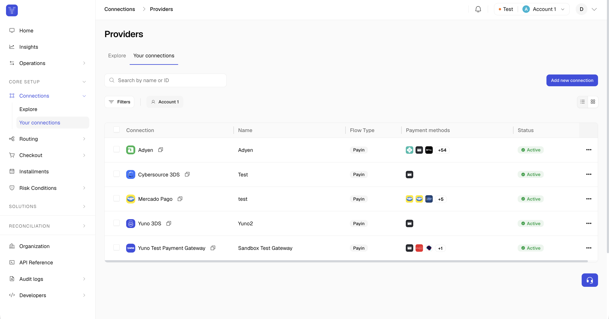
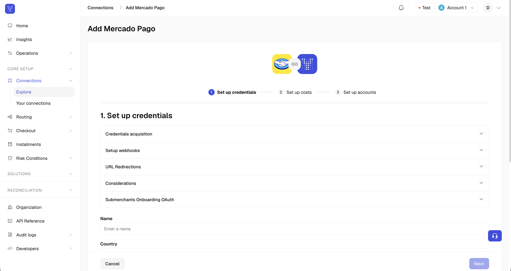

La sección Connections del Dashboard te permite integrar y gestionar varios proveedores, entre ellos métodos de pago, procesadores de pago y soluciones antifraude. Poder conectarte con proveedores de todo el mundo mediante Yuno reduce considerablemente los tiempos de integración y suma funcionalidades para tus clientes, lo que aumenta la comodidad y los ingresos.

Veamos el proceso de agregar, crear y gestionar conexiones para mejorar tus capacidades de procesamiento de pagos y enrutamiento.

## Agregar una conexión {#adding-a-connection}

1. La pestaña **Explore** se muestra por defecto al abrir Connections en el Dashboard. Desde aquí, recorre la lista de proveedores disponibles o usa el cuadro **Search** para encontrar la conexión que buscas. Los proveedores pueden ser métodos de pago, procesadores y soluciones antifraude. Haz clic en **Connect** para continuar.

<Frame></Frame>

2. Después de seleccionar un proveedor, comenzarás el proceso rápido de tres pasos para configurar la conexión. Primero, se te pedirán las credenciales del proveedor, necesarias para establecer una conexión segura. Escribe un nombre fácil de recordar para la conexión y luego ingresa los datos requeridos. La información específica que debes ingresar varía según el proveedor, aunque lo más probable es que ya la tengas. Si tienes dudas sobre alguno de estos campos o te falta información, consulta al proveedor. De forma opcional, puedes marcar **3DS Credentials** e ingresar los datos requeridos para activar la función. Haz clic en **Next**.

<Frame></Frame>

3. La siguiente pantalla, **Set up costs**, te permite ingresar información de costos para usar en Smart Routing y en las conciliaciones (Fees). Selecciona **Set up cost** para ingresar los costos de los pagos exitosos y no exitosos. Esta opción es totalmente opcional, así que puedes hacer clic en **Next** sin ingresar datos.

4. **Set up accounts** te permite seleccionar las cuentas que se verán afectadas por los cambios. Marca cuentas específicas o **Current account only** y haz clic en **Save** para terminar. El sistema confirmará que la conexión se creó, y establecerá un puente entre tu cuenta de Yuno y el proveedor elegido.

<Note>
**Edición de conexiones**

Cuando creas conexiones, se configura una conexión por cada cuenta que selecciones. Si necesitas hacer cambios más adelante, debes editar cada conexión de forma individual: la edición masiva no es compatible.
</Note>

5. Con tus conexiones configuradas, puedes pasar a la sección [Routing](/es/docs/using-yuno/dashboard-overview/routing) para configurar rutas de procesamiento de pagos con el proveedor y los métodos de pago que tienes disponibles en Yuno.

<Note>
**Configurar costos para conexiones nuevas**

Cuando agregas una conexión nueva, puedes configurar sus costos. Este paso opcional te permite definir costos distintos para los pagos exitosos y no exitosos, para ayudarte a gestionar las comisiones con la [función Smart Routing](/es/docs/using-yuno/dashboard-overview/routing#smart-routing).

Puedes definir costos predeterminados para todos los pagos y agregar condiciones específicas para distintas situaciones, como establecer un costo único cuando un cliente usa Visa.

Los costos se aplican en el orden en que los creas, pero puedes reordenarlos arrastrando y soltando. Esta configuración ayuda a Yuno Payments a elegir automáticamente la ruta más económica para cada transacción cuando activas Smart Routing.

Los costos se usan tanto para Smart Routing como para las comisiones (Fees) en las conciliaciones.
</Note>

## Gestionar conexiones {#managing-connections}

La pestaña **Your connections** dentro de Connections te permite gestionar las conexiones existentes para adaptarlas a las necesidades cambiantes de tu negocio. Las acciones disponibles incluyen:

* **Editar conexiones**: Actualiza fácilmente las credenciales o cambia la configuración de una conexión seleccionando los tres puntos junto a la conexión y luego **Edit**.
* **Pausar y reactivar conexiones**: Para detener temporalmente la interacción con un proveedor específico, puedes elegir **Pause** en una conexión. Cuando quieras reanudarla, selecciona **Unpause**. Esta flexibilidad te permite adaptarte a circunstancias cambiantes sin tener que rehacer tus conexiones.
* **Eliminar conexiones**: Si una conexión ya no es necesaria, puedes eliminarla. Ten cuidado al eliminar conexiones, ya que esta acción es irreversible.
* **Gestionar varias conexiones**: Marca la casilla junto a dos o más conexiones para pausarlas, reactivarlas y eliminarlas de forma masiva.

## Configuración de metadatos dinámicos {#dynamic-metadata-configuration}

La función Dynamic Metadata te permite controlar qué campos de metadatos se envían a cada proveedor conectado, y configurar exactamente qué claves de metadatos se envían desde la configuración de tu conexión. Esto es especialmente útil cuando distintos proveedores requieren metadatos diferentes.

Para usar Dynamic Metadata:

1. Activa la opción "Dynamic Metadata Configuration" en la configuración de tu conexión.
2. Configura las asignaciones de claves desde los metadatos de tu API pública a los metadatos específicos del proveedor.
3. Solo las claves de metadatos configuradas se enviarán al proveedor durante las transacciones.

<Info>
**Importante para usuarios de Stripe**

La lógica actual de metadatos en Stripe se eliminará el **29 de agosto de 2025**. Asegúrate de actualizar tu conexión para usar la asignación dinámica antes de esa fecha, para evitar cualquier interrupción en tu procesamiento de pagos.
</Info>
