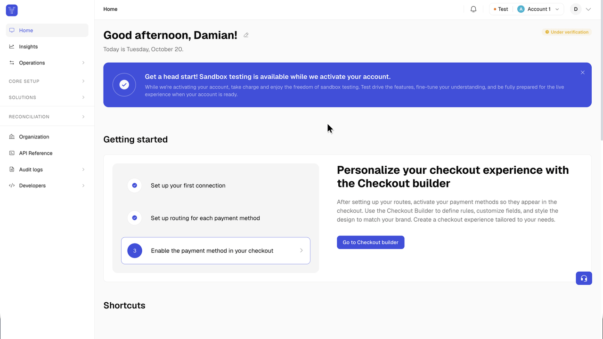
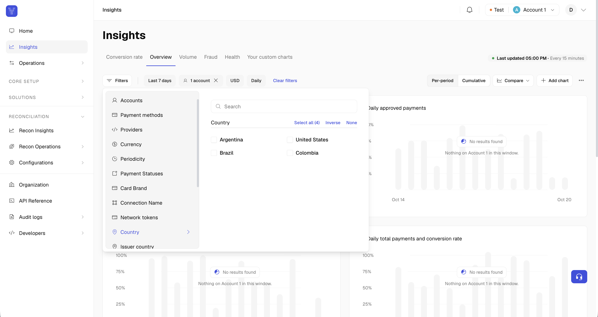
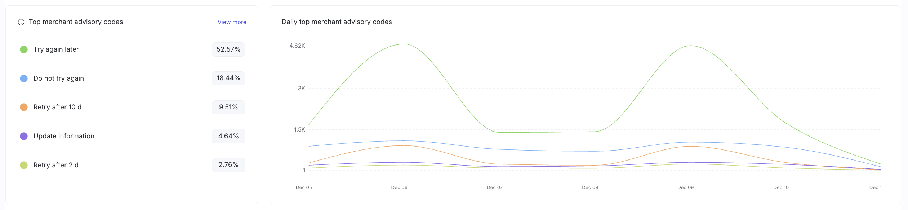

La sección **Insights** ofrece una vista unificada de las métricas y los análisis del rendimiento de tus pagos, directamente dentro del dashboard. Convierte los datos brutos de las transacciones en gráficos sobre volumen, conversión y fraude, con una interfaz personalizable adaptada a las necesidades de tu negocio.
<Frame></Frame>
## Entiende tu panorama de pagos {#understand-your-payment-landscape}

Obtén una comprensión completa de tu ecosistema de pagos a través de análisis útiles. Accede a todos los datos críticos de pago desde una plataforma centralizada, incluidos:

* Volúmenes de pago
* Tipos de transacción
* Métodos de pago
* Datos demográficos de los clientes

Con los datos históricos, puedes monitorear las tendencias del rendimiento de los pagos a lo largo del tiempo, identificar fortalezas y detectar áreas de optimización para refinar continuamente tus estrategias de pago.

Yuno Insights organiza tus datos en cuatro pestañas distintas, cada una con una perspectiva diferente:

<CardGroup cols={2}>
  <Card title="Descripción general" icon="chart-simple">
    Una visión general del procesamiento de tus pagos, incluidos el volumen total de pagos, el tamaño promedio del ticket y las tendencias de la tasa de conversión.
  </Card>
  <Card title="Volumen" icon="chart-line">
    Detalles sobre el volumen de pagos, reembolsos y contracargos por proveedor, método de pago y país.
  </Card>
  <Card title="Tasa de conversión" icon="percent">
    Métricas de rendimiento, incluidas las tasas de aprobación, los reintentos y el éxito de las validaciones.
  </Card>
  <Card title="Fraude" icon="shield-check">
    Métricas de detección y prevención del fraude, incluidas las tasas de fraude y los patrones detectados.
  </Card>
</CardGroup>

## Toma de decisiones informada {#informed-decision-making}

Los datos que se presentan en Yuno Insights están organizados estratégicamente en torno a dos facetas principales:

* Volumen: datos alineados con las métricas de negocio para entender el flujo general y el valor de tus transacciones.
* Rendimiento: datos de eficiencia operativa para medir la efectividad y la tasa de éxito de tus procesos de pago.

Analizar los datos disponibles desde estos dos ángulos te permitirá extraer fácilmente información valiosa, incluida:

* Tasas de conversión generales y segmentadas (por método de pago y proveedor) para identificar las opciones con mejor desempeño.
* Información detallada sobre las transacciones rechazadas, que te ayuda a entender y atender los motivos de la falta de conversión.
* Visibilidad clara de las tendencias del volumen de transacciones, que te permite seguir el crecimiento e identificar fluctuaciones.

## Personaliza y exporta insights {#tailor-and-export-insights}

La sección Insight contiene varias opciones para filtrar, personalizar y extraer datos según tus preferencias:

* **Filters**: usa el botón **Add filters** para segmentar la información mostrada por marca de tarjeta, moneda, rango de fechas y otros criterios, incluidos **country**, **issuer country** y **network tokens**. Esto te permite concentrarte en segmentos de datos específicos para un análisis dirigido. Puedes aplicar o borrar rápidamente selecciones grandes con los controles **Select all** y de selección inversa en cada filtro.
<Frame></Frame>
* **Personalization**: haz clic en **Customize** para controlar los reportes que ves y su disposición.
 Arrastra y suelta los elementos para reordenarlos según tus prioridades, o haz clic en el ícono de la papelera para quitar los reportes menos relevantes. Recuerda hacer clic en **Done** para guardar tu diseño personalizado.

* **Set your charts**: usa el botón **Add chart** para ajustar con precisión las visualizaciones mostradas. Después de seleccionar esta opción, haz clic en el ícono junto a cada reporte para activar o desactivar su visibilidad. Selecciona **Apply** para confirmar tu selección de gráficos.

* **Export as PDF**: el botón **Download** te permite exportar la página actual de Insights como un archivo PDF. Esta función simplifica el proceso de compartir los valiosos reportes de Yuno en toda tu organización.

## Tus gráficos personalizados {#your-custom-charts}

Esta sección te permite crear dashboards totalmente personalizados mediante instrucciones en lenguaje natural. Genera visualizaciones de datos a medida que se adaptan a tus necesidades de análisis, sin ninguna configuración manual. Puedes crear tantos gráficos como necesites, cada uno nacido de tu propio texto.

Cada gráfico incluye un ícono de información (ⓘ) donde puedes ver la instrucción exacta usada para generarlo, lo que ofrece total transparencia y te permite reutilizar o refinar fácilmente las instrucciones.

<CardGroup cols={2}>
  <Card title="Valor único" icon="1">
    Muestra un total o una métrica clave de un vistazo.
  </Card>
  <Card title="Gráficos de líneas o de barras" icon="chart-bar">
    Visualiza tendencias o compara el rendimiento a lo largo del tiempo.
  </Card>
  <Card title="Gráficos de varias líneas" icon="chart-line-up">
    Compara categorías como países, métodos de pago o proveedores.
  </Card>
  <Card title="Gráficos circulares" icon="chart-pie">
    Muestra la distribución proporcional de las categorías dentro de tus datos.
  </Card>
</CardGroup>

### Buenas prácticas para escribir instrucciones {#best-practices-for-prompting}

* **Sé específico y detallado**: describe claramente lo que quieres visualizar, incluidos detalles relevantes como el tipo de transacción, el estado, el país, el proveedor o cualquier filtro que quieras aplicar.

<Tip>
  "Show a bar chart of approved credit card transactions by country for the last 3 months."
</Tip>

* **Incluye siempre un rango de tiempo y una frecuencia**: al solicitar gráficos de líneas o de barras, especifica tanto el período como el nivel de agregación (por ejemplo, diario, semanal, mensual) para un análisis de tendencias preciso.

<Tip>
  "Line chart of total volume per week for the last quarter."
</Tip>

* **Usa referencias de tiempo dinámicas para gráficos reutilizables**: en lugar de fechas fijas, usa períodos relativos como "la semana pasada" o "el mes anterior" para que tus gráficos se mantengan actualizados automáticamente.

<Tip>
  "Show total transactions by day for the last 30 days."
</Tip>

## Insights de códigos de asesoría del comercio (MAC) {#merchant-advisory-codes-mac-insights}

Insights incluye gráficos que destacan los códigos de asesoría del comercio (MAC), y te ayudan a entender por qué los emisores recomiendan acciones como volver a intentarlo más tarde o actualizar la información.

Las visualizaciones clave de MAC incluyen:

* **Top merchant advisory codes**: un desglose de los códigos MAC más frecuentes devueltos en tus transacciones, junto con su proporción relativa.
* **Daily top merchant advisory codes**: un gráfico de serie temporal que muestra cómo evolucionan con el tiempo los principales códigos MAC, y te ayuda a detectar tendencias y cambios en el comportamiento de los emisores.

Usa estas vistas para identificar patrones de asesoría comunes, refinar tus estrategias de reintento y trabajar con los emisores o proveedores para reducir los rechazos evitables.
<Frame></Frame>
## Insights de fraude {#fraud-insights}

La pestaña Fraud desglosa la evaluación de fraude, la autenticación 3DS y la actividad de contracargos en los gráficos siguientes, organizados en tres secciones principales:

### Verificación de fraude {#fraud-screening}

Monitorea las actividades y el rendimiento de la evaluación de fraude:

* **Total fraud screening volume**: sigue el número total de evaluaciones de fraude realizadas
* **Successful fraud screening volume**: monitorea las evaluaciones de fraude exitosas
* **Unsuccessful fraud screening volume**: sigue las evaluaciones de fraude no exitosas
* **Daily fraud screening conversion rate**: consulta las tendencias de la tasa de conversión a lo largo del tiempo mediante gráficos de barras

### 3DS {#3ds}

Analiza el rendimiento de la autenticación 3D Secure:

* **Total 3DS authentication volume**: sigue el total de intentos de autenticación 3DS
* **Successful 3DS authentication volume**: monitorea las autenticaciones 3DS exitosas
* **Unsuccessful 3DS authentication volume**: sigue las autenticaciones 3DS no exitosas
* **Daily 3DS conversion rate**: consulta las tendencias de la tasa de conversión a lo largo del tiempo
* **3DS decline reasons**: analiza los motivos de rechazo de la autenticación 3DS
* **Daily fraudiness vs challenge**: compara las puntuaciones de fraudulencia (una puntuación que indica la probabilidad de que una transacción sea fraudulenta) con las tasas de desafío

### Contracargos {#chargebacks}

Monitorea la actividad y los resultados de los contracargos:

* **Total chargebacks volume**: sigue el total de contracargos recibidos
* **Won chargebacks volume**: monitorea los contracargos que se ganaron con éxito
* **Lost chargebacks volume**: sigue los contracargos que se perdieron
* **Disputed chargebacks volume**: monitorea los contracargos actualmente en disputa
* **Daily chargebacks rate**: consulta las tendencias de la tasa de contracargos a lo largo del tiempo
* **Chargebacks rate by provider and card brand**: analiza las tasas de contracargos segmentadas por proveedor y marca de tarjeta
* **Chargeback reason distribution**: entiende la distribución de los motivos de contracargo
* **Daily chargebacks win rate**: sigue la tasa a la que se ganan los contracargos
* **Daily disputed chargebacks**: monitorea los contracargos en estado de disputa
* **Chargebacks status distribution**: consulta la distribución de los estados de los contracargos
* **Chargebacks by type**: analiza los contracargos categorizados por tipo

Usa los insights de fraude para optimizar tus estrategias de prevención del fraude, ajustar las reglas de detección de fraude y asegurarte de proteger tu negocio sin rechazar innecesariamente transacciones legítimas.
