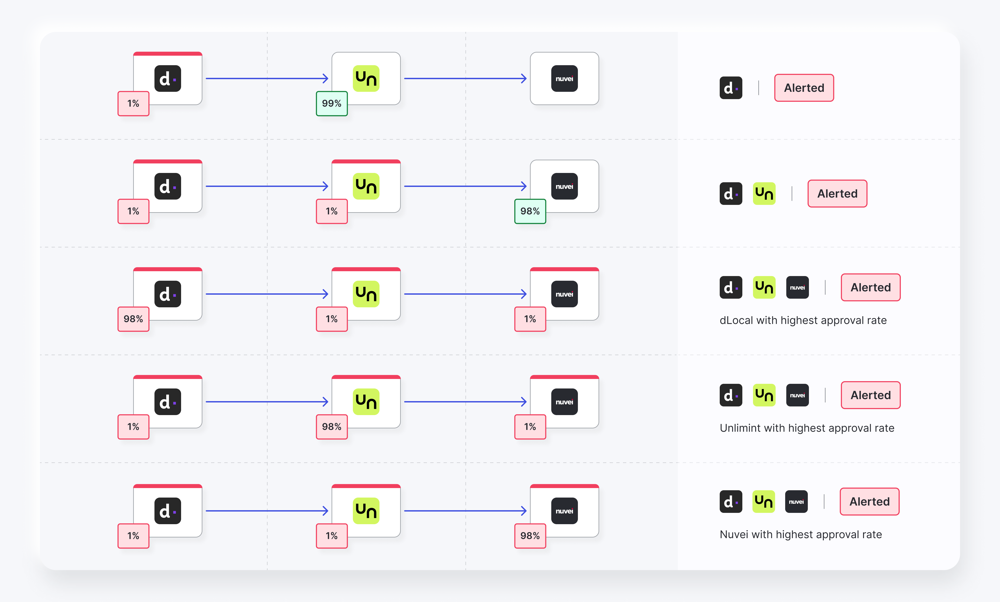
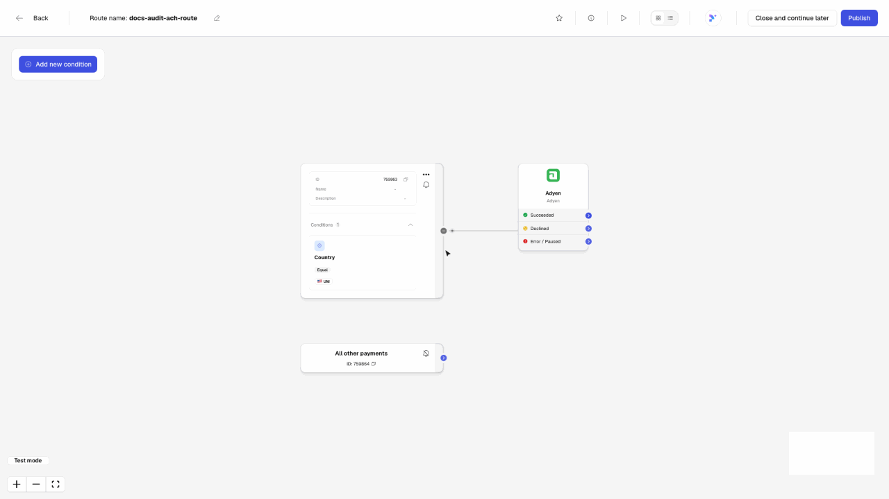

La función de monitores de Yuno te ayuda a detectar y resolver problemas de procesamiento de pagos en tiempo real. Accesible desde la sección Monitors del Dashboard de Yuno, esta herramienta identifica automáticamente anomalías en el rendimiento de los proveedores de pago y toma medidas inmediatas para mantener tasas de aprobación y de conversión altas en tus rutas de pago.

## Funcionamiento del proceso de monitoreo {#monitoring-process-operation}

El proceso de monitoreo consta de cuatro pasos clave que ayudan a identificar y restaurar rutas de pago:

<Steps>
  <Step title="Detección de anomalías">
    El sistema monitorea continuamente las tasas de aprobación. Cuando las tasas caen por debajo del umbral que definiste, activa alertas a través de los canales que configuraste, como email u **Opsgenie**.
  </Step>
  <Step title="Notificación de alertas">
    Si las tasas de aprobación caen por debajo del umbral, Yuno te notifica de inmediato a través de los canales de alerta que elegiste.
  </Step>
  <Step title="Redirección del tráfico">
    Al detectar tasas de aprobación bajas, Yuno redirige automáticamente los pagos a tus proveedores de respaldo. Una pequeña parte de las transacciones sigue pasando por el proveedor original para vigilar si el servicio se recupera.
  </Step>
  <Step title="Recuperación de la ruta">
    Cuando la tasa de aprobación del proveedor principal vuelve a superar el umbral, el tráfico regresa automáticamente a la ruta original.
  </Step>
</Steps>
Este proceso automatizado ayuda a mantener un procesamiento de pagos óptimo al detectar problemas rápidamente e implementar soluciones para mantener altas las tasas de aprobación.

### Escenarios de monitoreo adicionales {#additional-monitoring-scenarios}

La función de monitores maneja distintos escenarios de rutas de pago para mantener un procesamiento óptimo. Así gestiona situaciones específicas:

Interrupciones de proveedores:

* Cuando un proveedor tiene interrupciones, el tráfico se redirige automáticamente al proveedor de respaldo configurado
* Si el proveedor de respaldo tiene problemas, el tráfico pasa a un segundo proveedor de respaldo (si está configurado)
* Cuando ningún proveedor está disponible, el tráfico se dirige al proveedor con la tasa de aprobación reciente más alta
* El sistema monitorea continuamente a los proveedores y ajusta el tráfico de forma dinámica para lograr tasas de aprobación óptimas
* El estado del proveedor (caído o recuperado) se determina según tu configuración

Secuencia de redirección del tráfico:

1. Cuando un proveedor cae por debajo del umbral de aprobación, el tráfico se redirige al proveedor de respaldo
2. Si el proveedor de respaldo también cae por debajo del umbral, el tráfico pasa al segundo respaldo (si está disponible)
3. Si todos los proveedores están por debajo del umbral, el tráfico se dirige al proveedor que tenga la tasa de aprobación más alta

El siguiente diagrama ilustra estos escenarios de redirección del tráfico:
<Frame></Frame>
## Configurar un monitor {#configure-a-monitor}

Para configurar un monitor para tus rutas de pago:

1. Ve a la pestaña **Routing** en tu Dashboard y abre una ruta existente. Puedes configurar distintos monitores de tasa de aprobación para cada condición.

2. Personaliza tu ruta de pago con tus ajustes preferidos.

3. Agrega las condiciones necesarias y los proveedores de pago para cada conjunto.

4. Haz clic en el ícono de Monitors (campana) y configura estos ajustes:

   * **Time frame**: Define durante cuánto tiempo se mide la tasa de aprobación
   * **Approval rate limit**: Define el umbral que activa las alertas y acciones
   * **Number of payments**: Define el mínimo, el máximo o el rango de pagos necesarios para activar la condición. Esto evita redirecciones por anomalías cuando el volumen de pagos es bajo
   * **Alert channels**: Elige notificaciones por email u **Opsgenie**
   * **Automatic traffic redistribution**: Habilita la redirección automática cuando se activen las alertas. Requiere un proveedor de respaldo para las condiciones **Error** y **Pause**
   * **Percentage of traffic**: Define cuánto tráfico se queda con el proveedor original para el monitoreo

5. Guarda los cambios del monitor, o guárdalo como plantilla para usarlo en el futuro.
<Frame></Frame>
<Note>
**Restricción de los monitores**

No se pueden crear monitores para rutas que ya están publicadas.
</Note>
