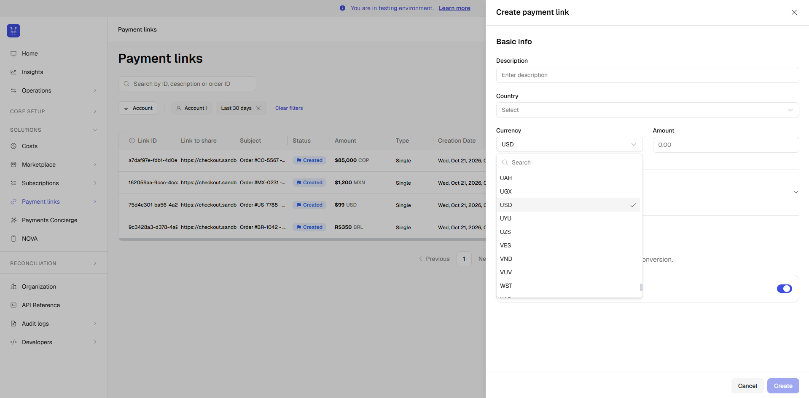
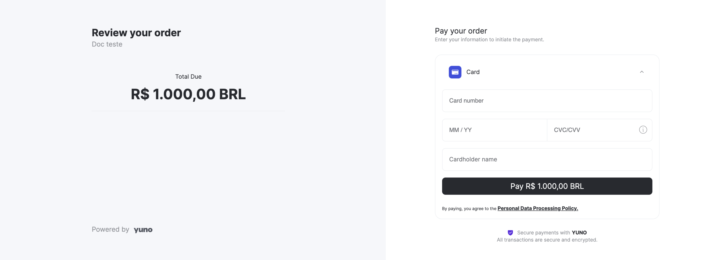
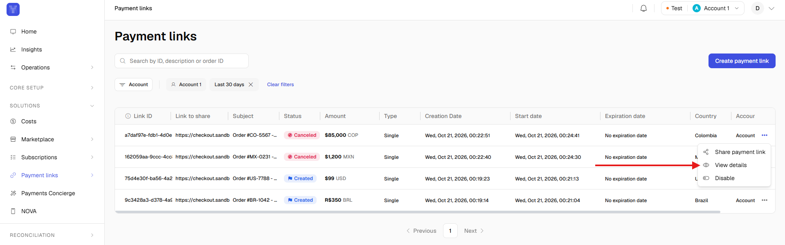

La sección de enlaces de pago del dashboard te permite crear URL para cobrar pagos sin escribir código. Los enlaces de pago de Yuno combinan una configuración sencilla con opciones avanzadas de checkout.

## Una experiencia sin código {#a-no-code-experience}

* **Enlaces de pago a tu medida**: Puedes crear enlaces de pago adaptados a tus necesidades sin programar
* **Configuración sencilla**: Crea un enlace de pago en unos pocos pasos intuitivos. Especifica un país, una moneda, un monto y al menos un método de pago para crear el enlace rápidamente
* **Fechas de inicio y vencimiento**: Aumenta la utilidad del enlace de pago definiendo fechas de inicio y vencimiento. Obtén más control al definir la hora exacta y la zona horaria

<Frame></Frame>

## Ventajas de los enlaces de pago {#advantages-of-payment-links}

* Una interfaz intuitiva, sin necesidad de programar
* Enlaces altamente personalizables que se alinean con las necesidades del negocio y mejoran la interacción con los clientes
* Mayor control, con la posibilidad de cancelar enlaces cuando lo necesites
* La información sobre transacciones ofrece una visibilidad profunda y analíticas valiosas sobre la actividad de pagos y el estado de las transacciones

## Crear un enlace de pago {#create-a-payment-link}

Si usas el dashboard, sigue estos pasos para crear un enlace de pago:

1. Accede al [dashboard de Yuno](https://auth.y.uno/u/login?)
2. Ve a **Solutions** → **Payment links** en la barra lateral del dashboard
3. Haz clic en **Create payment link**
4. Completa la **Basic info** (descripción, país, moneda y monto) de tu pago. Luego, configura las **Advanced options**
5. (Opcional) Usa **Payment settings** para agregar más métodos de pago, lo que podría aumentar la conversión
6. Comparte el enlace de pago con tu cliente

Si usas la integración por API, sigue estos pasos:

1. (Opcional) Crea un cliente con el endpoint [Create customer](/es/reference/customers/create-customer).
2. Crea el enlace de pago con el endpoint [Create payment link](/es/reference/payment-links/create-payment-link).
3. Comparte el enlace de pago con tu cliente.

## Opciones avanzadas {#advanced-options}

Los enlaces de pago se pueden mejorar de varias maneras:

* **Conecta el enlace de pago a un ID de orden existente**: Simplifica el seguimiento de las órdenes al asociar el enlace de pago con un ID de orden
* **Cobra varios pagos**: Determina si un enlace debe aceptar varios pagos o una sola transacción
* **Define una fecha de inicio y de vencimiento**: Establece un período en el que tu enlace estará activo, con precisión de minutos y zona horaria. Si no defines una fecha de inicio, tu enlace estará activo de inmediato
* **Agrega detalles de la orden**: Incluye artículos, servicios o causas para ofrecer una vista completa de la orden en el checkout del enlace de pago
* **Información de boletos de avión**: Útil para aerolíneas y negocios relacionados con viajes, esta función permite integrar la información de boletos de avión en el checkout del enlace de pago

## Usar enlaces de pago {#using-payment-links}

Cuando los clientes abren los enlaces de pago, ven una interfaz limpia que les informa el monto a pagar y los métodos de pago disponibles, según lo que seleccionaste al generar el enlace. El aspecto de la página se adapta dinámicamente a teléfonos y tabletas. Después de seguir las instrucciones en pantalla, los clientes podrán procesar su pago, que podrás ver en el dashboard al administrar los enlaces de pago.

<Frame></Frame>

### Personalización de la página de pago alojada {#hosted-payment-page-customization}

Adapta el aspecto de la página de pago alojada a tu marca desde Checkout Builder: agrega tu logo como miniatura y define los colores de tu marca.

La página de pago alojada se muestra por defecto en el idioma del navegador del cliente. Los clientes pueden cambiarlo en cualquier momento con el selector de idioma.

<Note>
  Los botones de pago exprés (PayPal, Apple Pay, Google Pay) también están disponibles en la página de pago alojada, desde Web SDK v1.6.
</Note>

<Note>
  Cuando [Promotions](/es/docs/payment-features/promotions) está habilitado para tu organización, la página de pago alojada aplica automáticamente las promociones que coinciden con la tarjeta del cliente y muestra el precio con descuento en el resumen de la orden. No hay nada que configurar en el enlace. Los enlaces de pago de suscripción no muestran promociones y cobran el precio regular.
</Note>

<Note>
  ¿Quieres que los clientes abran el enlace de pago bajo tu propio dominio, sin la marca de Yuno? Consulta [Payment Link White Label](/es/docs/sdks/customization/web/payment-link-white-label).
</Note>

## Administración de enlaces de pago {#payment-link-management}

**Payment links** mostrará todos tus enlaces en una lista. Haz clic en cualquier enlace para ver un resumen y los pagos realizados. También puedes acotar la búsqueda por ID del enlace de pago o con filtros. Además, al seleccionar los tres puntos junto a cada enlace verás:

* **Share payment link**: Obtén rápidamente el enlace para compartirlo con tus clientes
* **View details**: Consulta los métodos de pago y los pagos anteriores
* **Disable**: Desactiva el enlace cuando ya no lo necesites

<Frame></Frame>

Para obtener información detallada y resolver consultas, consulta la documentación de Yuno o comunícate con el equipo de soporte.
