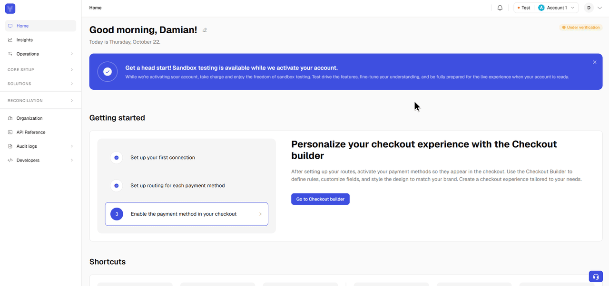
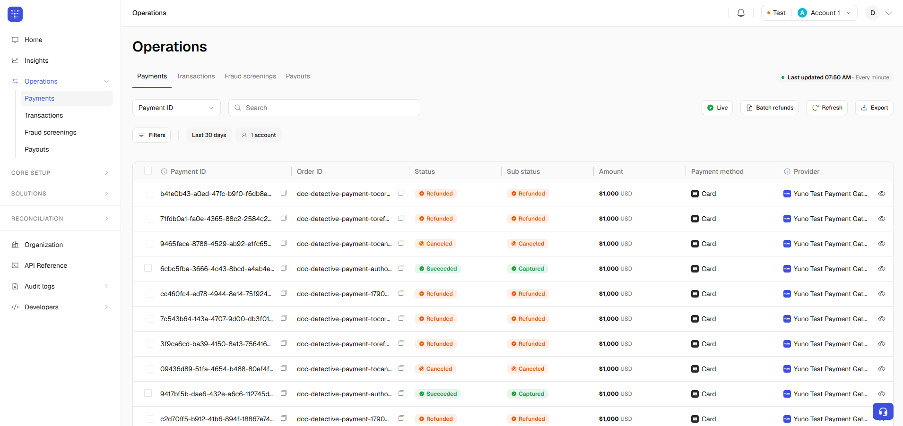

La sección Payments del dashboard muestra todos los pagos, transacciones, evaluaciones de fraude y datos de payouts. Además, puedes usar filtros para refinar tus búsquedas y disfrutar de una amplia configuración de exportaciones y reportes.
<Frame></Frame>
## Desglose de la sección Payments {#payments-section-breakdown}

<CardGroup cols={2}>
  <Card title="All payments" icon="wallet">
    Vista predeterminada que muestra todos los pagos sin importar su estado.
  </Card>
  <Card title="Reembolsos por lotes" icon="receipt">
    Procesa varios reembolsos subiendo un archivo CSV.
  </Card>
  <Card title="All transactions" icon="arrow-right-arrow-left">
    Vista detallada de todas las transacciones relacionadas con tus pagos.
  </Card>
  <Card title="All fraud screenings" icon="shield-halved">
    Verifica posibles transacciones fraudulentas en una vista dedicada.
  </Card>
  <Card title="View all payouts" icon="hand-holding-dollar">
    Accede a todos los payouts y fíltralos para encontrar transacciones específicas.
  </Card>
  <Card title="Export reports" icon="file-export">
    Exporta datos personalizados y programa reportes recurrentes por email.
  </Card>
</CardGroup>
La sección Payments te permite ver, filtrar y exportar datos de pagos, y procesar reembolsos por lotes, todo desde una única vista del dashboard.

<Frame></Frame>

## Reembolsos por lotes {#batch-refunds}

La función de reembolsos por lotes te permite procesar reembolsos de varias transacciones simultáneamente, lo que ahorra tiempo y esfuerzo. Puedes reembolsar hasta 1000 pagos a la vez.

Para ejecutar reembolsos por lotes, accede a la pestaña **All payments** y selecciona **Batch refunds → Upload**. Desde ahí, sube un archivo CSV con tus reembolsos. Puedes descargar un archivo de muestra que te ayude con el formato. Por cada pago que quieras reembolsar, debes informar:

* ID del pago
* ID de la transacción
* Monto a reembolsar
* Moneda
* Referencia del comercio
* Motivo (`DUPLICATE`, `FRAUDULENT` o `REQUESTED_BY_CUSTOMER`)

También puedes descargar el [archivo de muestra de reembolsos por lotes](https://dashboard-assets.y.uno/samples-files/Batch_refunds_sample_file.xlsx).

Después de subir el archivo, puedes seguir el estado del reembolso de cada pago en **All payments**, seleccionando **Batch refunds → Overview**.

## Exportar datos {#exporting-data}

Haz clic en el botón **Export** para ver tres pestañas, cada una con un control especializado sobre tus exportaciones de datos:

**Quick export**: Selecciona un rango de fechas específico y personaliza las columnas visibles en la exportación.\
**Scheduled reports**: Configura un reporte para que se envíe periódicamente a tu dirección de email. También puedes definir las columnas que se exportan.
**Downloads**: Los reportes anteriores se guardan en esta pestaña para que los descargues fácilmente.
