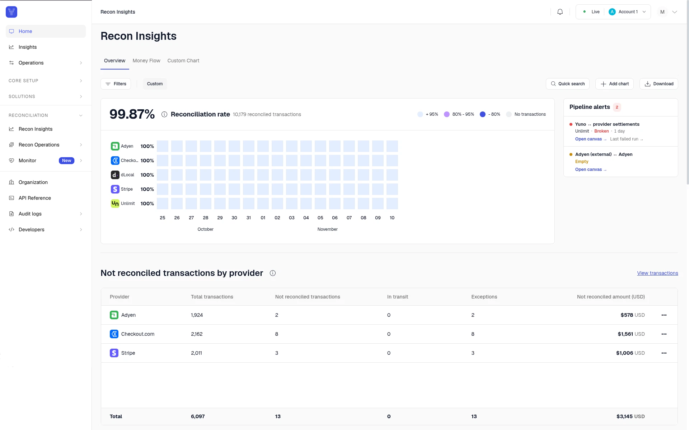
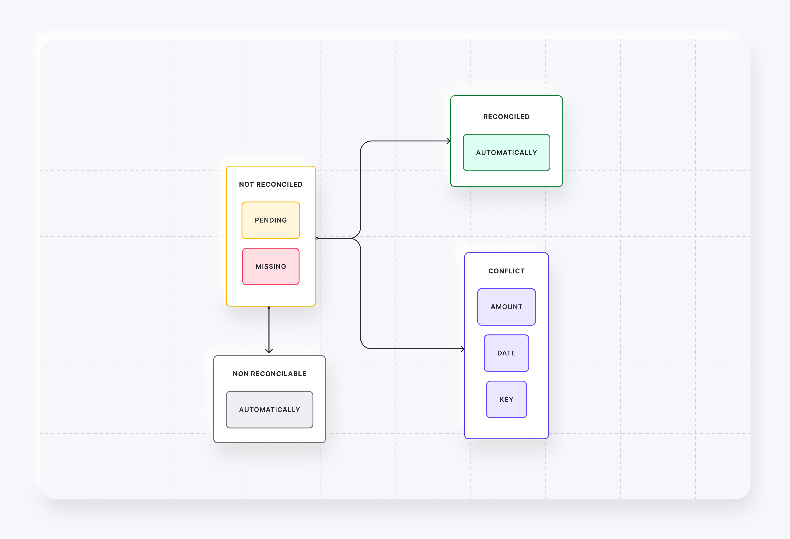

La conciliación es un proceso que compara tus transacciones con los documentos de liquidación de los proveedores de pago para:

* Identificar y resolver discrepancias
* Asegurar que todas las transacciones procesadas estén correctamente liquidadas
* Mantener registros financieros precisos

El proceso de conciliación funciona de la siguiente manera:

<Steps>
  <Step title="Recopilar los archivos de liquidación">
    Reúne los archivos de liquidación de cada proveedor de pago.
  </Step>
  <Step title="Comparar los archivos">
    Compara esos archivos con las transacciones procesadas a través de Yuno.
  </Step>
  <Step title="Verificar los saldos">
    Verifica los saldos de cuenta con tus adquirentes.
  </Step>
  <Step title="Comprobar los registros">
    Comprueba que todos los registros sean precisos, consistentes y estén actualizados.
  </Step>
</Steps>
<Frame></Frame>
## Por qué importa la conciliación {#why-reconciliation-matters}

La conciliación te ayuda a identificar y resolver discrepancias en el procesamiento de tus pagos. Aunque algunas discrepancias son inofensivas, factores como el momento del pago, los depósitos y las transacciones pendientes pueden afectar los saldos de tu cuenta bancaria. La conciliación periódica te permite:

* Detectar y prevenir errores de saldo
* Identificar posible fraude
* Dar seguimiento a los pagos fallidos
* Asegurar registros financieros precisos

Los objetivos clave de la conciliación son:

* Verificar que los comercios reciban todos los pagos de las transacciones exitosas de Yuno
* Asegurar el cumplimiento de los términos de pago entre comercios y adquirentes
* Monitorear los costos de procesamiento de adquirencia y validarlos frente a los términos acordados
* Mantener la integridad de los datos y los estados correctos de las transacciones en el dashboard de Yuno

Para obtener mejores resultados, realiza la conciliación a diario. Si la conciliación diaria no es viable, intenta conciliar semanalmente o, como mínimo, mensualmente.

## Cómo facilita Yuno la conciliación {#how-yuno-facilitates-reconciliation}

Yuno ofrece un proceso integral de conciliación de transacciones que te ayuda a:

* Asegurar la correcta acreditación de los pagos
* Verificar el cumplimiento de los términos de pago
* Dar seguimiento a los costos de procesamiento

Nuestro sistema orquesta y gestiona los datos de Yuno, los socios y los comercios para ejecutar una conciliación precisa.

### Estado de conciliación {#reconciliation-status}

Cada transacción puede tener uno de los siguientes estados de conciliación:

| Estado           | Descripción                                                                                                               |
| :--------------- | :------------------------------------------------------------------------------------------------------------------------ |
| Reconciled       | La transacción se encontró en la liquidación del proveedor y se acreditará en tu cuenta bancaria                          |
| Non reconcilable | La transacción no se puede conciliar porque no cumple los criterios de conciliación. No se tomará ninguna otra acción     |
| Not reconciled   | La transacción está pendiente de identificarse en una liquidación. Revisa el subestado para ver si aún está dentro de los términos de pago |
| Conflict         | Se encontró una transacción coincidente en la liquidación, pero tiene discrepancias con el registro procesado             |

### Máquina de estados {#state-machine}
<Frame></Frame>
### Reportes {#reports}

Yuno ofrece tres reportes de conciliación:

1. **Reconciliation Overview**
   * Muestra el estado y el subestado de conciliación
   * Incluye el ID de conciliación de cada transacción

2. **Settlements & Fees**
   * Lista todas las transacciones incluidas en las transferencias bancarias a tu cuenta
   * Incluye los detalles de conciliación de cada transacción

3. **Settlement Payouts report**
   * Lista los payouts (transferencias bancarias) que cada proveedor de pago informa haber pagado a tus cuentas de comercio
   * Disponible mediante la API de Reports para los comercios que usan el nuevo motor de conciliación de Yuno; todavía no hay una pestaña en el dashboard. Consulta [Settlement Payouts](/es/reference/reports/reports-fields#settlement-payouts)

### Obtener datos de conciliación por API {#getting-reconciliation-data-by-api}

Para dar seguimiento a los montos liquidados por proveedor, cuenta y moneda desde tu backend (por ejemplo, para la contabilidad), solicita los reportes de conciliación mediante la API de Reports: [crea el reporte](/es/reference/reports/create-a-report), [verifica que esté listo](/es/reference/reports/retrieve-a-report) y [descárgalo](/es/reference/reports/download-a-report). Consulta [Build reports](/es/docs/direct-integration-use-cases/build-reports) para ver el flujo completo.

* Usa [Settlements & Fees](/es/reference/reports/reports-fields#settlements--fees) para las líneas de liquidación y las comisiones de cada transacción.
* Usa [Settlement Payouts](/es/reference/reports/reports-fields#settlement-payouts) para los montos brutos, las comisiones y los montos netos de cada transferencia que un proveedor informa haber pagado a tus cuentas de comercio. Solicitarlo para una organización que aún no usa el nuevo motor de conciliación devuelve un error 400.

<Note>
Los campos `balance` que devuelve [Get Account Details](/reference/banking-connectivity/accounts/get-account-details-banking) pertenecen a cuentas bancarias creadas mediante [Banking Connectivity](/es/reference/banking-connectivity). No son saldos mantenidos con tus adquirentes o proveedores de pago.
</Note>
