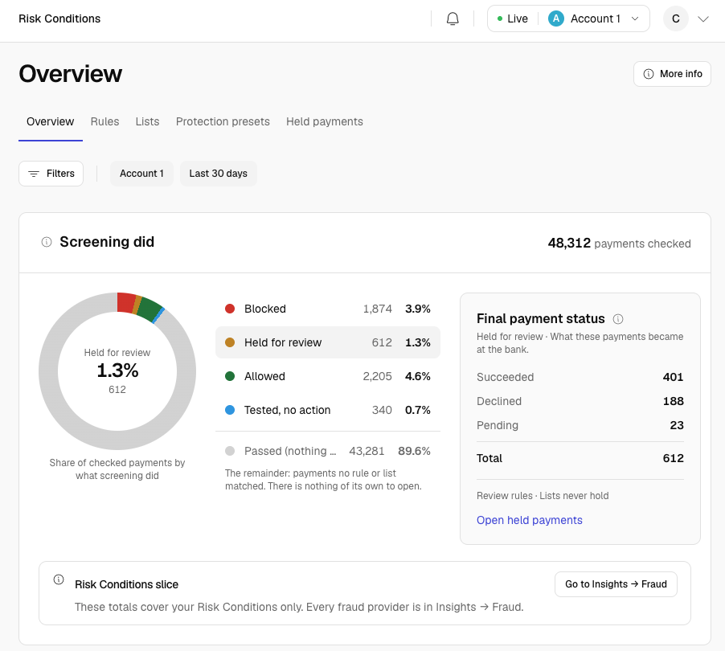
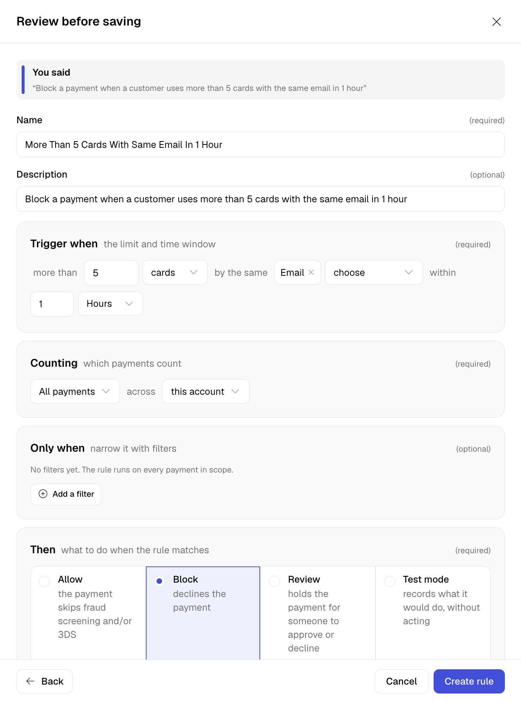
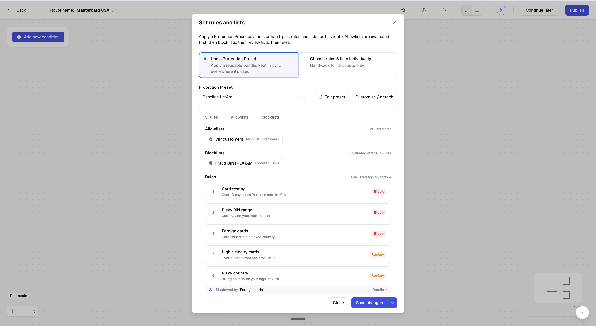
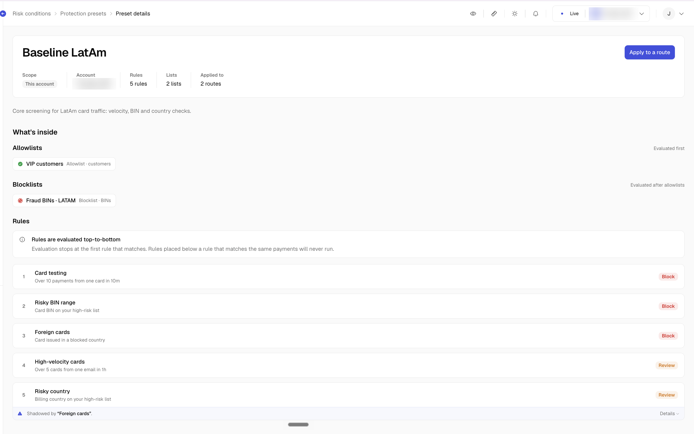

**Risk Conditions** es el paso de evaluación propio de Yuno. Escribes reglas y listas que detectan pagos riesgosos (o de confianza), las agregas a tus rutas y Yuno revisa cada pago que pasa por esas rutas. Como la verificación se ejecuta dentro de Yuno, también reduce la cantidad de solicitudes que envías a proveedores de fraude externos.

La sección tiene cinco pestañas:

* [Overview](#overview): qué hizo la evaluación y qué reglas y listas hacen el trabajo.
* [Rules](#rules): condiciones que cuentan pagos a lo largo del tiempo, como "más de 5 tarjetas de un mismo email en 1 hora".
* [Lists](#lists): valores fijos para bloquear, permitir o enviar a revisión, como un email o un BIN de tarjeta.
* [Protection presets](#protection-presets): conjuntos reutilizables de reglas y listas.
* [Held payments](#held-payments): pagos que esperan a que alguien los apruebe o los rechace.

<Frame></Frame>

## Antes de empezar {#before-you-start}

Una regla o una lista no hace nada hasta que está en una ruta y la ruta está publicada. Para configurarlo una sola vez:

<Steps>
  <Step title="Conecta Risk Conditions">
    Ve a **Connections**, busca **Risk Conditions** y haz clic en **Connect**. Sigue los pasos en pantalla.
  </Step>
  <Step title="Agrega una verificación de evaluación a una ruta">
    Ve a **Routing**, abre una ruta y agrega **Risk Conditions** como paso. En su paso **Set rules and lists**, aplica una configuración de protección o elige reglas y listas una por una.
  </Step>
  <Step title="Publica la ruta">
    Los cambios en una ruta se guardan como borrador. Publica la ruta para empezar a evaluar.
  </Step>
</Steps>

### Qué se ejecuta primero {#what-runs-first}

En cada verificación de evaluación, Yuno evalúa en este orden y se detiene en la primera coincidencia:

1. Listas de permitidos
2. Listas de bloqueo
3. Listas de revisión
4. Reglas, de arriba hacia abajo, en el orden definido en la ruta

Por lo tanto, una coincidencia en una lista de permitidos prevalece sobre todo, y una coincidencia en una lista de bloqueo prevalece sobre una lista de revisión. Una regla ubicada debajo de una regla más amplia que coincide con los mismos pagos nunca se ejecuta. [Overview](#overview) y la página de detalle de cada regla te avisan cuando esto ocurre.

### Permisos {#permissions}

Cada acción en Risk Conditions tiene su propio permiso: ver la sección, crear y editar reglas, listas y configuraciones, crear configuraciones para toda la organización, y aprobar o rechazar pagos retenidos. Puedes agregar estos permisos a cualquier rol personalizado. El rol **Admin** los incluye por defecto.

## Descripción general {#overview}

Overview muestra qué hizo la evaluación en el período que elijas (los últimos 7, 30 o 90 días).

* **Screening did**: cuántos pagos revisó la evaluación, divididos en **Blocked**, **Held for review**, **Allowed**, **Tested, no action** y **Passed (nothing matched)**. Cada pago se cuenta una sola vez, según la coincidencia que lo decidió.
* **Final payment status**: en qué terminaron esos mismos pagos en el banco, por ejemplo exitoso, rechazado por el banco o con contracargo.
* **Rule health** y **Blocklists & allowlists**: conteos por estado. Cada tarjeta abre la pestaña Rules o Lists, ya filtrada.
* **Which rules & lists do the work**: reglas y listas ordenadas según la frecuencia con la que coincidieron. Si una regla nunca se activa porque una regla superior atrapa antes los mismos pagos, indica **Never fires**, nombra esa regla y enlaza a Routing, donde cambias el orden.
* **Needs you**: cualquier elemento que requiera una acción, como una regla Block que en realidad no está bloqueando o pagos que esperan revisión.

<Note>
  El ranking cuenta eventos de coincidencia, mientras que el total principal cuenta pagos. Un pago que coincide con una lista y con una regla cuenta una vez en el total principal y dos veces en el ranking, por lo que el ranking puede sumar más que el total.
</Note>

La superposición entre reglas se calcula dentro de una sola cuenta. Cuando ves un grupo de cuentas o toda la organización, Overview muestra solo totales. Usa **Narrow to one account** para ver el ranking y los avisos de "nunca se activa".

Estos totales cubren solo Risk Conditions. Para comparar a todos los proveedores de fraude de tus rutas, ve a **Insights > Fraud**.

## Rules {#rules}

Una regla cuenta pagos en una ventana de tiempo y actúa cuando el conteo supera un límite. Por ejemplo: retener un pago para revisión cuando un cliente usa más de 5 tarjetas del mismo email en 1 hora.

<Note>
  Usa una lista, no una regla, cuando quieras coincidir con un valor fijo en un solo pago, como un email malicioso conocido. Consulta [Lists](#lists).
</Note>

### Crear una regla {#create-a-rule}

En la pestaña **Rules**, haz clic en **Create rule**. La forma más rápida de empezar es describir la regla en inglés sencillo, por ejemplo "Hold a payment when a customer uses more than 5 cards from one email in 1 hour", y hacer clic en **Generate**. Yuno redacta la regla y la muestra en **Review before saving**, junto a lo que escribiste, para que la revises y la ajustes antes de crearla. Si lo que describes es un solo valor sin límite en el tiempo, Yuno sugiere en su lugar una entrada de lista de bloqueo.

También puedes empezar desde una plantilla, copiar una regla existente o empezar en blanco. Las plantillas son:

* **Card testing**: una tarjeta probada demasiadas veces en una ventana corta.
* **High-value first order**: el primer pago de un cliente nuevo supera un umbral.
* **Prior chargebacks**: retener a los clientes cuyos pagos ya tuvieron un contracargo recientemente.
* **Repeated charges on the same card**: bloquear varios cobros hechos con la misma tarjeta en una hora.

Asigna un nombre a la regla y, opcionalmente, una descripción. Luego completa sus cuatro partes:

| Parte | Qué configuras |
| --- | --- |
| **Trigger when** | El límite y la ventana de tiempo: más de una cantidad de pagos o tarjetas, con el mismo valor (como email, número de tarjeta, fingerprint del dispositivo o dirección IP), dentro de una ventana de hasta 30 días. |
| **Counting** | Qué pagos cuentan (todos los pagos, exitosos, rechazados o rechazados por fraude) y si se cuenta en esta cuenta o en toda la organización. |
| **Only when** | Filtros opcionales que acotan la regla, hasta 10. Los filtros del mismo grupo deben coincidir todos (AND). Agrega otro grupo para que coincida cualquiera de los dos (OR). |
| **Then** | Qué ocurre cuando la regla coincide. Consulta los resultados más abajo. |

Mientras la construyes, **Rule summary** vuelve a leer la regla en inglés sencillo, para que verifiques que hace lo que querías.

<Frame></Frame>

Los filtros que puedes agregar se agrupan según lo que verifican:

* **Same across payments**: el mismo BIN de tarjeta, número de tarjeta, nombre del titular de la tarjeta, método de pago, dirección IP, dirección de envío, ID de dispositivo o monto en los pagos que cuentas.
* **Amount**: el monto de un solo pago, o el total acumulado en la ventana.
* **Card & response codes**: marca de la tarjeta, el código de respuesta o el Merchant Advice Code que devuelve un emisor tras un rechazo.
* **Chargeback history**: si el cliente tuvo contracargos en los últimos días que definas.
* **Verification**: si los pagos contados incluyen una verificación de tarjeta de $0.
* **Metadata**: tus propios campos personalizados enviados a Yuno.

### Resultados {#outcomes}

| Resultado | Qué ocurre |
| --- | --- |
| **Allow** | El pago omite la evaluación de fraude, 3DS o ambos. Tú eliges cuál. |
| **Block** | El pago se rechaza. |
| **Review** | El pago se retiene hasta que alguien lo apruebe o lo rechace en [Held payments](#held-payments). |
| **Test mode** | No pasa nada con el pago. La regla registra lo que habría hecho. |

<Tip>
  Empieza una regla nueva en **Test mode**. Su página de detalle muestra lo que habría hecho y cómo terminaron esos pagos. Cuando los números se vean bien, haz clic en **Enforce this rule** y elige el resultado.
</Tip>

Una vez que una regla se aplica, su resultado queda fijo. Para probar un resultado distinto, copia la regla.

<Warning>
  Una regla **Review** retiene el pago, y el comprador permanece en procesamiento hasta que alguien decida. Revisa [Held payments](#held-payments) con regularidad para que los pagos no esperen.
</Warning>

### Estados de las reglas {#rule-statuses}

Cada regla tiene un estado:

| Estado | Significado |
| --- | --- |
| **Live** | En una ruta publicada y evaluando pagos. |
| **Not live** | Guardada, pero todavía no está en ninguna ruta. No evalúa nada. |
| **Dormant** | En una ruta, pero sin coincidencias recientes. |
| **Needs you** | Algo requiere corrección, como una regla Block en una ruta donde el bloqueo ocurre después del banco, o una regla que nunca se activa porque una regla superior coincide primero. |
| **Test** | Registra lo que haría, sin actuar. |

La pestaña **Rules** lista cada regla con lo que evalúa, su cuenta, su resultado y su estado. Filtra por estado para encontrar las reglas que te necesitan.

### Detalle de la regla {#rule-detail}

Abre una regla para ver si está funcionando:

* **Health**: cuántos pagos coincidieron desde la última edición y qué proporción del tráfico de la cuenta representa.
* **Where it runs**: los mismos números, por ruta.
* **What it did**: para Block, qué detuvo. Para Allow, cómo terminaron los pagos permitidos. Para Review, qué está esperando y qué se aprobó o se rechazó. Para Test mode, qué habría hecho.
* **What it caught**: los pagos que coincidieron, los más nuevos primero, con el motivo de cada coincidencia.
* **Change history**: quién creó, editó, promovió o publicó la regla, y cuándo.

<Note>
  **Protection hole.** Si una regla Block está en un paso de evaluación que se ejecuta después del banco, puede coincidir con pagos que de todos modos resultan exitosos, porque un bloqueo en ese punto no puede revertir el cobro. El detalle de la regla muestra cuántos pagos se escaparon, y la regla se marca como **Needs you**. Para detener un pago antes de que se cobre, el paso de evaluación debe ejecutarse antes del proveedor.
</Note>

### Agregar una regla a una ruta {#add-a-rule-to-a-route}

Desde la lista de reglas o el detalle de la regla, haz clic en **Add to a route**. Elige la ruta y luego la verificación de evaluación a la que la agregarás, o agrega una nueva. La regla pasa al borrador de la ruta. Abre **Routing** para revisar y publicar el borrador.

### Eliminar una regla {#delete-a-rule}

Solo puedes eliminar una regla cuando no está activa. Si una ruta la usa, quítala primero de la ruta. Eliminar no se puede deshacer.

## Lists {#lists}

Una lista coincide con un valor de un pago, como un email, un BIN de tarjeta o un dispositivo. Hay tres tipos:

| Tipo | Qué ocurre en una coincidencia |
| --- | --- |
| **Blocklist** | El pago se rechaza. |
| **Allowlist** | El pago omite la evaluación de fraude, 3DS o ambos. |
| **Review list** | El pago se retiene hasta que alguien lo apruebe o lo rechace. |

Una lista puede coincidir con cualquiera de estos valores:

* Email o dominio de email
* Número de teléfono
* BIN de tarjeta
* BIN de tarjeta + últimos 4 dígitos
* Dirección IP o rango de direcciones IP
* ID de cliente del comercio
* ID de cliente
* Número de documento
* Nombre del titular de la tarjeta o cuenta bancaria
* ID de dispositivo
* Fingerprint
* Dirección de envío
* Metadata

### Crear una lista {#create-a-list}

En la pestaña **Lists**, haz clic en **Create list** y completa:

1. **Name**: un nombre claro y descriptivo.
2. **Type**: Blocklist, Allowlist o Review list.
3. **Match on**: el valor con el que coincidir, como email o BIN de tarjeta. Para el BIN de tarjeta, elige si una entrada coincide con todas las tarjetas que empiezan con él o solo con ese BIN exacto.
4. **Outcome** (solo listas de permitidos): omitir la evaluación de fraude, omitir 3DS u omitir ambos.
5. **Entries**: escribe valores separados por comas o tabulaciones, o sube un archivo CSV. Opcionalmente, elimina las entradas automáticamente después de un período que definas.
6. **Accounts**: la lista se aplica a la cuenta actual por defecto. Selecciona otras cuentas para aplicarla también allí.

La pestaña **Lists** muestra todas las listas en una sola tabla. Filtra por tipo para ver solo listas de bloqueo, de permitidos o de revisión.

### Listas de bloqueo {#blocklists}

Una lista de bloqueo rechaza cualquier pago que coincida con una de sus entradas. Úsala para clientes, tarjetas o dispositivos que nunca quieres aceptar.

### Listas de permitidos {#allowlists}

Una lista de permitidos deja pasar a los clientes de confianza con menos fricción. Al crearla, elige su resultado: omitir la evaluación de fraude, omitir 3DS u omitir ambos. Una coincidencia en una lista de permitidos prevalece sobre cualquier otra lista y cualquier regla, así que reserva las listas de permitidos para clientes que hayas verificado.

### Listas de revisión {#review-lists}

Una lista de revisión funciona como una lista de bloqueo, pero en lugar de rechazar el pago, Yuno lo retiene para que una persona decida. Úsala para clientes, tarjetas o dispositivos que quieres que alguien revise sin perder la venta.

Cuando un pago coincide con una lista de revisión en un paso de evaluación previo al proveedor:

* Yuno retiene el pago antes de que llegue al proveedor. El pago muestra el estado `PENDING` con el subestado `PENDING_FRAUD_REVIEW`, y al cliente no se le cobra mientras espera.
* El pago aparece en [Held payments](#held-payments), donde alguien de tu equipo lo aprueba o lo rechaza.

Un pago que coincide con una lista de revisión y con una lista de bloqueo se rechaza. Un pago que coincide con una lista de permitidos omite la revisión, igual que omite los bloqueos.

<Tip>
  Las reglas también pueden enviar un pago a revisión. Define el resultado de la regla como **Review** cuando quieras que un conteo a lo largo del tiempo, y no una lista fija, decida qué pagos revisa una persona.
</Tip>

<Note>
  No puedes eliminar una lista. Yuno la conserva para que siempre tengas el historial de los pagos con los que coincidió. Para dejar de usar una lista, quítala de tus rutas y configuraciones.
</Note>

## Protection presets {#protection-presets}

Una configuración de protección es un conjunto con nombre de listas de permitidos, listas de bloqueo, listas de revisión y reglas. La creas una vez y la aplicas a cualquier ruta, en lugar de elegir las mismas reglas y listas ruta por ruta.

Una ruta **sigue** la configuración en lugar de copiarla. Cuando editas una configuración, todas las rutas que la usan cambian de inmediato, sin volver a publicar cada ruta. El dashboard te avisa antes de que guardes una edición que alcanza rutas activas.

### Crear una configuración {#create-a-preset}

En la pestaña **Protection presets**, haz clic en **Create preset**:

1. Asígnale un nombre y, opcionalmente, una descripción.
2. Elige su alcance: **This account** o **Entire organization**.
3. Agrega listas de permitidos, listas de bloqueo, listas de revisión y reglas. Una configuración necesita al menos una. Las reglas se ejecutan de arriba hacia abajo y la evaluación se detiene en la primera coincidencia, por lo que el orden importa.

Una configuración de la organización pertenece a toda la organización, no a una cuenta. No llega por sí sola a ninguna cuenta: tú la aplicas a las rutas de cada cuenta.

### Aplicar una configuración a una ruta {#apply-a-preset-to-a-route}

En **Routing**, abre el paso **Set rules and lists** de la ruta y elige **Use a Protection Preset**. Luego publica la ruta.

<Frame></Frame>

* Para agregar reglas o listas solo a una ruta, además de la configuración, agrégalas en **Also on this route only**. Se evalúan antes que la configuración.
* Para cambiar una ruta sin cambiar la configuración, haz clic en **Customize / detach**. Las reglas y listas de la configuración se copian en la ruta, y las ediciones posteriores de la configuración ya no la alcanzan.

### Detalle de la configuración {#preset-detail}

Abre una configuración para ver qué contiene, las rutas que la usan, si alguna de sus reglas te necesita y su historial de cambios.

<Frame></Frame>

## Held payments {#held-payments}

**Held payments** lista todos los pagos que retiene una lista de revisión o una regla **Review**, del más antiguo al más nuevo. La pestaña muestra un contador, para que sepas cuándo hay algo esperando. La tabla muestra el pago, el monto, la regla o lista que lo retuvo, cuánto tiempo lleva retenido y el motivo.

Para cada pago retenido, elige:

* **Approve**: indica a la evaluación que la verificación de fraude se superó. El pago continúa por su ruta. Esto no equivale a marcarlo como exitoso: el proveedor todavía tiene que aprobarlo.
* **Decline**: detiene el pago. No continúa por su ruta.

Las retenciones no vencen. El comprador espera hasta que alguien decida, así que revisa la pestaña con regularidad. La pestaña muestra las retenciones de los últimos 30 días.

<Note>
  Un pago que la evaluación retuvo **después** de que el proveedor ya lo aprobó aparece en la lista para que puedas verlo, pero no se puede aprobar ni rechazar desde el dashboard, porque el dinero ya se cobró.
</Note>
