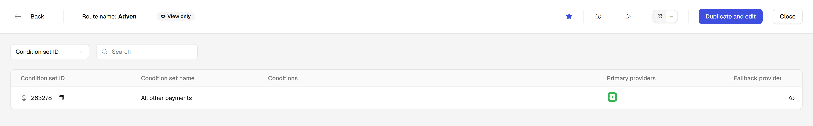

import { Video } from "/snippets/Video.jsx";
import { ExplainerVideo } from "/snippets/ExplainerVideo.jsx";

## Qué es el enrutamiento dinámico {#what-is-dynamic-routing}

El enrutamiento dinámico es una técnica de orquestación de pagos que mejora la experiencia de pago de los usuarios y automatiza el proceso de aumentar las tasas de aprobación. Consiste en dirigir las transacciones de pago al proveedor de servicios de pago o al banco adquirente más adecuado, según factores como el tipo de tarjeta, el monto de la transacción, la moneda y el origen del pago. También puedes usar la función [Smart Routing](#smart-routing), que utiliza inteligencia artificial para identificar la tasa de conversión óptima y asignar las transacciones al proveedor más adecuado.

<Note>
**Configuración de Routing**

Si usas nuestras integraciones de checkout Embedded o Semi-lite, puedes configurar el enrutamiento de tus métodos de pago habilitados después de definir las condiciones para mostrar cada método. En cambio, si usas la versión Lite, todos los métodos de pago disponibles serán accesibles de inmediato, y podrás empezar a configurar cómo se procesa cada pago.
</Note>

<Note>
**Edición de rutas publicadas**

Puedes configurar y editar cualquier aspecto de una ruta publicada, incluidos los monitores y otros ajustes. Las rutas publicadas siguen siendo totalmente editables.
</Note>

<ExplainerVideo src="/videos/explainers/smart-routing-fallback.mp4" poster="/videos/explainers/smart-routing-fallback.jpg" title="Smart Routing y fallback" duration="66 s" />

## Por qué usar el enrutamiento dinámico {#why-use-dynamic-routing}

El [dashboard](https://dashboard.y.uno/auth/login) de Yuno, fácil de usar, ofrece una interfaz gráfica para configurar reglas de negocio para los pagos. La función de enrutamiento dinámico de Yuno te permite crear flujos de pago personalizados al definir servicios de validación y procesamiento según tus requisitos específicos. Como resultado, puedes priorizar los servicios que se ajusten a tus necesidades, como los que tienen comisiones más bajas o tasas de aprobación más altas.

Al aprovechar el enrutamiento dinámico, disfrutarás de varias ventajas:

<CardGroup cols={2}>
  <Card title="Optimización" icon="bolt">
    Optimiza tu estrategia de procesamiento de pagos ante cambios del mercado o exigencias regulatorias ajustando rápidamente las reglas de enrutamiento.
  </Card>
  <Card title="Costos reducidos" icon="money-bill-transfer">
    Reduce de forma significativa las comisiones de procesamiento de pagos al enrutar las transacciones por el PSP o servicio más económico.
  </Card>
  <Card title="Mitigación del fraude" icon="shield-check">
    Dirige las transacciones de alto riesgo a proveedores especializados en prevención del fraude y reduce tu exposición a actividades fraudulentas.
  </Card>
  <Card title="Mayor velocidad de procesamiento" icon="gauge-high">
    Garantiza un procesamiento eficiente de las transacciones al dirigir el volumen al PSP más adecuado según su capacidad y sus tiempos de respuesta.
  </Card>
</CardGroup>

## Configurar el enrutamiento dinámico {#configuring-the-dynamic-routing}

<Tip>
Los métodos de pago que aún no tienen una ruta no aparecen en **Published**. Busca en su lugar la pestaña **Not published** en la parte superior de la sección Routing. Ahí encontrarás todos los métodos de pago conectados a tu cuenta que todavía necesitan una ruta.
</Tip>

1. Primero, accede a tu [dashboard de Yuno](https://dashboard.y.uno/auth/login) y ve a **Routing**. La sección Routing separa los métodos de pago en **Published** y **Not published**. En la pestaña **Not published** encontrarás los métodos de pago conectados a tu cuenta que no tienen una ruta publicada.
2. Elige un método de pago y haz clic en **Set up**. Aparecerá un panel, haz clic en **Create new route** para empezar a configurar rutas.
3. Ponle nombre a la ruta que vas a crear y haz clic en **Save**.
4. Usa el botón **Add new condition** para definir la condición que activará la ruta de procesamiento del pago.
5. Selecciona y define uno o más tipos de condición para acotar el uso de la ruta. Las condiciones disponibles varían según el método de pago seleccionado. Marca una condición para ver opciones intuitivas para configurar cada una.
6. Agrega conexiones a la condición creada. Haz clic en la flecha junto a tu condición y luego en **Add step**. Verás una lista de las conexiones disponibles, entre ellas soluciones antifraude, procesadores y adquirentes. Selecciona una y haz clic en **Select**. Si seleccionas más de una conexión, tendrás que hacer clic en **Next** y definir el porcentaje de pagos que pasará por cada una, o elegir Smart Routing para que asigne los pagos automáticamente según tu preferencia.
7. Para cada nueva conexión, puedes definir rutas para cada caso posible (**Succeeded**, **Pending**, **Declined** y **Error**). Puedes conectar nuevos pasos a cada escenario para construir un enrutamiento completo que cumpla tus necesidades.
8. Después de agregar todos los pasos de la ruta del proceso de pago, puedes publicarla con el botón **Publish**, y quedará disponible para el método de pago correspondiente.

<Video src="https://github.com/writechoiceorg/yuno-images/raw/main/doc/yourPaymentsOperationSystem/routing_V3.mp4" />

## Intentos de fallback y resultados del pago {#fallback-attempts-and-payment-outcomes}

Las ramas **Error** y **Declined** siguen las rutas configuradas para esos resultados. Llegar a otro proveedor significa que se puede ejecutar otro intento de pago, y ese intento aún puede fallar o quedar pendiente. En un pago dividido entre conexiones (consulta [enrutamiento dividido](/es/docs/basic-concepts/transactions)), que una parte sea exitosa no basta para establecer que el pago completo fue exitoso.

Usa [`status` y `sub_status`](/reference/payments/status-and-response-codes/payment) del pago para determinar su resultado. [Consulta el pago por ID](/reference/payments/retrieve-payment-by-id) para conocer su estado actual y usa [webhooks](/docs/webhooks) para recibir actualizaciones. Por ejemplo, `PENDING` con `AUTHORIZED` significa que el pago con tarjeta está autorizado y aún no se ha capturado.

## Smart Routing {#smart-routing}

Smart Routing es una solución diseñada para optimizar de forma inteligente el rendimiento de los pagos según la variable que elijas optimizar como comercio. Para activar Smart Routing, selecciona dos o más conexiones al definir las condiciones, haz clic en **Next** y activa el interruptor de Smart Routing.

Smart Routing puede optimizar tus pagos de dos maneras:

* **Tasa de conversión y latencia**: Toma decisiones inteligentes para optimizar el tiempo de procesamiento y, al mismo tiempo, lograr la tasa de conversión más alta.
* **Tasa de conversión y costos**: Toma decisiones inteligentes para optimizar los costos y, al mismo tiempo, lograr la tasa de conversión más alta. Ingresa los costos asociados a cada proveedor en la sección [Connections](/es/docs/using-yuno/dashboard-overview/connections). Smart Routing usa los costos que configuraste en la página de la conexión para optimizar tus costos.

Solo necesitas especificar con qué proveedores quieres trabajar y qué variable quieres optimizar, y Smart Routing enrutará cada pago por la ruta óptima.

Smart Routing se puede aplicar de forma automática y optimizar la distribución de los pagos por ti. También puedes usar el control manual, que te permite definir el porcentaje exacto de transacciones que se enrutan por cada conexión.

<Video src="https://github.com/writechoiceorg/yuno-images/raw/refs/heads/main/doc/yourPaymentsOperationSystem/smart-routing.mp4" />

## Posautorización después de Smart Routing {#post-authorization-after-smart-routing}

Puedes agregar un proveedor de posautorización después de un paso de Smart Routing. Esto te permite ejecutar acciones adicionales, como revisiones de riesgo o liquidaciones y capturas, después de la aprobación. Agrega un nuevo paso y elige el proveedor que quieras (por ejemplo, Cybersource).

<Frame></Frame>

## Antifraude y autenticación {#antifraud--authentication}

Puedes configurar flujos antifraude y de autenticación como parte de tu configuración de enrutamiento. Estos flujos ayudan a mejorar la seguridad y el cumplimiento normativo en el procesamiento de tus pagos.

### Cómo configurar flujos antifraude y de autenticación {#how-to-configure-antifraud-and-authentication-flows}

Al crear o editar una ruta en la sección Routing:

1. Después de agregar una conexión o un paso a tu ruta, haz clic en el paso para configurarlo.
2. En el panel de configuración del paso, encontrarás opciones para los flujos de **Antifraud & Authentication**.
3. Selecciona el tipo de flujo que quieres configurar:
   * **3DS**: Habilita la autenticación 3D Secure para añadir una capa adicional de seguridad a los pagos con tarjeta. Esto exige que los titulares de la tarjeta completen una autenticación adicional durante el proceso de pago.
   * **Preauth**: Configura flujos de preautorización para validar los métodos de pago antes de completar la transacción. Esto te permite verificar que haya fondos disponibles y que el método de pago sea válido antes de finalizar la transacción.
   * **Postauth**: Configura flujos de posautorización para realizar verificaciones adicionales después de que un pago haya sido autorizado. Si una verificación de posautorización es rechazada, puedes configurar una acción de cancelación de la transacción para revertir automáticamente la autorización.
4. Configura cualquier ajuste adicional específico del tipo de flujo seleccionado.
5. Guarda tus cambios para aplicar la configuración a tu ruta.

### Flujos disponibles {#available-flows}

* **3DS**: Configura la autenticación 3D Secure para añadir una capa adicional de seguridad a los pagos con tarjeta. Este flujo exige que los titulares de la tarjeta completen pasos de autenticación adicionales durante el proceso de pago, lo que ayuda a reducir el fraude y a cumplir los requisitos de Strong Customer Authentication (SCA).
* **Preauth**: Configura flujos de preautorización para validar los métodos de pago antes de completar la transacción. Esto te permite verificar que haya fondos disponibles y que el método de pago sea válido antes de finalizar la transacción, lo que reduce el riesgo de pagos rechazados más adelante en el proceso.
* **Postauth**: Configura flujos de posautorización para realizar verificaciones de seguridad adicionales después de que un pago haya sido autorizado. Si una verificación de posautorización es rechazada, puedes configurar una acción de cancelación de la transacción para revertir automáticamente la autorización, lo que protege a tu negocio de transacciones fraudulentas que pasan la autorización inicial.

### Captura automática {#automatic-capture}

Puedes configurar la captura automática con un retraso definido. Esto te permite capturar automáticamente los pagos autorizados después de un período específico, lo que agiliza tu flujo de procesamiento de pagos.

<Note>
**Configuración de la captura automática**

La captura automática con retraso se configura mediante la [API Create Payment](/es/reference/payments/create-payment) con `delayed_capture_settings` al crear un pago. Esta función no está disponible actualmente en la interfaz de Routing del dashboard. Para información detallada sobre cómo configurar la captura diferida, incluidos el formato del retraso y los ajustes, consulta la documentación de [Cancel and Capture Flow](/es/docs/payment-features/Cancel-and-capture-flow).
</Note>

Al usar la captura automática:

* Define `capture: false` en tu solicitud de pago
* Configura `delayed_capture_settings` con un campo `delay` en formato ISO 8601 (por ejemplo, "P7D" para 7 días, "PT3H" para 3 horas)
* Opcionalmente, define `simplified_mode: true` para habilitar el reintento automático si la captura falla

La captura automática procesará los pagos autorizados después del período de retraso especificado, lo que reduce la intervención manual y garantiza la liquidación oportuna de las transacciones.

## Risk Profiles en las condiciones de enrutamiento {#risk-profiles-in-routing-conditions}

Una condición de enrutamiento puede estar condicionada por un risk profile: una conexión que no es de pago (Fraud, 3DS o Authentication) colocada al inicio de la condición, antes de sus proveedores de pago. Esto habilita listas de bloqueo, listas de permitidos y reglas de velocidad en una ruta.

Esta función te permite agregar y quitar risk profiles directamente, sin modificar la cadena de pago existente. Antes, tenías que eliminar la condición de enrutamiento y reconstruirla desde cero.

<Note>
**Disponibilidad**

Esta función está disponible solo para Payins (está oculta para Payouts) y se puede usar desde tres puntos de entrada:
* El menú de cada condición (⋮) en la vista de árbol.
* El menú de cada fila (⋮) en la vista de lista.
* La barra de acciones masivas en la vista de lista, para aplicar el cambio a varias condiciones a la vez.
</Note>

### Agregar un risk profile {#adding-a-risk-profile}

Al agregar un risk profile:
1. Selecciona una conexión de Fraud, 3DS o Authentication.
2. La conexión se inserta al inicio de la condición: su salida **Succeeded** hereda aquello con lo que la condición empezaba antes. 
3. El enrutamiento de pago existente, incluidas las divisiones por porcentaje, se conserva sin cambios, y el risk profile pasa a ser el nuevo punto de entrada.

<Tip>
**Apilar risk profiles**

Los risk profiles se apilan: agregar un segundo risk profile lo coloca delante del existente (por ejemplo, 3DS → Risk Screening → Payments).
</Tip>

Cuando la conexión elegida es Yuno Risk Screening, un segundo paso opcional te permite configurar su lista de bloqueo, su lista de permitidos o sus reglas de velocidad en el mismo flujo, aplicadas a todas las condiciones seleccionadas. Si omites ese paso, la conexión se inserta sin más configuración.

### Quitar un risk profile {#removing-a-risk-profile}

Al quitar un risk profile, este sale del inicio de la condición y su rama Succeeded vuelve a ser el inicio: el enrutamiento de pago que este controlaba vuelve a ser el punto de entrada, con las divisiones de tráfico conservadas.

Solo sobrevive la rama **Succeeded**. Cualquier ruta que quede inalcanzable como resultado, como las ramas de fallback **Error**, **Declined** o **Pending** del risk profile eliminado y todo lo que haya a continuación de ellas, se elimina de forma recursiva. 

Una ruta que sigue siendo alcanzable a través de la rama **Succeeded** (por ejemplo, un proveedor al que apuntan tanto Succeeded como Declined) se conserva. El resultado es siempre un grafo de enrutamiento limpio, sin nodos huérfanos.

En las acciones masivas, la eliminación se aplica a la conexión elegida en todas las condiciones seleccionadas. Las condiciones que no usan la conexión seleccionada no se modifican.

## Vista de lista {#list-view}

Cuando trabajas con rutas complejas o extensas, puedes usar la vista de lista en lugar del diagrama de flujo visual. La vista de lista ofrece una representación estructurada, en forma de tabla, de la configuración de tu ruta, lo que facilita revisar y administrar rutas con muchos conjuntos de condiciones o configuraciones complejas.

Para acceder a la vista de lista, ve a una ruta en la sección Routing y haz clic en el botón **List view** en la barra de navegación superior. La vista de lista muestra la configuración de tu ruta en formato de tabla con columnas para Condition set ID, Condition set name, Conditions, Primary providers, Fallback providers y Other providers.

Puedes filtrar los conjuntos de condiciones por ID, buscar configuraciones específicas y hacer clic en el ícono del ojo en cualquier fila para ver información detallada. Esta vista es especialmente útil cuando tu ruta tiene muchos conjuntos de condiciones o cuando el diagrama visual resulta difícil de navegar.

<Frame></Frame>
