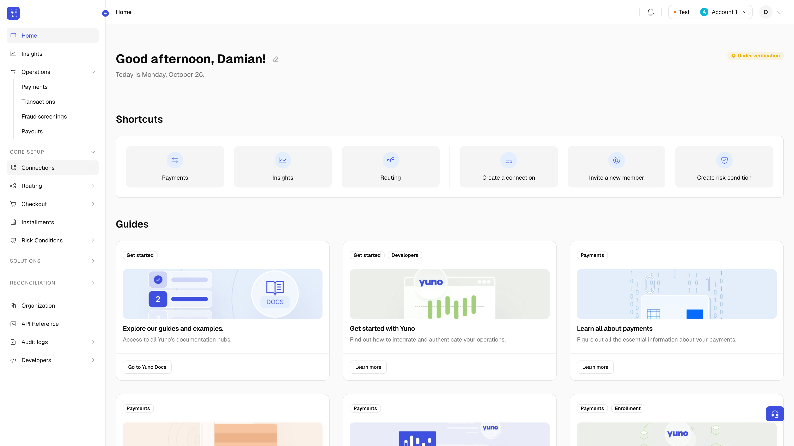

El Dashboard de Yuno ofrece una interfaz centralizada para gestionar y configurar tus cuentas de Yuno, con las funcionalidades clave organizadas para un acceso rápido. Algunas de las funcionalidades del Dashboard incluyen:

* Conectarte a una lista de proveedores en constante crecimiento
* Diseñar experiencias de checkout personalizadas
* Visualizar datos de pago completos
* Configurar Smart Routing
* Y mucho más

<Frame></Frame>

El checkout unificado y la integración de pagos de Yuno simplifican tu stack de pagos e integran APIs y herramientas de toda la web, creando flujos de pago dinámicos de extremo a extremo. Nuestra documentación te guiará por la arquitectura del Dashboard, sus componentes clave y sus funcionalidades, para que aproveches de forma eficaz las capacidades de orquestación de pagos de Yuno.
