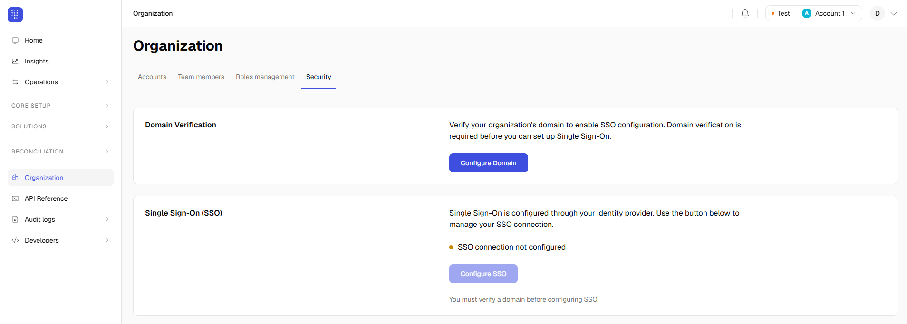
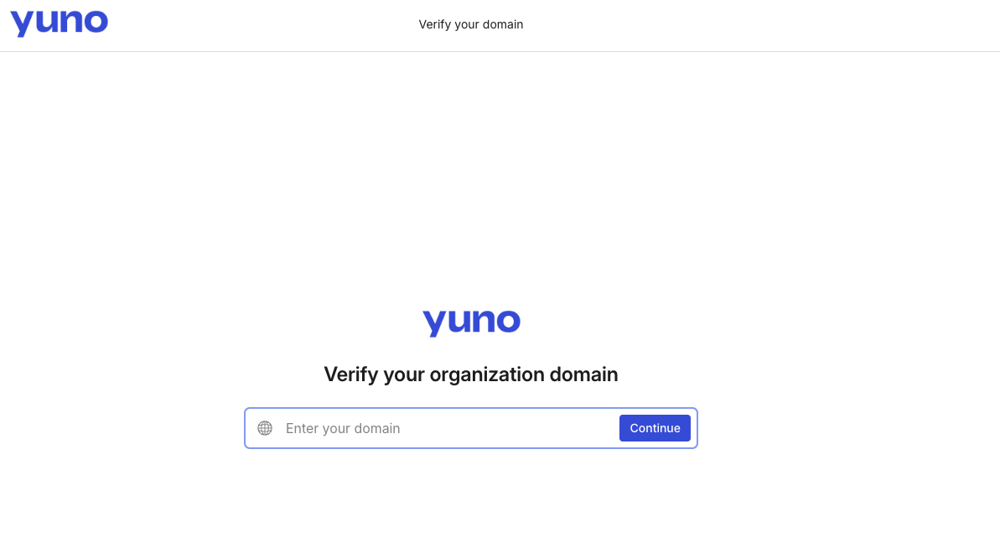
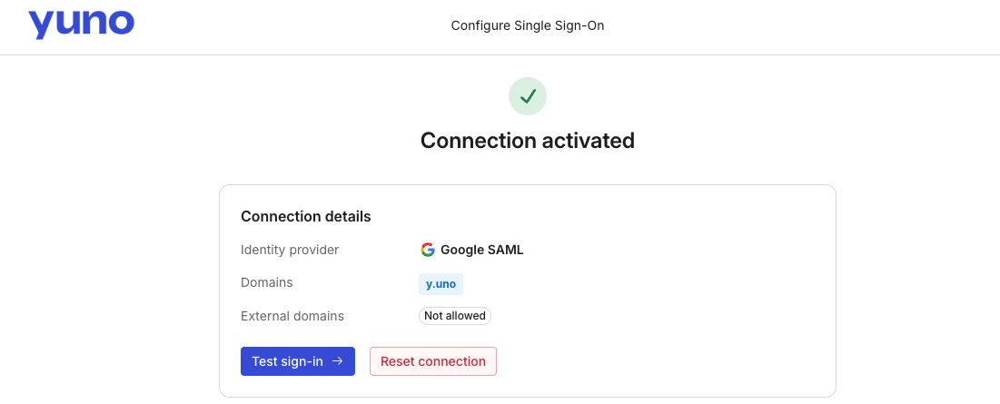

El **inicio de sesión único (SSO)** permite que tu equipo inicie sesión en el Dashboard de Yuno con el proveedor de identidad (IdP) que tu empresa ya usa, en lugar de crear credenciales separadas para Yuno.

<Tip>
**¿No puedes entrar ahora mismo?** Los emails de restablecimiento de contraseña no te devolverán el acceso si tu organización usa SSO. Escribe directamente a [support@y.uno](mailto:support@y.uno) con tu dirección de email y la hora aproximada en que intentaste iniciar sesión, para que el equipo pueda revisar qué está bloqueando el acceso. No esperes un email de restablecimiento de contraseña que quizás nunca resuelva el problema.
</Tip>

Yuno es compatible con SSO mediante el estándar **SAML 2.0** y con una amplia variedad de proveedores de identidad, entre ellos Google Workspace, Microsoft Entra ID (Azure AD), Okta, OneLogin, JumpCloud, ADFS, Ping Identity, Auth0, Keycloak y cualquier proveedor compatible con SAML 2.0. La configuración se realiza en un portal alojado dedicado: no necesitas pegar metadatos SAML, entity IDs ni certificados dentro del Dashboard de Yuno.

<Note>
Esta página describe el flujo actual de configuración de SSO, que usa un portal alojado tanto para la verificación de dominio como para la configuración de SSO. Si tu organización configuró SSO con el enfoque anterior dentro del Dashboard, vuelve a configurarlo con los pasos que se describen a continuación.
</Note>

## Requisitos previos {#prerequisites}

<Warning>
**Antes de comenzar**

- **Rol Admin** en cada cuenta que pertenece a tu organización.
- **Acceso a DNS** para agregar un registro TXT durante la verificación de dominio.
- **Acceso de administrador al IdP** para completar la configuración de SAML en la consola de tu proveedor de identidad.
</Warning>

## Configurar SSO {#setting-up-sso}

La pestaña **Security → Single sign-on** contiene dos tarjetas: **Domain Verification** y **Single Sign-On**. Complétalas en orden. La configuración de SSO permanece bloqueada hasta que tu dominio esté verificado.

<Frame></Frame>

<Steps>
  <Step title="Verifica el dominio de tu organización">
    La verificación de dominio demuestra que tu organización es propietaria del dominio de email con el que sus usuarios iniciarán sesión (por ejemplo, `acme.com`).

    1. En el Dashboard de Yuno, ve a **Organization** → **Security** → **Single sign-on**.
    2. En la tarjeta **Domain Verification**, haz clic en **Configure Domain**.
    3. Se abre una nueva pestaña del navegador con el portal de verificación de dominio de Yuno.

    <Frame></Frame>

    4. Ingresa el dominio de email que quieres verificar y haz clic en **Continue**.
    5. Copia el registro TXT que proporciona el portal y agrégalo en tu proveedor de DNS exactamente como se muestra, sin comillas ni espacios adicionales.
    6. Vuelve al portal y haz clic en **Verify**.
    7. Vuelve al Dashboard de Yuno. Cuando el registro se propague y el portal lo valide, la tarjeta Domain Verification muestra una etiqueta verde **Domain verified · your-domain.com**.

    <Note>
    La propagación del DNS puede tardar entre unos minutos y varias horas. El estado de la verificación se actualiza automáticamente cuando vuelves a abrir la página.
    </Note>
  </Step>

  <Step title="Configura tu conexión de SSO">
    Una vez que tu dominio está verificado, el botón **Configure SSO** de la tarjeta Single Sign-On se activa. Si tu dominio aún no está verificado, el botón está deshabilitado y la tarjeta muestra el mensaje *"You must verify a domain before configuring SSO."*

    1. Haz clic en **Configure SSO**. Se abre una nueva pestaña del navegador con el portal alojado de configuración de SSO.
    2. Elige tu proveedor de identidad en el catálogo (Google, Microsoft Entra ID, Okta, OneLogin, JumpCloud, Generic SAML y otros).
    3. El portal te guía en la configuración de la conexión con instrucciones específicas para cada proveedor. Los campos habituales son:

    | Campo | Dirección |
    |-------|-----------|
    | **ACS URL** (Assertion Consumer Service URL) | Lo proporciona el portal, pégalo en tu IdP |
    | **SP Entity ID** | Lo proporciona el portal, pégalo en tu IdP |
    | **IdP Sign-In URL** | Lo proporciona tu IdP, pégalo en el portal |
    | **IdP X.509 Certificate** | Lo proporciona tu IdP, pégalo en el portal |

    4. Guarda la conexión en el portal. El portal valida la conexión de extremo a extremo antes de activarla.

    <Frame></Frame>

    5. Vuelve al Dashboard de Yuno. La tarjeta **Single Sign-On** muestra uno de los siguientes estados:

    | Estado | Significado |
    |--------|-------------|
    | **SSO is ready to use** · `Google SAML` / `Okta SAML` / `SAML` | La conexión está activa y los usuarios pueden iniciar sesión con SSO. La etiqueta incluye el tipo de conexión. |
    | **SSO connection active** | La conexión existe y funciona, pero aún no está marcada como lista para uso general |
    | **SSO connection not configured** | No existe una conexión o la conexión está inactiva. Haz clic en **Configure SSO** para completar la configuración |

    <Note>
    No necesitas subir metadatos XML, pegar un entity ID ni subir un certificado dentro del Dashboard de Yuno. Toda la configuración de SAML está en el portal alojado.
    </Note>
  </Step>
</Steps>

## Iniciar sesión con SSO {#signing-in-with-sso}

Una vez que la conexión está activa, los usuarios pueden iniciar sesión con SSO desde la página de inicio de sesión de Yuno:

1. Abre `dashboard.y.uno`. Se te redirige brevemente a través de `id.y.uno`, el dominio de autenticación de Yuno.
2. Ingresa tu dirección de email corporativa y haz clic en **Continue with SSO**.
3. Se te redirige a tu proveedor de identidad para autenticarte.
4. Después de que tu IdP te autentique, regresas al Dashboard de Yuno.

## Administrar SSO {#managing-sso}

- **Deshabilitar o volver a habilitar SSO**: **Security** → **Login methods** muestra si SSO está habilitado en tu organización. Cambiarlo no es de autoservicio: contacta al equipo de Yuno para activar o desactivar SSO. Consulta [Métodos de inicio de sesión](/es/docs/using-yuno/organization/security#login-methods).
- **Editar una conexión existente**: ve a **Security** → **Single sign-on** y haz clic en **Configure SSO** para volver a abrir el portal alojado y actualizar la configuración.

## Solución de problemas {#troubleshooting}

**Los usuarios regresan a la pantalla de inicio de sesión**

Yuno exige que tanto la respuesta SAML como la aserción estén firmadas con SHA-256. Si el inicio de sesión falla, confirma en tu IdP que tanto la respuesta como la aserción estén firmadas con SHA-256, y que el certificado registrado en el portal alojado coincida con el que tu IdP usa actualmente.

**Rotación de certificados**

Cuando rotes los certificados en tu IdP, vuelve a abrir el portal de SSO alojado y actualiza el certificado allí. Mientras el portal no refleje el nuevo certificado, los inicios de sesión con SSO fallarán.

**Logs de inicio de sesión con SSO**

Los usuarios del Dashboard no pueden ver directamente los audit logs de los intentos de SSO. Para investigar un problema de autenticación, contacta a Yuno Support con la dirección de email del usuario y la marca de tiempo aproximada, para que el equipo de soporte pueda obtener los logs correspondientes.
