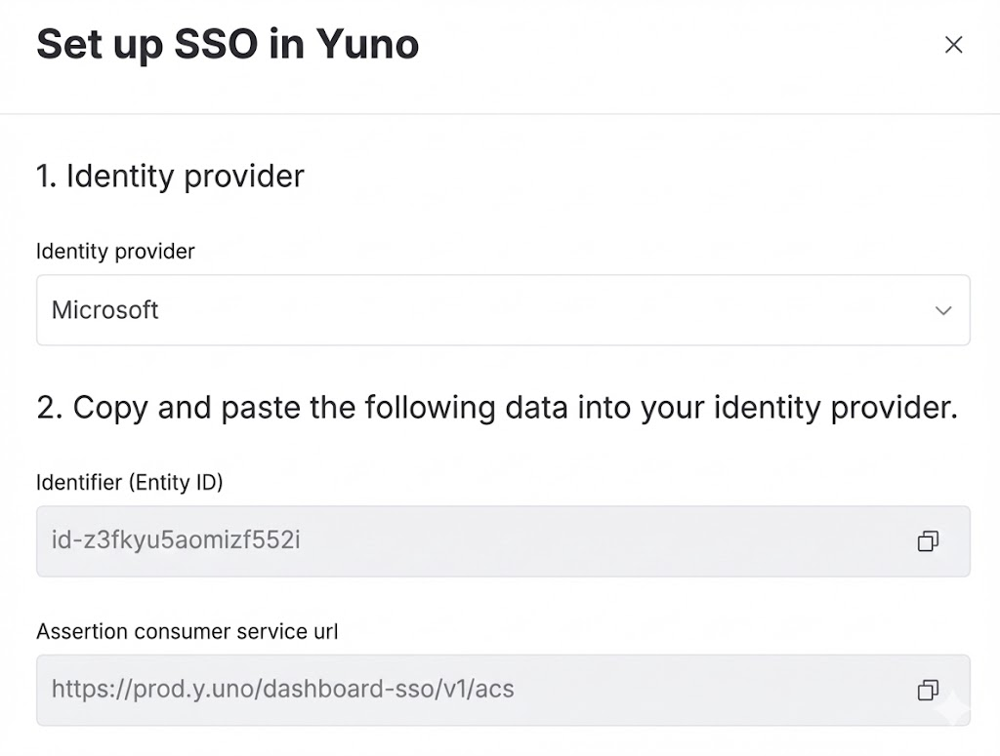
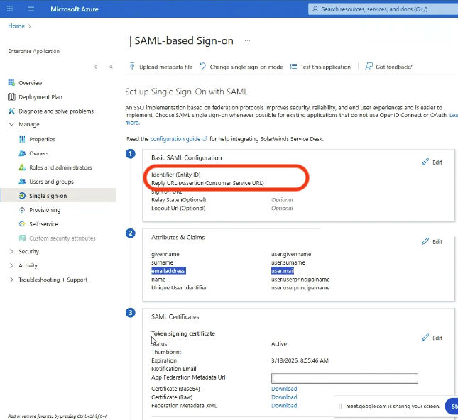
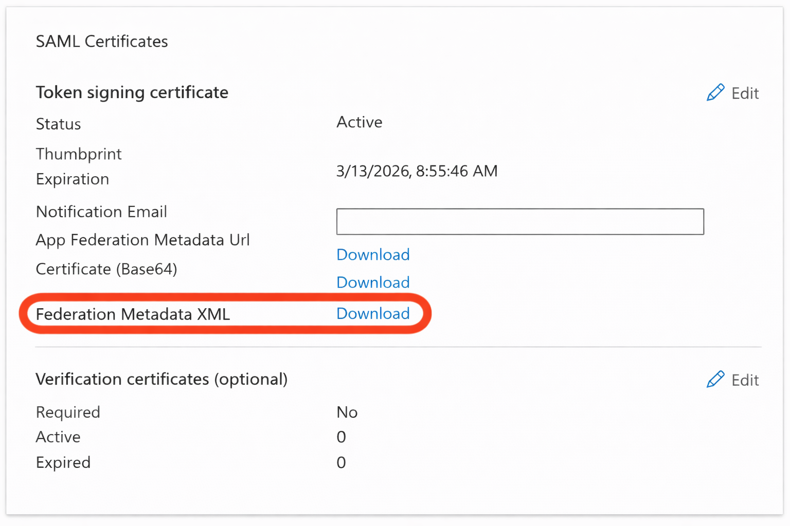
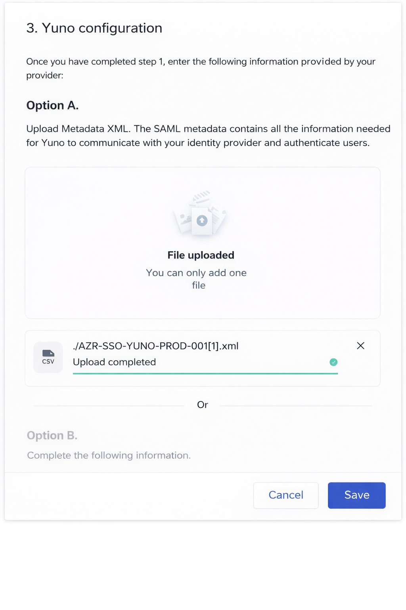

Esta guía explica cómo conectar Yuno con Microsoft Entra ID (anteriormente Azure Active Directory) mediante SAML 2.0.

## Requisitos previos {#prerequisites}

* Un tenant de Microsoft Entra ID
* Una aplicación para usar con Yuno
* Privilegios de administrador de Entra ID para administrar la configuración de SSO
* Acceso al [Dashboard de Yuno](https://dashboard.y.uno/)

<Steps>
  <Step title="Configura los ajustes básicos de SAML">
    Primero, ve al Dashboard, haz clic en tu imagen de perfil y abre **Security**. Ve a la pestaña Single Sign-On (SSO), haz clic en **Set up** y reúne esta información:

    * Identifier (Entity ID)
    * Assertion Consumer Service URL

    <Frame></Frame>

    En Microsoft Entra ID, ve a:

    **Enterprise applications → All applications → Your application → Single sign-on**

    En **Basic SAML configuration**, ingresa los valores del Dashboard de Yuno.

    <Frame></Frame>
  </Step>

  <Step title="Exporta y sube el XML de metadatos de federación">
    En Microsoft Entra ID, ve a la sección **SAML certificates** y descarga el archivo **Federation Metadata XML**.

    <Frame></Frame>

    Luego, en el Dashboard de Yuno:

    1. Sube el archivo XML en **Yuno configuration → Option A: Upload metadata XML**
    2. Espera la confirmación **Upload completed**
    3. Haz clic en **Save**

    <Frame></Frame>

    También puedes tomar la información que aparece en la **Option B** e ingresarla manualmente.
  </Step>

  <Step title="Verifica la configuración del certificado SAML">
    En Microsoft Entra ID, abre **SAML certificates** y asegúrate de que:

    * La opción de firma sea **Sign SAML response and assertion**
    * El algoritmo de firma sea **SHA-256**

    Haz clic en **Save** para aplicar los cambios.
  </Step>
</Steps>

## Solución de problemas {#troubleshooting}

Si no puedes configurar la conexión de SSO o tienes problemas después de la configuración inicial:

* Recuerda que Yuno requiere **respuestas SAML firmadas**, verifica que:
  * Tanto la respuesta SAML como la aserción estén firmadas
  * El algoritmo de firma sea **SHA-256**
  * El certificado de firma coincida con el que se subió a Yuno
* Revisa los logs de SSO en el Dashboard de Yuno, en **Security → Single sign-on (SSO)**