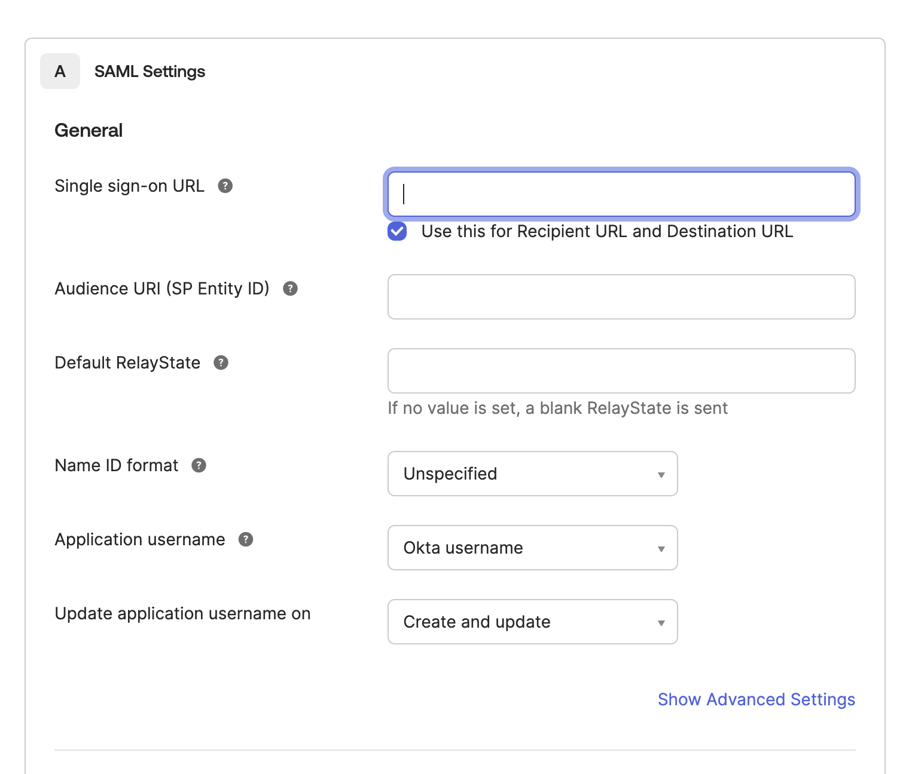
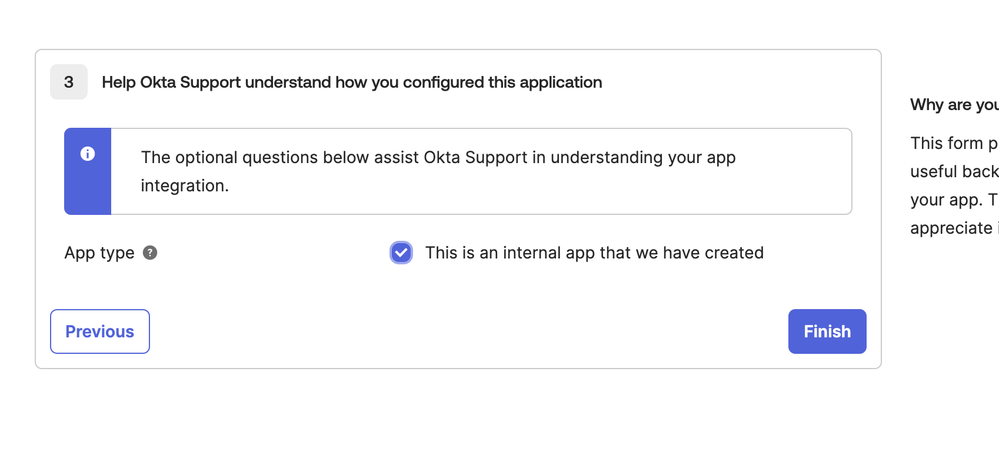
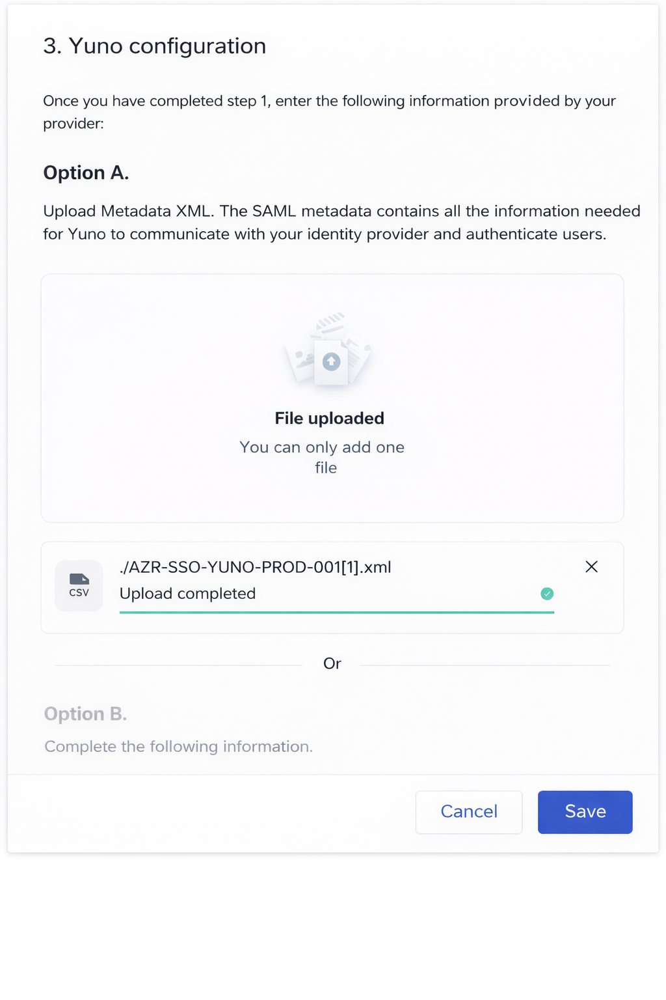

Esta guía explica cómo conectar Yuno con Okta mediante SAML 2.0.

## Requisitos previos {#prerequisites}

* Una cuenta de Okta
* Privilegios de administrador en Okta para administrar la configuración de SSO y crear aplicaciones (crearás la aplicación SAML para Yuno en el paso 1 que aparece más abajo; no es necesario que exista una aplicación de antemano)
* Acceso al [Dashboard de Yuno](https://dashboard.y.uno/)

<Steps>
  <Step title="Crea una aplicación SAML en Okta">
    En Okta, ve a:

    **Applications → Create App Integration → SAML 2.0 → Next**

    Elige un nombre para tu aplicación y, si quieres, sube un logo. Luego verás el formulario de configuración de SAML.

    <Frame></Frame>
  </Step>

  <Step title="Configura los ajustes de SAML con los valores de Yuno">
    Abre el Dashboard de Yuno, haz clic en tu imagen de perfil y luego abre **Security**.  Ve a la pestaña **Single Sign-On (SSO)**, haz clic en **Set up** y reúne esta información:

    * Identifier (Entity ID)
    * Assertion Consumer Service URL

    Copia estos valores en el formulario SAML de Okta:

    * **Audience URI (SP Entity ID)** → Identifier (Entity ID)
    * **Single sign-on URL** → Assertion Consumer Service URL

    Haz clic en **Next**, luego marca la opción **This is an internal app…** y termina la configuración.

    <Frame></Frame>
  </Step>

  <Step title="Exporta y sube el XML de metadatos">
    En Okta, busca la **Metadata URL** en la configuración de la aplicación y ábrela. Guarda el archivo como `metadata.xml`.

    Luego, en el Dashboard de Yuno:

    1. Sube el archivo `metadata.xml` en **Yuno configuration → Option A: Upload metadata XML**
    2. Espera la confirmación **Upload completed**
    3. Haz clic en **Save**

    <Frame></Frame>

    También puedes tomar la información que aparece en la **Option B** e ingresarla manualmente.
  </Step>

  <Step title="Asigna usuarios en Okta (opcional)">
    Una vez completada la configuración, puedes asignar usuarios o grupos de Okta a la aplicación para que puedan iniciar sesión con SSO.
  </Step>
</Steps>

## Solución de problemas {#troubleshooting}

Si no puedes configurar la conexión de SSO o tienes problemas después de la configuración inicial:

* Yuno requiere **respuestas SAML firmadas**, verifica que:
  * Tanto la respuesta SAML como la aserción estén firmadas
  * El algoritmo de firma configurado en Okta sea **SHA-256**
  * El certificado usado para la firma coincida con el incluido en los metadatos
* Revisa los logs de SSO en el Dashboard de Yuno, en **Security → Single sign-on (SSO)**