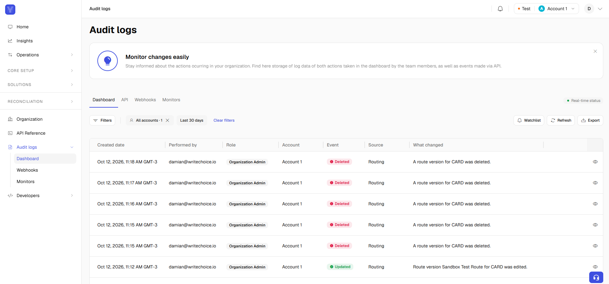

La sección **Audit logs** ofrece transparencia, seguridad y cumplimiento normativo al registrar y hacer seguimiento de todas las actividades de los miembros del equipo dentro del Dashboard. Con los audit logs puedes mantenerte informado sobre las acciones que ocurren dentro de tu organización.

<Frame></Frame>

Los audit logs de Yuno simplifican las tareas de administración mediante varias funciones:

* **Registro completo de la actividad**: haz seguimiento de cada acción realizada dentro del Dashboard, de cuándo ocurrió y de los cambios hechos. Este nivel de detalle garantiza transparencia y responsabilidad en todas las operaciones.
* **Seguimiento de usuarios**: los audit logs garantizan que cada acción pueda atribuirse a una persona específica, lo que te permite identificar la causa de cualquier cambio y analizar el comportamiento de los usuarios para mejorar de forma continua.
* **Datos técnicos detallados**: al hacer clic en la etiqueta **Event** de cada acción (como "Updated" o "Created") se muestra información adicional para desarrolladores y usuarios técnicos, incluida la dirección IP del dispositivo usado para hacer el cambio y el cuerpo de la respuesta del endpoint de la API.
* **Capacidades de búsqueda avanzada**: selecciona **Add filters** para acotar rápidamente tu búsqueda. Elige entre una variedad de filtros, como cuentas, fechas, miembros del equipo y más, para localizar los datos que necesitas de forma eficiente.

Los audit logs son esenciales para la seguridad y el cumplimiento de Yuno, ya que garantizan que cada acción quede registrada. Esto brinda un control fundamental, protege tus operaciones y facilita el análisis de la causa raíz después de los cambios de los usuarios.

## Navegar por los Audit logs {#navigating-audit-logs}

La sección **Audit logs** te da total transparencia sobre las acciones realizadas en tu cuenta de Yuno. Está organizada en dos pestañas principales:

* **Dashboard**: aquí encontrarás un registro de las acciones que los miembros del equipo realizaron directamente en el Dashboard de Yuno.
* **Monitors**: esta pestaña te permite hacer seguimiento de los eventos creados mediante la API, y ofrece información sobre las actividades automatizadas o programáticas.

En ambas pestañas puedes ajustar fácilmente el período para ver los eventos. Elige entre opciones predefinidas como hoy, este mes o los últimos 30 días, o define un rango de fechas personalizado.

Para ubicar información específica de forma eficiente, usa el botón **Add filters**. Ofrece varias opciones para refinar tu búsqueda:

### En la pestaña Dashboard {#within-the-dashboard-tab}

* **Accounts**: ordena los eventos por las distintas cuentas de tu Dashboard de Yuno.
* **Date**: selecciona entre varios filtros de tiempo o ingresa un rango de fechas personalizado.
* **Event**: filtra por acciones específicas, como eventos de "creación", "actualización" o "eliminación".
* **Source**: filtra por origen (webhooks, enlaces de pago, conexiones, enrutamiento, reembolsos y otros orígenes) para acotar tu búsqueda.
* **Team member**: ve los logs generados por las acciones de uno o más miembros del equipo específicos.

### La pestaña Monitors ofrece un conjunto distinto de filtros {#the-monitors-tab-offers-a-different-set-of-filters}

* **Actions**: filtra por eventos que redistribuyen el tráfico o no.
* **Created at**: especifica el período de tu búsqueda.
* **Payment methods**: ordena por los distintos métodos de pago que configuraste, como tarjeta de crédito.
* **Providers**: filtra por proveedores de pago específicos.
* **Status**: ve solo los eventos resueltos o sin resolver.