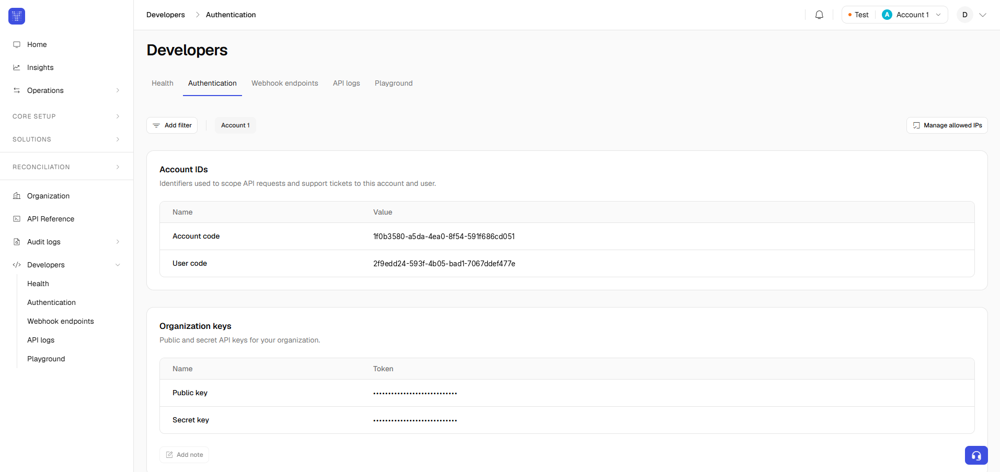

La sección **Developers** del Dashboard de Yuno proporciona credenciales de autenticación seguras (también conocidas como claves) para integrar los servicios de Yuno. Yuno mantiene claves separadas para los entornos de prueba y producción (Test y Live), lo que mantiene las credenciales aisladas entre entornos y reduce el riesgo de usar credenciales reales por accidente durante las pruebas.

## Estructura de las credenciales {#credential-structure}

Yuno implementa una jerarquía de autenticación de dos niveles:

1. **Claves de la organización**
   * Capa de autenticación principal que funciona como puerta de entrada a todas tus operaciones
   * Dan acceso a todas las [cuentas](/es/docs/using-yuno/organization/accounts) asociadas a tu organización
   * Se asignan a tu organización después de registrarte en Yuno
   * La clave de la organización es la que envías en el encabezado `X-Organization-Code` en los endpoints que lo requieren (por ejemplo, [Create a Report](/es/reference/reports/create-a-report))

2. **Claves de las cuentas**
   * Únicas para cada cuenta de tu organización
   * Funcionan de forma independiente entre los modos Test y Live
   * Ofrecen un control de acceso granular

## Acceder a las credenciales {#accessing-credentials}

Puedes acceder a tus credenciales de autenticación de dos maneras:

* **Accounts**: la pestaña [**Accounts**](https://dashboard.y.uno/organization/accounts) de la sección Organization contiene las credenciales de cada cuenta. Haz clic en el nombre de cada cuenta para acceder de inmediato a sus claves.
* **Sección Developers**:  también puedes acceder a tus credenciales de autenticación desde la sección **Developers**. La pestaña **Authentication**, abierta de forma predeterminada, muestra las claves de cuenta, de organización y las claves de API personalizadas. Tus permisos determinan qué claves se ven. Esta área es especialmente útil al integrar las funcionalidades de Yuno en tus aplicaciones o sistemas.

<Frame></Frame>

## Claves de API personalizadas {#customized-api-keys}

Yuno te permite crear claves de API personalizadas para mayor seguridad y control, de modo que solo los miembros autorizados puedan acceder a datos y reportes mediante la API.

Dentro de la pestaña Authentication de la sección Developers, busca Customized API keys y haz clic en **Create key** junto a ella. Desde ahí puedes definir varios parámetros:

* El nombre de la clave y el miembro que puede acceder a ella.
* Una o más cuentas asociadas a la nueva clave.
* Uno o más productos a los que puede acceder la clave, como suscripciones, pagos, planes de cuotas y más.

La flexibilidad de las claves de API personalizadas simplifica el control de accesos y permisos, y permite administrar la integración con la API de forma fácil y segura desde el Dashboard de Yuno.

<Info>
**Importante: visualización de la clave de API**

Cuando creas una clave de API personalizada, el valor de la clave se muestra solo una vez durante la creación. Asegúrate de copiarla y guardarla de forma segura de inmediato, porque no podrás volver a verla. Si pierdes la clave o necesitas rotarla por motivos de seguridad, puedes regenerarla, lo que invalidará la clave anterior y generará una nueva.
</Info>

## Protege tus credenciales {#safeguarding-your-credentials}

Proteger tus credenciales de autenticación es fundamental para mantener operaciones seguras. Sigue estas pautas:

* Trata las credenciales como información sensible
* Nunca compartas las credenciales con personas no autorizadas
* Supervisa el uso de las credenciales

<Note>
**Alerta de seguridad**

Si sospechas que tus credenciales quedaron expuestas o que hubo un acceso no autorizado, contacta de inmediato a nuestro equipo de soporte. Actuar con rapidez ayuda a mantener la seguridad de tus operaciones.
</Note>

## IP permitidas {#allowed-ips}

Puedes configurar una lista de direcciones IP permitidas para restringir el acceso a la API a direcciones IP o rangos de IP específicos. Esto agrega una capa adicional de seguridad, ya que garantiza que las solicitudes a la API solo puedan originarse en direcciones IP aprobadas.

<Info>
**Importante: validación de IP**

Si no se agrega ninguna dirección IP, las IP no se validan de forma predeterminada. Ten cuidado al agregar nuevas IP, ya que es un cambio sensible que puede afectar el procesamiento de pagos.
</Info>

Para configurar las IP permitidas:

1. Ve a la sección **Developers** del Dashboard de Yuno.
2. Ve a la pestaña **Authentication**.
3. Haz clic en el botón **Manage allowed IPs** (ubicado en la parte superior derecha de la pestaña Authentication).
4. En el modal que se abre, ingresa direcciones IP o rangos de IP en el campo **Enter IP address**. Puedes:
   * Ingresar direcciones IP individuales (por ejemplo, `192.168.1.1`)
   * Ingresar rangos de IP con notación CIDR (por ejemplo, `192.168.1.0/24`)
   * Agregar varias IP separándolas con una coma, un punto y coma, un espacio o presionando Enter
5. Revisa la lista de IP permitidas en la tabla de abajo.
6. Haz clic en **Save changes** para aplicar la configuración.

Una vez configurada, las solicitudes a la API desde direcciones IP que no estén en la lista de permitidas serán rechazadas, lo que mejora la seguridad de tus integraciones con la API.

<Note>
**Administración de direcciones IP**

Puedes agregar varias direcciones IP o rangos, y actualizarlos o eliminarlos según lo necesites. Los cambios en la lista de IP permitidas se aplican de inmediato.
</Note>

## Webhooks {#webhooks}

La pestaña **Webhooks** de la sección Developers te permite crear y administrar webhooks para recibir notificaciones en tiempo real sobre los eventos de tu cuenta de Yuno.

### Crear un webhook {#creating-a-webhook}

Para crear un nuevo webhook:

1. Ve a la sección **Developers** del Dashboard de Yuno.
2. Haz clic en la pestaña **Webhooks**.
3. Haz clic en **Add webhook** para abrir el formulario de creación del webhook.
4. Completa la información requerida en la sección **Details**:
   * **Name**: asigna un nombre descriptivo a tu webhook.
   * **Endpoint URL**: ingresa la URL a la que Yuno debe enviar las notificaciones del webhook.
   * **x-api-key** y **x-secret**: define las credenciales de autenticación para la verificación del webhook (obligatorio).
   * **Use OAuth 2.0 authentication**: autentica la entrega del webhook con un token OAuth 2.0 (opcional).
   * **Use HMAC signing**: firma los payloads del webhook con un secreto HMAC (opcional).
5. En **Trigger on** (obligatorio), selecciona los eventos que deben activar el webhook. Las categorías de eventos disponibles incluyen:
   * **Enrollment**: Enroll, Unenroll
   * **Payment**: Authorize, Cancel, Capture, Refund, Verify, Chargeback, Purchase
   * **Report**: Create, Update
   * **Subscription**: Create, Pause, Resume, Cancel, Complete
   Yuno recomienda seleccionar todos los eventos relevantes para garantizar una cobertura completa.
6. En **Apply this webhook to other accounts** (obligatorio), selecciona qué cuentas deben recibir las notificaciones del webhook. Puedes:
   * Seleccionar cuentas específicas de la lista
   * Usar "Select all" para aplicarlo a todas las cuentas
   * Usar "Inverse" para invertir tu selección
   * Elegir "Current account only" para limitar el webhook a la cuenta actual
7. Haz clic en **Create** para crear el webhook.

### Administrar webhooks {#managing-webhooks}

Una vez creado, puedes:

* **View webhook details**: ver la configuración del webhook, la URL del endpoint y los eventos que lo activan.
* **Edit webhook**: actualizar el nombre del webhook, la URL del endpoint, las credenciales de autenticación o los eventos que lo activan.
* **Test webhook**: enviar una notificación de prueba para verificar que el webhook funciona correctamente.
* **Delete webhook**: eliminar un webhook que ya no necesitas.

<Note>
**Seguridad de los webhooks**

Usa siempre HTTPS en las URL de los endpoints de tus webhooks para garantizar la transmisión segura de sus datos. Además, verifica las firmas de los webhooks con la clave pública y la clave secreta privada proporcionadas, para asegurarte de que los webhooks son auténticos y no han sido alterados.
</Note>