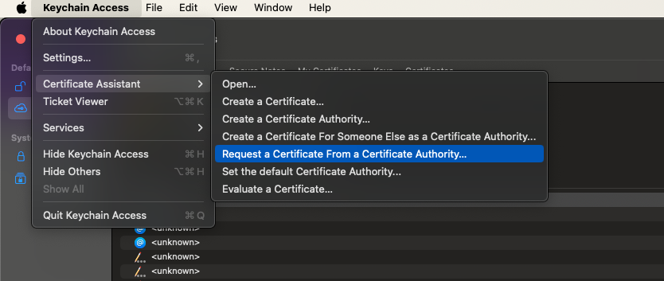
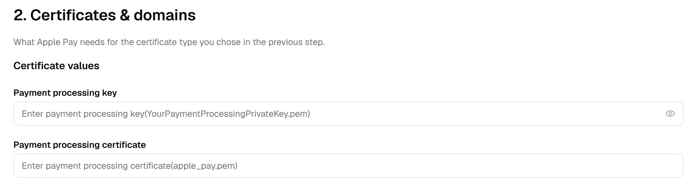
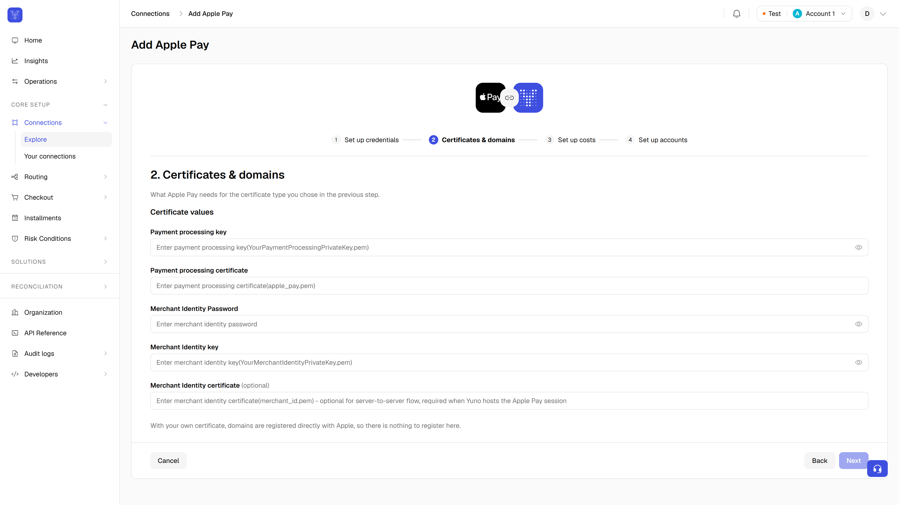
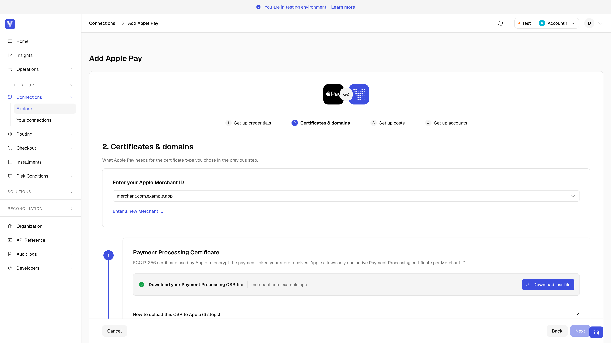
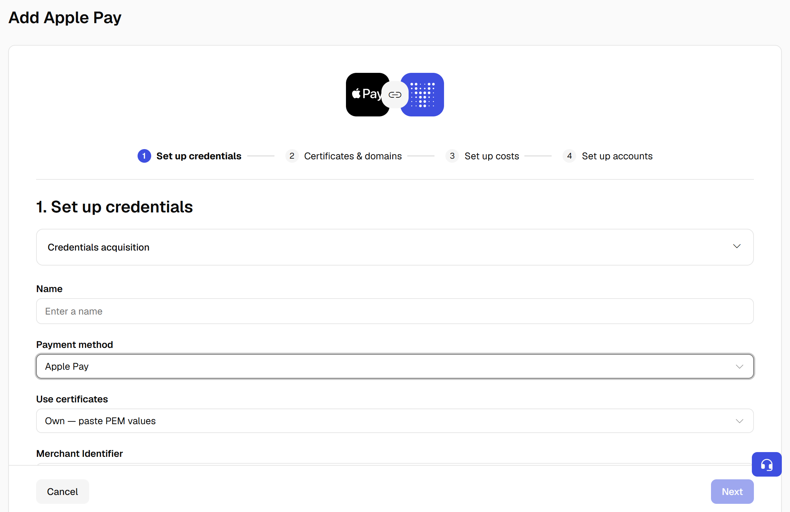
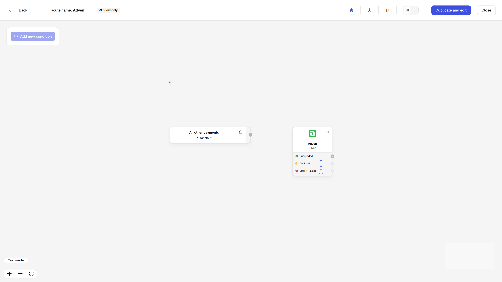
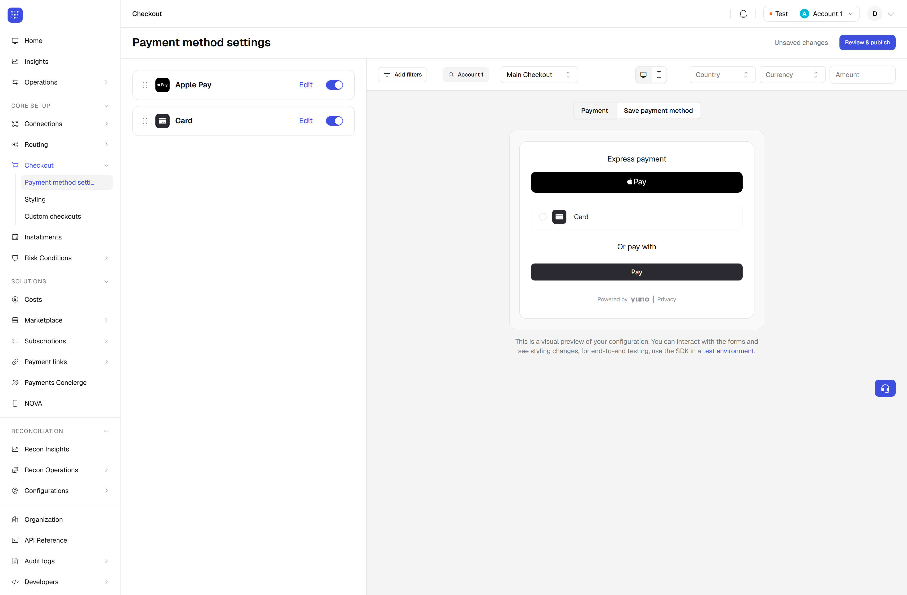

Usa esta guía para preparar y configurar Apple Pay con Yuno.

- [**Requisitos previos de Apple Developer**](#apple-pay-certificate-options): Según la ruta de certificados que elijas, puede que necesites crear un merchant ID y generar certificados y claves (Own), o registrar los dominios de tu comercio (Yuno).
- [**Configuración del Yuno Dashboard**](#finish-in-the-dashboard): Agrega la conexión de Apple Pay, configura el enrutamiento y habilita Apple Pay en Checkout Builder.

Al terminar, estarás listo para [elegir tu ruta de integración](#next-steps)  (SDK o Direct) para pagos únicos y recurrentes.

## Opciones de certificados de Apple Pay {#apple-pay-certificate-options}

En el Yuno Dashboard encontrarás tres opciones para los certificados de Apple Pay:

- **Yuno**: Esta opción es para comercios que no tienen una cuenta de Apple Developer ni una app móvil (es decir, que solo operan en la web). En estos casos, debes registrar los dominios de tu comercio para usar los certificados de Yuno. [→ Certificados de Yuno: registra los dominios de tu comercio](#yuno-certificates-register-your-merchant-domains)
- **Own (manual)**: Esta opción es para comercios que tienen una cuenta de Apple Developer y prefieren administrar sus propias claves privadas. Generas y conviertes los certificados manualmente con Keychain Access y OpenSSL (pasos 2 a 9), y luego pegas los valores PEM en el Yuno Dashboard. [→ Certificados propios (manual)](#own-certificates-manual)
- **Own — Yuno generates the CSRs**: Esta opción es para comercios que tienen una cuenta de Apple Developer pero no quieren generar claves privadas ni ejecutar comandos de OpenSSL. Yuno genera por ti las solicitudes de firma de certificado (CSR), tú las subes a Apple y devuelves los certificados firmados. [→ Certificados propios con CSR generados por Yuno](#own-certificates-with-yuno-generated-csrs)

## Certificados propios (manual) {#own-certificates-manual}

Esta ruta es para comercios que tienen una cuenta de Apple Developer y quieren generar y administrar sus certificados manualmente con Keychain Access y OpenSSL.

### Paso 1: Registra un identificador de comercio {#step-1-register-a-merchant-identifier}

<Note>
  Si usas VTEX como plataforma de e-commerce, deberás configurar tu Merchant ID de Apple Pay. Para ver instrucciones detalladas, consulta la [documentación oficial de VTEX](https://developers.vtex.com/docs/guides/setting-up-merchant-id-in-apple-pay).
</Note>

En el panel de Apple Developer:

1. Inicia sesión en [Apple Developer](https://idmsa.apple.com/IDMSWebAuth/signin?appIdKey=891bd3417a7776362562d2197f89480a8547b108fd934911bcbea0110d07f757&path=%2Faccount%2F&rv=1), ve a **Certificates, Identifiers & Profiles** y luego selecciona **Register a new identifier**.
2. Elige **Merchant IDs**.
3. Ingresa una **Description** (por ejemplo, `Apple Pay Integration`) y un **Identifier** con el formato `merchant.com.y.uno.YourBusinessName`.

### Paso 2: Genera un certificado de procesamiento de pagos {#step-2-generate-a-payment-processing-certificate}

1. Crea un directorio nuevo (por ejemplo, `Downloads/ApplePayFiles`) para guardar los archivos de certificados.
2. Abre **Keychain Access** en tu Mac.
3. Ve a **Keychain Access \> Certificate Assistant \> Request a Certificate From a Certificate Authority**.

<Frame>
  
</Frame>

4. Completa el formulario:
   - **Email Address**: tu dirección de email
   - **Common Name**: un nombre para el certificado (por ejemplo, `John Doe ProcessingCertificate`)
   - **CA Email Address**: déjalo en blanco
   - Selecciona **Saved to disk**
   - Marca **Let me specify key pair information**
5. Haz clic en **Continue** y luego guarda el archivo como `CertificateSigningRequestPaymentProcessingCertificate.certSigningRequest` en tu directorio de trabajo.
6. Cuando se te pida la configuración del par de claves, usa:
   - **Key Type**: Elliptic Curve (EC)
   - **Key Size**: 256-bit
   - **Algorithm**: ECDSA

### Paso 3: Obtén y convierte el certificado de procesamiento de pagos {#step-3-retrieve-and-convert-the-payment-processing-certificate}

1. Ve a la [lista de Merchant ID de Apple Developer](https://developer.apple.com/account/resources/identifiers/list/merchant).
2. Selecciona tu Merchant ID y haz clic en **Create Certificate** en **Apple Pay Payment Processing Certificate**.
3. Cuando se te pregunte, responde **No** a "Will payments... be processed exclusively in China mainland?"
4. Sube el archivo `CertificateSigningRequestPaymentProcessingCertificate.certSigningRequest`.
5. Descarga el certificado firmado como `apple_pay.cer` y guárdalo en tu directorio.
6. Convierte el certificado al formato PEM:

```bash
openssl x509 -inform DER -in apple_pay.cer -out apple_pay.pem
```

### Paso 4: Exporta la clave privada {#step-4-export-the-private-key}

1. En **Keychain Access**, busca la clave que creaste (por ejemplo, `John Doe ProcessingCertificate`).
2. Haz clic derecho y elige **Export**.
3. Exporta la clave como un archivo `.p12` (por ejemplo, `JohnDoeProcessingCertificate.p12`) y guárdalo en tu directorio de trabajo.
4. Define una contraseña segura (la usarás en el siguiente paso).
5. Convierte el `.p12` en una clave privada en formato PEM:

```bash
openssl pkcs12 -in JohnDoeProcessingCertificate.p12 -nocerts -nodes | sed -ne '/-BEGIN PRIVATE KEY-/,/-END PRIVATE KEY-/p' > ProcessingCertificatePrivateKey.pem
```

La clave privada se guardará en `ProcessingCertificatePrivateKey.pem`.

### Paso 5: Sube el certificado y la clave a Yuno {#step-5-upload-the-certificate-and-key-to-yuno}

1. Abre el [Yuno Dashboard](https://dashboard.y.uno/auth/login) **\> Connections \> Apple Pay \> Connect**
2. Ingresa el contenido de `ProcessingCertificatePrivateKey.pem` en el campo **Payment processing key**.
3. Ingresa el contenido de `apple_pay.pem` en el campo **Payment processing certificate**.

<Frame>
  
</Frame>

### Paso 6: Genera un certificado de identidad del comercio {#step-6-generate-a-merchant-identity-certificate}

1. Abre **Keychain Access**, ve a **Certificate Assistant \> Request a Certificate From a Certificate Authority** e ingresa:

- **Email Address**: tu email
- **Common Name**: por ejemplo, `John Doe MerchantIdentityCertificate`
- Deja **CA Email Address** en blanco
- Selecciona **Saved to disk**

2. Guárdalo como `CertificateSigningRequestMerchantIdentityCertificate.certSigningRequest`.

### Paso 7: Obtén y convierte el certificado de identidad del comercio {#step-7-retrieve-and-convert-the-merchant-identity-certificate}

1. Ve a la [lista de Merchant ID de Apple Developer](https://developer.apple.com/account/resources/identifiers/list/merchant).
2. Selecciona tu Merchant ID y haz clic en **Create Certificate** en **Apple Pay Merchant Identity Certificate**.
3. Sube el archivo `CertificateSigningRequestMerchantIdentityCertificate.certSigningRequest`.
4. Descarga el certificado firmado como `merchant_id.cer` y guárdalo.
5. Conviértelo a PEM:

```bash
openssl x509 -inform DER -in merchant_id.cer -out merchant_id.pem
```

### Paso 8: Exporta la clave privada de identidad del comercio {#step-8-export-the-merchant-identity-private-key}

1. En **Keychain Access**, busca el certificado creado en el paso 6, por ejemplo, `John Doe MerchantIdentityCertificate`.
2. Haz clic derecho y expórtalo como `JohnDoeMerchantIdentityCertificate.p12`.
3. Define una contraseña segura.
4. Convierte la clave privada a PEM:

```bash
openssl pkcs12 -in JohnDoeMerchantIdentityCertificate.p12 -nocerts -nodes | sed -ne '/-BEGIN PRIVATE KEY-/,/-END PRIVATE KEY-/p' > MerchantIdentityCertificatePrivateKey.pem
```

La clave privada estará disponible como `MerchantIdentityCertificatePrivateKey.pem`.

### Paso 9: Sube el certificado y la clave de identidad del comercio {#step-9-upload-the-merchant-identity-certificate-and-key}

1. Vuelve a tu conexión de Apple Pay en el [Yuno Dashboard](https://dashboard.y.uno/auth/login) y ve al paso **Certificates & domains**.
2. Copia el contenido de `MerchantIdentityCertificatePrivateKey.pem` y pégalo en el campo **Merchant Identity key**.
3. Pega el contenido de `merchant_id.pem` en el campo **Merchant Identity certificate**.

<Frame>
  
</Frame>

## Certificados propios con CSR generados por Yuno {#own-certificates-with-yuno-generated-csrs}

Esta opción es para comercios que tienen una cuenta de Apple Developer pero no quieren generar claves privadas, ejecutar comandos de OpenSSL ni pegar valores PEM en el Dashboard. Yuno genera por ti ambas solicitudes de firma de certificado (Payment Processing y Merchant Identity). Tú las subes a Apple, descargas los archivos .cer firmados que Apple te devuelve y los subes de nuevo a Yuno desde el formulario de la conexión de Apple Pay.

**Dónde encontrarlo:** En el Yuno Dashboard, abre tu conexión de Apple Pay y ve al paso **Certificates & domains**. Cuando estás creando la conexión, el paso aparece justo después de las credenciales; en una conexión existente, ábrela y ve al mismo paso.

### Paso 1: Ingresa tu Apple Merchant ID {#step-1-enter-your-apple-merchant-id}

En el campo **Your Apple Merchant ID**, ingresa el Merchant ID que registraste en el Apple Developer Portal (por ejemplo, `merchant.com.example.app`).

<Note>
  Encuentra tu Apple Merchant ID en tu Apple Developer Portal → Certificates, Identifiers & Profiles → Merchant IDs.
</Note>

### Paso 2: Genera el CSR de Payment Processing {#step-2-generate-the-payment-processing-csr}

Apple Pay requiere dos certificados independientes. El Payment Processing Certificate es un certificado ECC P-256 que Apple usa para cifrar el token de pago que recibe tu tienda.

<Note>
  Apple permite solo un certificado Payment Processing activo por Merchant ID.
</Note>

Haz clic en **Generate Payment Processing CSR**. Yuno genera la solicitud de firma. Haz clic en **Download .csr file** para guardarla localmente.

### Paso 3: Genera el CSR de Merchant Identity {#step-3-generate-the-merchant-identity-csr}

El Merchant Identity Certificate es un certificado RSA 2048 que se usa para autenticar tu servidor ante Apple mediante mTLS al iniciar una sesión de Apple Pay en la web.

<Note>
  Se permiten varios certificados Merchant Identity activos por Merchant ID.
</Note>

Haz clic en **Generate Merchant Identity CSR**. Haz clic en **Download .csr file** para guardar localmente el segundo archivo .csr.

### Paso 4: Sube cada .csr a Apple {#step-4-upload-each-csr-to-apple}

Repite estos pasos dos veces: una para el CSR de Payment Processing y otra para el CSR de Merchant Identity.

1. Ve a [developer.apple.com](https://developer.apple.com) → **Certificates, Identifiers & Profiles**.
2. Selecciona tu Merchant ID.
3. En **Apple Pay Payment Processing Certificate** (primera vez) o **Apple Pay Merchant Identity Certificate** (segunda vez), haz clic en **Create Certificate**.
4. Cuando se te pregunte, responde **No** a "Will payments… be processed exclusively in China mainland?"
5. Sube el archivo .csr cuando se te pida.
6. Descarga el archivo .cer que te entrega Apple.

Al final tendrás dos archivos .cer: uno para Payment Processing y otro para Merchant Identity.

### Paso 5: Configura la conexión de Apple Pay {#step-5-set-up-the-apple-pay-connection}

1. En **Use certificates**, selecciona **Own — Yuno generates the CSRs**.
2. Elige tu **Merchant Identifier** en la lista desplegable, que ya incluye los CSR que generaste.
3. Completa **Display Name** y **Domain Name**.
4. En **Payment Processing Certificate** → **Apple-issued .cer file**, haz clic en **Choose file** y selecciona el .cer que Apple emitió para Payment Processing.
5. En **Merchant Identity Certificate** → **Apple-issued .cer file**, haz clic en **Choose file** y selecciona el .cer que Apple emitió para Merchant Identity.

<Frame>
  
</Frame>

## Certificados de Yuno: registra los dominios de tu comercio {#yuno-certificates-register-your-merchant-domains}

Antes de que el botón de Apple Pay pueda aparecer en tu sitio web, debes registrar cada dominio que lo muestre. Tienes dos opciones:

### Dashboard (recomendado) {#dashboard-recommended}

Registra tus dominios directamente en el Yuno Dashboard: Yuno registra cada dominio en Apple en tu nombre.

Los dominios pertenecen a la conexión de Apple Pay en la que los registras, así que regístralos en la conexión a la que tu enrutamiento envía los pagos de Apple Pay.

1. En el Dashboard, abre esa conexión de Apple Pay y ve al paso **Certificates & domains**.
2. Abre **Association file**, haz clic en **Download file** y aloja su contenido en cada dominio que vas a registrar (consulta la advertencia a continuación).
3. Haz clic en **Add domain**.
4. Ingresa los dominios donde aparecerá el botón de Apple Pay, **uno por línea** (hasta 10 por conexión). Cada subdominio se registra por separado: `example.com`, `www.example.com` y `checkout.example.com` son tres dominios.

<Warning>
  Antes de agregar un dominio, debes alojar el archivo de verificación en él como texto sin formato (no lo dejes como un archivo descargable), usando la siguiente ruta de alojamiento:

  `/.well-known/apple-developer-merchantid-domain-association`

  Mantén el archivo alojado de forma permanente. Apple lo vuelve a verificar de vez en cuando, y Apple Pay puede dejar de funcionar en un dominio cuyo archivo ya no esté accesible. Un dominio puede alojar un solo archivo de este tipo, por lo que un dominio registrado con el certificado de Yuno tampoco se puede verificar con tu propio Apple Merchant ID.
</Warning>

5. Haz clic en **Add**. Cada dominio aparece en la tabla con el estado **Verifying** mientras Yuno completa el registro en Apple.
6. Cuando el registro es exitoso, el estado cambia a **Active**: el dominio está listo para mostrar Apple Pay. Si muestra **Failed**, verifica que el archivo sea accesible en ese dominio y usa **Retry** en la fila.

<Note>
  Cuando estás creando una conexión nueva, al menos un dominio debe llegar a **Active** antes de que puedas avanzar en el paso, porque Apple Pay no puede procesar un pago hasta que un dominio esté registrado y verificado. Editar una conexión existente nunca se bloquea, por lo que una conexión cuyos dominios fallen más adelante todavía se puede corregir.

  Con tu propio certificado no hay una lista de dominios en este paso: registras tus dominios directamente en Apple, con tu propio merchant ID.
</Note>

### API {#api}

Usa los siguientes endpoints para administrar el registro de tus dominios. Register domain devuelve un `id` por dominio: pásalo como `domain_id` para consultar su estado o eliminarlo.

- [Register domain](/es/reference/domains/register-domain): `POST /v1/payment-methods/domains`
- [Get domain](/es/reference/domains/get-domain): `GET /v1/payment-methods/{payment_method}/domains/{domain_id}`
- [Delete domain](/es/reference/domains/delete-domain): `DELETE /v1/payment-methods/{payment_method}/domains/{domain_id}`

La API informa los mismos estados que muestra el Dashboard: `CREATED` es **Verifying**, `REGISTERED` es **Active**, `ERROR` es **Failed** e `INACTIVE` es un dominio eliminado. Los eventos de dominio no se envían por webhook: lee el estado en la respuesta de Register domain y llama a Get domain hasta que deje de ser `CREATED`.

<Warning>
  Apple permite 99 nombres de dominio por merchant identifier. Yuno registra un identifier por conexión de Apple Pay, por lo que una conexión contiene como máximo 99 dominios, ya sea que los agregues en el Dashboard o mediante la API. Eliminar un dominio que ya no usas libera su lugar. Si esperas tener más de 99 dominios en una misma conexión (por ejemplo, un dominio por vendedor), contacta a Yuno antes de escalar.
</Warning>

## Finaliza en el Dashboard {#finish-in-the-dashboard}

Las tres rutas de certificados, Yuno, Own y Own (CSR generados por Yuno), convergen aquí para completar la configuración en el Yuno Dashboard.

### Paso 1: Conecta Apple Pay {#step-1-connect-apple-pay}

1. Inicia sesión en tu [Yuno Dashboard](https://dashboard.y.uno/connections).
2. Ve a **Connections**, busca **Apple Pay** en el catálogo de proveedores y haz clic en **Connect**.
3. Indica un **Name** para la conexión, selecciona **Apple Pay** como **Payment method** y, en la lista desplegable **Use certificates**, selecciona la opción que corresponde a tu configuración:
   - **Yuno**: Yuno administra los certificados en tu nombre de forma automática. No se requiere ninguna configuración adicional de certificados.
   - **Own — paste PEM values** (manual): pega los valores PEM que generaste en los pasos anteriores.
   - **Own — Yuno generates the CSRs**: selecciona esta opción, luego genera las solicitudes de firma y sube los archivos `.cer` emitidos por Apple en el paso **Certificates & domains**, como se describe en la sección [Certificados propios con CSR generados por Yuno](#own-certificates-with-yuno-generated-csrs).
4. Haz clic en **Next**. El paso **Certificates & domains** solicita lo que necesita el tipo de certificado que elegiste: tus dominios con el certificado de Yuno, o la configuración de tu certificado con cualquiera de las dos opciones de certificado propio.
5. Haz clic en **Next** de nuevo y luego completa las dos pantallas siguientes: costos de configuración (opcional) y cuentas.
6. Haz clic en **Save**. Apple Pay se agregará a tus conexiones.

<Note>
  El tipo de certificado no se puede cambiar una vez que existe la conexión, porque lo asociado a un tipo no se traslada al otro. Para cambiarlo, crea una conexión nueva y apunta tu enrutamiento hacia ella.
</Note>

<Frame>
  
</Frame>

### Paso 2: Configura el enrutamiento {#step-2-configure-routing}

Configura una ruta nueva para controlar cómo se procesan los pagos a través de Apple Pay.

<Note>
  Visita la página de [Routing](/es/docs/using-yuno/dashboard-overview/routing) para obtener más información sobre este paso.
</Note>

1. En el [Yuno Dashboard](https://dashboard.y.uno/), ve a la sección **Routing**.
2. Busca la conexión de **Apple Pay**. Si aún no has creado una ruta para Apple Pay, estará en la pestaña **Not published**.
3. Configura una ruta nueva presionando **Setup** en tu módulo de **Apple Pay** (o **View** si la ruta está publicada) y luego haciendo clic en **Create new route**. Asigna un nombre a la conexión y haz clic en **Save**.
4. Agrega condiciones para especificar cómo se deben enrutar los pagos a través de Apple Pay.
5. Agrega Apple Pay como procesador de pagos de esta ruta para asegurar que los pagos que cumplan las condiciones definidas se procesen a través de Apple Pay.
6. Haz clic en **Publish** para publicar la ruta una vez que todas las configuraciones estén definidas.

Esta es una ruta sencilla que procesa todos los pagos a través de Apple Pay.

<Frame>
  
</Frame>

### Paso 3: Habilita Apple Pay en Checkout Builder {#step-3-enable-apple-pay-in-checkout-builder}

<Note>
  Visita la página de [Checkout Builder](/es/docs/using-yuno/dashboard-overview/checkout-builder) para obtener más información sobre este paso.
</Note>

Para que Apple Pay esté disponible para tus usuarios finales, debes habilitarlo en Checkout Builder:

1. En el [Yuno Dashboard](https://dashboard.y.uno/), ve a la sección **Checkout Builder**.
2. Ubica los **Payment methods** disponibles y habilita **Apple Pay**. Haz clic en **Edit** junto a un método de pago para ver opciones adicionales.
3. Haz clic en **Review & publish** para que Apple Pay esté disponible como opción de pago en todas las transacciones que cumplan los criterios de enrutamiento definidos.

<Frame>
  
</Frame>

<Note>
  Si planeas implementar pagos recurrentes, deberás configurar en tu conexión de Apple Pay una URL adicional donde los clientes puedan administrar sus suscripciones (cancelar, modificar, etc.). Esta URL debe ser creada y alojada por la plataforma de tu comercio.
</Note>

## Próximos pasos {#next-steps}

Después de completar la configuración del Dashboard, elige tu ruta para integrar mediante SDK o Direct:

- **Integración con SDK**: [pago único](/es/docs/wallets/apple-pay/apple-pay-sdk-integration#one-time-payments-with-sdk) y [recurrente](/es/docs/wallets/apple-pay/sdk-integration/recurring-payments)
- **Integración Direct**: [pago único](/es/docs/wallets/apple-pay/apple-pay-direct-integration#one-time-payments)  y [recurrente](/es/docs/wallets/apple-pay/apple-pay-direct-integration#recurring-payments-with-direct-api)
