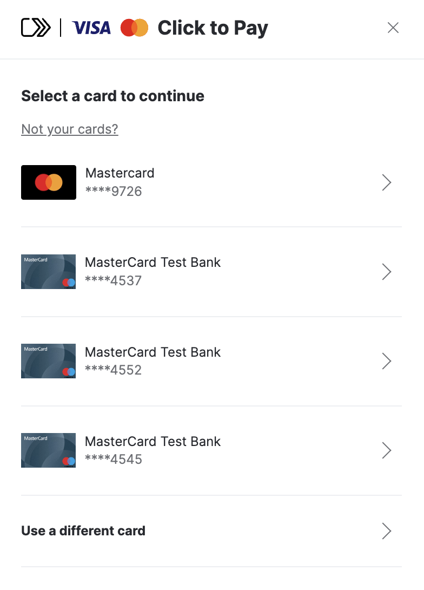
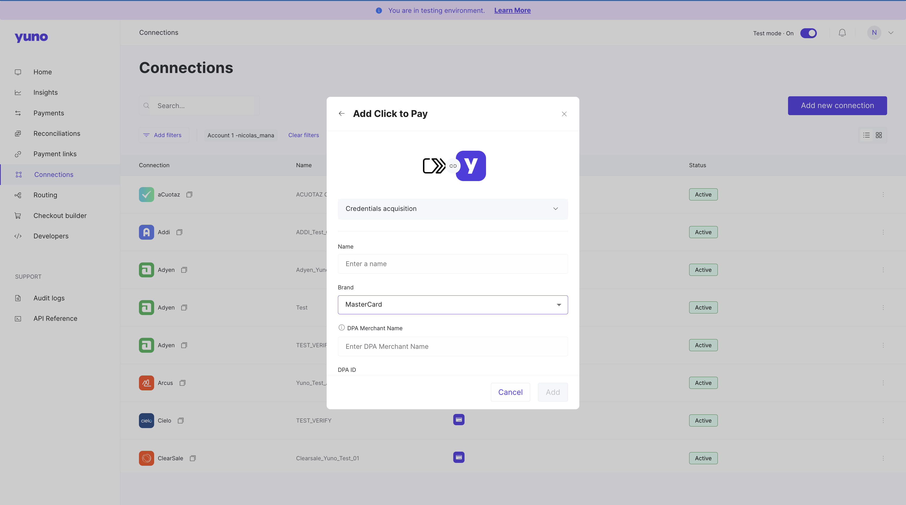
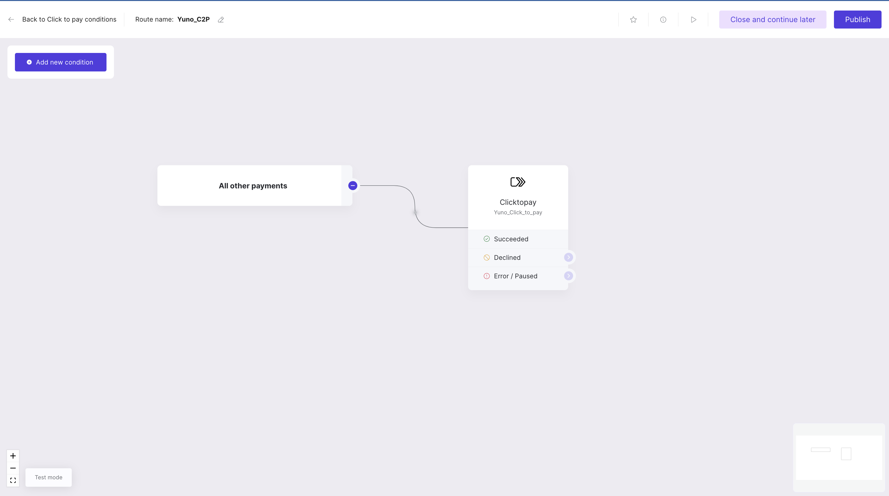
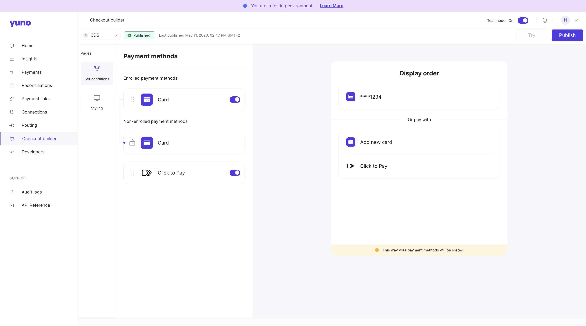
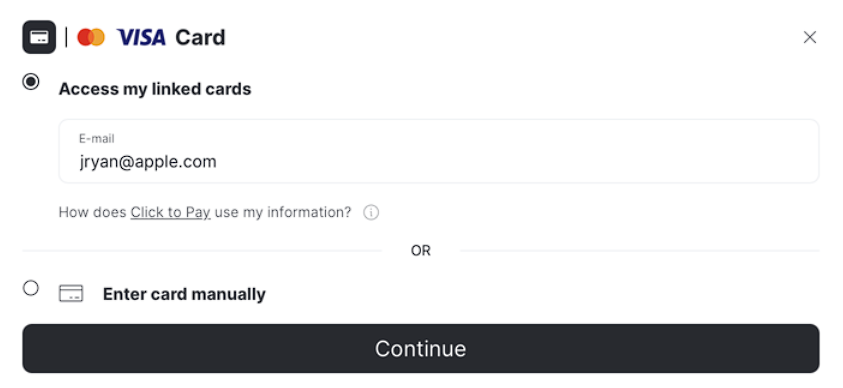

Click to Pay es una solución de pago en línea diseñada para agilizar y asegurar las transacciones en línea. Se basa en el estándar de pago seguro EMVCo, un consorcio global formado por las principales compañías de tarjetas, como Visa, MasterCard, American Express y Discover.

<div style={{width: "400px", margin: "0 auto"}}><Frame></Frame></div>

*Redes disponibles en Yuno*: [MasterCard](https://www.mastercard.us/en-us/personal/ways-to-pay/click-to-pay.html)

<Note>
  La compatibilidad con passkeys está disponible actualmente solo para **Mastercard**. La compatibilidad con passkeys de Visa está en desarrollo.
</Note>

## Características y beneficios principales {#key-features-and-benefits}

* **Facilidad de uso**: permite a los consumidores hacer compras en línea con un solo clic, sin tener que ingresar manualmente los datos de la tarjeta de crédito en cada compra.
* **Mayor seguridad**: utiliza estándares de autenticación modernos para minimizar el riesgo de fraude. Esto puede incluir métodos como la autenticación de dos factores o tokens de pago.
* **Coherencia entre sitios**: ofrece una experiencia de pago similar en todos los sitios web que admiten esta tecnología, de modo que los consumidores no tienen que aprender procesos distintos para cada tienda en línea.
* **Integración con marcas de tarjetas**: al estar respaldado por las principales marcas de tarjetas, Click to Pay es ampliamente aceptado y cuenta con su confianza.
* **Compatibilidad con móvil y escritorio**: está diseñado para funcionar en distintos dispositivos y facilita las compras en línea tanto en computadoras de escritorio como en dispositivos móviles.

Esta función mejora la experiencia del cliente y se alinea con las tendencias actuales de pago digital, lo que potencialmente aumenta las tasas de conversión y la lealtad de los clientes. Al incorporar Click to Pay, puedes reducir la fricción en el checkout y atender las preocupaciones de seguridad en las transacciones en línea.

<Info>
**Requisito de network tokens**

Se requiere compatibilidad con network tokens para Click to Pay en todos los flujos (Golden Flow y APM, con y sin passkeys). Los comercios deben configurar network tokens en sus reglas de **Routing** para garantizar un procesamiento exitoso.
</Info>

## Integración {#integration}

Para integrar Click to Pay y empezar a ofrecerlo a tus clientes, sigue estos 4 sencillos pasos:

1. Crea una [conexión](https://dashboard.y.uno/connections) en el Dashboard de Yuno con tus credenciales de Click to Pay.

   <Frame></Frame>
2. Define la ruta del método de pago en la sección [Routing](https://dashboard.y.uno/routing) para habilitarlo en el Checkout Builder.

   <Frame></Frame>
3. Habilita Click to Pay en el [Checkout builder](https://dashboard.y.uno/checkout-builder).

   <Frame></Frame>
4. Define la ruta de Card: dado que Click to Pay es una billetera que almacena información de tarjetas de crédito, la **ruta** en la que debes definir los proveedores para cada escenario es la misma que la del método de pago **Card**.

## Flujos de checkout {#checkout-flows}

Los comercios pueden elegir cómo aparece Click to Pay en el checkout. Ambas experiencias admiten passkeys en plataformas web y móviles.

<Note>
  **Comportamiento de los passkeys**: la primera transacción de un comprador siempre se autentica con 3DS, ya que aún no tiene un passkey. Cuando esa transacción se completa, se crea un passkey y las transacciones siguientes se autentican con él. Un passkey está vinculado al mismo dispositivo, navegador y tarjeta: si alguno de ellos cambia, se debe crear un nuevo passkey.
</Note>

### 1. Método de pago independiente (APM Flow) {#1-standalone-payment-method-apm-flow}
Click to Pay aparece como un botón de pago separado junto a las tarjetas y otros métodos.
* **Inscripción obligatoria**: la creación de una cuenta es obligatoria para todos los usuarios.
* **Requisito de payload**: requiere un payload específico de C2P.
* **Visibilidad**: ideal para comercios que quieren destacar Click to Pay.

### 2. Integrado en la tarjeta (Golden Flow) {#2-embedded-in-card-golden-flow}
Click to Pay está integrado en el método de pago con tarjeta y permanece invisible hasta que el usuario selecciona "Card".
* **Inscripción opcional**: la inscripción se hace mediante una casilla de verificación. Si el usuario la rechaza, continúa con el ingreso manual de la tarjeta (la transacción sigue mostrando `CLICK_TO_PAY` en el token de un solo uso (OTT)).
* **Visibilidad**: ideal para una experiencia de baja fricción en la que la inscripción se percibe como opcional.

<Frame></Frame>

## Almacenamiento de la tarjeta tras un pago exitoso {#card-vaulting-on-successful-payment}

Cuando un comprador se inscribe durante el checkout (de forma obligatoria en el APM Flow, o al aceptar la casilla de inscripción en el Golden Flow), su tarjeta se guarda en su billetera de Click to Pay una vez que el pago es aprobado. El almacenamiento ocurre como parte del pago exitoso; no se necesita una llamada de inscripción independiente.

En la siguiente visita del comprador, Click to Pay lo reconoce (por dispositivo o por búsqueda de email) y muestra sus tarjetas guardadas directamente en el checkout, de modo que los compradores recurrentes pueden pagar sin volver a ingresar los datos de la tarjeta.

## Ciclo de vida del estado del pago {#payment-status-lifecycle}

En Click to Pay, la autenticación con passkey ocurre **antes** de que exista el pago: el comprador se autentica dentro de la experiencia de Click to Pay y solo cuando la autenticación se completa se genera el token de un solo uso (OTT); el OTT ya incluye el resultado de esa autenticación. Luego creas el pago usando el OTT. Si el paso del passkey no se completa, el flujo se interrumpe y no se crea ningún pago.

Después de crear el pago, continúa el flujo en el SDK con `continuePayment`. El SDK evalúa el estado del pago en ese momento:

* `READY_TO_PAY`, o `PENDING` con el subestado `WAITING_ADDITIONAL_STEP` o `DELAYED_PROVIDER_RESPONSE`, significa que el proveedor requiere un paso adicional (por ejemplo, 3DS, una redirección o un OTP del proveedor), y el SDK lo ejecuta.
* Cualquier otro estado significa que el pago ya está resuelto, y el SDK informa el estado final.

Estos estados intermedios son condicionales: un pago que no requiere ningún paso adicional nunca pasa por ellos.

Consulta [Estados de pago](/es/reference/payments/status-and-response-codes/payment) para ver el ciclo de vida completo.

## Guía de activación {#activation-guide}

Sigue los pasos siguientes según la configuración que desees:

### Opción 1: solo Click to Pay (APM) {#option-1-click-to-pay-only-apm}
1. Solicita el **DPA ID** a la red de tarjetas (por ejemplo, Mastercard).
2. Agrega la **conexión de Click to Pay** en el Dashboard de Yuno usando el DPA ID.
3. Agrega la **conexión de tarjeta** que procesará estas tarjetas.
4. Define la ruta del método de pago en **Routing** y habilita Click to Pay en el **Checkout Builder**.

### Opción 2: Click to Pay + Passkey {#option-2-click-to-pay--passkey}
*Compatible con web y con los SDK nativos de Android e iOS. En móvil, el SDK abre la experiencia de passkey de Click to Pay en el navegador del sistema y regresa mediante una URL de callback por deeplink, que debe configurarse en los ajustes de Click to Pay. Los passkeys no están disponibles dentro de WebViews integradas; sin una URL de callback, el SDK recurre al flujo estándar de Click to Pay sin passkeys.*
1. Solicita el **DPA ID** a la red de tarjetas (por ejemplo, Mastercard).
2. Agrega la **conexión de Click to Pay** usando el DPA ID.
3. Agrega la **conexión de tarjeta** y configura el **Acquirer BIN**.
4. Solicita al equipo de backend de Yuno que habilite los flags **Passkey** y **Dual Payload**.
5. Crea sesiones de checkout con un `price` para que Passkey funcione correctamente.

### Opción 3: Click to Pay + Golden Flow {#option-3-click-to-pay--golden-flow}
1. Solicita el **DPA ID** a la red de tarjetas (por ejemplo, Mastercard).
2. Agrega la **conexión de Click to Pay** usando el DPA ID.
3. Agrega la **conexión de tarjeta** que procesará estas tarjetas.
4. Solicita al equipo de backend de Yuno que habilite el flag **Golden Flow**.

### Opción 4: Click to Pay + Golden Flow + Passkey {#option-4-click-to-pay--golden-flow--passkey}
*Compatible con web y con los SDK nativos de Android e iOS. En móvil, el SDK abre la experiencia de passkey de Click to Pay en el navegador del sistema y regresa mediante una URL de callback por deeplink, que debe configurarse en los ajustes de Click to Pay. Los passkeys no están disponibles dentro de WebViews integradas; sin una URL de callback, el SDK recurre al flujo estándar de Click to Pay sin passkeys.*
1. Solicita el **DPA ID** a la red de tarjetas (por ejemplo, Mastercard).
2. Agrega la **conexión de Click to Pay**.
3. Agrega la **conexión de tarjeta** y configura el **Acquirer BIN**.
4. Solicita al equipo de backend de Yuno que habilite los flags **Passkey**, **Dual Payload** y **Golden Flow**.
5. Crea sesiones de checkout con un `price` para que Passkey funcione correctamente.

## Click to Pay en VTEX {#click-to-pay-on-vtex}

Click to Pay también es compatible con las tiendas VTEX a través del [plugin de Yuno para VTEX](/es/docs/plugins/vtex). Los pasos de activación anteriores (conexión, routing, Checkout Builder) se aplican de la misma manera.

<Info>
Click to Pay depende de que exista un registro de cliente en Yuno. Al usar el plugin de VTEX, configura el campo **Create Customer** en **Yes** en la configuración de tu proveedor de Yuno para que el plugin cree o actualice el registro de cliente en cada pago. Consulta las [preguntas frecuentes del plugin de VTEX](/es/docs/plugins/vtex/faqs) para obtener más detalles.
</Info>

## Integración del SDK (Click to Pay Passkey) {#sdk-integration-click-to-pay-passkey}

<Info>
**Importante**

Los flujos estándar de tarjeta de Click to Pay usan los callbacks existentes del SDK, pero los usuarios de Passkey deben incluir un `callback_url` que coincida con el esquema de deeplink de la app, para que el comprador regrese a la app después de la autenticación (en Android debe coincidir con el esquema configurado en `AndroidManifest.xml`). Por ejemplo:

```json
{
  "callback_url": "myapp://pay/ctp"
}
```

En las transacciones con Passkey, el token de un solo uso (OTT) nunca llega a los callbacks habituales del SDK (incluido `callbackOTT` en Android). Léelo siempre de los parámetros del deeplink antes de continuar el flujo.
</Info>

### Móvil: manejo de la respuesta (OTT y deeplink) {#mobile-handling-the-response-ott-and-deeplink}

El flujo de integración de Click to Pay Passkey tiene un manejo de la respuesta específico que difiere del flujo de pago estándar.

Cuando un comprador completa un pago con CTP Passkey, el token de un solo uso (OTT) **no** se entrega mediante los métodos habituales de delegate/listener. En su lugar, el resultado de la transacción, tanto exitoso como fallido, se comunica a tu app mediante la **URL del deeplink**.

Esto es igual en **iOS, Android y Flutter**: el comercio lee el resultado de la URL del deeplink y actúa en consecuencia. Solo cambia *dónde* llega el deeplink en cada plataforma.

**Lee dos parámetros de la URL del deeplink**

- `has_error`: ocurrió un error o el comprador canceló. Lee el parámetro `message` y muestra el error.
- `one_time_token`: la transacción fue exitosa y el OTT está incluido en la URL.

**Una vez que tengas el `one_time_token`**

1. Envíalo a tu backend para crear el pago mediante el endpoint [Crear pago](/es/reference/payments/create-payment).
2. Continúa el flujo en el SDK con `continuePayment` para finalizar la transacción.

**Dónde llega el deeplink en cada plataforma**

- **iOS**: en `application(_:open:options:)`. Llama a `Yuno.receiveDeeplink(url)` para cerrar el navegador del Passkey y luego lee los parámetros de `url`.
- **Flutter**: en tu manejador de deeplinks. Usa `await Yuno.receiveDeeplink(url: uri)` para cerrar el navegador del Passkey y luego lee los parámetros de `uri`.
- **Android**: el deeplink vuelve a lanzar tu `Activity` (no hay una llamada del SDK para cerrar). Lee los parámetros de `intent.data` en `onCreate`/`onNewIntent`. La actividad receptora debe declarar un `intent-filter` en `AndroidManifest.xml` que coincida con el scheme/host/path de tu `callback_url`.

<CodeGroup>
```swift iOS
func application(_ app: UIApplication, open url: URL, options: [UIApplication.OpenURLOptionsKey : Any] = [:]) -> Bool {
    guard url.scheme == "myapp" else { return false }
    Yuno.receiveDeeplink(url) // closes the Passkey browser

    let items = URLComponents(url: url, resolvingAgainstBaseURL: false)?.queryItems
    if items?.contains(where: { $0.name == "has_error" }) == true {
        // handle error (read the `message` parameter)
    } else if let ott = items?.first(where: { $0.name == "one_time_token" })?.value {
        // send `ott` to your backend, then continue the flow in the SDK
    }
    return true
}
```

```dart Flutter
Future<void> _handleDeepLink(Uri uri) async {
    await Yuno.receiveDeeplink(url: uri); // closes the Passkey browser

    if (uri.queryParameters.containsKey('has_error')) {
        // handle error (read the `message` parameter)
    } else {
        final ott = uri.queryParameters['one_time_token'];
        if (ott != null) {
            // send `ott` to your backend, then continue the flow in the SDK
        }
    }
}
```

```kotlin Android
override fun onNewIntent(intent: Intent) {
    super.onNewIntent(intent)
    val uri = intent.data ?: return

    when {
        uri.getBooleanQueryParameter("has_error", false) ->
            showError(uri.getQueryParameter("message") ?: "Operation canceled")

        uri.getQueryParameter("one_time_token") != null -> {
            val ott = uri.getQueryParameter("one_time_token")
            // send `ott` to your backend, then continue the flow in the SDK
        }
    }
}
```
</CodeGroup>

## Método de autenticación {#authentication-method}

Cada transacción de Click to Pay devuelve un campo `authentication_method` en la respuesta del pago, que indica exactamente cómo se autenticó al comprador: por ejemplo, passkey (FIDO2), 3DS, OTP, SMS o email, inicio de sesión federado y SPC, entre otros.

Esto es útil para la prevención del fraude, las decisiones de enrutamiento y el seguimiento de métricas como la tasa de aprobación por método de autenticación.

<Note>
  Este campo es retrocompatible: las transacciones que no usan Click to Pay devuelven el campo sin un valor relevante.
</Note>

Para leerlo, llama a [Obtener pago](/es/reference/payments/retrieve-payment-by-id-v2) y busca `authentication_method` en la transacción.

## Filtro de tipo de tarjeta y comportamiento del CVV {#card-type-filter-and-cvv-behavior}

**Filtro de tipo de tarjeta**: puedes bloquear una fuente de fondos de débito o de crédito en las transacciones de Click to Pay. Esto es útil para las tarjetas combinadas, en las que el comprador de otro modo podría elegir cualquiera de los dos tipos: por ejemplo, mostrar solo la opción de crédito cuando un comercio quiere bloquear el débito.

<Note>
  Esto aún no es de autoservicio. Comunícate con el equipo de guardia de Yuno para configurarlo en tu cuenta. La configuración de autoservicio para todos los métodos de pago está en desarrollo.
</Note>

**CVV con network token**: a partir de la versión 1.7 del SDK, Click to Pay solo solicita el campo CVV cuando la tarjeta **no** admite network token. Antes de la versión 1.7, el CVV siempre era obligatorio, incluso cuando la tarjeta tenía un network token. No hay opción de activación ni desactivación para el comercio, este comportamiento es automático una vez que actualizas a la versión 1.7. Se aplica solo al flujo de Click to Pay (tanto el APM Flow independiente como el Golden Flow), no al flujo estándar de tarjeta.