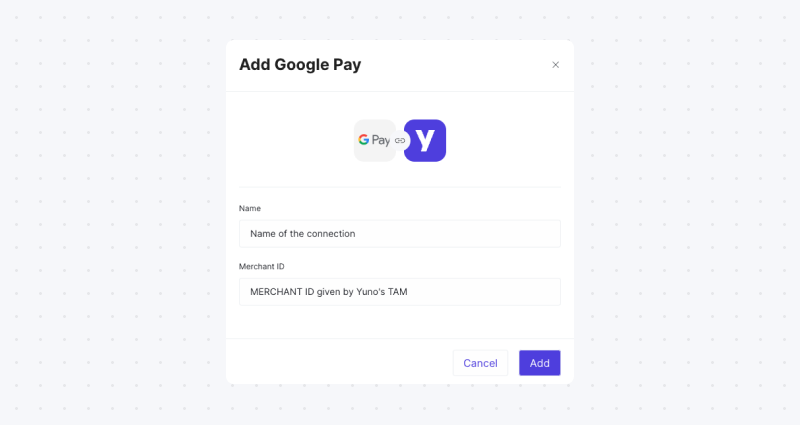
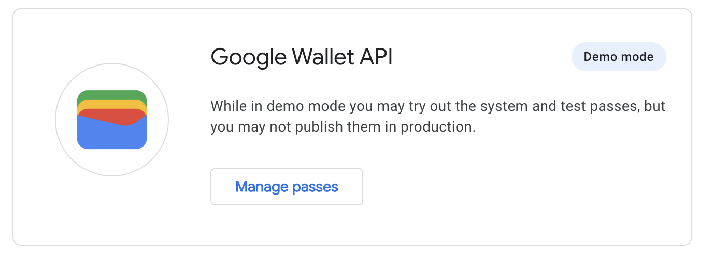

Con la integración directa, integras la API de Google Pay™ en tu frontend, obtienes el token de pago cifrado de Google y lo envías a la API de Yuno para su procesamiento. Esto te da control total sobre la experiencia de usuario de Google Pay.

**Workflow:** `DIRECT`

<Note>
  ¿No sabes qué integración usar? Consulta la [descripción general de Google Pay](/docs/google-pay#integration-options) para comparar las tres opciones.
</Note>

## Requisitos {#requirements}

Antes de comenzar, asegúrate de cumplir los [requisitos generales de Google Pay](/docs/google-pay#requirements). Además, debes registrarte en la [Google Pay Business Console](https://pay.google.com/business/console) para obtener un ID de comercio de Google. Completa la configuración de la consola siguiendo estos pasos:

1. Completa el **Business Profile**

2. Revisa la información requerida en **Google Pay API** > **Integrate with your website**:

   * Tu sitio web: debe coincidir exactamente con el dominio de tu página de checkout alojada (con o sin "www")
   * Tipo de integración: **GATEWAY**

3. Capturas de pantalla:

* Pantalla del método de pago: tu página de checkout alojada
* Pantalla de pago de la API de Google Pay: la hoja de pago de Google Pay (se muestra después de hacer clic en el botón de GPay)
* Pantalla posterior a la compra: página de confirmación de la transacción
* Envía las capturas de pantalla, indica que has enviado la solicitud y comparte el merchantId (BCR)

Usa el ID de comercio asignado para configurar la conexión de Google Pay en el dashboard de Yuno.

## Integración {#integration}

Para integrar Google Pay con Yuno, sigue estos pasos:

1. En el [dashboard de Yuno](https://dashboard.y.uno/), ve a la pestaña Connections. Busca Google Pay y haz clic en Connect. Ingresa tus credenciales en el panel lateral. Elige un nombre para la conexión y usa el ID de comercio obtenido de la [Google Pay Business Console](https://pay.google.com/business/console) en el campo Merchant ID.

<Frame></Frame>

2. Crea una ruta en el dashboard de Yuno usando el procesador que quieras para los pagos con Google Pay. Consulta la guía [Configurar el enrutamiento dinámico](/es/docs/using-yuno/dashboard-overview/routing#configuring-the-dynamic-routing) para obtener más información.

Yuno procesa el token de pago recibido de Google Pay a través del procesador de pagos que configuraste. Las transacciones de Google Pay aparecen en tu dashboard de Yuno junto con tus otros métodos de pago.

## Habilita y prueba Google Pay con Yuno {#enable-and-test-google-pay-with-yuno}

Después de integrar, puedes habilitar y probar Google Pay con Yuno de la siguiente manera:

1. Crea una cuenta de prueba de Google Wallet:
   * Visita la página [Google Wallet Test Account Sign-In](https://accounts.google.com/InteractiveLogin/signinchooser?continue=https%3A%2F%2Fpay.google.com%2Fbusiness%2Fconsole%2F\&followup=https%3A%2F%2Fpay.google.com%2Fbusiness%2Fconsole%2F\&osid=1\&passive=1209600\&ifkv=AeDOFXjl_LLJZyuykU06uleha4p7uSXJNnLCv_n2jshX6QVJYCy9AKq3K28mIfpgyfS2NDHfimnAFg\&flowName=GlifWebSignIn\&flowEntry=ServiceLogin).
   * Si no tienes una cuenta de Google, crea una para continuar.
   * Una vez que inicies sesión, serás redirigido a la consola de negocios de Google Wallet.
2. Accede a la sección de la API de Google Wallet:
   * En la consola de negocios de Google Wallet, ve a la sección de administración de la API o de integración (normalmente en la configuración de desarrollador o de integración).
3. Selecciona **Create a Pass** para habilitar el **Demo Mode**:
   * En la sección de la API de Google Wallet, busca la opción llamada **Create a Pass**.
   * Haz clic en esta opción para habilitar el **Demo mode**. Esto te permite simular y probar la creación de pases y las interacciones sin transacciones reales.

<Frame></Frame>

4. Descarga la [aplicación Google Wallet](https://play.google.com/store/apps/details?id=com.google.android.apps.walletnfcrel\&hl=en\&gl=US) desde Play Store.
5. Recorre el flujo de pago para probar la integración.

Al seguir estos pasos, puedes asegurarte de que Google Pay esté integrado y funcione como se espera antes de ponerlo a disposición de tus clientes.

## Salir a producción {#go-live}

Después de completar todos los pasos de integración en el entorno de pruebas, solicita el [Google Production Access](https://developers.google.com/pay/api/web/guides/test-and-deploy/request-prod-access) y contacta a tu Technical Account Manager. El equipo de Yuno te ayudará a verificar tu configuración y a confirmar que estás listo para salir a producción.

## Detalles de implementación {#implementation-details}

Detalles clave de tu integración de Google Pay con Yuno:

### Métodos de autorización de la API de Google Pay {#google-pay-api-authorization-methods}

Yuno admite ambos métodos de autorización de la API de Google Pay:

* **`PAN_ONLY`**: credenciales de tarjeta almacenadas en la cuenta de Google del usuario. Cuando se usa, Yuno gestiona automáticamente la autenticación de 3D Secure si está habilitada.
* **`CRYPTOGRAM_3DS`**: credenciales de tarjeta basadas en el dispositivo con autenticación integrada. Estas credenciales incluyen autenticación criptográfica y no requieren procesamiento 3DS adicional. Estas credenciales se descifran en un número específico del dispositivo (DPAN), así que consulta [Últimos cuatro dígitos de la tarjeta para tokens de dispositivo](#card-last-four-digits-for-device-tokens) si muestras los últimos cuatro dígitos de la tarjeta al titular de la tarjeta.

Ambos métodos se admiten a nivel global en todos los países donde opera Yuno. En el frontend, incluye `PAN_ONLY` y `CRYPTOGRAM_3DS` en tu arreglo `allowedAuthMethods` para lograr las máximas tasas de éxito de pago.

* **3D Secure (3DS) para credenciales `PAN_ONLY`**: si Google Pay devuelve una credencial `PAN_ONLY` (una tarjeta almacenada en la cuenta de Google del usuario), Yuno gestionará automáticamente el flujo de autenticación de 3D Secure si 3DS está habilitado. En el frontend, asegúrate de que tu solicitud a la API de Google Pay incluya `PAN_ONLY` en el arreglo `allowedAuthMethods`.
* **Configuración de Gateway y GatewayMerchantID**: al registrarte en la [Google Pay Business Console](https://pay.google.com/business/console), asegúrate de que, en **Google Pay API** > **Integrate with your website**, el **Integration type** esté configurado como **GATEWAY**. El `Merchant ID` de la Google Pay Business Console se usa en el campo "Merchant ID" al configurar la conexión de Google Pay en el dashboard de Yuno. Configura `gateway` como `yuno` y usa tu ID de comercio asignado como `gatewayMerchantId` en la configuración de tu API de Google Pay.
* **Métodos de autorización**: Yuno admite los métodos de autorización estándar (compra, autorización, captura). La disponibilidad depende del procesador de pagos y del banco adquirente de cada país y pago.
* **Requisitos de dirección de facturación**: si el procesamiento de tu pago requiere la dirección de facturación del cliente (por ejemplo, para verificaciones AVS), configúralo en tu solicitud a la API de Google Pay. Google proporciona `BillingAddressParameters` para especificar el detalle requerido (por ejemplo, MIN o FULL). Consulta la [documentación de Google](https://developers.google.com/pay/api/web/reference/request-objects#BillingAddressParameters). Solicita los datos de la dirección de facturación solo si es necesario, ya que esto puede aumentar la fricción en el checkout.
* **Datos de la transacción y criptografía de pago**: los comercios integran los SDK de Yuno (Android, iOS, Web) en sus aplicaciones. Cuando un cliente elige Google Pay, el SDK de Yuno interactúa con la API de Google Pay y recibe de forma segura los datos de pago cifrados (token de pago) de Google. Este token pasa de tu aplicación a tu servidor backend, que luego usa las API del lado del servidor de Yuno para enviar el token para su procesamiento de pago. Yuno se encarga del descifrado y del procesamiento con el procesador de pagos.

## Envía el token de pago de Google Pay en la solicitud {#pass-google-pay-payment-token-in-request}

<Warning>
  **Importante: se requiere la versión de protocolo ECv2 (Android SDK v2.8.0+)**

  A partir de la versión 2.8.0 del Android SDK de Yuno, solo se admite el protocolo ECv2 (Encrypted Card Version 2) de Google Pay. Si tu integración de Google Pay está configurada para usar ECv1, los pagos no se procesarán correctamente.

  Asegúrate de que la configuración de tu API de Google Pay incluya `"protocolVersion": "ECv2"` en la especificación de tokenización. Google dejó obsoleto ECv1 y el SDK de Yuno ya no lo admite.

  Si estás actualizando desde una versión anterior a la 2.8.0 o migrando desde una compilación personalizada del SDK, verifica que la configuración de comercio de Google Pay use ECv2 antes de procesar pagos. Para obtener orientación sobre cómo actualizar tu configuración de Google Pay, consulta la [documentación de Google](https://developers.google.com/pay/api/android/guides/resources/payment-data-cryptography#encrypted-card-version).
</Warning>

Cuando inicias una transacción con Google Pay, se devuelve un token de pago que contiene datos de pago cifrados. Envía el token completo recibido de Google Pay en el campo `payment_method.detail.wallet.payment_token` como una cadena JSON en tu solicitud de pago.

### Objeto de respuesta de la billetera de Google Pay {#google-pay-wallet-response-object}

El SDK de Google Pay devuelve la siguiente estructura de objeto, que debe enviarse como el valor completo de `payment_token`:

```json
{
  "signature": "MEQCIBvkZdkroLuBAj0K0yhqF4RfvkcWM8hW4nInpGnbSbqHAiA4emX0LkHkdnYqIiGgAQ+gF2Md5ac1DIsHItwJfwj9DQ==",
  "intermediateSigningKey": {
    "signedKey": "{\"keyValue\":\"MFkwEwYHKoZIzj0CAQYIKoZIzj0DAQcDQgAEZ8tVNZqE1G6292tV11Ff1Pc1xZDZU9Mj5QSqDaU9hMjaH+CYI7+XL+Cor0X+4r0jICgcZgQkS/q+WzY8Eku1Fg==\",\"keyExpiration\":\"1766083480615\"}",
    "signatures": [
      "MEYCIQC75wFVZ3JkWTZenVvU9WVdWzeKUvTiB2FAGtUjIP6qFgIhAP3nB97NF+2lXsqpflH/livwpy24IPSfWMF7i1pHqrw1"
    ]
  },
  "protocolVersion": "ECv2",
  "signedMessage": "{\n  \"encryptedMessage\": \"Fvw/m1KNUIAXRRd6gbbuH2eWEhARKpQL/WZBJF5GCWE9QTuJf15pJUASEIjooQa36AwbGuSUs5qtm36x/yWe8pGi4w2vNyN+bUcnw4HuxrhrPMD+VoioLwmJenHU7/ypW5wzGfOmaCWn3FQ8GjE59mfFtC+8+LPmt3Z9xcvr/wT4Qm09TNRp3k/4/6JaV2+OTYqeOER6pAvqb7WEEjRLjIapvAYKPE6VXrhIo5zdwGh2VWvxY000nkzEIbn3OKShJ/mT7ITLQF9b5J4caGGRVFBn2oobaO72I8CCpiTAWgsw3GnyQACk9ggqnXOugVWinFDDazcs0q2YF3x6fBjz8sJpODx1dTUPrOacvFzEJ9XPovYooYK3wDiRfrtwqoadG/SYlESoguIuuAx+XOdc1jP+NWy0WDVKIqAJOwsg5qkSvNS2qi3m7SKapX3EVLiw/619l9JpTIRHdiIIeOu5BtFYL86o4yb0plrE8/ivvQ2/7U4ISGxzaJ4o6PFk7RZ96nWafdT0m30JlxMmTOI6iUOtsw02SVtinwS+83xcN3s6XRAPWRjJ0d1kaUd/4kHbPy8S/UKNBjanytDwDzn6wEccluisI4E=\",\n  \"ephemeralPublicKey\": \"BPUzeogQZAp0N4D3vLYrvQ7Hc+fc261ZW17LIoMnIAgcWaANAhM39Z8mDCYxpiNIO/F0WtOkJhcvVZFSnI/yq/w=\",\n  \"tag\": \"owzrWByO1bNLbw9m/G2kzGmWDnBCs7QoMN+N0zovZAo=\"\n}"
}
```

### Ejemplo de solicitud {#request-example}

```json
{
  "account_id": "d34257e7-55d4-44cf-8b90-3a5152bbe020",
  "description": "Google Pay test",
  "merchant_order_id": "MER01",
  "country": "US",
  "amount": {
    "currency": "USD",
    "value": 1
  },
  "customer_payer": {
    "email": "testing@y.uno"
  },
  "workflow": "DIRECT",
  "payment_method": {
    "detail": {
      "wallet": {
        "payment_token": "{\"signature\":\"MEQCIBvkZdkroLuBAj0K0yhqF4RfvkcWM8hW4nInpGnbSbqHAiA4emX0LkHkdnYqIiGgAQ+gF2Md5ac1DIsHItwJfwj9DQ\\u003d\\u003d\",\"intermediateSigningKey\":{\"signedKey\":\"{\\\"keyValue\\\":\\\"MFkwEwYHKoZIzj0CAQYIKoZIzj0DAQcDQgAEZ8tVNZqE1G6292tV11Ff1Pc1xZDZU9Mj5QSqDaU9hMjaH+CYI7+XL+Cor0X+4r0jICgcZgQkS/q+WzY8Eku1Fg\\\\u003d\\\\u003d\\\",\\\"keyExpiration\\\":\\\"1766083480615\\\"}\",\"signatures\":[\"MEYCIQC75wFVZ3JkWTZenVvU9WVdWzeKUvTiB2FAGtUjIP6qFgIhAP3nB97NF+2lXsqpflH/livwpy24IPSfWMF7i1pHqrw1\"]},\"protocolVersion\":\"ECv2\",\"signedMessage\":\"{\\\"encryptedMessage\\\":\\\"Fvw/m1KNUIAXRRd6gbbuH2eWEhARKpQL/WZBJF5GCWE9QTuJf15pJUASEIjooQa36AwbGuSUs5qtm36x/yWe8pGi4w2vNyN+bUcnw4HuxrhrPMD+VoioLwmJenHU7/ypW5wzGfOmaCWn3FQ8GjE59mfFtC+8+LPmt3Z9xcvr/wT4Qm09TNRp3k/4/6JaV2+OTYqeOER6pAvqb7WEEjRLjIapvAYKPE6VXrhIo5zdwGh2VWvxY000nkzEIbn3OKShJ/mT7ITLQF9b5J4caGGRVFBn2oobaO72I8CCpiTAWgsw3GnyQACk9ggqnXOugVWinFDDazcs0q2YF3x6fBjz8sJpODx1dTUPrOacvFzEJ9XPovYooYK3wDiRfrtwqoadG/SYlESoguIuuAx+XOdc1jP+NWy0WDVKIqAJOwsg5qkSvNS2qi3m7SKapX3EVLiw/619l9JpTIRHdiIIeOu5BtFYL86o4yb0plrE8/ivvQ2/7U4ISGxzaJ4o6PFk7RZ96nWafdT0m30JlxMmTOI6iUOtsw02SVtinwS+83xcN3s6XRAPWRjJ0d1kaUd/4kHbPy8S/UKNBjanytDwDzn6wEccluisI4E\\\\u003d\\\",\\\"ephemeralPublicKey\\\":\\\"BPUzeogQZAp0N4D3vLYrvQ7Hc+fc261ZW17LIoMnIAgcWaANAhM39Z8mDCYxpiNIO/F0WtOkJhcvVZFSnI/yq/w\\\\u003d\\\",\\\"tag\\\":\\\"owzrWByO1bNLbw9m/G2kzGmWDnBCs7QoMN+N0zovZAo\\\\u003d\\\"}\"}"
      }
    },
    "type": "GOOGLE_PAY"
  }
}
```

## Pagos recurrentes (CIT y MIT) {#recurring-payments-cit-and-mit}

Para cobros recurrentes, guarda en el vault el instrumento en el primer pago y cobra después el `vaulted_token` resultante. En el CIT, `payment_token` y `stored_credentials` van juntos en `detail.wallet`. En el MIT, el instrumento es una tarjeta almacenada, por lo que `stored_credentials` pasa a `detail.card`. La matriz completa de `reason` y `usage` está en [Stored credentials](/es/docs/payment-features/stored-credentials#wallet-originated-tokens-apple-pay-and-google-pay).

CIT, primer pago con la hoja de Google Pay mostrada:

```json
"payment_method": {
  "type": "GOOGLE_PAY",
  "vault_on_success": true,
  "detail": {
    "wallet": {
      "payment_token": "{\"protocolVersion\":\"ECv2\", ...}",
      "stored_credentials": {
        "reason": "SUBSCRIPTION",
        "usage": "FIRST"
      }
    }
  }
}
```

MIT, cobro posterior sobre el instrumento guardado en el vault, sin token de Google Pay:

```json
"payment_method": {
  "type": "CARD",
  "vaulted_token": "vaulted-token-from-the-cit-response",
  "detail": {
    "card": {
      "stored_credentials": {
        "reason": "SUBSCRIPTION",
        "usage": "USED"
      }
    }
  }
}
```

`vault_on_success` requiere `customer_payer.id`. `customer_payer.id` debe hacer referencia a un cliente existente (créalo primero con [Create Customer](/es/reference/customers/create-customer)). Sin él, el pago igualmente es exitoso, pero no se guarda nada en el vault: la respuesta trae un `vaulted_token` vacío y ningún error. El `vaulted_token` se devuelve solo en la respuesta del pago CIT, así que guárdalo de tu lado. No coloques `stored_credentials` en `detail.card` en el CIT: no se valida para un pago con billetera y puede descartarse, lo que deja el registro guardado sin los indicadores de credenciales almacenadas y sin un `network_transaction_id`.

## Últimos cuatro dígitos de la tarjeta para tokens de dispositivo {#card-last-four-digits-for-device-tokens}

Cuando Google Pay devuelve una credencial `CRYPTOGRAM_3DS`, el token cifrado se descifra en el **DPAN**, un número específico del dispositivo, no la tarjeta almacenada por el titular de la tarjeta. Sus últimos cuatro dígitos no son los que el titular de la tarjeta reconoce, por lo que `card_data.lfd` en la respuesta del pago está vacío o muestra los últimos cuatro del DPAN.

Los últimos cuatro dígitos de la tarjeta real están disponibles para ti en la respuesta de Google, fuera del token cifrado:

```json
{
  "paymentMethodData": {
    "info": {
      "cardDetails": "1515",
      "cardNetwork": "VISA"
    },
    "tokenizationData": {
      "token": "..."
    }
  }
}
```

Envía `paymentMethodData.info.cardDetails` como `payment_method.detail.wallet.card_data.lfd` y Yuno lo usa en lugar del valor derivado del DPAN.

```json
{
  "payment_method": {
    "type": "GOOGLE_PAY",
    "detail": {
      "wallet": {
        "payment_token": "{\"protocolVersion\":\"ECv2\", ...}",
        "card_data": {
          "lfd": "1515"
        }
      }
    }
  }
}
```

| Campo | Tipo | Obligatorio | Descripción |
| :---- | :--- | :------- | :---------- |
| `lfd` | string | No | Últimos cuatro dígitos de la tarjeta real del titular de la tarjeta, tomados de `paymentMethodData.info.cardDetails`. Debe tener exactamente 4 dígitos numéricos. |

El campo es opcional y compatible con versiones anteriores. Si no lo envías, el comportamiento no cambia.

* Yuno aplica el valor solo cuando el token es un token de dispositivo: `auth_method` es `CRYPTOGRAM_3DS`, o `pan_type` es `DPAN` cuando `auth_method` no está presente.
* Las credenciales `PAN_ONLY` ignoran el valor. Estas se descifran en la tarjeta real, así que Yuno conserva los últimos cuatro descifrados.
* Solo se acepta `lfd`. `brand` y los demás campos de la tarjeta conservan sus valores descifrados, porque el BIN del DPAN ya identifica correctamente la red de la tarjeta.
* El valor se ignora para otras billeteras, como Apple Pay.

Una vez aplicado, el valor aparece en la respuesta de creación del pago, en la respuesta de Get payment by ID y en los webhooks de pago, en `payment_method.detail.card.card_data.lfd`. Los payloads de webhook lo anidan en `payment_method_detail` en lugar de `detail`.

Si `lfd` está presente pero no tiene exactamente 4 dígitos numéricos, la solicitud se rechaza:

```json
{
  "code": "INVALID_REQUEST",
  "messages": [
    "Invalid Request. payment_method.detail.wallet.card_data.lfd must be exactly 4 numeric digits."
  ]
}
```

## Documentación relacionada {#related-documentation}

* [Descripción general de Google Pay](/docs/google-pay)
* [Integración del SDK de Google Pay](/es/docs/wallets/google-pay/google-pay-sdk-integration)
* [Google Pay mediante proveedor](/es/docs/wallets/google-pay/integration-via-provider-google-pay)
* [Google Pay con PIX](/es/docs/wallets/google-pay/google-pay-with-pix)
