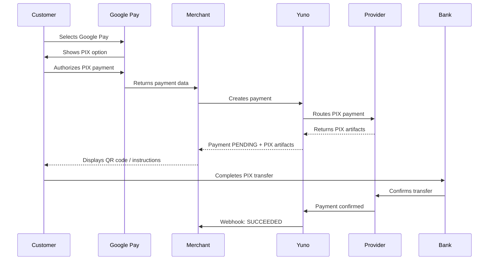
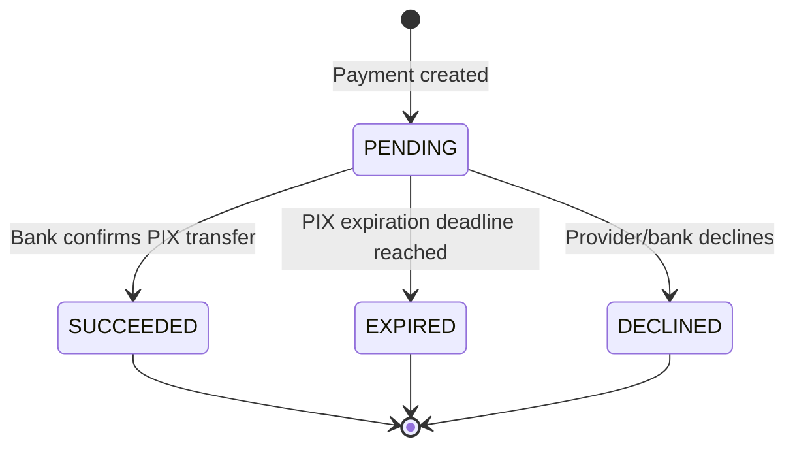

En Brasil, Yuno admite Google Pay™ como interfaz para pagos con PIX. Los clientes seleccionan Google Pay en el checkout y el pago se procesa mediante PIX, el sistema de pagos instantáneos de Brasil. Esto combina la comodidad de los métodos de pago almacenados de Google Pay con la liquidación en tiempo real de PIX.

<Note>
  Google Pay con PIX está disponible solo en Brasil, con transacciones en BRL (real brasileño).
</Note>

## Qué es Google Pay PIX {#what-is-google-pay-pix}

Google Pay PIX usa **Open Finance** para habilitar pagos con PIX a través de la billetera de Google Pay. En lugar de abrir la aplicación de su banco para completar una transferencia PIX, los clientes pueden pagar directamente desde su Google Wallet, lo que hace que la experiencia de checkout sea más rápida y cómoda.

Para pagar con Google Pay PIX, el cliente final debe configurar primero una cuenta bancaria para pagos con PIX dentro de su Google Wallet. Google ofrece instrucciones de configuración en [Set up PIX in Google Wallet](https://support.google.com/wallet/answer/14600929?hl=pt-BR).

## Cómo funciona {#how-it-works}

Desde la perspectiva del comercio, un pago con Google Pay + PIX se comporta como un pago PIX asíncrono estándar, aunque el cliente comience en Google Pay.

1. El cliente selecciona Google Pay en el checkout.
2. Google Pay presenta PIX como una opción de pago dentro de la hoja de pago de Google Pay.
3. El cliente selecciona un banco o una credencial que pueda iniciar una transferencia PIX y autoriza el pago.
4. Yuno crea el pago en estado `PENDING` y devuelve los artefactos estándar de PIX (código QR, código de copiar y pegar o deeplink) según el proveedor y la configuración. Consulta los [campos de respuesta de PIX](/es/reference/payments/payment-examples/bank-transfer#pix) para ver los nombres exactos de los campos.
5. El cliente completa la transferencia PIX a través de su banco.
6. El banco confirma la transferencia al proveedor, que notifica a Yuno.
7. Yuno actualiza el estado del pago a `SUCCEEDED` y dispara un webhook.



## Proveedores compatibles {#supported-providers}

Google Pay PIX está disponible actualmente a través de los siguientes proveedores:

* **Adyen**
* **Santander**
* **Itau**

Para otros proveedores, contacta a tu gerente de cuenta de Yuno para conversar sobre la disponibilidad y priorizar la integración.

## Requisitos {#requirements}

* Una cuenta de Yuno con una conexión a un [proveedor compatible](#supported-providers)
* Las transacciones deben ser en **BRL** (real brasileño)
* El cliente debe tener una cuenta bancaria configurada para PIX en su [Google Wallet](https://support.google.com/wallet/answer/14600929?hl=pt-BR)

## Integración {#integration}

Google Pay con PIX sigue los mismos patrones de integración que Google Pay con pagos con tarjeta. Elige el método de integración que se ajuste a tu arquitectura:

* **[Integración del SDK](/es/docs/wallets/google-pay/google-pay-sdk-integration)**: el SDK de Yuno gestiona el flujo completo, incluida la presentación de PIX como opción dentro de Google Pay.
* **[Integración directa](/es/docs/wallets/google-pay/google-pay-direct-integration)**: tú gestionas el frontend de Google Pay y pasas el token de pago de PIX a Yuno.
* **[Integración mediante proveedor](/es/docs/wallets/google-pay/integration-via-provider-google-pay)**: tu proveedor de pagos gestiona el flujo de Google Pay + PIX.

Al crear el pago, establece `payment_method.type` en `GOOGLE_PAY_PIX`. Esto le indica a Yuno que el pago es una transacción PIX iniciada mediante Google Pay.

## Solicitud de pago {#payment-request}

Crea un pago usando el tipo de método de pago `GOOGLE_PAY_PIX`. Establece el país en `BR` y la moneda en `BRL`:

```json
{
  "account_id": "your-account-id",
  "description": "Google Pay PIX payment",
  "merchant_order_id": "order-456",
  "country": "BR",
  "amount": {
    "currency": "BRL",
    "value": 5000
  },
  "customer_payer": {
    "email": "customer@example.com"
  },
  "payment_method": {
    "type": "GOOGLE_PAY_PIX"
  }
}
```

<Note>
  Para Google Pay PIX, usa `payment_method.type = GOOGLE_PAY_PIX` en lugar de `GOOGLE_PAY`. Esto es diferente de los pagos con tarjeta de Google Pay, que usan `GOOGLE_PAY`.
</Note>

## Estados de pago {#payment-statuses}

Google Pay con PIX es **asíncrono**. A diferencia de los pagos con tarjeta mediante Google Pay, que normalmente se resuelven de inmediato, los pagos con PIX pasan por un estado pendiente mientras se espera que se complete la transferencia bancaria.

| Estado      | Descripción                                                       |
| ----------- | ----------------------------------------------------------------- |
| `PENDING`   | Pago creado. La transferencia PIX aún no se ha completado.        |
| `SUCCEEDED` | El banco confirmó la transferencia PIX. Los fondos se liquidaron. |
| `EXPIRED`   | El pago PIX no se completó antes de la fecha límite de expiración. |
| `DECLINED`  | El proveedor o el banco rechazó el pago.                          |

### Ciclo de vida del estado {#status-lifecycle}



## Manejo de la cancelación del usuario {#handling-user-cancellation}

Si el cliente cierra la hoja de Google Pay o la pantalla de instrucciones de PIX antes de completar la transferencia bancaria:

* El **frontend/SDK** informa que el usuario abandonó el flujo (por ejemplo, el SDK devuelve un estado de cancelado por el usuario).
* El **pago en la API permanece en `PENDING`**. La referencia PIX sigue siendo válida y el cliente aún puede completar la transferencia desde la aplicación de su banco.
* El pago PIX solo pasa a `EXPIRED` cuando se alcanza la fecha límite de expiración, no cuando el usuario cierra la interfaz.

Tu checkout debe manejarlo de la siguiente manera:

1. **Volver a mostrar las instrucciones de PIX** si el cliente regresa a la misma sesión, ya que la referencia PIX sigue siendo válida.
2. **Permitir que el cliente pague más tarde** si tu UX lo admite. El código PIX permanece activo hasta que expira.
3. **Consultar el estado del pago** mediante `GET /v1/payments/{id}` o escuchar los webhooks para detectar cuándo se completa la transferencia.

## Webhooks {#webhooks}

Los webhooks de pago estándar se disparan en todas las transiciones de estado. El payload del webhook sigue la misma estructura que cualquier otra notificación de pago de Yuno.

Supervisa estos eventos:

* **Pago exitoso**: la transferencia PIX se completó. Actualiza el estado de tu orden y confirma al cliente.
* **Pago expirado**: la fecha límite de PIX pasó sin una transferencia. Deja de mostrar el código QR o las instrucciones de PIX e invita al cliente a iniciar un nuevo pago.

Consulta [Webhooks](/es/docs/webhooks) para ver los detalles de configuración.

## Diferencias con los pagos con tarjeta {#differences-from-card-payments}

| Aspecto                        | Google Pay con tarjetas          | Google Pay con PIX                            |
| ------------------------------ | -------------------------------- | --------------------------------------------- |
| Procesamiento                  | Normalmente síncrono             | Asíncrono (PENDING hasta que el banco confirma) |
| Liquidación                    | Depende del proveedor y el adquirente | Instantánea (red PIX)                    |
| Moneda                         | Admite varias monedas            | Solo BRL                                      |
| País                           | Disponibilidad global            | Solo Brasil                                   |
| Reembolsos                     | Flujo de reembolso estándar      | Flujo de reembolso de PIX                     |
| Pagos recurrentes              | Admitidos mediante tokens almacenados | No admitidos                             |
| Acción del cliente después del checkout | Ninguna requerida       | Debe completar la transferencia PIX mediante su banco |
| Expiración                     | N/A                              | La referencia PIX expira según las reglas del proveedor o de Yuno |

## Documentación relacionada {#related-documentation}

* [Descripción general de Google Pay](/docs/google-pay)
* [Integración del SDK de Google Pay](/es/docs/wallets/google-pay/google-pay-sdk-integration)
* [Integración directa de Google Pay](/es/docs/wallets/google-pay/google-pay-direct-integration)
* [Google Pay mediante proveedor](/es/docs/wallets/google-pay/integration-via-provider-google-pay)