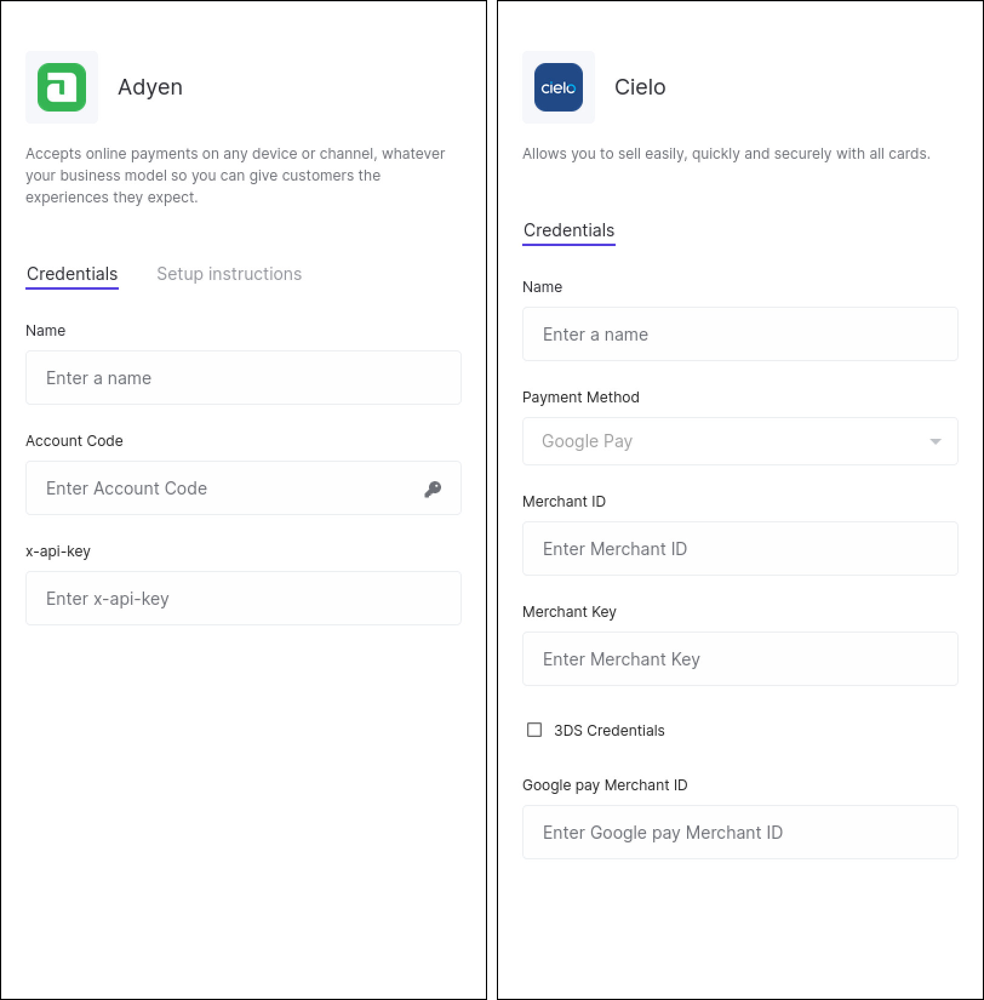

Con la integración mediante proveedor, tu proveedor de pagos gestiona Google Pay™ por completo (por ejemplo, Adyen, Cielo). Yuno enruta la transacción al proveedor, que gestiona el descifrado y el procesamiento del token de Google Pay. En este flujo, los datos de la tarjeta no pasan por Yuno.

Esta opción es ideal si ya usas la solución de Google Pay de un proveedor o si el proveedor gestiona el proceso de certificación de Google Pay en tu nombre.

<Note>
  ¿No estás seguro de qué integración usar? Consulta la [descripción general de Google Pay](/docs/google-pay#integration-options) para comparar las tres opciones.
</Note>

## Requisitos {#requirements}

Asegúrate de cumplir los [requisitos generales de Google Pay](/docs/google-pay#requirements).

## Proveedores {#providers}

Para incorporar Google Pay en tu sistema con Yuno, primero selecciona un proveedor compatible con este método de pago.

Debes tener credenciales para conectarte al proveedor seleccionado mediante el [Dashboard de Yuno](https://dashboard.y.uno/) antes de integrar Google Pay.

## Integración {#integration}

Debes completar algunos pasos para integrar Google Pay en tu sistema con Yuno.

1. Primero, revisarás el proceso de aprobación de Google para [dispositivos Android](https://developers.google.com/pay/api/android/overview) o [Google Pay en la Web](https://developers.google.com/pay/api/web/overview).
   1. Empieza revisando los Términos de servicio y la Política de uso aceptable.
   2. Completa los tutoriales y la lista de verificación de integración.
   3. Completa la lista de verificación de integración para [Android](https://developers.google.com/pay/api/android/guides/test-and-deploy/integration-checklist) o [Web](https://developers.google.com/pay/api/web/guides/test-and-deploy/integration-checklist) antes de solicitar a Google las credenciales de producción.
   4. Por último, solicitarás tu acceso a producción.
2. Obtén las credenciales de desarrollador del proveedor que elijas para empezar a usar con Yuno.

<Note>
**Conexión con Adyen**

Para Adyen, los comercios deben crear una [cuenta de pruebas](https://www.adyen.com/signup) y obtener un **Merchant Account** y una **x-api-key**.
</Note>

1. En el [Dashboard de Yuno](https://dashboard.y.uno/), selecciona la pestaña **Connections**. Busca el proveedor que elegiste y haz clic en **Connect**. Completa los campos del panel lateral con tus credenciales. A continuación, encontrarás ejemplos de los paneles de conexión para Adyen y Cielo.

<Frame></Frame>

4. Crea una ruta en el Dashboard de Yuno usando el gateway que conectaste. Accede a la guía [Configurar el enrutamiento dinámico](/es/docs/using-yuno/dashboard-overview/routing#configuring-the-dynamic-routing) para obtener más información sobre cómo crear rutas.

## Habilitar y probar Google Pay con Yuno {#enable-and-test-google-pay-with-yuno}

Después de realizar la integración en Yuno, puedes habilitar Google Pay con Yuno y realizar pruebas de integración con los siguientes pasos:

1. Primero, integra el [SDK de Yuno](/es/docs/sdks/full-checkout/android-payments) en tu app.
2. Crea una cuenta de prueba de Google Wallet:
   1. Visita la página de [inicio de sesión de la cuenta de prueba de Google Wallet](https://accounts.google.com/InteractiveLogin/signinchooser?continue=https%3A%2F%2Fpay.google.com%2Fbusiness%2Fconsole%2F\&followup=https%3A%2F%2Fpay.google.com%2Fbusiness%2Fconsole%2F\&osid=1\&passive=1209600\&ifkv=AeDOFXjl_LLJZyuykU06uleha4p7uSXJNnLCv_n2jshX6QVJYCy9AKq3K28mIfpgyfS2NDHfimnAFg\&flowName=GlifWebSignIn\&flowEntry=ServiceLogin).
   2. Si no tienes una cuenta de Google, deberás crear una para continuar.
   3. Una vez que hayas iniciado sesión, serás redirigido a la consola de negocio de Google Wallet.
3. Accede a la sección de la API de Google Wallet:
   1. En la consola de negocio de Google Wallet, ve a la sección relacionada con la administración de la API o la integración. Se encuentra en la configuración de desarrollador o de integración.
4. Selecciona **Create a Pass** para habilitar el **Demo Mode**:
   1. Dentro de la sección de la API de Google Wallet, localiza la opción llamada **Create a Pass**.
   2. Haz clic en esta opción para habilitar el **Demo mode**. Este modo te permite simular y probar la creación de pases y las interacciones sin realizar transacciones reales.

<Frame></Frame>

5. Descarga la app de Google Wallet desde Play Store.
6. Recorre el flujo de pago para probar la integración.

Si sigues estos pasos, puedes asegurarte de que Google Pay esté integrado en tu app y funcione como se espera antes de ponerlo a disposición de tus clientes.

## Detalles de implementación {#implementation-details}

Yuno admite ambos métodos de autorización de la API de Google Pay:

* **`PAN_ONLY`**: credenciales de tarjeta almacenadas en la cuenta de Google del usuario. Cuando se usa, el proveedor seleccionado gestiona la autenticación según su configuración.
* **`CRYPTOGRAM_3DS`**: credenciales de tarjeta basadas en el dispositivo con autenticación integrada. Estas credenciales incluyen autenticación criptográfica.

Ambos métodos son compatibles globalmente en todos los países donde opera Yuno. En el frontend, incluye `PAN_ONLY` y `CRYPTOGRAM_3DS` en tu arreglo `allowedAuthMethods` para lograr las mayores tasas de éxito de pago.

* **Configuración específica del proveedor**: el manejo de los métodos de autorización de Google Pay puede variar según el proveedor que selecciones. Consulta la documentación de tu proveedor para conocer los requisitos y las capacidades específicas del procesamiento de `PAN_ONLY` y `CRYPTOGRAM_3DS`.

## Documentación relacionada {#related-documentation}

* [Descripción general de Google Pay](/docs/google-pay)
* [Integración del SDK de Google Pay](/es/docs/wallets/google-pay/google-pay-sdk-integration)
* [Integración directa de Google Pay](/es/docs/wallets/google-pay/google-pay-direct-integration)
* [Google Pay con PIX](/es/docs/wallets/google-pay/google-pay-with-pix)