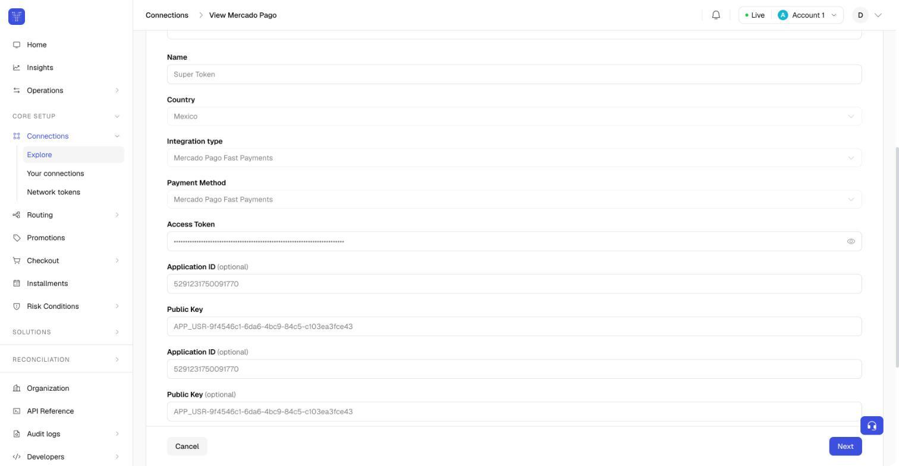
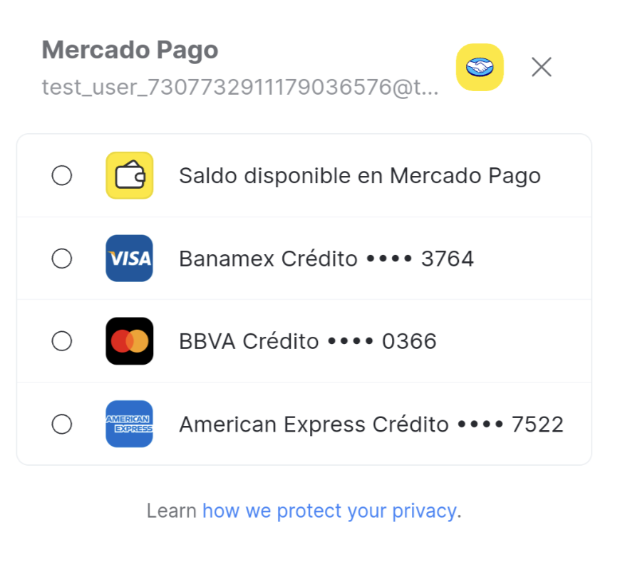

Mercado Pago Fast Payments muestra al comprador los métodos de pago que ya guardó en su cuenta de Mercado Pago (tarjetas y saldo de la cuenta) dentro de tu checkout de Yuno. El comprador elige uno, confirma con Mercado Pago y paga sin volver a escribir los datos de la tarjeta ni salir de tu página.

Yuno muestra la experiencia dentro de la lista de métodos de pago del Yuno SDK 2.0 y en el **Full checkout** y el **Lite checkout** del Web SDK v1.11. Tú creas la sesión de checkout y el pago como lo haces hoy; el SDK se encarga de la parte de Mercado Pago.

<Note>
Mercado Pago Fast Payments es compatible con el **Yuno SDK 2.0.0** (recomendado, con headless disponible desde la **2.7.1**) y con el **Web SDK v1.11.21** o posterior (`https://sdk-web.y.uno/v1.11/main.js`).

Los SDK heredados siguen siendo compatibles en paralelo durante la transición y está previsto dejar de darles soporte en **2027**. Yuno recomienda migrar al nuevo Yuno SDK en lugar de permanecer en un SDK heredado. Consulta la [guía de migración](/es/docs/yuno-sdk/migration/overview). Contacta a tu Account Manager para planificar la migración.
</Note>

## Disponibilidad {#availability}

Fast Payments está disponible en:

* **Lista de métodos de pago del Yuno SDK 2.0** (`getPaymentMethodsViews`), con la sesión de checkout creada con `workflow: 'SDK_SEAMLESS'`
* **`start()` headless del Yuno SDK** en Web, desde la versión 2.7.1, cuando tu página ejecuta el SDK de Mercado Pago y construye por sí misma la experiencia del comprador. Consulta [Integración headless](#headless-integration).
* **Full checkout del Web SDK v1.11** (`mountCheckout`)
* **Lite checkout del Web SDK v1.11** (`mountCheckoutLite`) con `paymentMethodType: 'MERCADO_PAGO_SUPERTOKEN'`, compatible con los modos de renderizado `element` y `modal` (Mercado Pago recomienda `element`).

No está disponible en el Seamless checkout del Web SDK v1, en la lista condensada de métodos de pago, en el checkout de Moon Active ni en los SDK móviles nativos.

### Compatibilidad y plataformas compatibles {#compatibility-and-platform-support}

Fast Payments funciona en contextos web y requiere que el comprador se autentique con Mercado Pago.

| Plataforma / Entorno | Nivel de compatibilidad | Notas |
| --- | --- | --- |
| **Desktop Web** | Compatible | Navegadores modernos con actualización continua (Chrome, Safari, Firefox, Edge). |
| **Mobile Web** | Compatible | Safari en iOS, Chrome en Android y navegadores móviles. |
| **WebView** | Aún no validado | Fast Payments no se ha validado en un WebView. No des por hecho que sea compatible allí. |
| **Native Mobile App** | No compatible | Los SDK nativos de iOS y Android no son compatibles actualmente con Fast Payments. |

<Note>
La visibilidad en los entornos compatibles depende de la **elegibilidad del comprador**. Si el comprador no tiene una cuenta de Mercado Pago válida, o si Mercado Pago no puede autenticar la sesión, Fast Payments no se ofrece. Lo que el comprador ve entonces depende de tu integración, descrita en [Cómo funciona para el comprador](#how-it-works-for-the-shopper).
</Note>

## Limitaciones funcionales {#functional-limitations}

Antes de planificar tu integración, revisa los límites funcionales en los que Fast Payments no debe usarse:

* **Recurrencia y transacciones iniciadas por el comercio (MIT):** Fast Payments requiere autenticación interactiva del comprador. No se puede usar para el cobro recurrente de suscripciones, el almacenamiento de tarjetas tokenizadas para cargos futuros fuera de sesión ni los flujos MIT.
* **Cupones y promociones de Mercado Pago:** Los descuentos dentro de la app de Mercado Pago o los códigos de cupón del comercio gestionados dentro de Mercado Pago no se pueden aplicar a través de Fast Payments.
* **Captura parcial o montos distintos:** No se admite autorizar un monto y capturar después un monto distinto o parcial. El monto capturado debe ser igual al monto de checkout autorizado.
* **Campos de subadquirente:** Los parámetros personalizados de subadquirente o los indicadores de procesamiento intermediario no se envían a Mercado Pago.
* **Pagos divididos:** Los pagos divididos 1:1 no son compatibles. Los escenarios de pago dividido 1:N están actualmente en validación y no están disponibles para el lanzamiento general.

## Incorporación y requisitos previos {#onboarding-and-prerequisites}

Activar Mercado Pago Fast Payments requiere una configuración coordinada entre el comercio, Yuno y Mercado Pago:

1. **Habilita Fast Payments** (Mercado Pago y comercio, en Mercado Pago Developers). Solicita la activación de Fast Payments en tu aplicación de Mercado Pago a través de tu account manager de Mercado Pago.
2. **Autoriza la conexión** (comercio, en el Yuno Dashboard). En **Settings > Connections**, ejecuta **Connect with Mercado Pago** para generar los tokens de acceso del vendedor.
3. **Configura las claves públicas** (comercio, en el Yuno Dashboard). Agrega la clave pública de cada sitio de Mercado Pago en el que vendes, etiquetada con su país. Agrega una clave etiquetada `GLOBAL` como respaldo.
4. **Configura el webhook** (comercio, en Mercado Pago Developers). Establece la Notification URL en `https://prod.y.uno/mercadopago-webhook/v1/orders/events` y suscríbete al evento **Order (Mercado Pago)**.
5. **Habilita las reglas de enrutamiento** (Yuno y comercio, en el Yuno Dashboard). Habilita el método de pago `MERCADO_PAGO_SUPERTOKEN` en tu workflow de enrutamiento del checkout.

<Frame caption="Configuración de la conexión de Mercado Pago Fast Payments en el Yuno Dashboard">
  
</Frame>

## Cómo funciona para el comprador {#how-it-works-for-the-shopper}

### Full checkout {#full-checkout}

En el Full checkout, Mercado Pago siempre aparece como **una sección** en la parte superior de la lista de métodos de pago, encabezada por el logotipo de Mercado Pago. Nunca es una fila seleccionable por sí sola: el comprador selecciona uno de los métodos dentro de la sección. La sección se adapta a lo que Yuno sabe del comprador:

| Situación | Lo que ve el comprador |
| --- | --- |
| La sesión de checkout no tiene el correo electrónico del comprador | Un campo que solicita el correo electrónico de su cuenta de Mercado Pago: *"Enter the e-mail of your Mercado Pago account to see your saved payment methods."* |
| El correo electrónico es conocido y Mercado Pago está cargando sus métodos | Un marcador de posición mientras se carga la lista |
| Mercado Pago respondió | Sus tarjetas guardadas y el saldo de la cuenta como filas, cada una con su marca y los últimos dígitos. Mercado Pago puede pedir el código de seguridad de la tarjeta antes de pagar con una tarjeta guardada, en un campo que muestra Mercado Pago |
| No se pudo contactar a Mercado Pago, no devolvió métodos o el comprador no es elegible | La sección de Mercado Pago no se muestra. El comprador ve tus otros métodos de pago. Si Mercado Pago es el único método de pago que tienes habilitado, se muestra en su lugar una sola fila de Mercado Pago para que la lista nunca quede vacía, y al seleccionarla se muestra el mensaje de no disponibilidad |

<Frame caption="Mercado Pago Fast Payments mostrando los métodos de pago guardados del comprador">
  
</Frame>

En todos los estados, la sección mantiene un aviso de privacidad (*"Learn how we protect your privacy."*) que enlaza a la página de privacidad de Mercado Pago del país del comprador (por ejemplo, `https://www.mercadopago.com.ar/privacidad` para Argentina). Tus otros métodos de pago aparecen a continuación, bajo un encabezado **Other payment methods**.

<Note>
Ocultar la sección es el comportamiento a partir del Web SDK **1.11.21**. En las versiones **1.11.6** a **1.11.20**, en su lugar permanece una sola fila de Mercado Pago en la lista, y el comprador que selecciona esa fila ve el mensaje *"Mercado Pago is not available right now. Please choose another payment method."* Actualiza a la versión 1.11.21 o posterior para que ese mensaje no aparezca en el recorrido del comprador.
</Note>

<Tip>
Envía el correo electrónico del comprador en `customer_payer.email` cuando [crees la sesión de checkout](/es/reference/checkout-sessions/create-checkout-session). Entonces la sección carga de inmediato los métodos guardados en lugar de pedirle el correo electrónico al comprador.
</Tip>

### Lite checkout {#lite-checkout}

En el Lite checkout, el SDK renderiza el componente de Mercado Pago en el contenedor configurado para `paymentMethodType: 'MERCADO_PAGO_SUPERTOKEN'`. Los compradores seleccionan y se autentican con sus métodos guardados de Mercado Pago directamente dentro de ese componente montado (o modal).

Igual que en el Full checkout, el componente muestra el aviso de privacidad que enlaza a la política de privacidad de Mercado Pago del país del comprador.

Como tu propia página es la dueña de la lista de métodos de pago en el Lite checkout, Yuno no puede quitar de ella la entrada de Mercado Pago. Cuando Mercado Pago no se puede usar, o el comprador no es elegible, el componente montado muestra el mensaje *"Mercado Pago is not available right now. Please choose another payment method."*

## Responsabilidades de la interfaz y la marca {#ui-responsibilities-and-branding}

Al integrar Fast Payments, sobre todo en configuraciones personalizadas o headless, es esencial saber qué capa se encarga de cada elemento:

* **Responsabilidades de la interfaz del comercio:**
  * Dibujar el selector de métodos de pago y los elementos de la lista (tarjetas, dinero en cuenta y otros métodos de pago del comercio).
  * Dibujar las opciones de cuotas con los datos exactos que entrega Mercado Pago (montos, etiquetas de tasa de interés).
  * Gestionar los estados de los botones: deshabilitar o bloquear los botones de envío durante la inicialización de la billetera, la autenticación o la creación del token para evitar clics duplicados.
  * Activar el indicador de carga de Yuno con `showLoading` durante la ejecución del pago y manejar los errores correctamente.
* **Responsabilidades del SDK de Mercado Pago:**
  * Alojar y dibujar el iframe del campo de CVV / código de seguridad (`wallet.mountSecurityCode()`) cuando se requiere para tarjetas de crédito/débito guardadas.
  * Dibujar los modales de autenticación biométrica o multifactor (desafíos OTP / FIDO).
  * Proporcionar la URL oficial y localizada de la política de privacidad (`wallet.privacyPolicyUrl`).
* **Requisitos de marca y recursos:**
  * **Logo:** Usa el logo oficial de Mercado Pago (`https://icons.prod.y.uno/mercadopago_logosimbolo.png`) junto al título de la sección o a la entrada del método.
  * **Ubicación:** Muestra Mercado Pago de forma destacada en la parte superior de las opciones de pago para maximizar la conversión de los compradores que iniciaron sesión.
  * **Política de privacidad:** Siempre que muestres métodos de Mercado Pago, muestra un enlace al aviso de privacidad de Mercado Pago con `wallet.privacyPolicyUrl` (por ejemplo, *"Conoce cómo protegemos tu privacidad"*).

## Integración {#integration}

### Correspondencia de workflow {#workflow-mapping}

Establece `workflow` en la sesión de checkout (`POST /v1/checkout/sessions`) según el SDK que integres:

| SDK y experiencia | Valor de `workflow` | Fast Payments | Notas |
| --- | --- | --- | --- |
| **Yuno SDK 2.0** (lista de métodos de pago) | `SDK_SEAMLESS` | Sí | Obligatorio en el Yuno SDK 2.0: permite que el SDK cree el pago. Sin él, la transacción termina en `INTERNAL_ERROR`. |
| **`start()` headless del Yuno SDK** | `SDK_SEAMLESS` | Sí | Tu página ejecuta el SDK de Mercado Pago. Crea una sesión de checkout por cada pago. Compatible con el SDK **v2.7.1+**. |
| **Full checkout del Web SDK v1.11** | `SDK_CHECKOUT` | Sí | La sección de Mercado Pago se muestra en la parte superior de la lista de métodos de pago. |
| **Lite checkout del Web SDK v1.11** (`element` o `modal`) | `SDK_CHECKOUT` | Sí | Mercado Pago recomienda `element`. |
| **Seamless checkout del Web SDK v1.11** | `SDK_SEAMLESS` | No | Fast Payments no está disponible en el Seamless checkout de la v1. |

### Ejemplos de integración {#integration-examples}

<Tabs>
<Tab title="Yuno SDK 2.0 (Recomendado)">

Carga el SDK desde la CDN (versión **2.7.1+**) e inicialízalo una sola vez.

```html
<script src="https://sdk-web.y.uno/v2.7.1/main.js"></script>
```

La sección de Mercado Pago se muestra en la parte superior de la lista de métodos de pago del SDK:

```javascript
const sdkPayments = await SdkPayments.initialize('YOUR_PUBLIC_API_KEY');

// Checkout session created by your backend with workflow: 'SDK_SEAMLESS'
const transaction = sdkPayments.transaction({
  checkoutSession: 'CHECKOUT_SESSION_ID',
  countryCode: 'AR',
  elementSelector: '#payment-form',
  onStatus: (result) => {
    console.log('Final status:', result.status);
  },
});

let selectedPaymentMethod = null;

const views = transaction.getPaymentMethodsViews({
  types: ['paymentMethodList'],
  onPaymentSelected: (paymentMethod) => {
    selectedPaymentMethod = paymentMethod;
  },
});

await views.paymentMethodList?.mount({ elementSelector: '#payment-list' });

// When the shopper confirms, from your Pay button
payButton.addEventListener('click', async () => {
  if (selectedPaymentMethod) {
    await transaction.start({ paymentMethod: selectedPaymentMethod });
  }
});
```

</Tab>
<Tab title="Web SDK v1.11 (Heredado)">

```javascript
// Web SDK v1.11.21+
const yuno = await Yuno.initialize('YOUR_PUBLIC_API_KEY');

await yuno.startCheckout({
  checkoutSession: 'CHECKOUT_SESSION_ID',
  elementSelector: '#root',
  countryCode: 'AR',
  // Mercado Pago recommends element render mode
  renderMode: {
    type: 'element', // or 'modal'
    elementSelector: {
      apmForm: '#apm-form',
      actionForm: '#action-form',
    },
  },
  // ...your callbacks
});

await yuno.mountCheckoutLite({
  paymentMethodType: 'MERCADO_PAGO_SUPERTOKEN',
});

await yuno.startPayment();
```

</Tab>
</Tabs>

### Lite checkout con varios métodos de pago {#lite-checkout-with-several-payment-methods}

En el Lite checkout, tu página es la dueña de la lista de métodos de pago y el SDK renderiza un método a la vez. Para ofrecer Fast Payments junto con tarjetas y otros métodos, monta el método que selecciona el comprador y mantén un solo botón Pay en tu página. Cuatro reglas definen la integración:

* **Un solo método montado a la vez.** `mountCheckoutLite` renderiza el formulario del método elegido en `renderMode.elementSelector.apmForm` (modo element) o en un modal. Si lo llamas de nuevo con otro `paymentMethodType`, reemplaza el formulario anterior, por lo que los datos escritos y el estado de validación nunca pasan de un método al siguiente.
* **Tu botón Pay.** Con `showPayButton: false`, los formularios de tarjeta y de otros métodos no muestran un botón propio. `onChange` te indica cuándo el formulario montado está completo, y `yuno.submitOneTimeTokenForm()` lo envía.
* **Mercado Pago confirma dentro de su propio componente.** El componente de Fast Payments conserva sus botones *Continue* y *Pay*, y `showPayButton` y `submitOneTimeTokenForm()` no se aplican a él. En modo element, oculta tu botón Pay mientras Mercado Pago esté seleccionado.
* **Un método que no pide nada paga al montarse.** Cuando un método no muestra ningún formulario, el SDK crea el token de un solo uso y llama a `createPayment` en cuanto el método se monta. Monta esos métodos cuando el comprador presione Pay, no cuando seleccione el método.

<Tabs>
<Tab title="Modo de renderizado element">

```html
<fieldset id="payment-methods">
  <label><input type="radio" name="payment-method" value="MERCADO_PAGO_SUPERTOKEN" /> Mercado Pago</label>
  <label><input type="radio" name="payment-method" value="CARD" /> Card</label>
  <label><input type="radio" name="payment-method" value="PIX" /> Pix</label>
</fieldset>

<div id="yuno-root"></div>
<div id="payment-form"></div>   <!-- the selected method's form renders here -->
<div id="action-form"></div>    <!-- 3DS and other actions render here -->
<button id="pay-button" type="button" disabled>Pay</button>
```

```javascript
// Web SDK v1.11.21+
const yuno = await Yuno.initialize('YOUR_PUBLIC_API_KEY');

const payButton = document.querySelector('#pay-button');
let selectedType = null;
let formIsValid = false;

await yuno.startCheckout({
  checkoutSession: 'CHECKOUT_SESSION_ID',
  elementSelector: '#yuno-root',
  countryCode: 'BR',
  renderMode: {
    type: 'element',
    elementSelector: {
      apmForm: '#payment-form',
      actionForm: '#action-form',
    },
  },
  // Card and other-method forms render no Pay button; yours submits them
  showPayButton: false,
  onChange: ({ form }) => {
    formIsValid = form.isValid;
    refreshPayButton();
  },
  async createPayment(oneTimeToken, tokenWithInformation) {
    // Create the payment from your backend with the one-time token
    await createPaymentOnYourServer({ oneTimeToken, checkoutSession: 'CHECKOUT_SESSION_ID' });
    await yuno.continuePayment();
  },
  paymentResult(status) {
    console.log('Payment result:', status);
  },
  error(message, data) {
    console.error('Error:', message, data);
  },
});

// Methods that render a form: mount on selection, submit from your Pay button.
// A method that asks nothing (Pix on this connection) creates the token as soon
// as it mounts, so it is mounted from the Pay button instead.
const MOUNT_ON_SELECTION = ['MERCADO_PAGO_SUPERTOKEN', 'CARD'];

async function selectMethod(type) {
  selectedType = type;
  formIsValid = false;
  if (MOUNT_ON_SELECTION.includes(type)) {
    // Mounting another type replaces the previous form and its validation state
    await yuno.mountCheckoutLite({ paymentMethodType: type });
    await yuno.startPayment();
  } else {
    // Remove the previous method's form; Pix mounts when the shopper presses Pay
    await yuno.unmountSdk();
  }
  refreshPayButton();
}

function refreshPayButton() {
  // Mercado Pago confirms inside its own component
  payButton.hidden = selectedType === 'MERCADO_PAGO_SUPERTOKEN';
  // Disable only while a mounted form is incomplete
  payButton.disabled = MOUNT_ON_SELECTION.includes(selectedType) && !formIsValid;
}

document.querySelectorAll('input[name="payment-method"]').forEach((radio) => {
  radio.addEventListener('change', () => selectMethod(radio.value));
});

payButton.addEventListener('click', async () => {
  if (MOUNT_ON_SELECTION.includes(selectedType)) {
    await yuno.submitOneTimeTokenForm();
    return;
  }
  await yuno.mountCheckoutLite({ paymentMethodType: selectedType });
  await yuno.startPayment();
});
```

El componente de Mercado Pago se renderiza en `#payment-form` en cuanto se monta: los métodos guardados cuando el comprador es elegible, o el mensaje de no disponibilidad descrito en [Lite checkout](#lite-checkout) cuando Mercado Pago no se puede usar. En ese caso, el comprador selecciona otro método de tu lista y el siguiente montaje reemplaza el mensaje.

</Tab>
<Tab title="Modo de renderizado modal">

En el modo de renderizado modal (el predeterminado), el SDK abre el modal del método en cuanto se monta, y el modal incluye el botón Pay propio del SDK. Monta al hacer clic en Pay en lugar de al seleccionar, deja `showPayButton` en su valor predeterminado, y al cerrar el modal el método se desmonta:

```javascript
// Web SDK v1.11.21+
const yuno = await Yuno.initialize('YOUR_PUBLIC_API_KEY');

let selectedType = null;

await yuno.startCheckout({
  checkoutSession: 'CHECKOUT_SESSION_ID',
  elementSelector: '#yuno-root',
  countryCode: 'BR',
  // renderMode defaults to { type: 'modal' }
  async createPayment(oneTimeToken, tokenWithInformation) {
    await createPaymentOnYourServer({ oneTimeToken, checkoutSession: 'CHECKOUT_SESSION_ID' });
    await yuno.continuePayment();
  },
  paymentResult(status) {
    console.log('Payment result:', status);
  },
  error(message, data) {
    console.error('Error:', message, data);
  },
});

document.querySelectorAll('input[name="payment-method"]').forEach((radio) => {
  radio.addEventListener('change', () => {
    selectedType = radio.value;
  });
});

document.querySelector('#pay-button').addEventListener('click', async () => {
  await yuno.mountCheckoutLite({ paymentMethodType: selectedType });
  await yuno.startPayment();
});
```

Mercado Pago se abre como un modal con los métodos guardados del comprador, o con el mensaje de no disponibilidad; el comprador lo cierra y elige otro método de tu lista.

</Tab>
</Tabs>

### Integración headless {#headless-integration}

En una integración headless, tu página ejecuta el SDK de Mercado Pago, muestra los métodos guardados del comprador en tu propia interfaz y obtiene la autorización del comprador. Luego le entregas a Yuno el token autorizado y el método que eligió el comprador con `transaction.start()`. El Yuno SDK no dibuja nada y crea el mismo token de un solo uso que la lista de métodos de pago.

Fast Payments headless está disponible en el Yuno SDK para Web desde la versión **2.7.1+**. La integración headless del Web SDK v1 no envía los campos de Mercado Pago.

#### 1. Ciclo de vida de la integración y selección única {#1-integration-lifecycle-and-unique-selection}

Para ofrecer una experiencia headless confiable, ten en cuenta estos principios básicos:

* **Una sesión de checkout por pago:** Crea la sesión desde tu backend con `workflow: 'SDK_SEAMLESS'` y crea una nueva para cada pago. Una vez creado un pago en una sesión, Yuno rechaza otro pago en ella.
* **Correo electrónico desconocido:** Con un correo electrónico que Mercado Pago no conoce, `mp.wallet()` devuelve `available: false` y ningún método. Ofrece tus otros métodos de pago en su lugar.
* **Clave de selección única:** El `id` que devuelve Mercado Pago identifica la marca del método de pago (por ejemplo, `visa`, `master`, `account_money`). Varias tarjetas guardadas pueden compartir el mismo `id`. Usa siempre `token` como clave de selección única en todo el checkout. Mantén la selección exclusiva entre todas las opciones del checkout.
* **Ciclo de vida y `wallet.destroy()`:** Una instancia de billetera está vinculada al `amount` y al `email` específicos con los que se inicializó. Si el comprador cambia su correo electrónico o si el monto del checkout se actualiza (por ejemplo, al aplicar envío o descuentos), llama a `wallet.destroy()` antes de volver a llamar a `mp.wallet()` para evitar fugas de memoria y tokens de sesión obsoletos.
* **Estructura del método de pago:** Cada elemento de `wallet.paymentMethods` contiene:
  * `token`: Token único de la tarjeta o del saldo.
  * `id`: Identificador de la marca (`visa`, `master`, `account_money`).
  * `type`: Categoría (`credit_card`, `debit_card`, `account_money`).
  * `name`: Nombre para mostrar (por ejemplo, `"Mastercard"`).
  * `thumbnail`: URL del recurso del ícono de la marca de la tarjeta o del método de pago.
  * `lastFourDigits`: Últimos 4 dígitos de la tarjeta (vacío para `account_money`).
  * `securityCode`: Objeto con `{ required: boolean, length: number }`. Cuando `required: true`, monta el campo de CVV con `wallet.mountSecurityCode()`.
  * `installments`: Arreglo de opciones de cuotas disponibles.

#### 2. Visualización de las cuotas {#2-installments-rendering}

Cada entrada de `method.installments` proporciona:
* `installments`: Número de cuotas (por ejemplo, `1`, `3`, `6`).
* `installmentAmount`: Monto por cuota (por ejemplo, `50.00`).
* `totalAmount`: Monto total financiado (por ejemplo, `150.00`).
* `installmentRate`: Tasa de interés de la financiación (por ejemplo, `0` para sin interés).
* `labels`: Etiquetas descriptivas (por ejemplo, `["recommended_installment"]`).

<Tip>
Muestra el desglose de cuotas directamente a partir de `installmentAmount`, `totalAmount` e `installmentRate`. No recalcules la financiación ni los intereses en tu frontend; los números de Mercado Pago son los que valen.
</Tip>

```javascript
// Example: formatting an installment option
function renderInstallmentOption(installment) {
  const interestText = installment.installmentRate === 0 ? 'without interest' : 'with interest';
  return `${installment.installments}x $${installment.installmentAmount.toFixed(2)} (${interestText} - Total: $${installment.totalAmount.toFixed(2)})`;
}
```

#### 3. Manejo de errores, cancelación y flujos de reintento {#3-error-handling-cancellation-and-retry-flows}

Autentica y envía el pago dentro de un bloque `try/catch/finally` estructurado. Distingue entre los distintos escenarios de falla para ofrecer la experiencia adecuada:

* **Cancelación (`USER_CANCELLED`, `OTP_CANCELLED`, `FIDO_CANCELLED`):** El comprador descartó el desafío o la solicitud biométrica. Mantén activo el método seleccionado, vuelve a habilitar el botón de pago y deja que el comprador lo intente de nuevo sin perder su selección.
* **No elegible / sesión obsoleta (`INVALID_PAYMENT_METHOD_TOKEN`, `account_payment_methods_empty`):** Destruye la billetera con `wallet.destroy()`, vuelve a inicializarla o recurre a los métodos de pago estándar del checkout.
* **Fallas técnicas (`PAYMENT_REQUEST_ERROR`, `AUTHORIZATION_FAILED`):** Desbloquea la interfaz e invita al comprador a reintentar o a elegir otro método.

```javascript
let isSubmitting = false;

async function handlePay() {
  if (isSubmitting) return;

  const payButton = document.querySelector('#pay-button');
  payButton.disabled = true;
  isSubmitting = true;

  try {
    // 1. Submit to Mercado Pago
    const result = await wallet.submit({ token: selectedMethod.token });
    const thirdPartyToken = result?.payment_method?.token ?? selectedMethod.token;

    // 2. Start Yuno transaction
    await transaction.start({
      paymentMethod: {
        type: 'MERCADO_PAGO_SUPERTOKEN',
        data: {
          wallet: {
            thirdPartyToken,
            providerMethodId: selectedMethod.id,
            providerMethodType: selectedMethod.type,
          },
          ...(selectedMethod.type !== 'account_money' && selectedInstallment && {
            installment: { value: selectedInstallment.installments },
          }),
        },
      },
    });
  } catch (error) {
    console.error('Mercado Pago authorization error:', error);
    const errorCode = error?.errorCode;

    if (['USER_CANCELLED', 'OTP_CANCELLED', 'FIDO_CANCELLED'].includes(errorCode)) {
      // Shopper cancelled challenge; allow them to retry
      console.log('Shopper cancelled authorization prompt.');
    } else if (['INVALID_PAYMENT_METHOD_TOKEN', 'account_payment_methods_empty'].includes(errorCode)) {
      // Stale wallet or method invalidated; reload wallet
      await reloadWallet();
    } else {
      // General error; inform shopper
      alert('Unable to complete payment with Mercado Pago. Please try again or select another method.');
    }
  } finally {
    // Unlock button unless payment completed
    isSubmitting = false;
    payButton.disabled = false;
  }
}
```

El objeto `data` que pasas a `transaction.start()` acepta estos campos:

| Campo | Valor |
| --- | --- |
| `wallet.thirdPartyToken` | El token que devuelve `wallet.submit()`. Obligatorio. |
| `wallet.providerMethodId` | El `id` del método elegido, por ejemplo `visa`, `master` o `account_money`. Obligatorio. |
| `wallet.providerMethodType` | El `type` del método elegido: `credit_card`, `debit_card` o `account_money`. Obligatorio. |
| `installment.value` | El número de cuotas que el comprador eligió entre las `installments` del método. Opcional. Sin él, el SDK envía 1. El SDK no envía cuotas para `account_money`. |

Cuando falta cualquiera de los tres campos de `wallet`, el SDK no crea ningún token y `onStatus` recibe `INTERNAL_ERROR` con `message.code` `WALLET_DATA_MISSING`. `message.reason` indica los campos que faltan.

Ambos modos de creación del pago funcionan. Sin `createPayment`, el SDK crea el pago. Con `createPayment`, lo creas desde tu backend con el token de un solo uso, como con cualquier otro método.

#### 4. Ejemplo headless completo y ejecutable {#4-complete-runnable-headless-example}

El siguiente ejemplo muestra:
* La carga del **Yuno SDK v2.7.1+** compatible y del SDK de Mercado Pago.
* La inicialización y el cierre del ciclo de vida de la billetera (`wallet.destroy()`).
* Los métodos guardados de Mercado Pago (con `thumbnail`, `name`, últimos dígitos y `installments` completo) junto a una opción estándar de tarjeta de crédito del comercio.
* El cambio entre métodos con y sin CVV (`wallet.mountSecurityCode()`).
* El enlace a la política de privacidad con `wallet.privacyPolicyUrl`.

```html
<!DOCTYPE html>
<html lang="en">
<head>
  <meta charset="UTF-8">
  <title>Yuno Headless - Mercado Pago Fast Payments</title>
  <!-- 1. Compatible SDK scripts -->
  <script src="https://sdk-web.y.uno/v2.7.1/main.js"></script>
  <script src="https://sdk.mercadopago.com/js/v2"></script>
  <style>
    .payment-option { border: 1px solid #ddd; padding: 12px; margin-bottom: 8px; border-radius: 6px; }
    .payment-option.selected { border-color: #009ee3; background-color: #f6fbfe; }
    .method-header { display: flex; align-items: center; gap: 8px; font-weight: bold; }
    .method-icon { height: 24px; }
    .cvv-container { margin-top: 10px; padding: 8px; background: #fff; border: 1px dashed #ccc; }
    .privacy-notice { font-size: 12px; color: #666; margin-top: 12px; }
  </style>
</head>
<body>
  <h2>Select a Payment Method</h2>

  <!-- Payment Methods List -->
  <div id="payment-methods-container"></div>

  <!-- Privacy notice -->
  <div id="privacy-container" class="privacy-notice" hidden>
    <a id="privacy-link" href="#" target="_blank" rel="noopener noreferrer">Learn how Mercado Pago protects your privacy</a>
  </div>

  <br />
  <button id="pay-button" disabled>Pay</button>

  <script>
    let mp = null;
    let wallet = null;
    let sdkPayments = null;
    let transaction = null;

    let selectedPayment = null; // { type: 'MERCADO_PAGO' | 'CARD', methodData, token }
    let selectedInstallment = null;

    async function initCheckout() {
      // 1. Initialize Yuno SDK Payments
      sdkPayments = await SdkPayments.initialize('YOUR_YUNO_PUBLIC_API_KEY');
      transaction = sdkPayments.transaction({
        checkoutSession: 'CHECKOUT_SESSION_ID',
        countryCode: 'AR',
        onStatus: (result) => {
          console.log('Transaction status:', result.status);
          if (result.status === 'SUCCEEDED') {
            window.location.href = '/success';
          }
        },
      });

      // 2. Initialize Mercado Pago SDK
      mp = new MercadoPago('YOUR_MERCADO_PAGO_PUBLIC_KEY', { locale: 'es-AR' });

      await loadWallet({
        amount: '150.00',
        email: 'shopper@example.com'
      });
    }

    async function loadWallet({ amount, email }) {
      // Clean up existing wallet if email or amount changes
      if (wallet) {
        wallet.destroy();
        wallet = null;
      }

      try {
        wallet = await mp.wallet({
          amount,
          payer: { email }
        });

        renderPaymentOptions();
      } catch (err) {
        console.error('Wallet initialization failed:', err);
        renderPaymentOptions(); // Render standard methods only
      }
    }

    function renderPaymentOptions() {
      const container = document.querySelector('#payment-methods-container');
      container.innerHTML = '';

      // A. Render Mercado Pago Saved Methods (if available)
      if (wallet && wallet.available && wallet.paymentMethods.length > 0) {
        wallet.paymentMethods.forEach((method) => {
          const div = document.createElement('div');
          div.className = 'payment-option';
          div.dataset.token = method.token; // Use token as unique selection key

          const lastDigits = method.lastFourDigits ? ` •••• ${method.lastFourDigits}` : '';
          div.innerHTML = `
            <div class="method-header">
              <input type="radio" name="checkout-method" value="${method.token}" id="mp-${method.token}">
              
              <label for="mp-${method.token}">${method.name}${lastDigits}</label>
            </div>
            <div class="method-details" id="details-${method.token}" style="display:none; margin-top:8px;"></div>
          `;

          div.querySelector('input').addEventListener('change', () => selectMercadoPagoMethod(method));
          container.appendChild(div);
        });

        // Display privacy policy
        if (wallet.privacyPolicyUrl) {
          const privacyContainer = document.querySelector('#privacy-container');
          const privacyLink = document.querySelector('#privacy-link');
          privacyLink.href = wallet.privacyPolicyUrl;
          privacyContainer.hidden = false;
        }
      }

      // B. Render Standard Merchant Card Option
      const cardDiv = document.createElement('div');
      cardDiv.className = 'payment-option';
      cardDiv.innerHTML = `
        <div class="method-header">
          <input type="radio" name="checkout-method" value="standard-card" id="standard-card">
          <label for="standard-card">Credit or Debit Card (Standard)</label>
        </div>
      `;
      cardDiv.querySelector('input').addEventListener('change', selectStandardCard);
      container.appendChild(cardDiv);
    }

    function selectMercadoPagoMethod(method) {
      selectedPayment = { type: 'MERCADO_PAGO', method };
      document.querySelector('#pay-button').disabled = false;

      // Clear previous CVV containers and details
      document.querySelectorAll('.method-details').forEach(el => {
        el.style.display = 'none';
        el.innerHTML = '';
      });

      const detailsContainer = document.querySelector(`#details-${method.token}`);
      detailsContainer.style.display = 'block';

      // 1. Render installments if credit card
      if (method.type === 'credit_card' && method.installments && method.installments.length > 0) {
        const select = document.createElement('select');
        method.installments.forEach((inst) => {
          const opt = document.createElement('option');
          opt.value = inst.installments;
          const interest = inst.installmentRate === 0 ? 'without interest' : 'with interest';
          opt.textContent = `${inst.installments}x $${inst.installmentAmount.toFixed(2)} (${interest})`;
          select.appendChild(opt);
        });
        selectedInstallment = method.installments[0];
        select.addEventListener('change', (e) => {
          selectedInstallment = method.installments.find(i => i.installments == e.target.value);
        });
        detailsContainer.appendChild(select);
      } else {
        selectedInstallment = null;
      }

      // 2. Mount CVV container if required
      if (method.securityCode && method.securityCode.required) {
        const cvvBox = document.createElement('div');
        cvvBox.id = `security-code-${method.token}`;
        cvvBox.className = 'cvv-container';
        detailsContainer.appendChild(cvvBox);

        // Mount Mercado Pago security code iframe
        wallet.mountSecurityCode(cvvBox.id, { token: method.token });
      }
    }

    function selectStandardCard() {
      selectedPayment = { type: 'CARD' };
      selectedInstallment = null;
      document.querySelector('#pay-button').disabled = false;

      // Close all MP detail containers
      document.querySelectorAll('.method-details').forEach(el => {
        el.style.display = 'none';
        el.innerHTML = '';
      });
    }

    // Handle Pay button click
    document.querySelector('#pay-button').addEventListener('click', async () => {
      const payButton = document.querySelector('#pay-button');
      payButton.disabled = true;

      try {
        if (selectedPayment.type === 'MERCADO_PAGO') {
          const method = selectedPayment.method;

          // Authenticate / submit with Mercado Pago
          const result = await wallet.submit({ token: method.token });
          const thirdPartyToken = result?.payment_method?.token ?? method.token;

          // Start Yuno transaction
          await transaction.start({
            paymentMethod: {
              type: 'MERCADO_PAGO_SUPERTOKEN',
              data: {
                wallet: {
                  thirdPartyToken,
                  providerMethodId: method.id,
                  providerMethodType: method.type,
                },
                ...(method.type !== 'account_money' && selectedInstallment && {
                  installment: { value: selectedInstallment.installments },
                }),
              },
            },
          });
        } else {
          // Standard card flow
          console.log('Proceeding with standard card payment');
        }
      } catch (err) {
        console.error('Payment error:', err);
        const errorCode = err?.errorCode;
        if (['USER_CANCELLED', 'OTP_CANCELLED', 'FIDO_CANCELLED'].includes(errorCode)) {
          console.log('User cancelled verification prompt.');
        } else {
          alert('Payment authentication failed. Please try again.');
        }
      } finally {
        payButton.disabled = false;
      }
    });

    initCheckout();
  </script>
</body>
</html>
```

### Token de un solo uso y creación del pago {#one-time-token-and-payment-creation}

Cuando el comprador confirma, en la lista de métodos de pago o mediante un `start()` headless, el token de un solo uso del SDK lleva por ti los detalles de Mercado Pago:

```json
{
  "payment_method": {
    "type": "MERCADO_PAGO_SUPERTOKEN",
    "wallet": {
      "third_party_token": "<token issued by Mercado Pago for this payment>",
      "provider_method_id": "master",
      "provider_method_type": "credit_card"
    },
    "installment": { "value": 1, "id": null }
  }
}
```

* `third_party_token` es el token que Mercado Pago emite para el método que eligió el comprador. Yuno lo usa para cobrar el pago; tú nunca ves los datos de la tarjeta.
* `provider_method_id` y `provider_method_type` identifican el método dentro de la cuenta de Mercado Pago del comprador (una marca de tarjeta como `master`, o `account_money` para el saldo de la cuenta).
* `installment` se envía para tarjetas, con el número de cuotas que el comprador eligió entre las opciones de Mercado Pago. Se omite para `account_money`.

Crea el pago con el token de un solo uso exactamente como lo haces con cualquier otro método ([Paso 7 de la guía del Full checkout](/es/docs/sdks/full-checkout/web-payments#step-7-create-the-payment)). El pago se procesa a través de tu conexión de Mercado Pago.

## Idempotencia, reintentos y diagnóstico {#idempotency-retries-and-diagnostics}

* **Idempotencia y tiempos de espera del servidor:** Incluye siempre un encabezado `X-Idempotency-Key` al crear pagos mediante `POST /v1/payments`. Si ocurre un tiempo de espera de red durante esta solicitud, tu servidor debe primero reintentar la solicitud con exactamente el mismo `X-Idempotency-Key` o conciliar el estado del pago mediante `GET /v1/payments/{payment_id}`.
* **Recuperación del estado del checkout (`continuePayment`):** Llama a `yuno.continuePayment()` en el cliente solo después de crear el pago, cuando la respuesta del pago indique que se necesita una acción (como `sdk_action_required`) o cuando una tarjeta devuelva `DECLINED` o `ERROR` y el comprador deba seleccionar otro método o reintentar. No uses `continuePayment()` como sustituto de los reintentos por tiempo de espera del servidor ni de la conciliación de estados.
* **Diagnóstico para soporte:** Al escalar problemas de pagos o de integración al soporte de Yuno o de Mercado Pago, captura y proporciona siempre estos identificadores:
  * `checkout_session`: El identificador único de la sesión creada mediante `POST /v1/checkout/sessions`.
  * `payment_id`: El identificador de la transacción devuelto por Yuno en la respuesta del pago.
  * `trace_id` / `request_id`: El encabezado de seguimiento de la respuesta HTTP (`X-Trace-Id`) de las solicitudes a la API.

## Países {#countries}

Fast Payments está disponible en Argentina, Brasil, México y Chile. Sigue tu conexión de Mercado Pago: el SDK usa la clave pública etiquetada con el país del checkout, recurre a una clave etiquetada `GLOBAL` y, si no hay ninguna de las dos, usa la primera clave pública de la conexión.

## Pruebas y lanzamiento a producción {#testing-and-production-release}

### Lista de verificación de pruebas {#testing-checklist}

Antes de salir en vivo, valida tu integración en los entornos sandbox de Mercado Pago:

1. **Creación de usuarios de prueba:** Crea cuentas de prueba de comprador y de vendedor en el portal de Mercado Pago Developers para el sitio del país de destino.
2. **Configuración de métodos de pago:** Asegúrate de que el usuario comprador de prueba tenga métodos de pago guardados en su cuenta de Mercado Pago (tarjeta de crédito y saldo de la cuenta).
3. **Correo electrónico de la sesión:** En `POST /v1/checkout/sessions`, pasa el email registrado del comprador de prueba en `customer_payer.email`.
4. **Flujo de autenticación:** Verifica que las tarjetas guardadas se carguen en la sección del checkout. Prueba las solicitudes del código de seguridad y los pasos de desafío simulados.
5. **Reglas de enrutamiento:** Asegúrate de que las reglas de enrutamiento dirijan las transacciones `MERCADO_PAGO_SUPERTOKEN` a la conexión de prueba de Mercado Pago.

### Lista de verificación del lanzamiento a producción {#production-release-checklist}

Al pasar de sandbox a producción:

1. **Autorización OAuth de producción:** En el Yuno Dashboard, haz clic en **Connect with Mercado Pago** en tu cuenta de producción para generar tokens de vendedor activos.
2. **Claves públicas de producción:** Asegúrate de que las claves públicas de producción estén asignadas a cada sitio de país activo.
3. **Verificación del webhook:** Verifica que la Notification URL de producción esté configurada y reciba eventos en Mercado Pago Developers.
4. **Validación del checkout:** Verifica la experiencia de los compradores no elegibles y de los compradores sin métodos de pago guardados, como se describe en [Cómo funciona para el comprador](#how-it-works-for-the-shopper).
