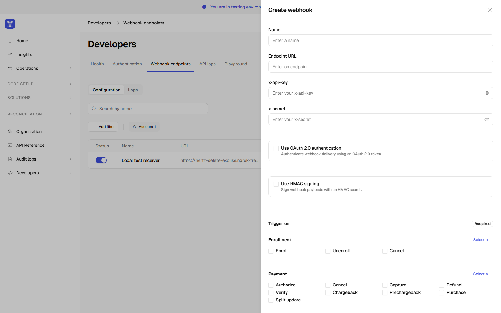
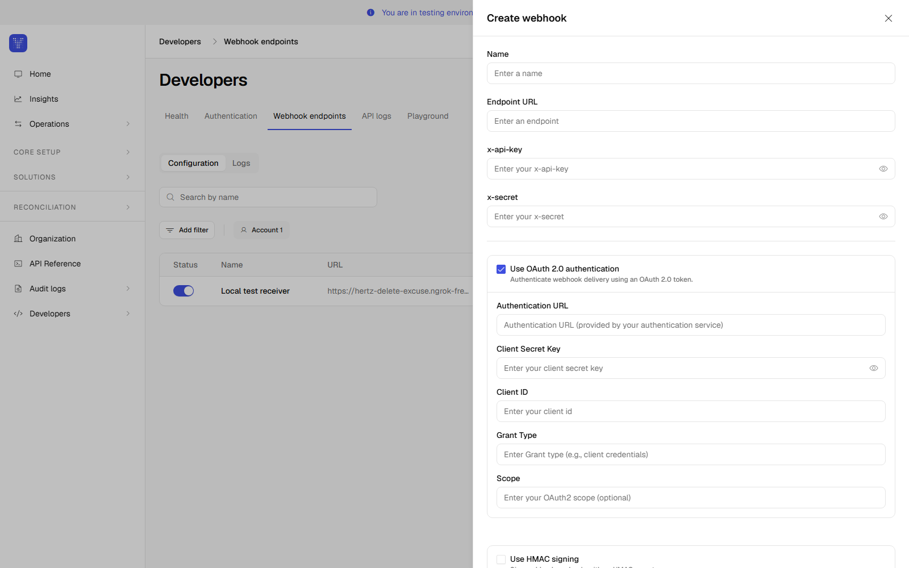

Un webhook se configura de la misma manera sin importar cómo lo configures, con una `url` de destino, al menos un disparador y, opcionalmente, cómo se autentica Yuno ante tu endpoint. Consulta [Events and Triggers](/es/docs/webhooks/events) para ver el catálogo completo de eventos que puedes seleccionar.

El `url` del webhook y, si usas OAuth2, la URL de autenticación deben ser endpoints accesibles públicamente (la URL de autenticación de OAuth2 debe usar HTTPS). Yuno no llama a URLs que resuelvan a direcciones de red privadas o internas, incluidas las direcciones IP de esos rangos.

<Tabs>
  <Tab title="Dashboard">
    1. Ve a la pestaña **Developers**
    2. Haz clic en **Webhook endpoints**
    3. Haz clic en **Add webhook**

    Se abrirá un panel donde configurarás:

    * **Name**: identifica tu webhook
    * **Endpoint URL**: la URL de tu servidor para recibir las notificaciones
    * **x-api-key**: tu clave de API, enviada en los encabezados de las notificaciones (`api_key` mediante la API)
    * **x-secret**: tu secreto, enviado en los encabezados de las notificaciones (`secret` mediante la API)
    * **Use OAuth 2.0 authentication**: casilla opcional para OAuth2
    * **Use HMAC signing**: casilla opcional para la verificación de firmas HMAC
    * **Trigger on**: selecciona qué eventos activarán este webhook, agrupados por categoría (Enrollment, Payment, Report, Subscription, Onboarding), cada una con su propio enlace **Select all**
    * **Apply to accounts**: para organizaciones con más de una cuenta, elige a qué cuentas se aplica este webhook. Por defecto se aplica a la cuenta actual.

    Una vez configurado, el webhook enviará notificaciones cada vez que ocurran los eventos seleccionados. La imagen siguiente muestra el panel para agregar un webhook.

    <Frame></Frame>

    En la pestaña Developers del [dashboard de Yuno](https://dashboard.y.uno/), puedes activar y desactivar webhooks con el botón de alternancia **Status**.
  </Tab>
  <Tab title="API">
    Envía la `url` de destino, un `name` único y al menos un disparador a [Create a Webhook](/es/reference/webhooks/create-webhook):

    ```bash cURL
    curl -X POST 'https://api-sandbox.y.uno/v1/webhooks' \
      -H 'public-api-key: <YOUR_PUBLIC_API_KEY>' \
      -H 'private-secret-key: <YOUR_PRIVATE_SECRET_KEY>' \
      -H 'Content-Type: application/json' \
      -d '{
        "account_id": "<ACCOUNT_ID>",
        "name": "Order updates",
        "url": "https://your-endpoint.example.com/yuno-webhooks",
        "payment_triggers": ["AUTHORIZE", "PURCHASE"]
      }'
    ```

    La respuesta incluye el `id` que usas para [consultar](/es/reference/webhooks/retrieve-webhook), [actualizar](/es/reference/webhooks/update-webhook) o [eliminar](/es/reference/webhooks/delete-webhook) el webhook. Consulta la [referencia completa de la API de Webhooks](/es/reference/webhooks) para ver todos los campos, incluidos la autenticación de entrega y las respuestas de error.
  </Tab>
</Tabs>

Accede a la página [Payloads and Examples](/es/docs/webhooks/object-and-examples) para ver ejemplos de eventos de notificación de pagos, inscripciones y muchos otros.

### Autenticación HMAC {#hmac-authentication}

Marca **Use HMAC signing** en el dashboard y completa el campo **Client Secret Key**, o define `hmac_client_secret` mediante la API. En ambos casos, Yuno usa esa clave para generar una firma HMAC-SHA256 y la envía en el encabezado `x-hmac-signature` con cada entrega, de modo que puedas verificar que un webhook realmente proviene de Yuno y no fue alterado.

Consulta la guía [Verify Webhook Signatures (HMAC)](/es/docs/webhooks/verify-webhook-signatures-hmac) para ver los detalles de implementación.

### OAuth2 {#oauth2}

Marca **Use OAuth 2.0 authentication** en el dashboard, o define los campos correspondientes mediante la API, para que Yuno pueda obtener el token que envía con cada entrega:

| Campo del dashboard | Campo de la API | Descripción |
| :--------------- | :-------- | :----------- |
| Authentication URL | `oauth2_authentication_url` | El endpoint de tokens de tu servicio, mediante HTTPS. |
| Client ID | `oauth2_client_id` | El identificador de cliente con el que Yuno se autentica. |
| Client Secret Key | `oauth2_client_secret` | El secreto de cliente con el que Yuno se autentica. |
| Grant Type | `oauth2_grant_type` | El tipo de concesión con el que Yuno solicita el token, normalmente `client_credentials`. |
| Scope (optional) | `oauth2_scope` | El alcance de OAuth2 que se solicita, si tu servicio de autenticación lo requiere. |

<Note>
La API también expone `oauth2_authorization_name` (el encabezado en el que Yuno envía el token, por defecto `Authorization`) y `oauth2_include_client_id`. Estos todavía no tienen un equivalente en el dashboard. Consulta [OAuth2](/es/reference/webhooks#oauth2) para ver la referencia completa de campos.
</Note>

<Frame></Frame>
