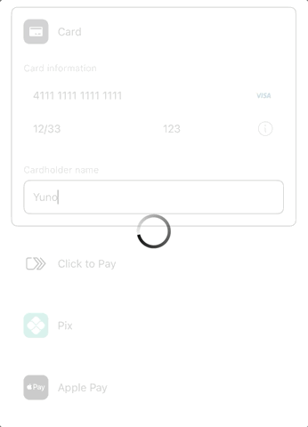

`showLoading` se invoca cuando el SDK entra o sale de un estado de carga. De forma predeterminada, el SDK muestra su propio indicador de carga a pantalla completa; sobrescribe este controlador para mostrar el tuyo.

## El indicador de carga que obtienes por defecto {#the-loader-you-get-by-default}

Mientras el SDK trabaja (creación del pago, 3DS, carga de sus formularios) los compradores
ven un spinner simple:

<div className="media-showcase media-showcase-narrow">
  
  <p>El spinner predeterminado, que se muestra mientras el SDK trabaja.</p>
</div>

## ¿Prefieres tu propio indicador de carga? {#want-your-own-loader-instead}

Sobrescribe `showLoading` y muestra lo que mejor se adapte a tu marca.

Si no sobrescribes este controlador, el SDK muestra un indicador de carga a pantalla completa durante la tokenización, la creación del pago, 3DS y la consulta del estado. Esto también se aplica cuando sobrescribes `showView` e incrustas el formulario del SDK en tu propia pantalla: en Android, el indicador cubre la Activity que pasas a `Transaction.start`, por lo que no se muestra nada dentro de tu diseño y el botón de retroceso queda bloqueado mientras está en pantalla. Una excepción en iOS: mientras la lista de `getPaymentMethodsViews` está en pantalla y el SDK no tiene ninguna vista propia presentada, el indicador de carga es la propia lista, atenuada con un spinner, para que el comprador siga viéndola. Una vez que hay una vista del SDK activa, el indicador pasa a ella.

Cuando lo sobrescribes, el SDK no muestra un indicador de carga propio. En su lugar, emite `isLoading: true` al entrar en un estado de carga e `isLoading: false` al salir de él. Tú muestras tu propio indicador según esos valores. En Web, trata cada llamada como el estado actual, mostrar u ocultar, en lugar de contar las llamadas. Un `start()` headless o de campos seguros puede informar `true` más de una vez antes del `false` correspondiente.

El controlador puede invocarse varias veces durante una misma transacción, a medida que el SDK entra y sale de estados de carga.

En iOS puedes conservar el indicador de carga del SDK en algunos flujos y mostrar el tuyo en otros. Llama a `SdkPayments.defaultShowLoading(isLoading:)` desde tu sobrescritura para ejecutar el comportamiento predeterminado:

```swift
func showLoading(isLoading: Bool) {
    guard usesOwnLoader else {
        SdkPayments.defaultShowLoading(isLoading: isLoading)
        return
    }
    spinner.isHidden = !isLoading
}
```

En React Native, llama a `SdkPayments.defaultShowLoading(isLoading)` desde tu sobrescritura:

```tsx
showLoading: (isLoading) => {
  if (!usesOwnLoader) {
    SdkPayments.defaultShowLoading(isLoading);
    return;
  }
  setLoading(isLoading);
},
```

## Firma {#signature}

<Tabs>
  <Tab title="Web">

```typescript
sdkPayments.transaction({
  ...,
  showLoading: (isLoading) => mySpinner.toggle(isLoading),
})
```

  </Tab>

  <Tab title="iOS">

```swift
func showLoading(isLoading: Bool)
```

  </Tab>

  <Tab title="Android">

```kotlin
fun showLoading(isLoading: Boolean)
```

  </Tab>

  <Tab title="React Native">

```typescript
showLoading?(isLoading: boolean): void
```

  </Tab>
</Tabs>

## Hilos de ejecución {#threading}

En iOS y Android, `showLoading` se invoca en el hilo principal. Puedes actualizar la interfaz directamente desde este manejador. En React Native se ejecuta en el hilo de JavaScript: actualiza desde él el estado de tu componente.

## Relacionado {#related}

- [`showView`](/es/docs/yuno-sdk/controllers/show-view) (iOS, Android, React Native). Controla la renderización del formulario.
