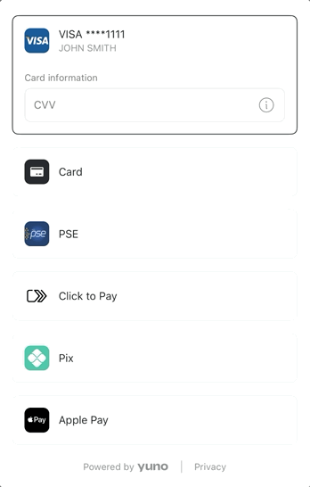
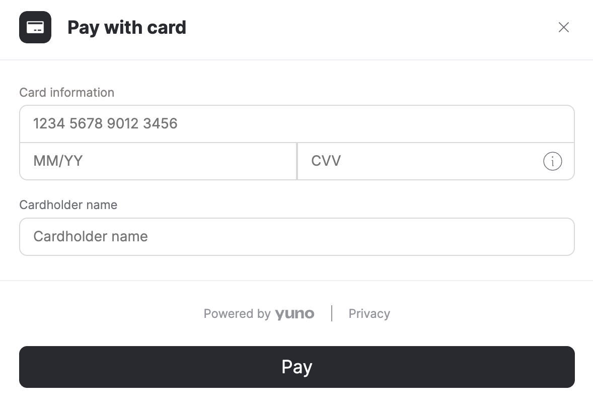
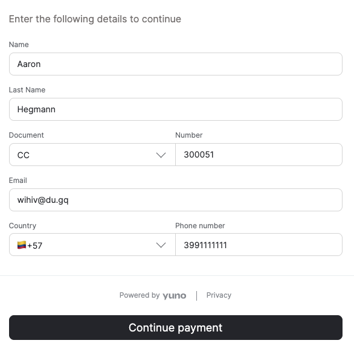
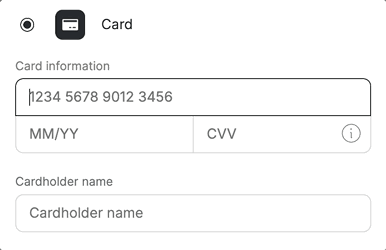
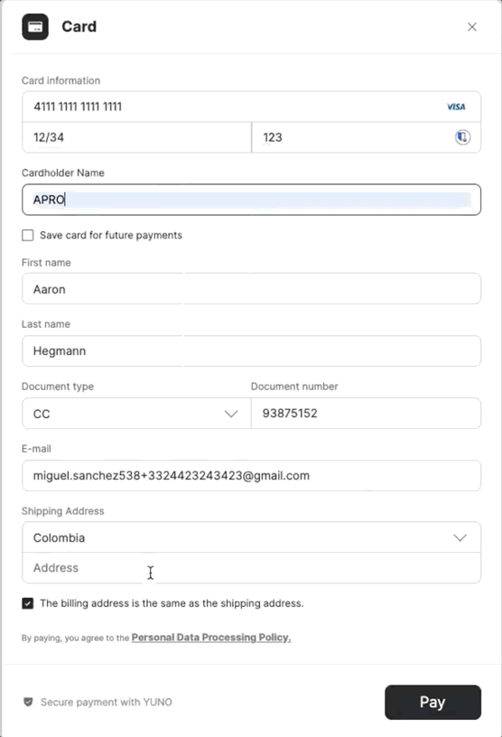

El SDK muestra un formulario integrado: número de tarjeta, fecha de vencimiento, código de seguridad y nombre del titular de la tarjeta, además de campos del cliente y de dirección cuando el método de pago los necesita. Todo lo de esta página viene incluido de forma predeterminada: sin configuración y sin código adicional.

## Despliega los formularios {#unfold-the-forms}

Configura nuestros formularios desplegados y el formulario de cada método aparecerá ya
abierto dentro de la lista de métodos de pago, para que los compradores ingresen sus datos
sin un toque adicional. Lo activas desde el **Checkout Builder** en
tu [Yuno Dashboard](https://dashboard.y.uno/), sin necesidad de código.

  
  
Desplegado: el formulario ya está abierto, los compradores solo escriben.

## Así es nuestro formulario {#this-is-what-our-form-looks-like}

Un solo diseño, renderizado de forma nativa en cada plataforma.

<Tabs>
  <Tab title="Tarjeta">
    

      
    

  </Tab>
  <Tab title="Métodos de pago alternativos">
    

      
      
El formulario de APM: los datos del cliente que el método requiere, nada más.

    

  </Tab>
</Tabs>

<Note>
La cantidad de campos que muestra el formulario depende del proveedor del método de pago
y de la información adicional que decidas exigir. Configuras ambos
desde el **Checkout Builder** en tu [Yuno Dashboard](https://dashboard.y.uno/).
</Note>

## El cursor se mueve por ti {#the-cursor-moves-for-you}

Los compradores solo escriben. Cuando cada campo se completa, el foco salta al siguiente, sin tocar entre campos. El número de tarjeta se formatea y la marca se detecta mientras se escribe.

  
  
El foco avanza solo: número → vencimiento → CVV → nombre.

## Las direcciones se completan solas {#addresses-fill-themselves}

Las tarjetas guardadas en el dispositivo se completan con un toque. En iOS y Android, cuando el comprador escribe su código postal, el SDK completa la calle, la ciudad y el estado por él. En Web, el autocompletado de direcciones depende de la configuración de autocompletado de direcciones de tu cuenta. Con ella activada, el formulario de dirección ofrece búsqueda de direcciones y, para Brasil, completa la dirección a partir del código postal. Con ella desactivada, el comprador escribe los campos de la dirección.

  
  
Escribe un código postal y el SDK completa el resto.

## Relacionado {#related}

- [Muestra una lista de métodos](/es/docs/yuno-sdk/features/payment-methods-list). La lista prediseñada de métodos de pago, con los botones express incluidos.
- [Personaliza el checkout](/es/docs/yuno-sdk/features/styling). Personaliza la apariencia visual del formulario.
- [TransactionConfig](/es/docs/yuno-sdk/reference/objects-you-pass#transaction-config). Referencia completa de configuración.
