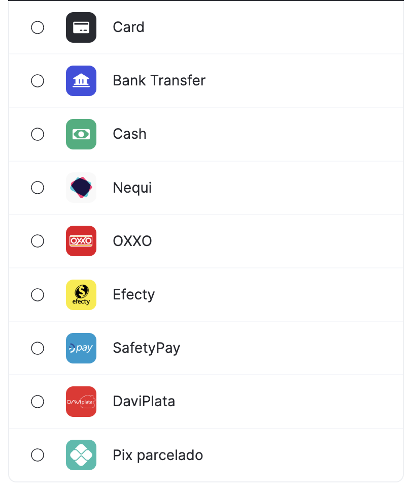
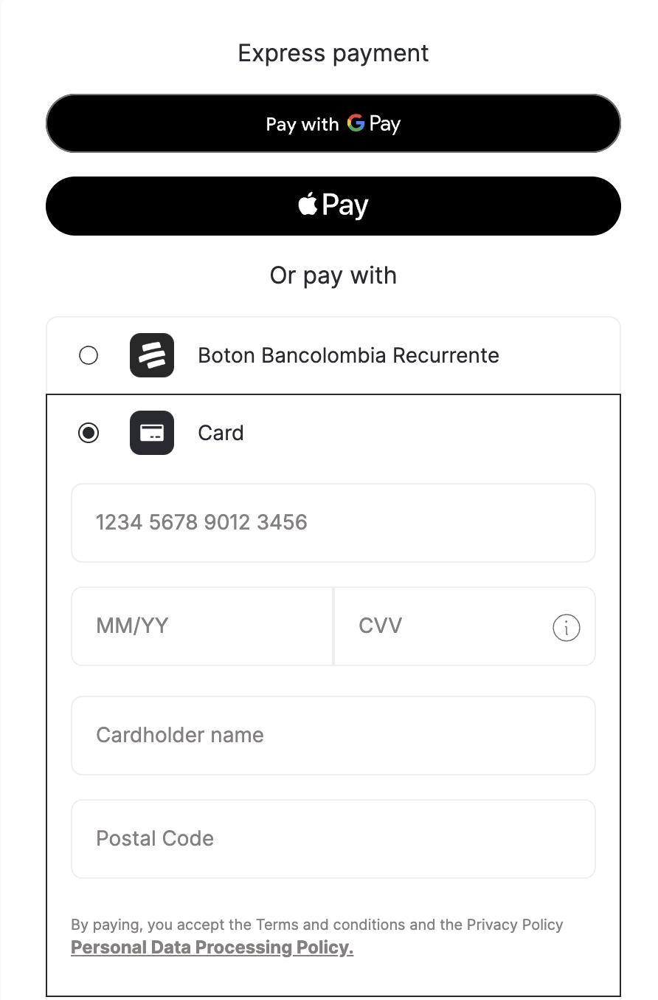

`getPaymentMethodsViews` devuelve vistas prediseñadas para los métodos de pago que quieres mostrar. Úsalo para mostrar la lista completa de métodos de pago del SDK, un botón de billetera (Apple Pay o Google Pay) o cualquier combinación disponible en tu plataforma.

Esta función aplica solo a flujos de pago. No está disponible para la inscripción.

<Note>
**La lista es solo de selección.** Renderiza los métodos de pago para que el comprador elija, pero no procesa pagos por sí sola. Después de que el comprador elige un método, inicias la transacción para procesar el pago. Esto hace que la lista sea compatible con cualquier flujo de pago, incluidas las integraciones headless en las que recopilas los datos de pago en tu propia interfaz. Monta la lista para la selección del método, recibe la selección mediante el callback o el controlador de selección e inicia la transacción con tus propios datos de pago ya recopilados. Consulta las guías de migración Headless ([Web](/es/docs/yuno-sdk/migration/web/headless), [iOS](/es/docs/yuno-sdk/migration/ios/payment/headless), [Android](/es/docs/yuno-sdk/migration/android/payment/headless), [React Native](/es/docs/yuno-sdk/migration/react-native/payment/headless)) para más detalles.
</Note>

## Compacta o desplegada: elige el diseño {#compact-or-unfolded-choose-the-layout}

El SDK renderiza la lista completa de métodos de pago habilitados en tu dashboard: logos, nombres y los métodos guardados del comprador incluidos. Y si prefieres menos toques, puedes elegir mostrar el formulario de cada método expandido dentro de la lista, para que los compradores ingresen sus datos sin salir de ella, con un checkout más rápido. Habilitas el diseño expandido desde el **Checkout Builder** en tu [Yuno Dashboard](https://dashboard.y.uno/), sin necesidad de código.

<Columns cols={2}>
  <div className="media-showcase">
    
    <p>Lista compacta: los compradores seleccionan un método para abrir su formulario por separado.</p>
  </div>
  <div className="media-showcase">
    
    <p>Vista desplegada: los formularios se expanden directamente en línea para un checkout más rápido.</p>
  </div>
</Columns>

### Diseño compacto (predeterminado) {#compact-layout-default}

El diseño compacto es el comportamiento estándar listo para usar. No requiere ninguna configuración en el dashboard:

- La lista muestra los logos y los nombres de los métodos de pago, además de los métodos guardados.
- El comprador toca un método para seleccionarlo.
- Al iniciar la transacción, se abre o se monta por separado el formulario de pago de ese método para recopilar los datos, o tú activas el envío desde tu propio botón de pago personalizado.

<Tip>
**Combina la selección compacta con headless.** Como el modo compacto funciona únicamente como un menú de selección, puedes usarlo junto con una integración headless. Monta la lista para la selección del método, recibe la elección del comprador mediante el callback o el controlador de tu plataforma e inicia la transacción pasando tus propios datos de pago recopilados. Consulta las guías de migración Headless ([Web](/es/docs/yuno-sdk/migration/web/headless), [iOS](/es/docs/yuno-sdk/migration/ios/payment/headless), [Android](/es/docs/yuno-sdk/migration/android/payment/headless), [React Native](/es/docs/yuno-sdk/migration/react-native/payment/headless)) para ver ejemplos de código.
</Tip>

### Diseño desplegado {#unfolded-layout}

El diseño desplegado expande el formulario de cada método de pago directamente dentro de la fila de la lista, de modo que los compradores pueden ingresar los datos de su tarjeta o de pago de inmediato, sin pantallas separadas ni toques adicionales.

Para habilitarlo, activa **Checkout Builder → Styling → Unfolded display** en tu [Yuno Dashboard](https://dashboard.y.uno/).

Cuando el diseño desplegado está activo:
- Al seleccionar un método, su formulario de pago se expande directamente en línea dentro del elemento de la lista.
- Al iniciar la transacción, se envía el formulario en línea que ya está completo.
- Las billeteras exprés (Apple Pay, Google Pay, PayPal) renderizan sus botones nativos directamente en la fila.

## Antes de comenzar {#before-you-start}

Tu backend debe haber creado una `checkoutSession` y la `Transaction` debe construirse con esa sesión. Consulta [Primeros pasos](/es/docs/yuno-sdk/get-started).

## Implementación {#implementation}

Llama a `getPaymentMethodsViews` con los tipos que quieres y un controlador. El SDK devuelve un mapa de `PaymentMethodType` a vista. Inserta cada vista en tu diseño. Cuando el usuario elige un método, tu controlador recibe un `PaymentMethodSelected` que pasas a `Transaction.start()`.

<Tabs>
  <Tab title="Web">

```typescript
let selectedPaymentMethod: PaymentMethodSelected | null = null

const views = transaction.getPaymentMethodsViews({
    types: ['applePay', 'googlePay', 'paymentMethodList'],
    onPaymentSelected: (paymentMethod) => {
        selectedPaymentMethod = paymentMethod
    },
})

views.applePay?.mount({ elementSelector: '#apple-pay', buttonType: 'buy', buttonStyle: 'black' })
views.googlePay?.mount({ elementSelector: '#google-pay', buttonColor: 'black' })
views.paymentMethodList?.mount({ elementSelector: '#payment-list' })

// Later, when the user confirms (e.g. your Pay button):
if (selectedPaymentMethod) {
    transaction.start({ paymentMethod: selectedPaymentMethod })
}
```

Cada vista del objeto devuelto expone un método `.mount({ elementSelector, ...config })`. El estilo de cada vista (tipo de botón de Apple Pay, color de Google Pay, etc.) se define en `.mount()`. Las opciones que pasas al `mount()` de una billetera sobrescriben las mismas claves en `externalButtons` de la configuración de la transacción. `paymentMethodList.mount()` también acepta `scrollContainerSelector`, `visibleTriggerOffsetPx` y `bottomOffsetPx` para una lista dentro de un contenedor con desplazamiento. Estas sobrescriben las mismas claves en `paymentListConfig` de la configuración de la transacción.

Lo que hace `start()` después de una selección depende del Checkout Builder. Con los formularios desplegados dentro de la lista, `start({ paymentMethod })` envía el formulario que el comprador ya completó, por lo que es tu acción de pago. Con los formularios plegados, `start()` monta el formulario del método seleccionado en el `elementSelector` de la configuración de tu transacción y se resuelve. Luego el comprador paga desde el botón de ese formulario. Si configuras `showPayButton: false`, llama a `transaction.submit()` desde tu propio botón. Pasa `elementSelector` en la configuración de la transacción para que el formulario plegado tenga dónde renderizarse.

  </Tab>

  <Tab title="iOS">

```swift
var selectedPayment: SdkPayments.PaymentMethodSelected?

let views = transaction.getPaymentMethodsViews(
    types: [.APPLE_PAY(), .PAYMENT_METHOD_LIST],
    controller: self
)

// In your SdkPayments.PaymentListController:
func onPaymentSelected(paymentSelected: SdkPayments.PaymentMethodSelected) {
    selectedPayment = paymentSelected
}

// Later, when the user confirms (e.g. your Pay button):
if let selectedPayment {
    transaction.start(paymentSelected: selectedPayment)
}
```

Las vistas son `AnyView` de SwiftUI. Para un diseño con UIKit, llama en su lugar a `getPaymentMethodsViewsUIKit(types:controller:)`: mismos argumentos, y devuelve `[PaymentMethodType: UIView]`, listo para agregarse como subvistas.

  </Tab>

  <Tab title="Android">

```kotlin
var selectedPayment: PaymentMethodSelected? = null

val views = transaction.getPaymentMethodsViews(
    host = this,
    types = listOf(PaymentMethodType.GooglePay(), PaymentMethodType.PaymentMethodList),
    controller = this
)

// In your PaymentListController:
override fun onPaymentSelected(paymentSelected: PaymentMethodSelected) {
    selectedPayment = paymentSelected
}

// Later, when the user confirms (e.g. your Pay button):
selectedPayment?.let { transaction.start(activity = this, paymentSelected = it) }
```

  </Tab>

  <Tab title="React Native">

```tsx
import { YunoView, type PaymentMethodSelected, type YunoViewHandle } from '@yuno-payments/yuno-sdk-react-native';

const [listView, setListView] = useState<YunoViewHandle | null>(null);
const [selected, setSelected] = useState<PaymentMethodSelected | null>(null);

useEffect(() => {
  transaction
    .getPaymentMethodsViews([{ kind: 'PAYMENT_METHOD_LIST' }], {
      onPaymentSelected: setSelected,
    })
    .then((views) => setListView(views[0]?.view ?? null));
}, [transaction]);

// Later, when the user confirms (e.g. your Pay button):
// if (selected) transaction.start(selected);

return listView ? <YunoView view={listView} /> : null;
```

En React Native, `getPaymentMethodsViews` devuelve una Promise de entradas `{ type, view }` en el orden en que las solicitaste. Renderiza cada `view` con `<YunoView>`; un tipo que la plataforma no admite regresa con `view: null`.

  </Tab>
</Tabs>

## PaymentMethodType {#paymentmethodtype}

| Valor | Disponible en | Qué obtienes |
|---|---|---|
| `APPLE_PAY` | iOS, Web, React Native (iOS) | El botón nativo de Apple Pay, conectado para iniciar el flujo de pago. En iOS es un caso de enum con valores asociados: escríbelo como `.APPLE_PAY()`, o pasa `type:` / `style:` para personalizar el botón. |
| `GOOGLE_PAY` | Android, Web, React Native (Android) | El botón nativo de Google Pay, conectado para iniciar el flujo de pago. |
| `PAYPAL` | Web | El botón nativo de PayPal, conectado para iniciar el flujo de pago. |
| `PAYPAL_BRAINTREE` | Web | El botón de PayPal para cuentas que procesan PayPal mediante Braintree. |
| `SAMSUNG_PAY` | Web | El botón de Samsung Pay, conectado para iniciar el flujo de pago. |
| `REVOLUT_PAY` | Web | El botón de Revolut Pay, conectado para iniciar el flujo de pago. |
| `PAYMENT_METHOD_LIST` | iOS, Android, Web, React Native | Lista completa de métodos de pago habilitados en tu Yuno dashboard. |

En React Native, pasa objetos: `{ kind: 'PAYMENT_METHOD_LIST' }`, `{ kind: 'GOOGLE_PAY', cta, theme, cornerRadius }` y `{ kind: 'APPLE_PAY', buttonType, buttonStyle }`, con las mismas opciones de botón que el SDK nativo de cada plataforma.

En Web, pasa los valores como cadenas en camelCase en `types`: `'applePay'`, `'googlePay'`, `'paypal'`, `'paypalBraintree'`, `'samsungPay'`, `'revolutPay'` y `'paymentMethodList'`.

En Android, un tipo que no aplica a la plataforma o a la configuración regresa como `null`. En iOS, todos los tipos solicitados regresan con una vista. En Web, se devuelven todos los tipos solicitados y la verificación ocurre en `mount()`. Cuando la billetera no está habilitada para la sesión de checkout, el SDK registra `There are not valid payment methods`, reporta el fallo mediante `onStatus` y la promesa que devuelve `mount()` se rechaza. `mount()` está tipado como `void`, así que usa `await` para capturar ese rechazo y monta solo las billeteras habilitadas para la sesión.

<Note>
En Android, `PaymentMethodType` es una interfaz sellada en lugar de un conjunto de constantes de cadena: `GOOGLE_PAY` corresponde a `PaymentMethodType.GooglePay(...)`, que también incluye la personalización del botón (`cta`, `theme`, `cornerRadius`), y `PAYMENT_METHOD_LIST` corresponde a `PaymentMethodType.PaymentMethodList`. `APPLE_PAY` no existe en Android.

En iOS, `APPLE_PAY` es un caso de enum con valores asociados, ambos opcionales: `.APPLE_PAY(type: .buy, style: .black)` recibe un `PKPaymentButtonType` y un `PKPaymentButtonStyle` (valores predeterminados `.plain` y `.automatic`), que incluyen la personalización del botón de Apple Pay. La forma sin paréntesis `.APPLE_PAY` no compila: escríbelo siempre como `.APPLE_PAY()`.
</Note>

### Botones exprés {#express-buttons}

`APPLE_PAY`, `GOOGLE_PAY` y `PAYPAL` devuelven los botones exprés nativos, listos para usar. Les das estilo mediante los modificadores de vista estándar de cada plataforma (tamaño, relleno, radio de esquina, etc.). El SDK solo agrega un indicador de carga encima mientras se inicializa el flujo de pago. En Web, `PAYPAL_BRAINTREE`, `SAMSUNG_PAY` y `REVOLUT_PAY` también son botones exprés, y a todos les das estilo mediante las opciones de `mount()`.

<div className="media-showcase-light">
  
  
  
</div>

<Note>
No necesitas llamar a `Transaction.start()` para los botones exprés. Tocar el botón es la confirmación del usuario, así que el SDK inicia la transacción internamente y reporta el resultado mediante `onStatus`.

Esto también aplica dentro de la lista en Web. Cuando el comprador selecciona una fila de billetera exprés, su botón se renderiza dentro de la fila y es el control de pago. `start()` para esa selección regresa sin hacer nada, así que oculta tu propio botón de pago mientras `onPaymentSelected` reporte un tipo exprés (`APPLE_PAY`, `GOOGLE_PAY`, `PAYPAL`, `PAYPAL_BRAINTREE`, `SAMSUNG_PAY` o `REVOLUT_PAY`).
</Note>

## PaymentListController {#paymentlistcontroller}

El controlador que pasas a `getPaymentMethodsViews`. En iOS, Android y React Native solo `onPaymentSelected` es obligatorio. En Web `onPaymentSelected` es opcional, pero sin él la lista no puede decirte qué eligió el comprador, así que pásalo siempre que solicites `'paymentMethodList'`.

| Método | Obligatorio | Plataformas | Comportamiento |
|---|---|---|---|
| `onPaymentSelected(paymentSelected)` | Sí (Web: opcional) | iOS, Android, Web, React Native | Se invoca cuando el usuario elige un método de pago. Pasa el `PaymentMethodSelected` a `Transaction.start()`. |
| `onHeightChange(newHeight)` | No\* | iOS, Android, React Native | Se invoca cuando cambia la altura de la vista renderizada, para que puedas aplicarla a tu diseño. |
| `onUnenroll(success)` | No | iOS, Android, React Native | Se invoca después de que el SDK intentó eliminar un método de pago guardado desde la lista. Recibe un booleano que indica si la baja tuvo éxito. |

<Note>
**\* `onHeightChange` es opcional de _implementar_, pero debes aplicar la altura reportada cuando tu diseño restringe la lista.**
</Note>

En Web e iOS, `onPaymentSelected` puede dispararse antes de cualquier toque. Cuando la lista preselecciona el método preferido del comprador al montarse, el callback se ejecuta con `selectionSource: 'auto'` (`.auto` en iOS). Un toque lo ejecuta con `selectionSource: 'user'` (`.user` en iOS). En Web también se dispara cuando el comprador toca un botón exprés que montaste. El `PaymentMethodSelected` de Web es `{ type, name?, vaultedToken?, selectionSource? }`. Conserva el último valor y pásalo a `start()` solo desde tu propio control de pago. En React Native, `selectionSource` es `'AUTO'` o `'USER'`.

<Note>
Si la lista no se puede cargar porque falla el servicio de métodos de pago, el SDK lo reporta mediante tu `TransactionController.onStatus` con el estado `INTERNAL_ERROR` y un `message`: `source` `backend` con el código de error del backend en `code` (el estado HTTP cuando el cuerpo no trae ninguno) y el cuerpo del error en `raw`, o `source` `sdk` para fallos de red, con `context` `MethodsViewImplementation.getPaymentMethods` en iOS y `paymentMethodList.getPaymentMethods` en Web. La lista permanece vacía: muestra tu propio estado de error o solicita las vistas de nuevo para reintentar.
</Note>

<Note>
El control **Edit / remove** que permite al comprador eliminar un método guardado, y lo único que hace que se dispare `onUnenroll`, se renderiza solo cuando **`edit_payment_method_list`** está habilitado en **Checkout Builder → Styling** en tu [Yuno Dashboard](https://dashboard.y.uno/). Está **desactivado de forma predeterminada** en iOS y Android, así que hasta que lo actives los métodos guardados no muestran ninguna opción para eliminar y `onUnenroll` nunca se invoca. La misma configuración controla el control de eliminación en Web. Web no tiene el callback `onUnenroll`. Tras una eliminación, el SDK vuelve a obtener los métodos de pago de la sesión y la lista se vuelve a renderizar.
</Note>

## Notas {#notes}

- `getPaymentMethodsViews` es sincrónico en iOS, Android y Web. En React Native devuelve una Promise.
- Puedes solicitar cualquier combinación de tipos disponibles en tu plataforma en una sola llamada.
- El `PaymentMethodSelected` que entrega `onPaymentSelected` es lo que pasas a `Transaction.start()`. Consulta [Primeros pasos](/es/docs/yuno-sdk/get-started).
- **Verificar la disponibilidad de métodos antes de montar listas personalizadas (Web):** si construyes tu propio selector de métodos de pago en lugar de usar `paymentMethodList`, usa [`transaction.isPaymentMethodAvailable({ paymentMethodType })`](/es/docs/yuno-sdk/reference/objects-you-receive#checking-payment-method-availability-web) para verificar si las billeteras exprés (como `APPLE_PAY` o `GOOGLE_PAY`) o métodos específicos pueden renderizarse en el dispositivo actual del cliente y en su sesión de checkout antes de mostrarlos.
- **Bancos en mantenimiento (SDK Web 2.8.0+):** cuando un banco tiene una ventana de mantenimiento programada en el Dashboard, el SDK lo muestra deshabilitado/no disponible al final del selector de bancos, impidiendo que el cliente lo elija. Los SDKs heredados (legacy) no son compatibles con ventanas de mantenimiento ni indicadores visuales fuera de línea. Consulta [Obtener emisores](/es/reference/payments/retrieve-issuers#bancos-en-mantenimiento) para detalles de API y códigos de respuesta.
- En Web, una vez que un pago de la sesión alcanza un estado final, el SDK elimina la lista y marca la sesión de checkout como finalizada. `start()`, `submit()` y `mount()` en esa sesión lanzan un error a partir de entonces. Para pagar de nuevo, crea una nueva sesión de checkout y una nueva `Transaction`, o llama a `transaction.updateCheckoutSession()` con la nueva sesión, y luego monta la lista de nuevo.

## Relacionado {#related}

- [`PaymentMethodSelected`](/es/docs/yuno-sdk/reference/objects-you-pass#payment-method-selected). El objeto que recibes y pasas a `start()`.
- [Primeros pasos](/es/docs/yuno-sdk/get-started). Guía completa de integración.
