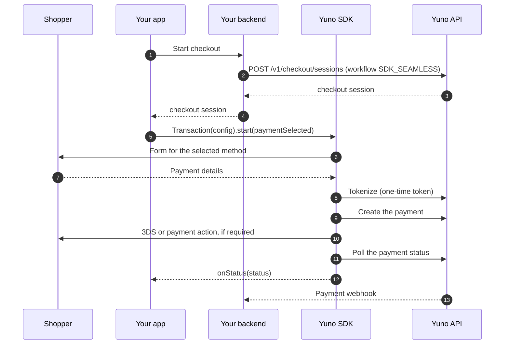
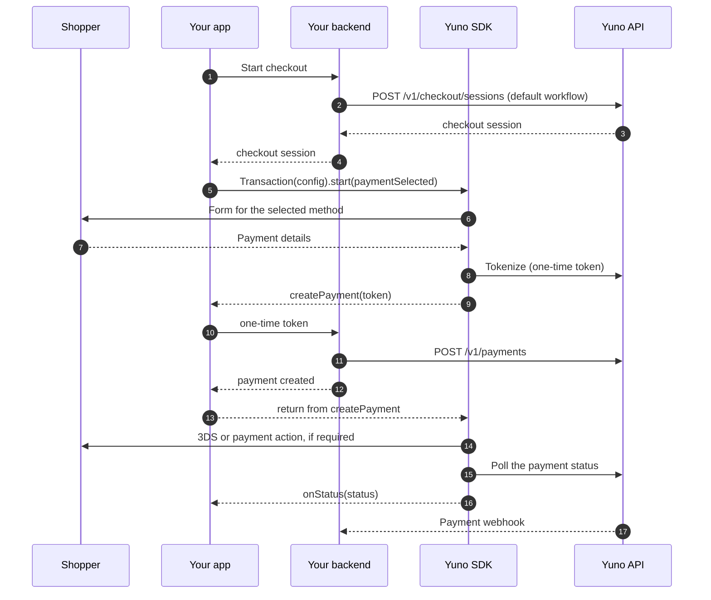
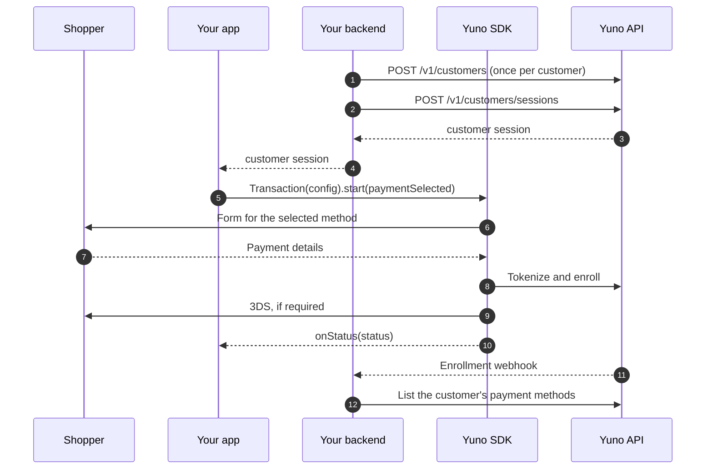

Toda integración ejecuta la misma secuencia: tu backend crea una sesión, tu app inicia una `Transaction`, el SDK lleva al comprador a un estado final y lo informa a `onStatus`, y Yuno confirma el resultado a tu backend. Lo que cambia entre integraciones es quién crea el pago y qué sesión pasas. Los tres flujos de abajo cubren todos los casos.

## El flujo predeterminado: el SDK crea el pago {#the-default-flow-the-sdk-creates-the-payment}

Crea la sesión de checkout con `workflow: "SDK_SEAMLESS"` y no sobrescribas `createPayment`. El SDK hace todo entre `start` y `onStatus`.

1. Tu backend crea la sesión de checkout y le entrega su ID a tu app.
2. Tu app inicializa el SDK una sola vez, crea un `TransactionConfig` con la sesión y tu controlador, y llama a `start` con el método que eligió el comprador.
3. El SDK muestra el formulario del método, u omite el formulario cuando pasas `transactionData`, y tokeniza los datos en un token de un solo uso.
4. El SDK crea el pago con ese token, ejecuta 3DS o cualquier otra acción que el método necesite, y consulta el estado periódicamente hasta que sea final.
5. `onStatus` recibe el estado final. En iOS, los métodos asíncronos informan `PENDING` primero; consulta [`onStatus`](/es/docs/yuno-sdk/controllers/on-status). Si `showStatusScreen` es `true`, el SDK también muestra su pantalla de resultado.
6. Yuno envía el webhook del pago a tu backend. Confirma el resultado allí antes de entregar la orden.

## Cuando tu backend crea el pago {#when-your-backend-creates-the-payment}

Sobrescribe `createPayment` y conserva el flujo de sesión predeterminado (`SDK_CHECKOUT`). El SDK se pausa después de la tokenización, te entrega el token y se reanuda cuando tu manejador retorna.

La diferencia está en los pasos 9 a 13: el SDK entrega el token de un solo uso a `createPayment`, tu backend crea el pago y el retorno del manejador es lo que reanuda el flujo. Si el manejador lanza un error, el flujo se detiene y no se llama a `onStatus`. Define `autoContinuePayment` como `false` solo si necesitas que el SDK se detenga justo después de crear el pago. En Web se aplica solo cuando sobrescribes `createPayment`; en iOS se aplica también a la creación de pagos del propio SDK. Entonces el SDK no ejecuta 3DS, no consulta el estado y no informa nada a `onStatus` para ese intento. En Web, PayPal ignora el indicador y siempre continúa. Consulta [`autoContinuePayment`](/es/docs/yuno-sdk/reference/objects-you-pass#autocontinuepayment).

<Warning>
El `workflow` de la sesión debe coincidir con quién crea el pago. Una sesión con el flujo predeterminado y sin sobrescritura de `createPayment` termina en `INTERNAL_ERROR`: el backend rechaza la creación del pago del SDK. Consulta [`createPayment`](/es/docs/yuno-sdk/controllers/create-payment).
</Warning>

## Inscripción: guardar un método sin cobrar {#enrollment-save-a-method-without-charging}

Pasa una `customerSession` en lugar de una `checkoutSession`. No hay ningún pago que crear, por lo que `createPayment` nunca se invoca.

El token almacenado en la bóveda nunca se entrega a la app. Después de que `onStatus` informe éxito, tu backend lee el método inscrito desde Yuno y usa su token almacenado en la bóveda para pagos futuros.

## Dónde se documenta cada paso {#where-each-step-is-documented}

| Paso | Página |
|---|---|
| Crear sesiones y el primer pago | [Primeros pasos](/es/docs/yuno-sdk/get-started) |
| Elegir quién crea el pago, recopila los datos y muestra el formulario | [¿Por dónde empiezo?](/es/docs/yuno-sdk/where-do-i-start) |
| `createPayment` y el flujo de la sesión | [`createPayment`](/es/docs/yuno-sdk/controllers/create-payment) |
| El estado final y su confirmación en tu servidor | [`onStatus`](/es/docs/yuno-sdk/controllers/on-status) |
| Inscripción con una sesión de cliente | [Inscripción](/es/docs/yuno-sdk/features/enrollment) |
| Volver desde una app o página externa (iOS) | [Manejar deeplinks](/es/docs/yuno-sdk/features/handle-deeplinks) |
