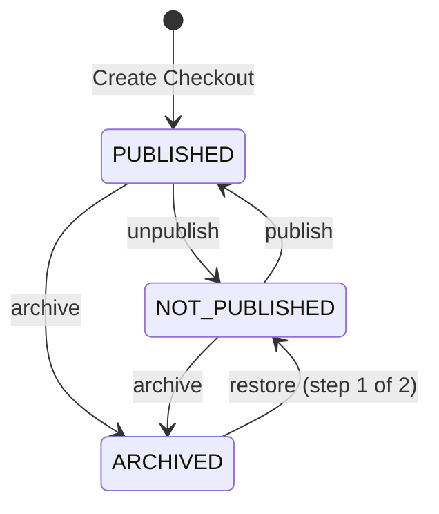

<Note>Esta API está en **Beta**. Los Endpoints y los esquemas pueden cambiar sin previo aviso.</Note>

El cuerpo admite cualquier combinación de `name`, `description`, `status` e `is_default`; se requiere al menos un campo. Los metadatos (`name`/`description`) se pueden editar en **cualquier** estado, incluido `ARCHIVED`; la configuración y los estilos de un checkout archivado permanecen congelados (el endpoint [Publish](/es/reference/checkout-builder/publish-checkout-configuration) lo rechaza).

## Máquina de estados del ciclo de vida {#lifecycle-state-machine}

- **Publicar** (`status: PUBLISHED`) solo es válido desde `NOT_PUBLISHED`.
- **Restaurar se hace en dos pasos**: un checkout `ARCHIVED` vuelve primero a borrador (`status: NOT_PUBLISHED`) y luego se puede publicar (`status: PUBLISHED`). Un patch directo de `ARCHIVED → PUBLISHED` se rechaza con `400 INVALID_STATUS_TRANSITION`.
- Hacer patch al estado **actual** también se rechaza con `400`.
- **Promover** (`is_default: true`) publica a la fuerza el checkout desde cualquier estado (incluido `ARCHIVED`) y degrada de forma atómica al predeterminado anterior. Cuando se envía junto con `status`, prevalece la promoción y `status` se ignora. `is_default: false` se rechaza con `400`; para degradar un checkout predeterminado, promueve otro checkout.
- El **checkout predeterminado está protegido**: archivarlo o despublicarlo se rechaza con `409` para que la tienda de la cuenta nunca se quede sin un checkout activo.
