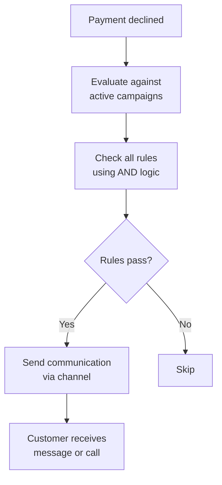

Aprende a integrarte con la API de Campaigns de Yuno para automatizar comunicaciones personalizadas de recuperación de pagos rechazados.

## Endpoints {#endpoints}

**URL base**: `https://api-sandbox.y.uno/v1`

* [Crear campaña](/reference/create-campaign)
* [Obtener campaña](/reference/get-campaign)
* [Listar campañas](/reference/list-campaigns)
* [Actualizar estado de la campaña](/reference/update-campaign-status)
* [Crear reglas](/reference/create-rules)
* [Obtener regla](/reference/get-rule)
* [Actualizar regla](/reference/update-rule)
* [Actualizar estado de la regla](/reference/update-rule-status)

## Descripción general {#overview}

La API de Campaigns te permite crear campañas de comunicación automatizadas que se activan cuando se rechaza el pago de un cliente. Cuando un evento de pago coincide con las reglas de segmentación de tu campaña, Yuno envía automáticamente un mensaje personalizado al cliente por el canal configurado (WhatsApp o llamada telefónica), lo que ayuda a recuperar la transacción fallida.

### Conceptos clave {#key-concepts}

* **Campaña**: define a quién dirigirse, por qué canal y cuándo enviar las comunicaciones.
* **Reglas**: condiciones asociadas a una campaña que determinan qué pagos rechazados califican. Todas las reglas activas deben cumplirse para que un pago active la campaña (lógica AND).
* **Programación**: controla la ventana horaria diaria y la zona horaria para enviar las comunicaciones.
* **Duración**: las fechas de inicio y fin durante las cuales la campaña está activa.

## Cómo funciona {#how-it-works}



**Ejemplo**: creas una campaña dirigida a pagos rechazados en Colombia con montos superiores a 50,000 COP. Cuando se rechaza el pago de 80,000 COP de un cliente colombiano, Yuno le envía automáticamente un mensaje de WhatsApp con una sugerencia personalizada de recuperación.

## Autenticación {#authentication}

Todas las solicitudes a la API requieren los siguientes encabezados:

| Encabezado             | Descripción                                        | Obligatorio |
| ---------------------- | -------------------------------------------------- | -------- |
| `X-Public-Api-Key`     | Tu clave de API pública del comercio               | Sí       |
| `X-Private-Secret-Key` | Tu clave secreta privada del comercio              | Sí       |
| `Content-Type`         | Debe ser `application/json` para solicitudes POST/PATCH | Sí       |

```bash
curl -X GET https://api-sandbox.y.uno/v1/campaigns \
  -H "X-Public-Api-Key: your-public-api-key" \
  -H "X-Private-Secret-Key: your-private-secret-key"
```

## Modelos de datos {#data-models}

### Objeto de campaña {#campaign-object}

<div className="code-nowrap-table dense-table">

| Campo               | Tipo   | Descripción                                            |
| ------------------- | ------ | ------------------------------------------------------ |
| `id`                | UUID   | Identificador único de la campaña                      |
| `name`              | string | Nombre de la campaña                                   |
| `account_id`        | UUID   | ID de la cuenta de Yuno                                |
| `organization_code` | UUID   | Identificador de la organización                       |
| `country`           | string | Código de país ISO 3166-1 alpha-2                      |
| `channel`           | enum   | `WHATSAPP_MESSAGE` o `PHONE_CALL`                      |
| `focus`             | string | Descriptor opcional del enfoque de la campaña          |
| `schedule`          | object | Configuración de programación                          |
| `duration`          | object | Período activo de la campaña                           |
| `status`            | string | `ACTIVE`, `PAUSED`, `COMPLETED` o `CANCELLED`          |
| `rules`             | array  | Reglas asociadas a la campaña (incluidas en GET por ID) |
| `created_at`        | string | Marca de tiempo de creación en ISO 8601                |
| `updated_at`        | string | Marca de tiempo de última actualización en ISO 8601    |

</div>

### Objeto de regla {#rule-object}

<div className="code-nowrap-table dense-table">

| Campo          | Tipo   | Descripción                                     |
| -------------- | ------ | ----------------------------------------------- |
| `id`           | UUID   | Identificador único de la regla                 |
| `campaign_id`  | UUID   | ID de la campaña a la que pertenece esta regla  |
| `rule_type`    | string | Tipo de regla (consulta la referencia más abajo) |
| `values`       | array  | Arreglo de valores de tipo string para comparar |
| `conditional`  | string | Operador de comparación (consulta la referencia más abajo) |
| `metadata_key` | string | Nombre del campo de metadata (solo para reglas `METADATA`) |
| `status`       | string | `ACTIVE` o `INACTIVE`                           |
| `created_at`   | string | Marca de tiempo de creación en ISO 8601         |
| `updated_at`   | string | Marca de tiempo de última actualización en ISO 8601 |

</div>

### Referencia de tipos de regla {#rule-types-reference}

Las reglas definen qué pagos rechazados califican para una campaña. Todas las reglas activas de una campaña deben cumplirse (lógica AND) para que se active una comunicación.

#### Reglas de datos del pago {#payment-data-rules}

Estas reglas evalúan datos disponibles directamente en el evento de pago.

<div className="code-nowrap-table dense-table">

| Tipo de regla | Formato de valores | Ejemplo |
| --------------------- | ------------------------ | ------------------ |
| `AMOUNT`<br />Filtrar por monto del pago | `["number"]` | `["50000"]` |
| `CURRENCY`<br />Filtrar por código de moneda | `["code"]` | `["COP"]` |
| `AMOUNT_AND_CURRENCY`<br />Verificación combinada de monto y moneda | `["amount", "currency"]` | `["50000", "COP"]` |
| `PAYMENT_STATUS`<br />Filtrar por estado del pago | `["status"]` | `["DECLINED"]` |

</div>

#### Reglas de datos enriquecidos {#enriched-data-rules}

Estas reglas evalúan datos enriquecidos de la transacción (método de pago, proveedor, detalles de la tarjeta, etc.).

<div className="code-nowrap-table dense-table">

| Tipo de regla | Formato de valores | Ejemplo |
| ------------------- | ----------------- | ---------------------- |
| `PAYMENT_METHOD`<br />Filtrar por tipo de método de pago | `["method"]` | `["CARD"]` |
| `PROVIDER`<br />Filtrar por ID del proveedor de pago | `["provider_id"]` | `["stripe"]` |
| `CARD_BIN`<br />Filtrar por prefijo BIN/IIN de la tarjeta | `["bin_prefix"]` | `["411111", "552345"]` |
| `RESPONSE_CODE`<br />Filtrar por código de respuesta del proveedor | `["code"]` | `["05", "51"]` |
| `ISO_RESPONSE_CODE`<br />Filtrar por código de respuesta ISO 8583 | `["code"]` | `["51", "05"]` |
| `CATEGORY`<br />Filtrar por categoría de la transacción | `["category"]` | `["ecommerce"]` |

</div>

#### Reglas de metadata {#metadata-rules}

Evalúan campos de metadata personalizados asociados al pago.

<div className="code-nowrap-table dense-table">

| Tipo de regla | Formato de valores | Requiere `metadata_key` |
| ---------- | ------------- | ----------------------- |
| `METADATA`<br />Filtrar por par clave-valor de metadata personalizada | `["value"]` | Sí |

</div>

**Ejemplo**: dirígete a los pagos de una vertical de negocio específica:

```json
{
  "rule_type": "METADATA",
  "metadata_key": "vertical",
  "values": ["restaurant", "grocery"],
  "conditional": "ONE_OF"
}
```

#### Reglas de límite de frecuencia {#rate-limiting-rules}

Controlan la frecuencia de las comunicaciones para evitar enviar demasiados mensajes al mismo usuario.

<div className="code-nowrap-table dense-table">

| Tipo de regla | Formato de valores | Ejemplo |
| -------------------- | -------------- | ------- |
| `USER_COMMS_PER_DAY`<br />Máximo de comunicaciones por usuario por día | `["limit"]` | `["3"]` |
| `UNIQUE_BY_USER`<br />Una comunicación por usuario por campaña | No aplica | - |

</div>

**Notas importantes sobre las reglas de límite de frecuencia**:

* Tanto `USER_COMMS_PER_DAY` como `UNIQUE_BY_USER` requieren que el campo `user_id` esté presente en la metadata del pago.
* `USER_COMMS_PER_DAY` **no** requiere el campo `conditional`. Proporciona solo `values` con el límite diario.
* `UNIQUE_BY_USER` **no** requiere `values` ni `conditional`. Solo incluye el `rule_type`.

### Referencia de operadores condicionales {#conditional-operators-reference}

<div className="code-nowrap-table dense-table">

| Conditional | Tipos de regla aplicables | Cantidad de valores |
| ----------------------- | ------------------------------------------- | ---------------------------------- |
| `EQUAL`<br />Coincidencia exacta | Todos | 1 |
| `NOT_EQUAL`<br />No coincide | Todos | 1 |
| `ONE_OF`<br />Coincide con cualquier valor de la lista | Todos | 1+ |
| `NOT_ONE_OF`<br />No coincide con ninguno de los valores | Todos | 1+ |
| `IN`<br />Igual que `ONE_OF` | Todos | 1+ |
| `GREATER_THAN`<br />Mayor que (numérico) | `AMOUNT`, `AMOUNT_AND_CURRENCY`, `METADATA` | 1 |
| `GREATER_THAN_OR_EQUAL`<br />Mayor o igual que (numérico) | `AMOUNT`, `AMOUNT_AND_CURRENCY`, `METADATA` | 1 |
| `LESS_THAN`<br />Menor que (numérico) | `AMOUNT`, `AMOUNT_AND_CURRENCY`, `METADATA` | 1 |
| `LESS_THAN_OR_EQUAL`<br />Menor o igual que (numérico) | `AMOUNT`, `AMOUNT_AND_CURRENCY`, `METADATA` | 1 |
| `BETWEEN`<br />Entre dos valores, inclusive (numérico) | `AMOUNT`, `AMOUNT_AND_CURRENCY`, `METADATA` | 2 (o 3 para `AMOUNT_AND_CURRENCY`) |
| `CONTAINS`<br />Contiene una subcadena (sin distinguir mayúsculas) | `METADATA` | 1+ |
| `STARTS_WITH`<br />Comienza con un prefijo | `CARD_BIN`, `METADATA` | 1+ |

</div>

<Note>
Estos operadores pertenecen al motor de reglas propio de Communications Campaigns. **No** son los
operadores de enrutamiento: `AMOUNT` con `BETWEEN` en el enrutamiento toma **dos** valores más un campo
`currency` aparte, y rechaza un tercero. Consulta [Condiciones de enrutamiento](/reference/organizations/routing/routing-conditions).
</Note>

> **Nota sobre `BETWEEN` con `AMOUNT_AND_CURRENCY`**: al usar `BETWEEN` con `AMOUNT_AND_CURRENCY`, proporciona 3 valores: `["min", "max", "currency"]`. Para los demás tipos de regla, proporciona 2 valores: `["min", "max"]`.

## Primeros pasos {#getting-started}

### Paso 1: crea una campaña {#step-1-create-a-campaign}

Define a quién dirigirte, qué canal usar y cuándo se deben enviar las comunicaciones.

```bash
curl -X POST https://api-sandbox.y.uno/v1/campaigns \
  -H "X-Public-Api-Key: your-public-api-key" \
  -H "X-Private-Secret-Key: your-private-secret-key" \
  -H "Content-Type: application/json" \
  -d '{
    "name": "Declined Payment Recovery - Colombia",
    "account_id": "YOUR_ACCOUNT_ID",
    "organization_code": "YOUR_ORGANIZATION_CODE",
    "country": "CO",
    "channel": "WHATSAPP_MESSAGE",
    "schedule": {
      "daily_start_time": "08:00",
      "daily_end_time": "21:00",
      "time_zone": "America/Bogota"
    },
    "duration": {
      "start_at": "2025-07-01T00:00:00Z",
      "end_at": "2026-07-01T00:00:00Z"
    }
  }'
```

> **Nota**: la campaña se crea con estado `ACTIVE` de forma predeterminada. Guarda el `id` devuelto para el siguiente paso.

### Paso 2: agrega reglas de segmentación {#step-2-add-targeting-rules}

Define qué pagos rechazados deben activar esta campaña. Usa el `id` de la campaña del Paso 1.

```bash
curl -X POST https://api-sandbox.y.uno/v1/campaigns/{campaign_id}/rules \
  -H "X-Public-Api-Key: your-public-api-key" \
  -H "X-Private-Secret-Key: your-private-secret-key" \
  -H "Content-Type: application/json" \
  -d '[
    {
      "rule_type": "PAYMENT_STATUS",
      "values": ["DECLINED"],
      "conditional": "EQUAL"
    },
    {
      "rule_type": "CURRENCY",
      "values": ["COP"],
      "conditional": "EQUAL"
    },
    {
      "rule_type": "AMOUNT",
      "values": ["50000"],
      "conditional": "GREATER_THAN"
    },
    {
      "rule_type": "USER_COMMS_PER_DAY",
      "values": ["2"]
    }
  ]'
```

Esta campaña ahora activará un mensaje de WhatsApp cuando:

* El estado del pago sea `DECLINED` **Y**
* La moneda sea `COP` **Y**
* El monto sea mayor que 50,000 **Y**
* El usuario haya recibido menos de 2 comunicaciones hoy

### Paso 3: verifica tu campaña {#step-3-verify-your-campaign}

Confirma que la campaña está configurada correctamente junto con sus reglas.

```bash
curl -X GET https://api-sandbox.y.uno/v1/campaigns/{campaign_id} \
  -H "X-Public-Api-Key: your-public-api-key" \
  -H "X-Private-Secret-Key: your-private-secret-key"
```

### Paso 4: monitorea y administra {#step-4-monitor-and-manage}

* **Pausa** una campaña temporalmente: `PATCH` con `{"status": "PAUSED"}`
* **Reanuda** una campaña pausada: `PATCH` con `{"status": "ACTIVE"}`
* **Desactiva una regla específica** sin eliminarla: `PATCH /rules/{rule_id}/status` con `{"status": "INACTIVE"}`
* **Finaliza** una campaña de forma permanente: `PATCH` con `{"status": "COMPLETED"}`

## Ejemplos de casos de uso {#use-case-examples}

### 1. Recuperación básica de pagos rechazados {#1-basic-declined-payment-recovery}

Envía un mensaje de WhatsApp a clientes en México cuyos pagos con tarjeta son rechazados.

**[Campaña](/reference/create-campaign)**:

```json
{
  "name": "Mexico Card Recovery",
  "account_id": "YOUR_ACCOUNT_ID",
  "organization_code": "YOUR_ORGANIZATION_CODE",
  "country": "MX",
  "channel": "WHATSAPP_MESSAGE",
  "focus": "payment_recovery",
  "schedule": {
    "daily_start_time": "09:00",
    "daily_end_time": "20:00",
    "time_zone": "America/Mexico_City"
  },
  "duration": {
    "start_at": "2025-08-01T00:00:00Z",
    "end_at": "2026-08-01T00:00:00Z"
  }
}
```

**[Reglas](/reference/create-rules)**:

```json
[
  {
    "rule_type": "PAYMENT_STATUS",
    "values": ["DECLINED"],
    "conditional": "EQUAL"
  },
  {
    "rule_type": "PAYMENT_METHOD",
    "values": ["CARD"],
    "conditional": "EQUAL"
  }
]
```

### 2. Recuperación de transacciones de alto valor mediante llamada telefónica {#2-high-value-transaction-recovery-via-phone-call}

Llama a los clientes cuyas transacciones superiores a 500 USD fueron rechazadas.

**[Campaña](/reference/create-campaign)**:

```json
{
  "name": "High Value Recovery - Phone",
  "account_id": "YOUR_ACCOUNT_ID",
  "organization_code": "YOUR_ORGANIZATION_CODE",
  "country": "CO",
  "channel": "PHONE_CALL",
  "focus": "payment_recovery",
  "schedule": {
    "daily_start_time": "09:00",
    "daily_end_time": "18:00",
    "time_zone": "America/Bogota"
  },
  "duration": {
    "start_at": "2025-08-01T00:00:00Z",
    "end_at": "2026-08-01T00:00:00Z"
  }
}
```

**[Reglas](/reference/create-rules)**:

```json
[
  {
    "rule_type": "PAYMENT_STATUS",
    "values": ["DECLINED"],
    "conditional": "EQUAL"
  },
  {
    "rule_type": "AMOUNT_AND_CURRENCY",
    "values": ["500", "USD"],
    "conditional": "GREATER_THAN"
  },
  {
    "rule_type": "USER_COMMS_PER_DAY",
    "values": ["1"]
  }
]
```

### 3. Recuperación por proveedor específico con rango de monto {#3-provider-specific-recovery-with-amount-range}

Dirígete a los pagos rechazados de un proveedor específico dentro de un rango de monto.

**[Reglas](/reference/create-rules)**:

```json
[
  {
    "rule_type": "PAYMENT_STATUS",
    "values": ["DECLINED"],
    "conditional": "EQUAL"
  },
  {
    "rule_type": "PROVIDER",
    "values": ["stripe", "adyen"],
    "conditional": "ONE_OF"
  },
  {
    "rule_type": "AMOUNT",
    "values": ["10000", "500000"],
    "conditional": "BETWEEN"
  },
  {
    "rule_type": "CURRENCY",
    "values": ["COP"],
    "conditional": "EQUAL"
  }
]
```

### 4. Segmentación basada en metadata {#4-metadata-based-segmentation}

Dirígete a segmentos de clientes específicos usando la metadata del pago (por ejemplo, la vertical de negocio o el nivel del cliente).

**[Reglas](/reference/create-rules)**:

```json
[
  {
    "rule_type": "PAYMENT_STATUS",
    "values": ["DECLINED"],
    "conditional": "EQUAL"
  },
  {
    "rule_type": "METADATA",
    "metadata_key": "vertical",
    "values": ["restaurant", "grocery"],
    "conditional": "ONE_OF"
  },
  {
    "rule_type": "METADATA",
    "metadata_key": "customer_tier",
    "values": ["premium", "gold"],
    "conditional": "ONE_OF"
  },
  {
    "rule_type": "UNIQUE_BY_USER"
  }
]
```

### 5. Excluir códigos de respuesta específicos {#5-exclude-specific-response-codes}

Envía mensajes de recuperación para todos los pagos rechazados, excepto aquellos con códigos de respuesta específicos que indican fraude o problemas permanentes.

**[Reglas](/reference/create-rules)**:

```json
[
  {
    "rule_type": "PAYMENT_STATUS",
    "values": ["DECLINED"],
    "conditional": "EQUAL"
  },
  {
    "rule_type": "ISO_RESPONSE_CODE",
    "values": ["14", "43", "59"],
    "conditional": "NOT_ONE_OF"
  }
]
```

> **Nota**: los códigos ISO `14` (número de tarjeta inválido), `43` (tarjeta robada) y `59` (sospecha de fraude) se excluyen porque no deben recibir comunicaciones de recuperación.

## Manejo de errores {#error-handling}

Todas las respuestas de error siguen un formato consistente:

```json
{
  "code": 400,
  "message": "Descriptive error message",
  "details": "Additional context (optional)"
}
```

### Códigos de estado HTTP {#http-status-codes}

| Código | Descripción           | Causas comunes                                                                                             |
| ----- | --------------------- | ---------------------------------------------------------------------------------------------------------- |
| `400` | Solicitud incorrecta  | UUID inválido, campos obligatorios faltantes, parámetros de consulta inválidos                             |
| `404` | No encontrado         | La campaña o la regla no existe                                                                            |
| `422` | Entidad no procesable | Falló la validación (por ejemplo, tipo de regla inválido, conditional inválido para el tipo de regla, `end_at` anterior a `start_at`) |
| `500` | Error interno del servidor | Error inesperado del servidor                                                                         |

### Errores de validación comunes {#common-validation-errors}

<div className="code-nowrap-table dense-table">

| Error                     | Causa                                       | Solución                                                                                                  |
| ------------------------- | ------------------------------------------- | --------------------------------------------------------------------------------------------------------- |
| campaign\_id inválido     | Parámetro de ruta que no es un UUID         | Usa el UUID devuelto al crear la campaña                                                                  |
| rule\_type inválido       | Valor de tipo de regla no reconocido        | Consulta la [Referencia de tipos de regla](#rule-types-reference)                                         |
| conditional inválido      | Conditional no válido para el tipo de regla | Consulta la [Referencia de operadores condicionales](#conditional-operators-reference)                    |
| BETWEEN requiere 2 valores | El arreglo `values` tiene una cantidad incorrecta de elementos | Proporciona exactamente 2 valores: `["min", "max"]` (o 3 para `AMOUNT_AND_CURRENCY`: `["min", "max", "currency"]`) |
| metadata\_key obligatorio | Regla `METADATA` sin `metadata_key`         | Agrega el campo `metadata_key`                                                                            |
| Transición de estado inválida | Se intenta cambiar desde un estado terminal | `COMPLETED` y `CANCELLED` son estados finales                                                         |

</div>
