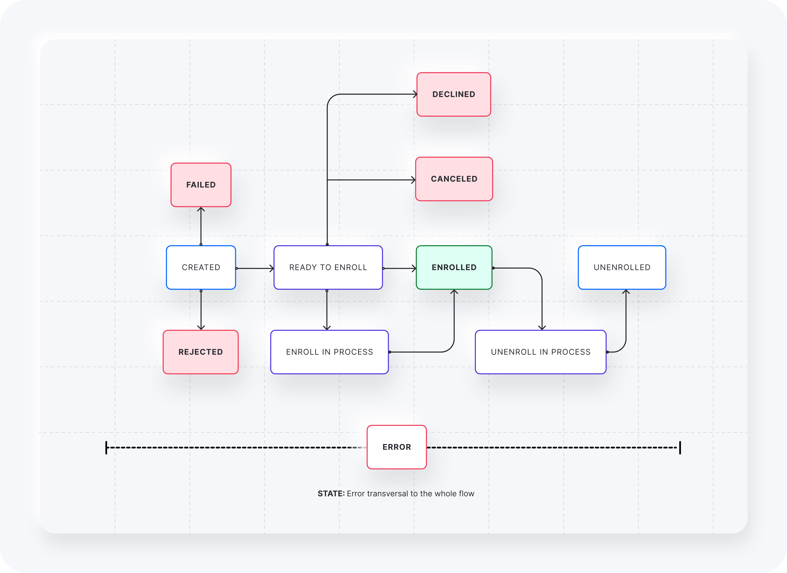

Yuno ofrece a los clientes la posibilidad de inscribir un método de pago para usarlo en compras futuras y tener una experiencia de pago fluida. Esa inscripción del método de pago puede usarse tanto en la implementación de pago [Full](/es/docs/sdks/overview/understanding-flows) como en la [Lite](/es/docs/sdks/overview/quickstart) de Yuno. Puede tener uno de los siguientes estados.

## Workflow {#workflow}

<Frame></Frame>

## Estado del método de pago {#payment-method-status}

| Estado                | Tipo de transacción | Descripción                                                 |
| :-------------------- | :--------------- | :---------------------------------------------------------- |
| `CREATED`               | Inscripción       | Estado inicial al momento de crear un método de pago.     |
| `EXPIRED`               | Inscripción       | El método de pago ha expirado.                        |
| `REJECTED`              | Inscripción       | Yuno ha rechazado la inscripción del método de pago.            |
| `READY_TO_ENROLL`     | Inscripción       | El método de pago está disponible para inscripción.             |
| `DECLINED`              | Inscripción       | El método de pago ha sido rechazado.                        |
| `CANCELED`              | Inscripción       | El método de pago ha sido cancelado.                       |
| `ENROLL_IN_PROCESS`   | Inscripción       | La inscripción del método de pago se está procesando.           |
| `ENROLLED`              | Inscripción       | La inscripción del método de pago fue exitosa.          |
| `UNENROLL_IN_PROCESS` | Inscripción       | La baja de la inscripción del método de pago se está procesando.         |
| `UNENROLLED`            | Inscripción       | Se dio de baja la inscripción del método de pago.            |
| `ERROR`                 | Inscripción       | Hubo un error en la inscripción del método de pago. |

