Postman es una plataforma de API que ayuda a los desarrolladores a diseñar y probar APIs. Es una forma alternativa de hacer solicitudes a la API de Yuno en lugar de usar la referencia de la API en Readme.io. [Descarga Postman](https://www.postman.com/downloads/) para Linux, Windows o Mac, o úsalo desde tu navegador web.

Aquí encuentras cómo importar la colección y el entorno de Yuno. Todos los endpoints de la [referencia de la API](/es/reference/getting-started/api-reference-overview) están disponibles en la colección de Postman proporcionada, para que puedas probar los servicios de Yuno en tu equipo.

<Note>
**Colección de Postman**

Accede a la [colección de Postman de las APIs de Yuno](https://documenter.getpostman.com/view/25083296/2sBXikpXDZ?utm_source=slack&utm_medium=link_preview&utm_campaign=other&utm_content=link&utm_term=other#173ba2dd-1dbb-466c-934c-19a4308d9d80).
</Note>

## Paso 1: bifurca la colección de Postman de Yuno {#step-1-fork-the-yuno-postman-collection}

Antes de probar los endpoints, debes bifurcar la colección de Yuno en tu cuenta de Postman.

1. Accede a la [colección de Postman de Yuno](https://documenter.getpostman.com/view/25083296/2sBXikpXDZ?utm_source=slack&utm_medium=link_preview&utm_campaign=other&utm_content=link&utm_term=other#173ba2dd-1dbb-466c-934c-19a4308d9d80).
2. Selecciona el siguiente botón **Run in Postman**.
3. Elige si quieres ejecutar Postman en tu navegador o con la aplicación de Postman.
4. Regístrate o inicia sesión en una cuenta de Postman.
5. Selecciona un espacio de trabajo en el que importar la colección.

<Note>
**La colección y el entorno son independientes**

Al bifurcar la colección solo se traen las solicitudes. El entorno (el archivo con tus claves de API y variables de cuenta) es un archivo `.json` independiente que debes importar por separado, no viene incluido con la colección bifurcada.
</Note>

## Paso 2: configura las variables de entorno {#step-2-configure-the-environment-variables}

Antes de comenzar a probar el endpoint, debes importar y configurar el entorno. De lo contrario, las solicitudes fallarán.

1. Descarga [`Yuno_Sandbox.postman_environment.json`](/files/postman/Yuno_Sandbox.postman_environment.json) e impórtalo. Accede a **Environments** en el panel izquierdo y luego a **Import**.

<Frame>
  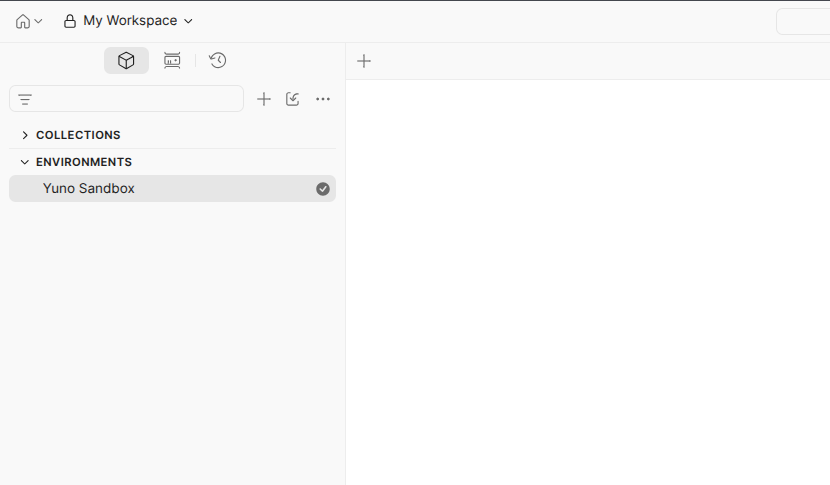
  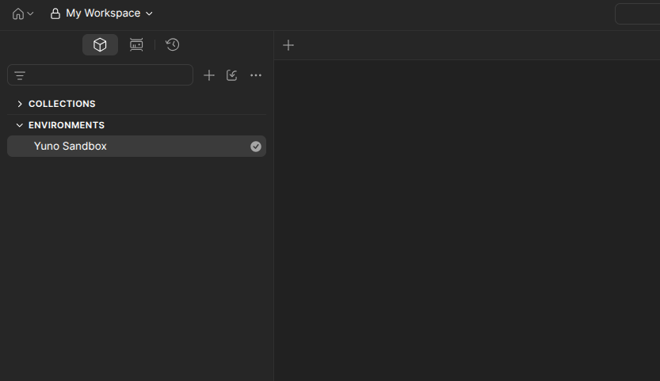
</Frame>

2. Selecciona el entorno **Yuno Sandbox** una vez importado.

<Frame>
  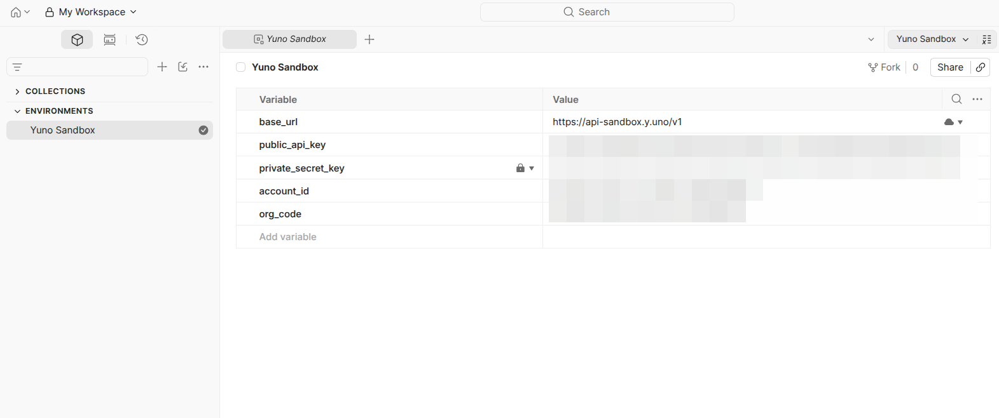
  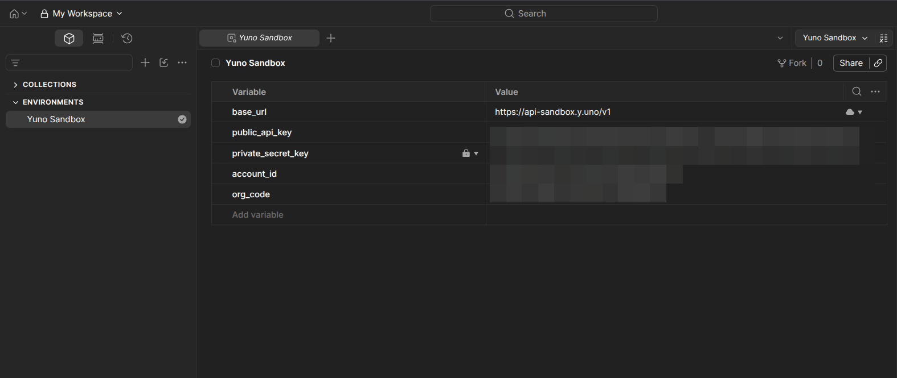
</Frame>

3. Actualiza los valores de las variables. Para comenzar a probar, debes actualizar al menos `public_api_key`, `private_secret_key` y `account_id`.

<Note>
**Las claves de sandbox requieren el modo de prueba**

En el Yuno Dashboard, configura el [chip de contexto](/es/docs/using-yuno/account-context) de la barra superior en **Test** antes de copiar tus claves de API. Con el chip en **Live**, las claves tienen alcance de producción y no se autenticarán en el entorno de sandbox.
</Note>

4. Define **Yuno Sandbox** como el entorno con el selector **No Environment** en la esquina superior derecha.

<Frame>
  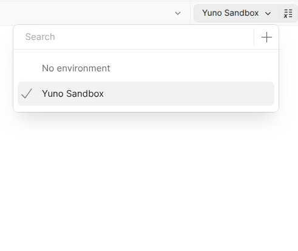
  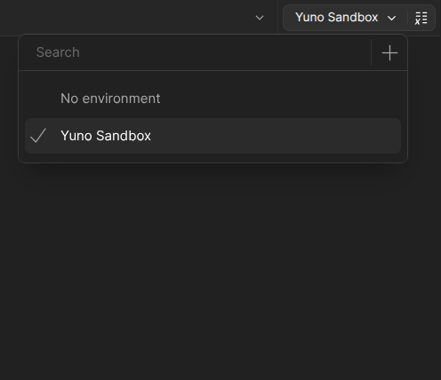
</Frame>

El entorno **Yuno Sandbox** tiene una extensa lista de variables que se usan en todas las solicitudes de la colección. Puedes definir sus valores a medida que pruebes nuevos endpoints.

## Paso 3: ejecuta en Postman {#step-3-run-in-postman}

Después de seleccionar el entorno y definir los valores de las variables, puedes comenzar a probar el endpoint.

1. Selecciona la colección **Yuno Payments API Playground** en la pestaña Collections.
2. Elige un endpoint.

<Frame>
  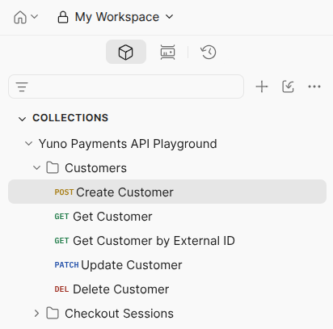
  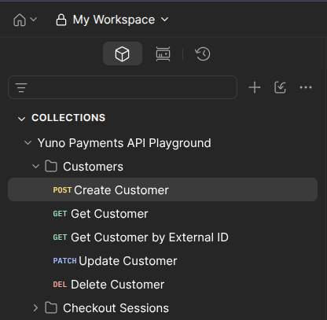
</Frame>

3. Proporciona los valores necesarios para los parámetros disponibles en las pestañas **Headers** y **Body**.

<Frame>
  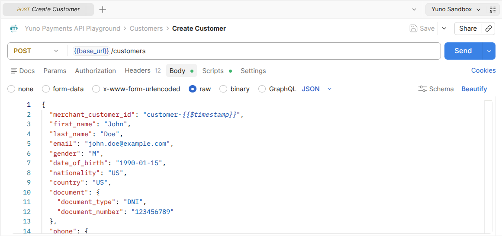
  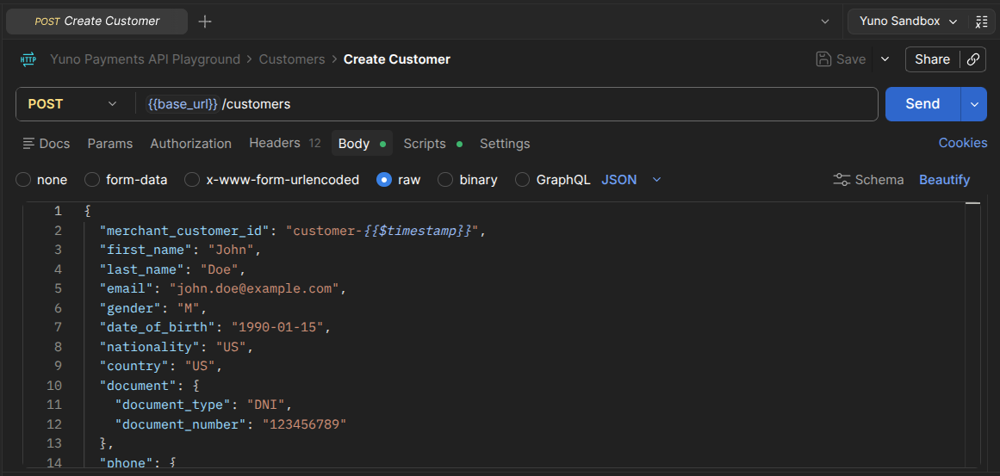
</Frame>

4. Usa el botón **Send** para realizar la solicitud al servidor de Yuno.

<Frame>
  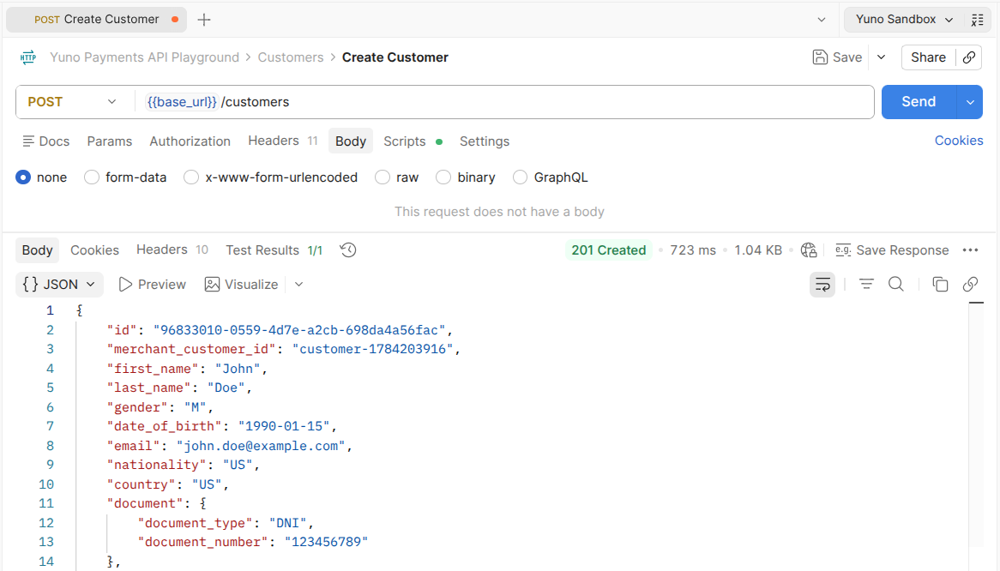
  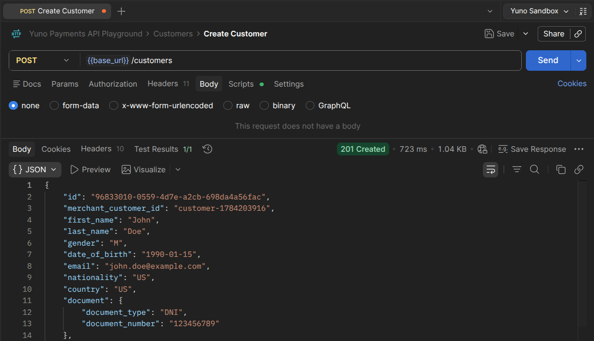
</Frame>

<Note>
**Variables de Postman**

En la colección de Yuno, varios parámetros se consideran variables. Estos valores se pueden definir en el entorno o al recibir una respuesta del servidor. Las variables de Postman ayudan a probar distintos endpoints en secuencia. Los valores recibidos en una respuesta completan los parámetros del cuerpo de la siguiente solicitud.
</Note>

## Recursos útiles {#useful-resources}

- [Colección de Postman de Yuno](https://documenter.getpostman.com/view/25083296/2sBXikpXDZ?utm_source=slack&utm_medium=link_preview&utm_campaign=other&utm_content=link&utm_term=other#173ba2dd-1dbb-466c-934c-19a4308d9d80)
- [`Yuno_Sandbox.postman_environment.json`](/files/postman/Yuno_Sandbox.postman_environment.json)
- [`Yuno_Production.postman_environment.json`](/files/postman/Yuno_Production.postman_environment.json)
