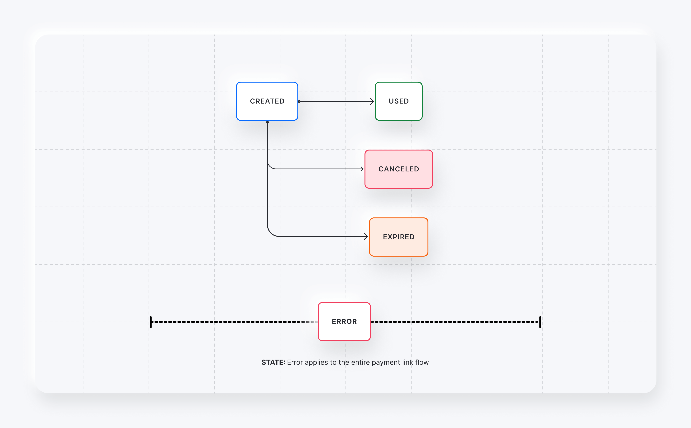

La solución de enlaces de pago de Yuno permite a las empresas aceptar pagos y ofrecer suscripciones sin necesidad de sitios web ni aplicaciones adicionales. Estos enlaces versátiles se pueden compartir en diversas plataformas, como redes sociales, correos electrónicos y sitios web. Con compatibilidad para diversos métodos de pago, como tarjetas de crédito y débito, Apple Pay y Google Pay, los enlaces de pago ofrecen una forma segura y rápida de cobrar pagos.

## Flujo de trabajo {#workflow}

En el siguiente flujo de trabajo, puedes ver los distintos estados de un enlace de pago y cómo se pueden actualizar.

<Frame></Frame>

## Estados de los enlaces de pago {#payment-links-status}

Los enlaces de pago pueden tener los estados descritos en la tabla siguiente.

| Estado   | Descripción                                                   |
| -------- | ------------------------------------------------------------- |
| CREATED  | El enlace de pago está activo y se puede usar para realizar un pago. |
| USED     | El enlace de pago ya fue utilizado.                           |
| CANCELED | Enlace de pago cancelado.                                     |
| EXPIRED  | El enlace expiró antes de que tu cliente pudiera pagarlo.     |
| ERROR    | Ocurrió un error en el proceso.                               |
