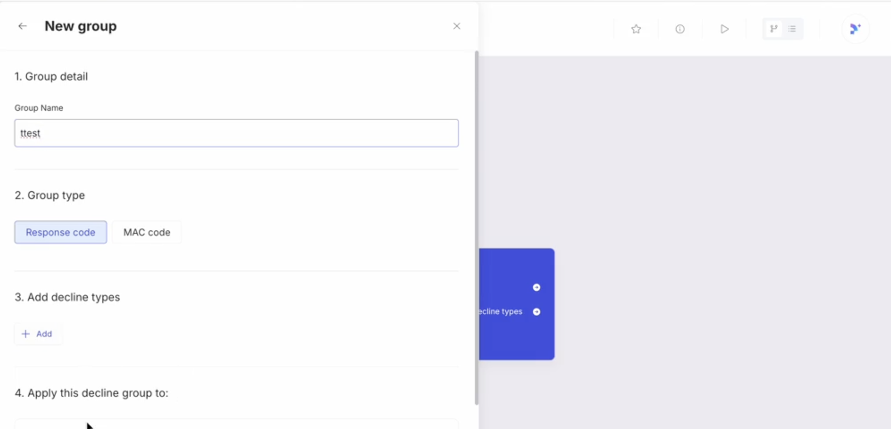

Cuando se rechaza una transacción, los Merchant Advice Codes (MAC) indican con claridad si conviene reintentar y cuándo hacerlo. Para favorecer la transparencia y las decisiones informadas, las API públicas de Yuno incluyen tanto los códigos de respuesta normalizados como los originales. Al entender los MAC, los comercios pueden identificar rápidamente el motivo del rechazo y determinar las mejores acciones, como actualizar el enrutamiento o los datos del cliente antes de reintentar.

## Lista de MAC {#macs-list}

Esta tabla relaciona los Merchant Advice Codes normalizados de Yuno (`merchant_advice_code`, con su mensaje legible `merchant_advice_code_message` debajo de cada código) con sus equivalentes de Mastercard, Visa y Elo. Úsala como referencia para interpretar los motivos de rechazo, definir reglas de reintento y aplicar estrategias de enrutamiento consistentes entre redes.

| `merchant_advice_code` | Mastercard | Visa | Elo |
| :--------------------------- | :----------------------------------------------- | :---------------------------------------------------------------------------------------------------------------------------------------------- | :------------------------------------------------------------------------------------------------------- |
| `UPDATE_INFORMATION` Se necesita información actualizada o adicional | `01` – Información actualizada de la cuenta disponible | – | – |
| `TRY_AGAIN_LATER` Reintentar dentro de 30 días | `02` – Intentar de nuevo más tarde | `3, 19, 39` `51, 52, 53` `59, 60, 61` `62, 65, 75` `78, 86, 91` `93, 96, N3` `N4, Z5, 5C` `9G` | `51, 59, 04` `06, 38, 61` `62, 65, 75` `78, 91` |
| `DO_NOT_TRY_AGAIN` No volver a intentar | `03` – No volver a intentar | `4, 7, 12` `14, 15, 41` `43, 46, 57` `R0, R1, R3` | `57, 14, 56` `46, FM, 19` `12, 30, 13` `23, 41, 43` `64, 83, 76` `77` |
| `REQUIREMENTS_NOT_FULFILLED` No se cumplen los requisitos del token | `04` – No se cumplen los requisitos del token | – | – |
| `NO_RETRY_LIFE_CYCLE` Sin ciclo de vida de reintento | `21` – Plan recurrente cancelado | – | – |
| `RETRY_AFTER_1_H` Reintentar después de 1 hora | `24` – Reintentar después de 1 hora (fondos insuficientes) | – | – |
| `RETRY_AFTER_24_H` Reintentar después de 24 horas | `25` – Reintentar después de 24 horas (fondos insuficientes) | – | – |
| `RETRY_AFTER_2_D` Reintentar después de 2 días | `26` – Reintentar después de 2 días (fondos insuficientes) | – | – |
| `RETRY_AFTER_4_D` Reintentar después de 4 días | `27` – Reintentar después de 4 días (fondos insuficientes) | – | – |
| `RETRY_AFTER_6_D` Reintentar después de 6 días | `28` – Reintentar después de 6 días (fondos insuficientes) | – | – |
| `RETRY_AFTER_8_D` Reintentar después de 8 días | `29` – Reintentar después de 8 días (fondos insuficientes) | – | – |
| `RETRY_AFTER_10_D` Reintentar después de 10 días | `30` – Reintentar después de 10 días (fondos insuficientes) | – | – |
| `NO_RETRY_POLICY` Sin política de reintento | `40` – Tarjeta prepagada no recargable | – | – |
| `NO_RETRY_SECURITY` Sin reintento por seguridad | `42` – Puntaje de sanciones excedido | – | – |
| `MULTIPLE_USE_CARD` Tarjeta virtual de uso múltiple | `43` – Tarjeta virtual de uso múltiple | – | – |
| `INVALID_DATA` Información de pago incorrecta; el comercio debe revalidarla antes de reintentar | – | `54, 55, 82` `N7, 1A, 70` `6P` | `54, 55, 82` `63` |

## Campos de MAC en las transacciones {#mac-fields-in-transactions}

La API pública de Yuno incluye campos dedicados para facilitar el uso de los Merchant Advice Codes.

### MAC normalizados {#normalized-macs}

Yuno ofrece un conjunto estandarizado de Merchant Advice Codes que simplifica las respuestas de los proveedores. Estos códigos te permiten crear lógica de reintento y reglas de enrutamiento sin tener que gestionar las variaciones propias de cada proveedor.

* **`transactions.merchant_advice_code`**: un MAC normalizado por Yuno que se devuelve cuando se rechaza una transacción. Este código te ayuda a entender el motivo del rechazo, si es posible reintentar y qué acciones tomar antes de volver a intentar el pago.
* **`transactions.merchant_advice_code_message`**: este campo complementa el `merchant_advice_code` descrito arriba y explica el código en términos legibles. Este mensaje te permite actuar según la información sin tener que memorizar el significado de cada código.

### MAC originales {#raw-macs}

Junto con los valores normalizados, Yuno también expone los códigos y mensajes originales que devuelven los proveedores. Estos campos originales garantizan total transparencia y te permiten diagnosticar problemas o seguir la guía específica de cada proveedor cuando sea necesario.

* **`transactions.provider_data.merchant_advice_code`**: el Merchant Advice Code original que devuelve directamente el proveedor de pagos. Este campo te da acceso al código original para tener total transparencia y diagnosticar problemas.
* **`transactions.provider_data.merchant_advice_code_message`**: un mensaje legible del proveedor que explica el significado del MAC original. Usa este mensaje para entender la guía específica del proveedor sin tener que interpretar los valores de los códigos.

<Note>
  Ten en cuenta que estos campos se encuentran dentro del objeto `transactions` en las respuestas de la API.
</Note>

## Acerca de los reintentos {#about-retries}

Cuando se rechaza una compra con tarjeta, cualquier intento posterior de completar la compra con la misma tarjeta es un reintento. Las tarifas y los umbrales de los reintentos los define cada red de tarjetas. La cantidad de reintentos permitidos antes de que se apliquen tarifas varía según la marca. Los comercios que no cumplan pueden recibir cargos por las transacciones excedidas.

La industria de pagos, junto con ABECS, estandarizó los códigos de respuesta para los rechazos de transacciones con tarjeta. Estos intentos se clasifican en dos tipos:

* **Reversible**: un rechazo potencialmente temporal que puede cambiar con el tiempo. El emisor puede rechazar la transacción por fondos insuficientes, problemas del sistema o demasiados intentos fallidos de PIN.
* **Irreversible**: cualquier autorización posterior a un rechazo irreversible que no cambie los campos del mensaje fallará. Esto puede significar que la tarjeta fue cancelada o que se confirmó un fraude.

Visa, Mastercard y Elo actualizaron sus políticas para limitar los intentos de reintento de autorización después de un rechazo, y cobran tarifas por los intentos que superan esos límites. Consulta las reglas de cada marca a continuación.

* [Mastercard](#mastercard)
* [Visa](#visa)
* [Elo](#elo)
* [Otras marcas](#other-brands)

## Mastercard {#mastercard}

Mastercard gestiona los MAC como parte de su programa Transaction Processing Excellence (TPE), que tiene dos componentes principales:

### Intentos de autorización excesivos {#excessive-authorization-attempts}

El TPE de Intentos de autorización excesivos de Mastercard busca monitorear de forma constante el uso de la red para detectar y prevenir demasiadas solicitudes de autorización. Mastercard también monitorea las transacciones aprobadas por montos muy pequeños (menos de una unidad de moneda) que luego se reembolsan, ya que pueden indicar actividad de prueba de tarjetas.

Este monitoreo se aplica tanto a las compras rechazadas como a las aprobadas. Un reintento se define como cualquier nuevo intento de autorizar un pago con la misma tarjeta y el mismo comercio. Las reglas de Mastercard establecen umbrales diarios y mensuales según la región (por ejemplo, no más de 10 intentos por día o 35 reintentos en un mes). Superar cualquiera de los dos límites puede generar tarifas adicionales.

### Merchant Advice Codes (MAC) de Mastercard {#mastercard-merchant-advice-codes-macs}

Mastercard usa los MAC para ayudar a los comercios a entender cuándo es adecuado reintentar una transacción. Algunos rechazos son irreversibles, es decir, la transacción no debe reintentarse, con frecuencia porque la tarjeta está cerrada o se confirmó un fraude.

El programa TPE hace seguimiento específico de los reintentos posteriores a estos rechazos irreversibles, y se centra en dos códigos: el MAC 03 (“No volver a intentar”) y el MAC 21 (“Sin ciclo de vida de reintento”). Si intentas procesar de nuevo la misma tarjeta y el mismo monto después de recibir uno de estos códigos, Mastercard puede cobrarte una tarifa.

Otros MAC, como los que indican un problema temporal o fondos insuficientes, no generan tarifas de MAC Transaction Excellence, pero aun así podrían cobrarte bajo el programa de Intentos de autorización excesivos si superas los límites de reintento.

En algunos casos, los MAC recomiendan esperar un tiempo específico antes de reintentar (por ejemplo, “Reintentar después de 24 horas”). Esto te ayuda a elegir el mejor momento para volver a intentar.

Consulta todos los MAC de Mastercard y sus equivalentes normalizados por Yuno en la [Lista de MAC](#macs-list).

## Visa {#visa}

Los MAC de Visa se organizan en cuatro categorías. El objetivo es mantener el equilibrio del ecosistema, reducir los reintentos innecesarios y exigir que los emisores usen códigos de rechazo precisos y no genéricos.

<Note>
**Tarifas de Visa**

Como son irreversibles, los códigos de la categoría 1 generan un cargo a partir del segundo intento. Las categorías 2, 3 y 4 permiten hasta 20 intentos en 30 días, con tarifas a partir del intento 21. Pasados 30 días desde el primer intento, cualquier reintento se cobra. Las tarifas de Visa son las siguientes:

* **Nacional**: USD 0.10 + 13.83% de impuesto
* **Transfronterizo**: USD 0.25 + 13.83% de impuesto
</Note>

### Categoría 1 (el emisor nunca aprobará) {#category-1-issuer-will-never-approve}

Irreversible, indica que la tarjeta fue cancelada o nunca existió, o que el rechazo es resultado de una restricción o un error permanente que bloqueará cualquier aprobación futura. Tarifas a partir del segundo intento.

* Los códigos comunes de la categoría 1 pueden incluir: `04`, `07`, `12`, `15`, `41`, `43`, `46`, `57`, `R0`, `R1`, `R3`

### Categoría 2 (el emisor no puede aprobar en este momento) {#category-2-issuer-cannot-approve-at-this-time}

Reversible, significa que el rechazo se debe a una condición temporal, como el riesgo crediticio u otras restricciones de la tarjeta, que podrían permitir que un reintento de la transacción sea aprobado. Algunos casos requieren que el titular de la tarjeta o el emisor eliminen la restricción antes de la aprobación.

* Los códigos comunes de la categoría 2 pueden incluir: `03`, `19`, `39`, `51`, `52`, `53`, `59`, `61`, `62`, `65`, `75`, `78`, `86`, `91`, `93`, `96`, `N3`, `N4`, `Z5`, `5C`, `9G`

### Categoría 3 (calidad de los datos) {#category-3-data-quality}

Reversible, se activa por un error de datos identificado por el emisor. Los comercios deben revalidar los datos de pago antes de reintentar. Estos códigos de rechazo pueden indicar posibles riesgos de fraude para los comercios.

* Los códigos comunes de la categoría 3 pueden incluir: `14`, `54`, `55`, `70`, `82`, `1A`, `6P`, `N7`

<Warning>
**Cargos de la categoría 3**

Los comercios pueden tener hasta 25,000 transacciones rechazadas por errores de calidad de los datos (categoría 3) en un período de 30 días. Si superas este límite, Visa cobrará una tarifa por cada transacción rechazada adicional en esta categoría.
</Warning>

### Categoría 4 (códigos de respuesta genéricos) {#category-4-generic-response-codes}

Reversible, incluye todos los demás códigos de respuesta de rechazo que no están en las categorías 1, 2 y 3, ya que puede haber casos en los que no exista un valor de código de respuesta para un rechazo específico. Los emisores pueden usar otros valores de código de respuesta definidos en las especificaciones técnicas de VisaNet. Sin embargo, se aconseja un uso mínimo.

Todos los MAC de Visa y sus equivalentes normalizados por Yuno están disponibles en la [Lista de MAC](#macs-list).

## Elo {#elo}

Elo implementó reglas en enero de 2025 con el objetivo de reducir los reintentos innecesarios por parte de comercios y adquirentes. Las transacciones se cuentan desde el primer hasta el último día calendario del mes.

<Note>
**Tarifas de Elo**

BRL 0.80 por cada intento que exceda el límite del grupo.
</Note>

### Grupos de Elo y reglas de reintento {#elo-groups-and-retry-rules}

Elo clasifica los códigos reversibles e irreversibles en tres grupos separados:

| Grupo                  | Descripción                                                                                    | Regla de cobro                                                   |
| :--------------------- | :--------------------------------------------------------------------------------------------- | :--------------------------------------------------------------- |
| Grupo 1 (Irreversible) | Transacciones rechazadas con códigos irreversibles (misma tarjeta, mismo CNPJ del establecimiento, mismo monto)  | Se cobra a partir del segundo intento dentro del mes de evaluación      |
| Grupo 2 (Reversible)   | Transacciones rechazadas con códigos reversibles                                               | Se cobra a partir del intento 16 dentro del mes de evaluación     |
| Grupo 3 (Calidad de los datos) | Rechazos con características de ataques de fuerza bruta (considerando el mismo CNPJ raíz del comercio) | Se cobra a partir de 10,001 transacciones rechazadas si superan el 5% del total de rechazos |

<Note>
  “CNPJ” se refiere a la identificación fiscal brasileña de la empresa para el establecimiento (CNPJ raíz a nivel de grupo).
</Note>

Consulta la [Lista de MAC](#macs-list) para ver todos los códigos de Elo y sus equivalentes normalizados por Yuno.

## Otras marcas {#other-brands}

* **Códigos reversibles**: se permiten reintentos para el mismo cliente y la misma tarjeta. No hay un límite ni un plazo preestablecido.

<Warning>
**Atención**

Antes de volver a intentar, sigue la guía recibida en la respuesta de la transacción rechazada.
</Warning>

* **Códigos irreversibles**: no se permitirán autorizaciones para la misma tarjeta o el mismo establecimiento después de recibir la primera respuesta de rechazo del emisor.

## Enrutamiento con MAC {#routing-with-mac}

El comportamiento de reintento debe implementarse mediante condiciones de [enrutamiento](/es/docs/using-yuno/dashboard-overview/routing). Actualiza las rutas para incluir las nuevas condiciones de MAC.

Al crear un grupo de rechazo en el [Dashboard de Yuno](https://dashboard.y.uno/), puedes elegir agregar condiciones por Response Code o por MAC Code.

<Warning>
**Período de transición**

Hasta que todas las integraciones emitan el MAC por separado, algunos valores de MAC aparecerán tanto en Response Codes como en MAC Codes. Esto es lo esperado mientras se completa el despliegue de la función.
</Warning>

<Frame></Frame>

 
