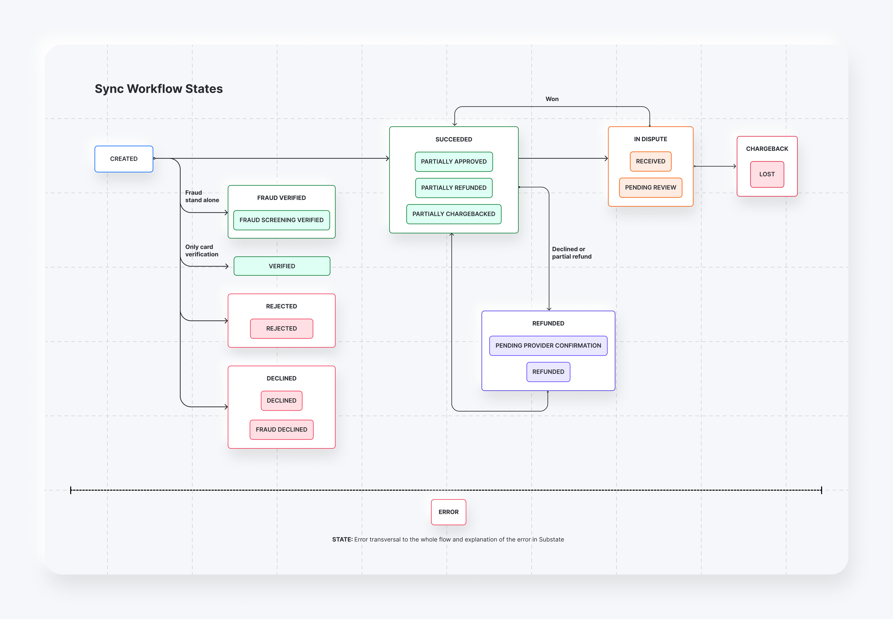
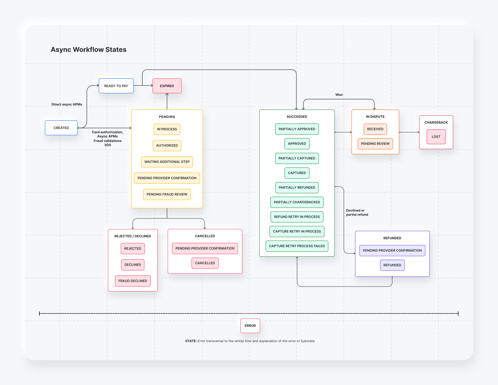

import { HTMLBlock } from "/snippets/HTMLBlock.jsx";
import { StatusBadge } from "/snippets/StatusBadge.jsx";
import { ExplainerVideo } from "/snippets/es/ExplainerVideo.jsx";

Los pagos contienen toda la información esencial del pedido, incluida la información del cliente, el monto, la moneda, los artículos, los datos de envío, etc. Siempre puedes consultar los detalles de la transacción para obtener más información sobre el pedido y las interacciones del pago.

<ExplainerVideo src="/videos/explainers/payment-status-lifecycle.mp4" poster="/videos/explainers/payment-status-lifecycle.jpg" title="Ciclo de vida del estado del pago" duration="68 s" />

## Flujo de trabajo {#workflow}

En el siguiente flujo de trabajo, puedes ver los diferentes estados del pago y cómo se pueden actualizar.

<Frame></Frame>

Para cada implementación, recomendamos tomar el <code>status</code> y el <code>sub_status</code> del pago como la referencia principal del estado del pago. Un pago puede tener diferentes [transacciones](/es/reference/payments/status-and-response-codes/transaction) asociadas. Al enfocarte en el <code>status</code> / <code>sub\_status</code> del pago, obtienes el estado más reciente sin importar cuántas transacciones se hayan realizado, lo que te da información clara para tomar decisiones.

## Estados de los pagos {#payments-status}

Los pagos pueden tener los siguientes estados y subestados.

<table class="payment-status-table">
  <thead>
    <tr>
      <th>Estado</th>
      <th>Subestado</th>
      <th>Transacción <small>tipo · estado</small></th>
      <th>Descripción</th>
    </tr>
  </thead>
  <tbody>
    <tr>
      <td class="status"><StatusBadge type="info" text="CREATED" /></td>
      <td class="substatus"><StatusBadge type="info" text="CREATED" /></td>
      <td></td>
      <td>Estado inicial al momento de crear un pago.</td>
    </tr>
    <tr>
      <td class="status"><StatusBadge type="info" text="READY_TO_PAY" /></td>
      <td class="substatus"><StatusBadge type="info" text="CREATED" /></td>
      <td>Purchase · Created</td>
      <td>Estado inicial al momento de crear un pago. En espera de una acción del cliente</td>
    </tr>
    <tr>
      <td class="status" rowspan="9"><StatusBadge type="warning" text="PENDING" /></td>
      <td class="substatus"><StatusBadge type="warning" text="AUTHORIZED" /></td>
      <td>Authorize · Succeeded</td>
      <td>Autorizaciones de tarjeta</td>
    </tr>
    <tr>
      <td class="substatus"><StatusBadge type="warning" text="IN_PROCESS" /></td>
      <td>Purchase · Created</td>
      <td>El cliente fue redirigido al proveedor y estamos esperando la finalización del pago.</td>
    </tr>
    <tr>
      <td class="substatus" rowspan="2"><StatusBadge type="warning" text="WAITING_ADDITIONAL_STEP" /></td>
      <td>Purchase · Pending</td>
      <td>3DS/Segundo factor</td>
    </tr>
    <tr>
      <td>Authorize · Pending</td>
      <td>3DS/Segundo factor para el flujo de autorización</td>
    </tr>
    <tr>
      <td class="substatus" rowspan="2"><StatusBadge type="warning" text="PENDING_PROVIDER_CONFIRMATION" /></td>
      <td>Purchase · Pending</td>
      <td>En espera de la confirmación del pago por parte de los proveedores.</td>
    </tr>
    <tr>
      <td>Capture · Pending</td>
      <td>El proveedor no confirmó la captura a tiempo. Yuno consulta la captura con el proveedor y luego mueve el pago a <code>CAPTURED</code> o <code>PARTIALLY_CAPTURED</code>, o de vuelta a <code>AUTHORIZED</code> si la captura no se realizó.</td>
    </tr>
    <tr>
      <td class="substatus"><StatusBadge type="warning" text="PENDING_FRAUD_REVIEW" /></td>
      <td>Fraud · Pending</td>
      <td>La transacción está siendo analizada por el proveedor de fraude</td>
    </tr>
    <tr>
      <td class="substatus"><StatusBadge type="warning" text="PENDING_OTP_COMPLETION" /></td>
      <td>Purchase · Pending</td>
      <td>Estado inicial al crear el pago</td>
    </tr>
    <tr>
      <td class="substatus"><StatusBadge type="warning" text="WAITING_FOR_ENROLLMENT" /></td>
      <td></td>
      <td>El pago espera a que el cliente termine de inscribir el método de pago, por ejemplo una aprobación de vault de PayPal o un opt-in de Boku.</td>
    </tr>
    <tr>
      <td rowspan="2" class="status"><StatusBadge type="error" text="EXPIRED" /></td>
      <td rowspan="2" class="substatus"><StatusBadge type="error" text="EXPIRED" /></td>
      <td>Purchase · Expired</td>
      <td>El método de pago offline alcanza su fecha de vencimiento.</td>
    </tr>
    <tr>
      <td>Authorize · Expired</td>
      <td>La autorización vence</td>
    </tr>
    <tr>
      <td rowspan="3" class="status"><StatusBadge type="error" text="REJECTED" /></td>
      <td rowspan="2" class="substatus"><StatusBadge type="error" text="REJECTED" /></td>
      <td>Purchase · Rejected</td>
      <td>Rechazado por Yuno</td>
    </tr>
    <tr>
      <td>Capture · Error</td>
      <td>Rechazo de la captura por Yuno</td>
    </tr>
    <tr>
      <td class="substatus"><StatusBadge type="error" text="ENROLLMENT_ERROR" /></td>
      <td></td>
      <td>La inscripción del método de pago vinculada a este pago falló con un error.</td>
    </tr>
    <tr>
      <td rowspan="6" class="status"><StatusBadge type="error" text="DECLINED" /></td>
      <td rowspan="2" class="substatus"><StatusBadge type="error" text="DECLINED" /></td>
      <td>Purchase · Declined</td>
      <td>Rechazo del proveedor</td>
    </tr>
    <tr>
      <td>Capture · Declined</td>
      <td>Rechazo de la captura por el proveedor</td>
    </tr>
    <tr>
      <td class="substatus"><StatusBadge type="error" text="FRAUD_DECLINED" /></td>
      <td>Fraud screening · Declined</td>
      <td>Validación de fraude rechazada</td>
    </tr>
    <tr>
      <td class="substatus"><StatusBadge type="secondary" text="REFUND_RETRY_IN_PROCESS" /></td>
      <td>Refund · Declined</td>
      <td>Pago con dos tarjetas: una tarjeta falló y el reembolso de la otra tarjeta también falló. Yuno reintenta el reembolso automáticamente.</td>
    </tr>
    <tr>
      <td class="substatus"><StatusBadge type="secondary" text="CANCEL_RETRY_IN_PROCESS" /></td>
      <td>Cancel · Declined</td>
      <td>Pago con dos tarjetas: una tarjeta falló y la cancelación de la otra tarjeta también falló. Yuno reintenta la cancelación automáticamente.</td>
    </tr>
    <tr>
      <td class="substatus"><StatusBadge type="error" text="ENROLLMENT_DECLINED" /></td>
      <td></td>
      <td>La inscripción del método de pago vinculada a este pago fue rechazada.</td>
    </tr>
    <tr>
      <td rowspan="15" class="status"><StatusBadge type="success" text="SUCCEEDED" /></td>
      <td class="substatus"><StatusBadge type="success" text="PARTIALLY_APPROVED" /></td>
      <td>Purchase · Succeeded</td>
      <td>Pago parcial (pago con 2 tarjetas)</td>
    </tr>
    <tr>
      <td class="substatus"><StatusBadge type="success" text="VERIFIED" /></td>
      <td>Verify · Succeeded</td>
      <td>Autorizaciones de tarjeta con monto cero</td>
    </tr>
    <tr>
      <td class="substatus"><StatusBadge type="success" text="APPROVED" /></td>
      <td>Purchase · Succeeded</td>
      <td>Pago exitoso</td>
    </tr>
    <tr>
      <td class="substatus"><StatusBadge type="success" text="CAPTURED" /></td>
      <td>Capture · Succeeded</td>
      <td>Captura exitosa</td>
    </tr>
    <tr>
      <td rowspan="3" class="substatus"><StatusBadge type="success" text="PARTIALLY_CAPTURED" /></td>
      <td>Capture · Succeeded</td>
      <td>Captura parcial exitosa</td>
    </tr>
    <tr>
      <td>Refund · Error/Declined</td>
      <td>Sigue aprobado debido a un error en el reembolso / la cancelación</td>
    </tr>
    <tr>
      <td>Chargeback · Error/Declined</td>
      <td>Sigue aprobado debido al rechazo en el contracargo</td>
    </tr>
    <tr>
      <td class="substatus"><StatusBadge type="secondary" text="PARTIALLY_REFUNDED" /></td>
      <td>Refund · Succeeded</td>
      <td>Reembolso parcial exitoso</td>
    </tr>
    <tr>
      <td class="substatus"><StatusBadge type="secondary" text="PARTIALLY_CHARGEBACKED" /></td>
      <td>Chargeback · Succeeded</td>
      <td>Contracargo parcial exitoso</td>
    </tr>
    <tr>
      <td class="substatus"><StatusBadge type="error" text="FRAUD_DECLINED" /></td>
      <td>Fraud screening · Declined</td>
      <td>Validación de fraude rechazada. Puede ocurrir antes o después de la autorización del proveedor. El pago fue exitoso y los fondos se movieron.</td>
    </tr>
    <tr>
      <td class="substatus"><StatusBadge type="secondary" text="REFUND_RETRY_IN_PROCESS" /></td>
      <td>Refund · Declined</td>
      <td>La transacción fue rechazada y está en espera de reintento.</td>
    </tr>
    <tr>
      <td class="substatus"><StatusBadge type="secondary" text="CAPTURE_RETRY_IN_PROCESS" /></td>
      <td>Capture · Declined</td>
      <td>La transacción fue rechazada y está en espera de reintento.</td>
    </tr>
    <tr>
      <td class="substatus"><StatusBadge type="secondary" text="CAPTURE_RETRY_PROCESS_FAILED" /></td>
      <td>Capture · Declined</td>
      <td>La transacción fue rechazada y el esquema de reintentos finalizó.</td>
    </tr>
    <tr>
      <td class="substatus"><StatusBadge type="success" text="THREE_D_SECURE_VERIFIED" /></td>
      <td>Three D Secure · Succeeded</td>
      <td>La autenticación 3DS fue exitosa en un flujo de [3DS standalone](/es/docs/payment-features/3ds-standalone).</td>
    </tr>
    <tr>
      <td class="substatus"><StatusBadge type="secondary" text="TRANSFER_REVERSED" /></td>
      <td>Split transfer reversal · Succeeded</td>
      <td>Se revirtió una transferencia dividida de marketplace. El pago conserva este subestado si luego pasa a un estado de contracargo.</td>
    </tr>
    <tr>
      <td rowspan="2" class="status"><StatusBadge type="secondary" text="REFUNDED" /></td>
      <td class="substatus"><StatusBadge type="warning" text="PENDING_PROVIDER_CONFIRMATION" /></td>
      <td>Refund · Pending</td>
      <td>Reembolso pendiente</td>
    </tr>
    <tr>
      <td class="substatus"><StatusBadge type="secondary" text="REFUNDED" /></td>
      <td>Refund · Succeeded</td>
      <td>Reembolso exitoso</td>
    </tr>
    <tr>
      <td rowspan="2" class="status"><StatusBadge type="error" text="CANCELED" /></td>
      <td class="substatus"><StatusBadge type="warning" text="PENDING_PROVIDER_CONFIRMATION" /></td>
      <td>Cancel · Pending</td>
      <td>Cancelación pendiente</td>
    </tr>
    <tr>
      <td class="substatus"><StatusBadge type="error" text="CANCELED" /></td>
      <td>Cancel · Succeeded</td>
      <td>Cancelación exitosa</td>
    </tr>
    <tr>
      <td rowspan="2" class="status"><StatusBadge type="secondary" text="IN_DISPUTE" /></td>
      <td class="substatus"><StatusBadge type="secondary" text="RECEIVED" /></td>
      <td>Chargeback · Created</td>
      <td>Contracargo o consulta recibidos. Se debe proporcionar una decisión o documentación</td>
    </tr>
    <tr>
      <td class="substatus"><StatusBadge type="secondary" text="PENDING_REVIEW" /></td>
      <td>Chargeback · Pending</td>
      <td>In_review</td>
    </tr>
    <tr>
      <td rowspan="1" class="status"><StatusBadge type="error" text="CHARGEBACK" /></td>
      <td class="substatus"><StatusBadge type="error" text="LOST" /></td>
      <td>Chargeback · Prevented</td>
      <td>Predisputa desviada por el proveedor o la red. El pago refleja fondos perdidos.</td>
    </tr>
    <tr>
      <td rowspan="4" class="status"><StatusBadge type="error" text="ERROR" /></td>
      <td class="substatus"><StatusBadge type="error" text="ERROR" /></td>
      <td></td>
      <td>Ejemplo: timeout.</td>
    </tr>
    <tr>
      <td class="substatus"><StatusBadge type="error" text="TIMEOUT" /></td>
      <td></td>
      <td></td>
    </tr>
    <tr>
      <td class="substatus"><StatusBadge type="warning" text="PENDING_REVERSE" /></td>
      <td></td>
      <td></td>
    </tr>
    <tr>
      <td class="substatus"><StatusBadge type="warning" text="REVERSED_BY_TIMEOUT" /></td>
      <td></td>
      <td></td>
    </tr>
    <tr>
      <td rowspan="1" class="status"><StatusBadge type="success" text="FRAUD_VERIFIED" /></td>
      <td class="substatus"><StatusBadge type="success" text="FRAUD_SCREENING_VERIFIED" /></td>
      <td>Fraud · Succeeded</td>
      <td>Transacción verificada por el proveedor de fraude durante la verificación de fraude independiente</td>
    </tr>
  </tbody>
</table>

<Note>
`PREVENTED` es un estado de transacción solo para `type = CHARGEBACK` cuando el proveedor o la red informa una [desviación de predisputa](/es/docs/payouts-and-disputes/chargeback-management). En estos casos, solo se envía el webhook de contracargo; no se emite ningún webhook de reembolso.

`REVIEW_WON` es un estado de transacción solo de contracargo. Cuando se gana un contracargo, el pago vuelve a su estado anterior (por ejemplo, `SUCCEEDED` / `APPROVED`) y no se emite ningún nuevo estado de pago.
</Note>

### Pagos con dos tarjetas {#two-card-payments}

Un pago financiado con dos tarjetas (`POST /v2/payments`) tiene un solo `status` y `sub_status` que resumen ambas tarjetas; una tarjeta no tiene un estado propio. Se aplica la primera regla que coincida: un rechazo por fraude en cualquier tarjeta da `DECLINED` / `FRAUD_DECLINED`; ambas tarjetas rechazadas dan `REJECTED`; cualquier tarjeta rechazada da `DECLINED`; luego `ERROR`, `EXPIRED`, `PENDING` (`PENDING_FRAUD_REVIEW`, `WAITING_ADDITIONAL_STEP`, `AUTHORIZED`) y `SUCCEEDED` (`APPROVED`, `CAPTURED`, `PARTIALLY_CAPTURED`, `PARTIALLY_REFUNDED`). Si ambas tarjetas se reembolsan, el resultado es `REFUNDED`, y un contracargo abierto en una tarjeta da `IN_DISPUTE`. Cuando una tarjeta falla y la reversión de la otra tarjeta también falla, el pago permanece en `DECLINED` con `REFUND_RETRY_IN_PROCESS` o `CANCEL_RETRY_IN_PROCESS` mientras Yuno reintenta. Consulta [Pagar con dos tarjetas](/es/docs/payment-features/pay-with-two-cards#statuses).

### Estados posibles para flujos síncronos y asíncronos {#possible-states-for-sync-and-async-flows}

Usa el diagrama que corresponda a tu tipo de integración para entender qué estados y transiciones del pago esperar.

#### Flujo síncrono {#synchronous-flow}

En un flujo síncrono, el pago pasa de `CREATED` directamente a un estado final (como `SUCCEEDED`, `DECLINED` o `REJECTED`) dentro de la misma respuesta de la API. No hay una fase intermedia `PENDING`. `ERROR` es transversal y puede ocurrir en cualquier punto del flujo.

<Frame></Frame>

#### Flujo asíncrono {#asynchronous-flow}

En un flujo asíncrono, el pago pasa por una fase `PENDING` después de su creación antes de llegar a un estado final. Durante esta fase, subestados como `IN_PROCESS`, `AUTHORIZED` y `WAITING_ADDITIONAL_STEP` reflejan el procesamiento en curso. El estado final se entrega mediante webhook cuando el procesamiento termina. Los pagos iniciados mediante APM asíncronos directos también pueden entrar en un estado `READY_TO_PAY`, que puede pasar a `EXPIRED` si no se completa. `ERROR` es transversal y puede ocurrir en cualquier punto del flujo.

<Frame></Frame>
