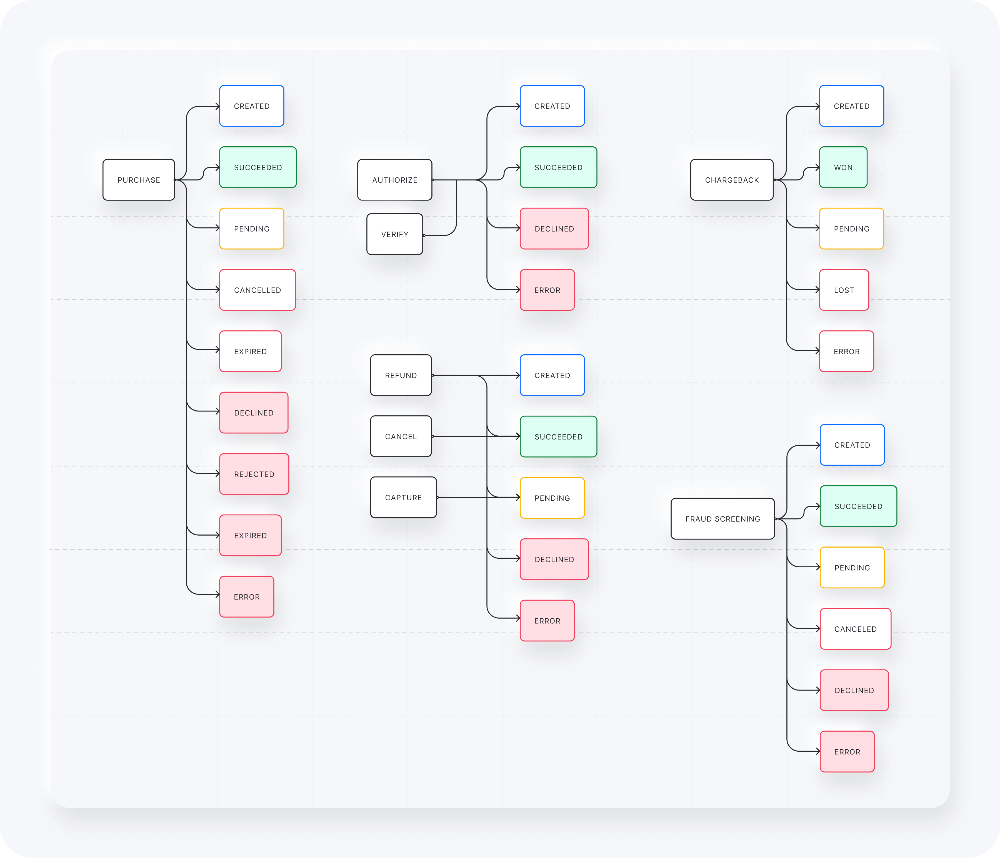

Cada pago tiene una o más transacciones asociadas. La siguiente documentación cubre los tipos de transacción, los códigos de estado y las descripciones después de obtener un estado HTTP 200 y de procesar una transacción.

## Flujo de trabajo {#workflow}

<Frame></Frame>

## Tipos de transacciones {#types-of-transactions}

| Tipo              | Descripción                                                          |
| :---------------- | :------------------------------------------------------------------- |
| `PURCHASE`        | Una transacción de compra directa.                                   |
| `AUTHORIZE`       | Transacción asociada con la autorización. Principalmente para pagos con tarjeta. |
| `CAPTURE`         | Una captura de una transacción autorizada previamente.               |
| `REFUND`          | Un reembolso de una transacción aprobada previamente.                |
| `CANCEL`          | Una cancelación de una transacción pendiente previamente.            |
| `VERIFY`          | Transacción asociada con la verificación de una tarjeta de crédito.  |
| `CHARGEBACK`      | Transacción asociada con un contracargo.                             |
| `THREE_D_SECURE`  | Una transacción de verificación 3DS para una compra inicial.         |
| `FRAUD_SCREENING` | El análisis de fraude está asociado con la verificación de fraude.   |
| `SPLIT_TRANSFER_REVERSAL` | Una reversión de transferencia vinculada a una transacción de pago específica. |
| `SPLIT_TRANSFER`  | Una transferencia directa independiente dentro de un Marketplace.    |
| `SPLIT_TRANSFER_REVERSE` | Una transferencia inversa independiente dentro de un Marketplace. |

## Códigos de transacción {#transaction-codes}

Con cada transacción, recibirás un `response_code` que detalla más información sobre ella. Los detalles relacionados con cada estado se presentan a continuación. Usa los siguientes botones para ir al contenido que necesites.

Los detalles de la respuesta del proveedor, cuando están disponibles, aparecen en el objeto `provider_data` de la transacción. Para reembolsos y cancelaciones, las respuestas síncronas actualmente llenan `provider_data.response_code` con el código normalizado de Yuno. Las actualizaciones asíncronas pueden llenarlo con el código propio del proveedor, por lo que no se garantiza que este campo contenga el código original del proveedor para estas operaciones. Usa el `response_code` de la transacción para obtener el resultado normalizado de Yuno.

Cuando lo proporciona el proveedor, la respuesta original está disponible en `provider_data.raw_response` y el mensaje del proveedor está disponible en `provider_data.response_message`. Su disponibilidad y contenido dependen de la integración.

Para consultar a qué corresponde un código específico del proveedor, usa el [decodificador de códigos de error de pago](https://www.y.uno/payment-error-codes). El decodificador es un mapeo de referencia que se mantiene según la documentación publicada de cada proveedor, por lo que debes usarlo como una guía y no como una descripción del comportamiento de una integración específica.

<CardGroup cols={3}>
  <Card title="Estado SUCCEEDED" icon="arrow-up-right-from-square" href="#succeeded-status" />
  <Card title="Estado WON" icon="arrow-up-right-from-square" href="#won-status" />
  <Card title="Estado CREATED" icon="arrow-up-right-from-square" href="#created-status" />
  <Card title="Estado PENDING" icon="arrow-up-right-from-square" href="#pending-status" />
  <Card title="Estado DECLINED" icon="arrow-up-right-from-square" href="#declined-status" />
  <Card title="Estado REJECTED" icon="arrow-up-right-from-square" href="#rejected-status" />
  <Card title="Estado ERROR" icon="arrow-up-right-from-square" href="#error-status" />
  <Card title="Estado EXPIRED" icon="arrow-up-right-from-square" href="#expired-status" />
  <Card title="Estado LOST" icon="arrow-up-right-from-square" href="#lost-status" />
  <Card title="Estado PREVENTED" icon="arrow-up-right-from-square" href="#prevented-status" />
</CardGroup>

### Estado SUCCEEDED {#succeeded-status}

<Accordion title={<>Detalles del estado <code>SUCCEEDED</code></>}>

| response_code | Descripción | Rechazo hard/soft | Código ISO 8583 |
| --- | --- | --- | --- |
| `SUCCEEDED` | Transacción exitosa | N/A | 0,8,10,11,16,32 |
| `FRAUD_VERIFIED` | Transacción verificada por el proveedor de fraude | N/A | - |
| `SUCCEEDED_THREE_D_SECURE` | Validación 3DS exitosa | N/A | - |
| `PENDING_IN_REVIEW` | Transacción autorizada, pendiente de revisión manual | N/A | - |

</Accordion>

### Estado WON {#won-status}

<Accordion title={<>Detalles del estado <code>WON</code></>}>

| response_code | Descripción | Rechazo hard/soft | Código ISO 8583 |
| --- | --- | --- | --- |
| `REVIEW_WON` | El adquirente rechazó el contracargo | N/A | - |

</Accordion>

### Estado CREATED {#created-status}

<Accordion title={<>Detalles del estado <code>CREATED</code></>}>

| response_code | Descripción | Rechazo hard/soft | Código ISO 8583 |
| --- | --- | --- | --- |
| `ACTION_REQUIRED` | Pago creado, pero requiere una acción adicional del usuario. Esto ocurre en los flujos de autenticación 3D Secure, en las redirecciones de método de pago, en los flujos de Headless SDK que requieren continuePayment o en los métodos de pago asíncronos con pasos adicionales. Revisa el campo `redirect_url` o `sdk_action_required` para conocer los siguientes pasos. | N/A | - |
| `SUCCEEDED` | Transacción creada correctamente | N/A | - |
| `RECEIVED` | Transacción recibida | N/A | - |
| `FRAUD_REPORTED` | Fraude reportado por la red de tarjetas antes de un contracargo formal. Solo en transacciones con `type = PRE_CHARGEBACK` | N/A | - |

</Accordion>

### Estado PENDING {#pending-status}

<Accordion title={<>Detalles del estado <code>PENDING</code></>}>

| response_code | Descripción | Rechazo hard/soft | Código ISO 8583 |
| --- | --- | --- | --- |
| `CHALLENGE_REQUIRED` | Transacción en espera de que se complete el desafío | N/A | - |
| `IN_REVIEW` | La documentación del contracargo se envió al proveedor y está siendo analizada | N/A | - |
| `PENDING_FRAUD_REVIEW` | El proveedor de fraude está analizando la transacción | N/A | - |
| `PENDING_PROVIDER_CONFIRMATION` | Transacción en espera de confirmación | N/A | - |
| `PENDING_REVIEW` | Transacción en espera de la confirmación de la revisión de fraude | N/A | - |
| `WAITING_ADDITIONAL_STEP` | Transacción en espera de que se complete un paso adicional | N/A | - |

</Accordion>

### Estado DECLINED {#declined-status}

<Note>
  Algunos rechazos incluyen un `merchant_advice_code` (MAC) que indica si se debe reintentar y cuándo. Consulta [Merchant Advice Codes (MAC)](#merchant-advice-codes-mac).
</Note>

<Accordion title={<>Detalles del estado <code>DECLINED</code></>}>

| response_code | Descripción | Rechazo hard/soft | Código ISO 8583 |
| --- | --- | --- | --- |
| `ACCESS_DENIED` | Acceso denegado | - | - |
| `ACCOUNT_STATUS` | Contacta a tu proveedor de fraude para verificar el estado de tu cuenta. | N/A | - |
| `ACQUIRE_CONTINGENCY` | Servicio del adquirente no disponible | SOFT | 22, 80, 90, 91, 92, 96 |
| `AUTHENTICATION_ATTEMPT` | Intento de autenticación sin finalizar | N/A | - |
| `AUTHENTICATION_FAILED_THREE_D_SECURE` | Falló la validación 3D | N/A | - |
| `AUTHENTICATION_FAILED_3DS` | Falló la validación 3D | N/A | - |
| `BAD_FILLED_INFO` | La tarjeta no coincide con los parámetros del emisor | HARD | 30,89 |
| `BANK_NOT_SUPPORTED` | Banco no compatible con el switch | SOFT | 31 |
| `BRAND_NOT_SUPPORTED` | Marca de tarjeta no compatible | - | - |
| `CALL_FOR_AUTHORIZE` | El aceptador de la tarjeta debe llamar al departamento de seguridad del adquirente | SOFT | 66 |
| `CANCELLED_BY_USER` | Cancelado por el usuario | SOFT | 17 |
| `CARD_AUTHENTICATION_FAILED` | Falló la autenticación de la tarjeta | N/A | - |
| `CARD_HOLDER_DECLINED` | El titular de la tarjeta rechazó la transacción | N/A | - |
| `CARD_NOT_ENROLLED` | No hay registro de la tarjeta. La tarjeta no está inscrita en 3DS | N/A | - |
| `CHALLENGE_CANCELED` | El comprador canceló el desafío 3DS | N/A | - |
| `COUNTRY_NOT_SUPPORTED` | Esta transacción no se puede procesar porque el país no es compatible | HARD | - |
| `CURRENCY_NOT_ALLOWED` | Moneda no permitida | HARD | - |
| `DECLINED_BY_BANK` | Rechazado por el banco. Consulta al emisor de la tarjeta | SOFT | - |
| `DECLINED_BY_PROVIDER` | Rechazado por el proveedor. Consulta el provider_data | SOFT | - |
| `DISABLED` | Tarjeta restringida | SOFT | - |
| `DO_NOT_HONOR` | No honrar | SOFT | 5 |
| `DO_NOT_TRY_AGAIN` | No intentar de nuevo | - | - |
| `DUPLICATED_TRANSACTION` | Transmisión duplicada de la transacción | SOFT | 26,94 |
| `EXPIRED` | Método de pago alternativo expirado | SOFT |  |
| `EXPIRED_CARD` | Tarjeta vencida | HARD | 33,54 |
| `EXPIRED_TIMEOUT` | La transacción no se completó a tiempo y expiró | N/A | - |
| `FIRST_USE` | Primer uso bloqueado | SOFT | 78 |
| `FRAUD_VALIDATION` | Violación de seguridad | SOFT | 34, 59, 63, 64 |
| `FRAUD_VERIFICATION_DECLINED` | - | - | - |
| `INSUFFICIENT_FUNDS` | Fondos insuficientes | SOFT | 51 |
| `INVALID_AMOUNT` | Monto inválido | SOFT | 13,64 |
| `INVALID_ACCOUNT` | Cuenta inválida | - | - |
| `INVALID_CARD_DATA` | La tarjeta no coincide con los parámetros del emisor. | HARD | 56 |
| `INVALID_CARD_NUMBER` | La tarjeta no coincide con los parámetros del emisor. | HARD | 14 |
| `INVALID_API` | Se intenta verificar el pago desde una dirección IP no autorizada | HARD | - |
| `INVALID_API_VERSION` | Versión de API inválida | HARD | - |
| `INVALID_CREDENTIALS` | Credenciales del proveedor de fraude inválidas en Yuno. | HARD | - |
| `INVALID_ISSUER` | Emisor inválido | SOFT | 15 |
| `INVALID_MERCHANT` | Comercio o proveedor de servicios inválido | SOFT | 3 |
| `INVALID_OTP` | OTP inválido | - | - |
| `INVALID_PARAMETERS` | Parámetros inválidos | HARD | - |
| `INVALID_SECURITY_CODE` | Código de seguridad de la tarjeta inválido | HARD | 56,82 |
| `INVALID_STATUS` | Estado inválido | SOFT | - |
| `INVALID_RESPONSE_FORMAT` | El cuerpo de la respuesta devuelto por el proveedor tiene un formato inválido | SOFT | - |
| `INVALID_TRANSACTION` | La transacción que se intenta realizar es inválida | HARD | 12,23 |
| `ISSUER_VIOLATION` | El banco emisor rechazó la transacción debido a alguna violación relacionada con la cuenta. | SOFT | 93 |
| `MISSING_PARAMETERS` | Faltan parámetros | HARD | - |
| `NO_RETRY_LIFE_CYCLE` | Sin ciclo de vida de reintento | HARD | 79 |
| `NO_RETRY_POLICY` | Sin política de reintento | HARD | 82 |
| `NO_RETRY_SECURITY` | Sin reintento por seguridad | HARD | 83 |
| `RETRY_AFTER_1_H` | Reintentar después de 1 hora | HARD |  |
| `RETRY_AFTER_24_H` | Reintentar después de 24 horas | HARD |  |
| `RETRY_AFTER_2_D` | Reintentar después de 2 días | HARD |  |
| `RETRY_AFTER_4_D` | Reintentar después de 4 días | HARD |  |
| `RETRY_AFTER_6_D` | Reintentar después de 6 días | HARD |  |
| `RETRY_AFTER_8_D` | Reintentar después de 8 días | HARD |  |
| `RETRY_AFTER_10_D` | Reintentar después de 10 días | HARD |  |
| `REJECTED_THREE_D_SECURE_REQUIRED` | Rechazo de la validación 3DS | SOFT | - |
| `REJECTED_3D_SECURE_REQUIRED` | Rechazo de la validación 3DS | SOFT | - |
| `REFER_TO_CARD_ISSUER` | Rechazado por el banco. Consulta al emisor de la tarjeta | SOFT | 01 |
| `REPORTED_LOST` | Tarjeta perdida | HARD | 41 |
| `REPORTED_STOLEN` | Tarjeta robada, retener | HARD | 43 |
| `REQUESTS_EXCEEDED` | Se alcanzó el límite de solicitudes de la cuenta del proveedor. | SOFT | - |
| `RESTRICTED_BY_BANK` | Rechazado por el banco. Consulta las condiciones especiales del emisor de la tarjeta | SOFT | 62 |
| `RESTRICTED_CARD` | Tarjeta restringida | - | - |
| `SUSPECTED_FRAUD` | El emisor o el proveedor de fraude marcó la transacción como sospechosa de fraude | N/A | - |
| `TERMINAL_ERROR` | Tu cuenta de comercio no está configurada correctamente para la transacción | SOFT | 58 |
| `THREE_D_SECURE_REQUIRED` | El proveedor antifraude requiere un desafío 3DS para una validación adicional. | SOFT |  |
| `TRANSACTION_DATA_INVALID` | El proveedor rechazó los datos de la transacción | N/A | - |
| `TRY_AGAIN_LATER` | Reintentar la transacción más tarde | - | - |
| `TRANSACTION_NOT_FOUND` | Transacción no encontrada | HARD | 25 |
| `UNAVAILABLE_PAYMENT_METHOD` | Función solicitada no compatible | HARD | - |
| `UNSUPPORTED_OPERATION` | Función solicitada no compatible | HARD | 40 |
| `UNKNOWN_ERROR` | Error desconocido | SOFT | - |
| `USER_RESTRICTION` | Transacción no permitida para el titular de la tarjeta | HARD | 57 |
| `UPDATED_INFORMATION` | Actualizar información | - | - |

</Accordion>

### Merchant Advice Codes (MAC) {#merchant-advice-codes-mac}

Estos códigos proporcionan orientación útil al gestionar transacciones rechazadas. Puedes encontrar estos campos en nuestras respuestas de la API pública:

* **`transactions.merchant_advice_code` y `transactions.merchant_advice_code_message`**: campos normalizados por Yuno que proporcionan códigos estandarizados y explicaciones sobre el rechazo.
* **`transactions.provider_data.merchant_advice_code` y `transactions.merchant_advice_code_message`**: código y mensaje sin procesar del proveedor.

Consulta [Merchant Advice Codes (MAC)](#merchant-advice-codes-mac) para obtener más información.

<Accordion title="Merchant Advice Codes (MAC)">

Los Merchant Advice Codes proporcionan orientación de los emisores y proveedores sobre el comportamiento y la política de reintentos. Cuando están presentes en un rechazo, usa el MAC para determinar si debes reintentar y el momento recomendado.

| merchant_advice_code | Descripción | Código MAC del proveedor |
| --- | --- | --- |
| `UPDATE_INFORMATION` | Se necesita información actualizada o adicional | 01 – Información actualizada de la cuenta disponible |
| `TRY_AGAIN_LATER` | Reintentar después de 10 días | 02 – Intentar de nuevo más tarde |
| `DO_NOT_TRY_AGAIN` | No intentar de nuevo | 03 – No intentar de nuevo |
| `REQUIREMENTS_NOT_FULFILLED` | No se cumplieron los requisitos del Token | 04 – No se cumplieron los requisitos del Token |
| `NO_RETRY_LIFE_CYCLE` | Sin ciclo de vida de reintento | 21 – Plan recurrente cancelado |
| `RETRY_AFTER_1_H` | Reintentar después de 1 hora | 24 – Reintentar después de 1 hora (fondos insuficientes) |
| `RETRY_AFTER_24_H` | Reintentar después de 24 horas | 25 – Reintentar después de 24 horas (fondos insuficientes) |
| `RETRY_AFTER_2_D` | Reintentar después de 2 días | 26 – Reintentar después de 2 días (fondos insuficientes) |
| `RETRY_AFTER_4_D` | Reintentar después de 4 días | 27 – Reintentar después de 4 días (fondos insuficientes) |
| `RETRY_AFTER_6_D` | Reintentar después de 6 días | 28 – Reintentar después de 6 días (fondos insuficientes) |
| `RETRY_AFTER_8_D` | Reintentar después de 8 días | 29 – Reintentar después de 8 días (fondos insuficientes) |
| `RETRY_AFTER_10_D` | Reintentar después de 10 días | 30 – Reintentar después de 10 días (fondos insuficientes) |
| `NO_RETRY_POLICY` | Sin política de reintento | 40 – Tarjeta prepago no recargable |
| `NO_RETRY_SECURITY` | Sin reintento por seguridad | 42 – Puntaje de sanciones excedido |
| `MULTIPLE_USE_CARD` | Tarjeta virtual de uso múltiple | 43 – Tarjeta virtual de uso múltiple |

</Accordion>

### Estado REJECTED {#rejected-status}

<Accordion title={<>Detalles del estado <code>REJECTED</code></>}>

| response_code | Descripción | Rechazo hard/soft | Código ISO 8583 |
| --- | --- | --- | --- |
| `COUNTRY_NOT_SUPPORTED` | - | HARD | - |
| `CURRENCY_NOT_ALLOWED` | - | HARD | - |
| `INVALID_PARAMETERS` | - | HARD | - |
| `INVALID_REQUEST` | - | HARD | - |
| `INTERNAL_ERROR` | - | HARD | - |
| `MISSING_PARAMETERS` | - | HARD | - |

</Accordion>

### Estado ERROR {#error-status}

<Accordion title={<>Detalles del estado <code>ERROR</code></>}>

| response_code | Descripción | Rechazo hard/soft | Código ISO 8583 |
| --- | --- | --- | --- |
| `ERROR` | Error interno desconocido | SOFT | - |
| `PROVIDER_ERROR` | Error. Ocurrió un error desconocido durante la autorización | SOFT | 6 |
| `PROVIDER_INTERNAL_ERROR` | Error interno | SOFT | 98 |
| `PROVIDER_INVALID_CREDENTIALS` | Credenciales inválidas | HARD | - |
| `PROVIDER_INVALID_REQUEST` | Solicitud inválida | HARD | - |
| `PROVIDER_TIMEOUT` | Respuesta recibida demasiado tarde | SOFT | 68 |
| `PROVIDER_UNKNOWN_ERROR` | Error desconocido | SOFT | - |
| `OPERATION_NOT_SUPPORTED` | El proveedor no admite esta operación | HARD | - |
| `TO_REVERSE` | La transacción será revertida | HARD | - |
| `PROVIDER_INVALID_RESPONSE` | Respuesta inválida | HARD | 20 |
| `PROVIDER_INVALID_API_VERSION` | Versión de API inválida | HARD | - |
| `DOCUMENT_TYPE_NOT_SUPPORTED` | El proveedor no admite el tipo de documento enviado | HARD | - |

</Accordion>

### Estado EXPIRED {#expired-status}

<Accordion title={<>Detalles del estado <code>EXPIRED</code></>}>

| response_code | Descripción | Rechazo hard/soft | Código ISO 8583 |
| --- | --- | --- | --- |
| `EXPIRED_BY_PROVIDER` | - | N/A | - |

</Accordion>

### Estado LOST {#lost-status}

<Accordion title={<>Detalles del estado <code>LOST</code></>}>

| response_code | Descripción | Rechazo hard/soft | Código ISO 8583 |
| --- | --- | --- | --- |
| `CLOSED` | - | N/A | - |
| `EXPIRED` | - | N/A | - |
| `PARTIALLY_CHARGE_BACKED` | Los fondos fueron contracargados parcialmente | N/A | - |
| `REVIEW_LOST` | La disputa del contracargo se perdió | N/A | - |

</Accordion>

### Estado PREVENTED {#prevented-status}

<Accordion title={<>Detalles del estado <code>PREVENTED</code></>}>

| response_code | Descripción | Rechazo hard/soft | Código ISO 8583 |
| --- | --- | --- | --- |
| `CHARGEBACK_AVOIDED` | Predisputa desviada por el proveedor o la red. No se requiere evidencia. Terminal. | N/A | - |

</Accordion>

<Note>
`PREVENTED` solo se aplica a las transacciones con `type = CHARGEBACK` cuando el proveedor o la red indica una desviación de predisputa. En estos escenarios, Yuno emite solo el webhook de contracargo; no se envía ningún webhook de reembolso.
</Note>

***

### response_codes específicos de contracargos {#chargebacks-specific-responsecodes}

Para obtener más detalles, consulta la [página de códigos de motivo](/es/docs/payouts-and-disputes/reason-codes) en la sección de [guías de contracargos](/es/docs/payouts-and-disputes/chargeback-management).

<Accordion title={<>Detalles del estado <code>CREATED</code></>}>

| response_code | Categoría | Descripción |
| --- | --- | --- |
| `EMV_LIABILITY_SHIFT_COUNTERFEIT` Fraude por falsificación con transferencia de responsabilidad EMV | Fraude | El titular de la tarjeta afirma que no autorizó ni participó en una transacción que procesaste. |
| `EMV_LIABILITY_SHIFT_NON_COUNTERFEIT_FRAUD` Fraude sin falsificación con transferencia de responsabilidad EMV | Fraude | El titular de la tarjeta afirma que no autorizó ni participó en una transacción que procesaste. |
| `CARD_PRESENT_FRAUD` Otro fraude: entorno con tarjeta presente | Fraude | El titular de la tarjeta afirma que no autorizó ni participó en una transacción con ingreso manual de datos o desatendida realizada en un entorno con tarjeta presente. |
| `NON_CARD_PRESENT_FRAUD` Otro fraude: entorno sin tarjeta presente | Fraude | El titular de la tarjeta no autorizó ni participó en una transacción realizada en un entorno sin tarjeta presente, como internet, pedido por correo, pedido por teléfono y otros. |
| `SCHEME_MONITORING_PROGRAM` Otro fraude: programa de monitoreo de la red | Fraude | Programa de monitoreo de fraude del esquema |
| `NO_AUTHORIZATION` Sin autorización | Autorización | El comercio no obtuvo una autorización correcta y válida. |
| `DECLINED_AUTHORIZATION` Autorización rechazada | Autorización | La solicitud de autorización recibió una respuesta de rechazo y el comercio completó la transacción. |
| `LATE_PRESENTMENT` Presentación tardía | Errores de procesamiento | La transacción no se envió a Visa dentro del plazo requerido. |
| `INCORRECT_TRANSACTION_CODE` Código de transacción incorrecto | Errores de procesamiento | El titular de la tarjeta afirma que el monto convertido del cargo en una transacción internacional es incorrecto. |
| `INCORRECT_CURRENCY` Moneda incorrecta | Errores de procesamiento | El comercio cometió uno o más errores relacionados con la moneda de la transacción |
| `INCORRECT_ACCOUNT_NUMBER` Número de cuenta incorrecto | Errores de procesamiento | El número de cuenta de la autorización no coincide con el número de cuenta utilizado en la transacción. |
| `INCORRECT_AMOUNT` Monto incorrecto | Errores de procesamiento | El titular de la tarjeta afirma que el monto que acordó pagar difiere del monto cobrado. |
| `DUPLICATE_PROCESSING` Procesamiento duplicado o pagado por otros medios | Errores de procesamiento | Una sola transacción se procesó dos o más veces. |
| `INVALID_DATA` Datos inválidos | Errores de procesamiento | La autorización se obtuvo con datos no válidos o incorrectos. |
| `PRODUCT_OR_SERVICE_NOT_RECEIVED` Mercancía o servicios no recibidos | Disputas de clientes | El titular de la tarjeta afirma que no recibió la mercancía o los servicios que pidió. |
| `CANCELED_RECURRING_TRANSACTION` Transacción recurrente cancelada | Disputas de clientes | Se procesó una transacción recurrente después de haber sido cancelada. |
| `PRODUCT_OR_SERVICE_ISSUE` Mercancía o servicios no conformes con la descripción o defectuosos | Disputas de clientes | El titular de la tarjeta afirma que los bienes no eran como se describían. |
| `COUNTERFEIT_MERCHANDISE` Mercancía falsificada | Disputas de clientes | La mercancía fue identificada como falsificada. |
| `MISREPRESENTATION` Declaración engañosa | Disputas de clientes | El banco del titular de la tarjeta recibió un aviso del titular en el que afirma que los términos de venta fueron presentados de forma engañosa. |
| `CREDIT_NOT_PROCESSED` Crédito no procesado | Disputas de clientes | El banco del titular de la tarjeta recibió un aviso del titular en el que afirma que recibió una autorización, un crédito o un comprobante de transacción anulada que no se ha procesado. |
| `PRODUCT_OR_SERVICE_CANCELED` Mercancía o servicios cancelados | Disputas de clientes | El banco del titular de la tarjeta recibió un aviso del titular en el que indica que devolvió mercancía o canceló servicios, pero el crédito no aparece en su estado de cuenta de Visa. |
| `ORIGINAL_TRANSACTION_NOT_ACCEPTED` Transacción de crédito original no aceptada | Disputas de clientes | El crédito original no fue aceptado. |
| `CASH_TRANSACTION_VALUE` No recepción de efectivo o del valor de una transacción de carga | Disputas de clientes | El titular de la tarjeta no recibió el retiro de efectivo completo en un cajero automático. |
| `CUSTOMER_AGREEMENT` Se requiere comprobante de la transacción o del acuerdo del cliente. | Disputas de clientes | El emisor solicita al comercio una copia del recibo firmado por el titular de la tarjeta o cualquier otra documentación que verifique el acuerdo del cliente con la compra. Normalmente sirve para verificar una transacción con tarjeta presente que el titular disputa o no reconoce. |

</Accordion>
