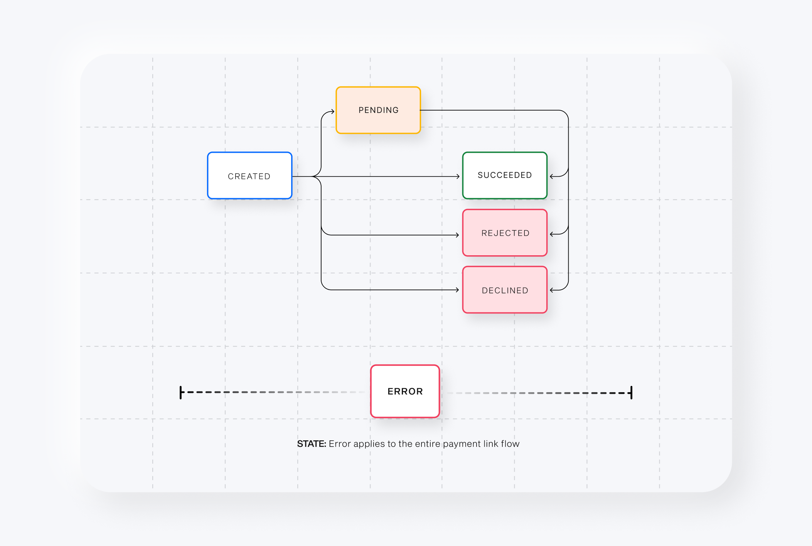

Esta página ofrece una descripción general del proceso de payout en Yuno, junto con un flujo de trabajo detallado y la información de estado correspondiente. Cada estado representa una etapa específica del proceso de payout, desde la creación hasta la finalización o la cancelación. Siempre puedes consultar los [detalles de la transacción](/es/reference/payments/status-and-response-codes/transaction) para obtener más información sobre la orden y las interacciones del pago.

## Flujo de trabajo {#workflow}

Toma el `status` del payout como referencia principal del estado del payout. Un payout puede tener distintas transacciones asociadas. Por lo tanto, al centrarte en el `status` del payout, puedes obtener el estado más reciente sin importar cuántas transacciones se hayan realizado, lo que te da una entrada clara para la toma de decisiones. La siguiente imagen presenta la máquina de estados del payout.

<Frame></Frame>

## Estado del payout {#payout-status}

La siguiente tabla presenta todos los `status` y `response_code` que encontrarás al gestionar payouts con el sistema de Yuno. Además, encontrarás la relación entre `status`/`response_code` y el estado de la transacción del proceso de payout.

| Status      | Response code                   | Description                                                                                                                                                                             |
| ----------- | ------------------------------- | --------------------------------------------------------------------------------------------------------------------------------------------------------------------------------------- |
| `CREATED`   | `CREATED`                       | Estado inicial cuando se crea un payout. Es un estado interno.                                                                                                                          |
| `PENDING`   | `PENDING_PROVIDER_CONFIRMATION` | El payout fue entregado al proveedor y está siendo analizado.                                                                                                                           |
| `PENDING`   | `AUTHORIZED`                    | El payout fue entregado al proveedor, está autorizado y espera la confirmación del comercio para liberar la transacción. Solo disponible para ciertos proveedores que lo admiten.      |
| `SUCCEEDED` | `SUCCEEDED`                     | El payout se completó correctamente.                                                                                                                                                    |
| `REJECTED`  | `REJECTED`                      | Payout rechazado por Yuno. Revisa los campos de la solicitud.                                                                                                                           |
| `DECLINED`  | `DECLINED`                      | El proveedor rechazó el payout.                                                                                                                                                         |
| `ERROR`     | `ERROR`                         | Error.                                                                                                                                                                                  |

