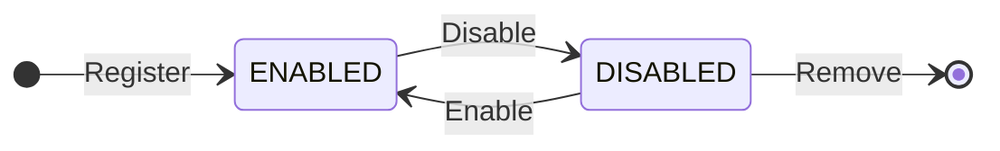

Cada host de tu [lista de destinos permitidos](/es/docs/security-and-compliance/pci-proxy/allowlist) del PCI Proxy tiene un estado que controla si el [forward proxy](/es/reference/pci-proxy/invoke-forward-proxy) puede enviarle datos de tarjeta. Un destino se crea en el estado `ENABLED` y se puede alternar sin perder su configuración ni su historial de auditoría. Solo los destinos `ENABLED` son accesibles. Una solicitud a un host `DISABLED` (o eliminado) se rechaza con `403 DESTINATION_NOT_ALLOWED`.

## Workflow {#workflow}

Un destino puede **eliminarse** desde cualquiera de los dos estados, habilitado o desactivado. La eliminación es permanente; el registro sale de la lista de permitidos, aunque la eliminación permanece en el registro de auditoría de solo anexado.

## Estado del destino {#destination-status}

| Estado     | Descripción                                                                                                   |
| :--------- | :----------------------------------------------------------------------------------------------------------- |
| `ENABLED`  | El destino está activo. El forward proxy puede enviar datos de tarjeta a este host. Un destino comienza aquí al registrarse. |
| `DISABLED` | El destino está suspendido. Se conservan su registro y su historial de auditoría, pero el forward proxy no lo usará hasta que se vuelva a habilitar. Las solicitudes a él devuelven `403 DESTINATION_NOT_ALLOWED`. |
| _(eliminado)_ | El destino se ha eliminado de la lista de permitidos. Ya no aparece en List y las solicitudes a él se rechazan. La eliminación permanece en el registro de auditoría de solo anexado. |
