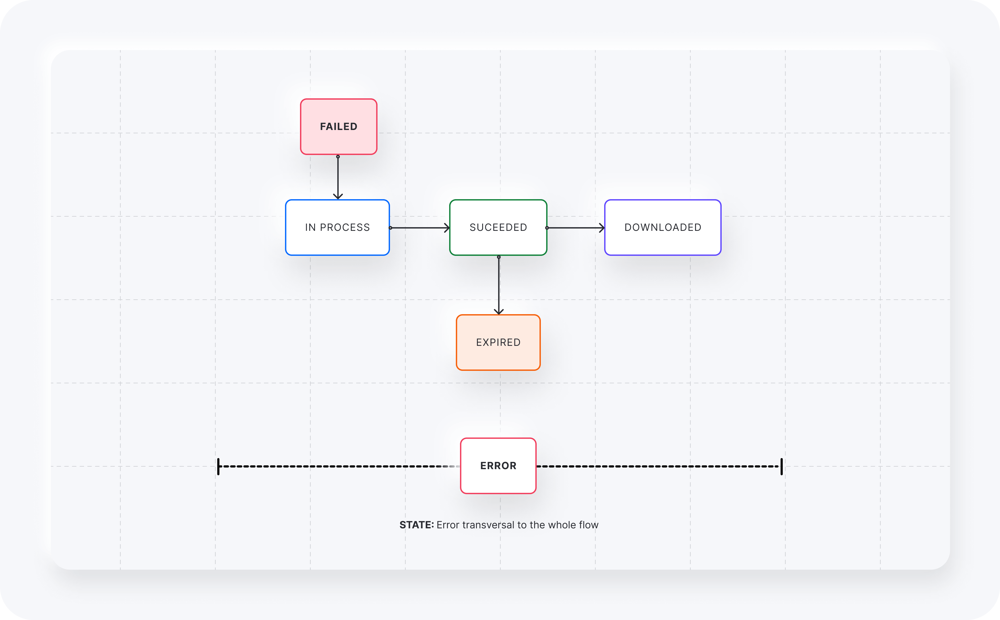

## Flujo de trabajo {#workflow}

En el siguiente flujo de trabajo, puedes ver los distintos estados de los reportes y cómo se pueden actualizar.

<Frame></Frame>

## Estado del reporte {#report-status}

Los reportes pueden tener los siguientes estados.

| Estado       | Descripción                                                                                                                                                   |
| :----------- | :------------------------------------------------------------------------------------------------------------------------------------------------------------ |
| `IN_PROCESS` | El reporte se está generando.                                                                                                                                 |
| `SUCCEEDED`  | La solicitud de creación del reporte se ejecutó correctamente.                                                                                                |
| `DOWNLOADED` | El comercio descargó el reporte.                                                                                                                              |
| `EXPIRED`    | La URL del reporte expiró y el reporte ya no está disponible para descargar. Esto ocurre 10 minutos después de la confirmación de creación (estado `SUCCEEDED`). |
| `FAILED`     | La generación del reporte falló.                                                                                                                              |
| `ERROR`      | Ocurrió un error en el proceso.                                                                                                                               |
