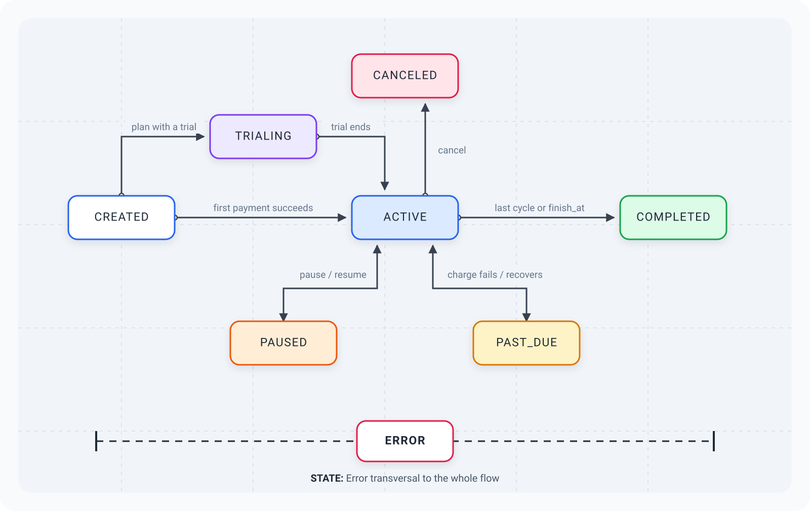

Yuno te permite gestionar el estado de las suscripciones directamente a través de la API, sin necesidad de sitios web ni aplicaciones adicionales. Puedes crear, pausar, reanudar y cancelar suscripciones.

## Flujo de trabajo {#workflow}

En el siguiente flujo de trabajo, puedes ver los distintos estados de la suscripción y cómo se pueden actualizar.

<Frame>
  
</Frame>

Una suscripción en la fase de prueba se comporta como una activa: se puede pausar, pasa a `PAST_DUE` cuando falla un cargo y vuelve a `TRIALING` cuando un cargo posterior es exitoso. Cualquier estado no terminal se puede cancelar, y una suscripción creada con `initial_payment_validation: true` pasa directamente de `CREATED` a `CANCELED` si el primer pago falla.

## Estado de la suscripción {#subscription-status}

Las suscripciones pueden tener los estados que se describen en la siguiente tabla.

| Estado      | Descripción                                                                                                                                                                                                        |
| ----------- | ------------------------------------------------------------------------------------------------------------------------------------------------------------------------------------------------------------------ |
| `CREATED`   | Estado transitorio mientras el pago inicial aún no se ha procesado. Solo ocurre cuando la suscripción se crea con `initial_payment_validation: true`.                                                       |
| `ACTIVE`    | La suscripción se ha creado con un cliente asociado y ya está activa.                                                                                                                               |
| `TRIALING`  | La suscripción está dentro de la fase de prueba inicial de un plan. Pasa automáticamente a `ACTIVE` cuando termina la prueba.                                                                                                |
| `PAST_DUE`  | Falló un cargo recurrente y la suscripción está a la espera de recuperación. Sigue facturando: el siguiente cargo exitoso la devuelve a `ACTIVE`, o a `TRIALING` si la fase de prueba todavía está en curso. Consulta [Reintentos](/es/docs/payment-features/subscriptions/retries), o [Pix Automático](/es/docs/payment-features/subscriptions/pix-automatico#the-retry-ladder) para la escalera fija con la que se recupera una suscripción `PIX_AUTOMATIC`. |
| `PAUSED`    | La suscripción se ha pausado y se puede reactivar.                                                                                                                           |
| `COMPLETED` | La suscripción se completó porque llegó a la fecha y hora de finalización.                                                                                                            |
| `CANCELED`  | Suscripción cancelada. Consulta `cancellation_source` para saber qué la desencadenó.                                                                                                            |
| `ERROR`     | Ocurrió un error en el proceso.                                                                                                                                                                                  |

<Note>
  Si tus suscripciones nunca pasan a `PAST_DUE`, el estado aún no está habilitado para tu cuenta: un
  cargo recurrente fallido deja la suscripción en `ACTIVE` mientras se ejecutan los reintentos. Contacta
  a tu representante de Yuno para habilitarlo.
</Note>

## Matriz de transición de estados {#status-transition-matrix}

Cada celda muestra qué mueve una suscripción del estado de la fila al estado de la columna. N/A significa que la transición no existe. La facturación nunca sale de `COMPLETED` ni de `CANCELED` por sí sola: la única forma de salir de cualquiera de los dos es una llamada explícita a [Reactivar suscripción](/es/reference/subscriptions/reactivate-subscription).

|  Desde \ Hacia   | `TRIALING` | `ACTIVE` | `PAST_DUE` | `PAUSED` | `COMPLETED` | `CANCELED` |
| ------------ | ---------- | -------- | ---------- | -------- | ----------- | ---------- |
| `CREATED`    | Se confirma el primer pago y el plan comienza con una fase de prueba | Se confirma el primer pago | N/A | N/A | N/A | El primer pago falla con `initial_payment_validation`, o se cancela la suscripción |
| `TRIALING`   | N/A | Termina la fase de prueba | Falla un cargo recurrente¹ | Se pausa la suscripción | Se alcanza `billing_cycles.total` o termina la ventana de disponibilidad | Cancelada por ti, por la cancelación de un plan o por `retries.cancel_on_exhausted_retries` |
| `ACTIVE`     | Un [cambio de plan](/es/reference/subscriptions/change-subscription-plan) cae dentro de una fase de prueba | N/A | Falla un cargo recurrente¹ | Se pausa la suscripción | Se alcanza `billing_cycles.total` o termina la ventana de disponibilidad | Cancelada por ti, por la cancelación de un plan o por `retries.cancel_on_exhausted_retries` |
| `PAST_DUE`   | Un cargo posterior es exitoso mientras la fase de prueba sigue en curso | Un cargo posterior es exitoso | N/A | N/A | Termina la ventana de disponibilidad | Cancelada por ti, o los reintentos terminan sin un pago exitoso y `retries.cancel_on_exhausted_retries` es `true` |
| `PAUSED`     | Se reanuda mientras la fase de prueba sigue en curso | Se reanuda después de la fase de prueba | N/A | N/A | N/A | Se cancela la suscripción |
| `COMPLETED`  | [Reactivada](/es/reference/subscriptions/reactivate-subscription) mientras una fase de prueba cubre el ciclo | [Reactivada](/es/reference/subscriptions/reactivate-subscription), mientras quedan ciclos de facturación | N/A | N/A | N/A | N/A |
| `CANCELED`   | [Reactivada](/es/reference/subscriptions/reactivate-subscription) mientras una fase de prueba cubre el ciclo | [Reactivada](/es/reference/subscriptions/reactivate-subscription) | N/A | N/A | N/A | N/A |

¹ Solo donde `PAST_DUE` está habilitado para la cuenta; de lo contrario, la suscripción permanece en su estado actual mientras se ejecutan los reintentos.

<Note>
  `ERROR` queda fuera de este flujo: está reservado para fallas de procesamiento y no forma parte del
  ciclo de vida normal descrito arriba.
</Note>

## Cancelar una suscripción {#canceling-a-subscription}

Puedes cancelar una suscripción en `CREATED`, `ACTIVE`, `TRIALING`, `PAST_DUE` y `PAUSED`, tanto
a través de [Cancelar suscripción](/es/reference/subscriptions/cancel-subscription) como desde el dashboard.
`COMPLETED` y `CANCELED` no se pueden cancelar: intentarlo devuelve `400 INVALID_STATE`, que es también
lo que devuelve una cancelación repetida de una suscripción ya cancelada. Cualquiera de las dos se puede volver
a `ACTIVE` con [Reactivar suscripción](/es/reference/subscriptions/reactivate-subscription).

El mismo endpoint también puede programar la cancelación para una fecha o un ciclo de facturación futuros en lugar de
aplicarla de inmediato: consulta [Cancelar suscripción](/es/reference/subscriptions/cancel-subscription#scheduling-a-cancellation-instead).
