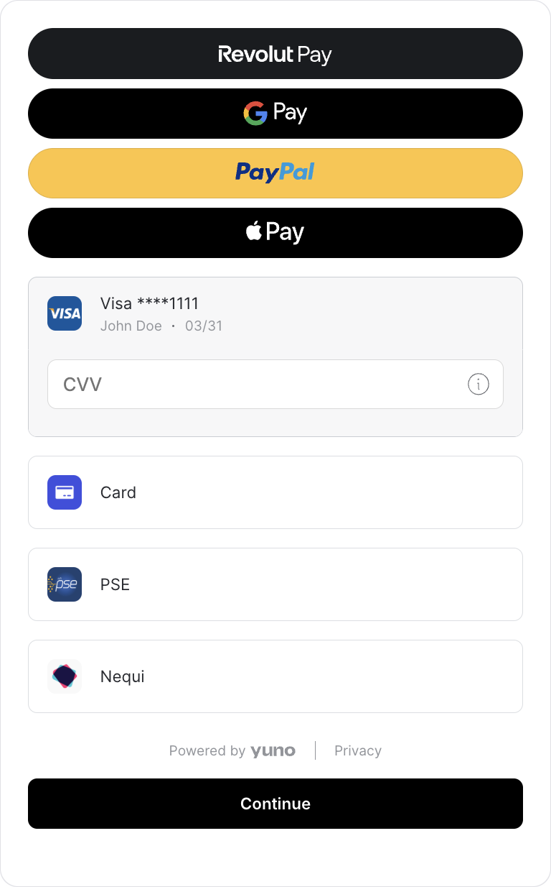

import { ChangelogBadge } from '/snippets/ChangelogBadge.jsx';

Boas-vindas aos Destaques de Produto da Yuno. Aqui, apresentamos os principais recursos, novos meios de pagamento e atualizações da plataforma criados para ajudar você a otimizar a conversão, simplificar o checkout e escalar globalmente.

Para mudanças técnicas detalhadas, novas versões de SDK e correções de bugs, consulte nossos [Changelogs da plataforma](/pt-br/changelog).

---

## Destaque {#featured-spotlight}

  

    

      

        Destaque
        Web, iOS e Android
        Nova arquitetura
      

      <h3 className="text-2xl font-bold tracking-tight text-gray-900 dark:text-white">O novo Yuno SDK</h3>
      

        Uma integração unificada para pagamentos e cadastro em todas as plataformas cliente. Desenvolva com um único ciclo de vida de transação, handlers de status consistentes e inicialização simplificada do SDK, enquanto os SDKs legados continuam com suporte lado a lado até a descontinuação prevista para 2027.
      

      

        <a href="/docs/yuno-sdk/introduction" className="inline-flex items-center text-sm font-semibold text-blue-600 dark:text-blue-400 hover:underline">
          Conheça a visão geral do novo Yuno SDK →
        </a>
      

    

    

      

        
      

    

  

---

## Q4 2026 {#q4-2026}

<CardGroup cols={1}>
  <Card title="O novo Yuno SDK" icon="code" href="/docs/yuno-sdk/introduction">
    

      Nova arquitetura
      Web, iOS e Android
    

    Uma integração unificada para pagamentos e cadastro em todas as plataformas cliente. Desenvolva com um único ciclo de vida de transação, handlers de status consistentes e inicialização simplificada do SDK, enquanto os SDKs legados continuam com suporte lado a lado até a descontinuação prevista para 2027.
  </Card>

  <Card title="Pagamentos rápidos com Mercado Pago para VTEX" icon="bolt" href="/changelog/plugins/vtex">
    

      Carteiras e plugins
      VTEX
    

    Permita que os compradores da VTEX paguem com os cartões e o saldo salvos na conta do Mercado Pago por meio da afiliação da Yuno. Requer um Payment App no Web SDK 1.11 ou posterior; o checkout por redirecionamento (Legacy) ainda não oferece suporte.
  </Card>
</CardGroup>

---

## Q3 2026 {#q3-2026}

<CardGroup cols={1}>
  <Card title="Visa Tap to Add (Android)" icon="nfc" href="/pt-br/docs/sdks/card-enrollment/visa-tap-to-add-android">
    

      Novo recurso
      Android SDK e Tap SDK
    

    Transforme qualquer celular Android com NFC em um leitor de cartões por aproximação para capturar os dados do cartão e cadastrar o cartão salvo em segundos, sem digitação manual e com menos desistências.
  </Card>

  <Card title="Mecanismo de promoções e descontos" icon="tags" href="/docs/payment-features/promotions">
    

      Novo recurso
      Checkout e API
    

    Execute campanhas promocionais dinâmicas, descontos instantâneos e promoções por BIN de parceiros diretamente no checkout. Calcule cotações de desconto em tempo real antes da criação do pagamento para aumentar a conversão sem lógica de preços personalizada.
  </Card>

  <Card title="Google Pay Express Checkout (Android)" icon="google" href="/pt-br/docs/wallets/google-pay/sdk-integration/express-checkout">
    

      Carteiras
      Android SDK
    

    Acelere as compras no celular permitindo que os compradores paguem diretamente das páginas de produto ou do carrinho com o Google Pay Express Checkout, eliminando formulários de várias etapas.
  </Card>

  <Card title="Filtros de aceitação de cartões no Apple Pay" icon="apple" href="/docs/wallets/apple-pay">
    

      Carteiras
      Web SDK
    

    Filtre as bandeiras de cartão e as capacidades de pagamento aceitas diretamente na folha de pagamento do Apple Pay, evitando que os compradores selecionem cartões não suportados antes da autorização.
  </Card>

  <Card title="Pagamentos presenciais e conectividade com Smart POS" icon="cash-register">
    

      Comércio unificado
      POS e terminais
    

    Unifique transações digitais e físicas com o Yuno In-Person Payments. Conecte sistemas de ponto de venda, gerencie terminais inteligentes, monitore a saúde dos terminais e concilie vendas omnichannel em uma única visão operacional.

    Entre em contato com o seu key account manager para mais informações.
  </Card>

  <Card title="Cadastro e Vaulting Element do PayPal" icon="paypal" href="/pt-br/docs/sdks/lite-web/enrollment#paypal-enrollment-with-element-render-mode">
    

      Carteiras e vaulting
      Web SDK
    

    Renderize elementos dedicados de cadastro e de acordo de cobrança do PayPal com botões externos personalizáveis, simplificando a configuração de carteiras recorrentes e o vaulting com um clique.
  </Card>
</CardGroup>

---

## Q2 2026 {#q2-2026}

<CardGroup cols={1}>
  <Card title="Pix Automático para assinaturas recorrentes" icon="rotate" href="/pt-br/docs/payment-features/subscriptions/pix-automatico">
    

      Meios de pagamento
      Brasil
    

    Ofereça débito bancário automático pré-autorizado pela rede Pix do Brasil. Defina intervalos recorrentes, gerencie as autorizações de consentimento e cobre pagamentos de assinatura sem complicações e sem cartão de crédito.
  </Card>

  <Card title="Integração direta e parcelas com Samsung Pay" icon="mobile-screen" href="/pt-br/docs/wallets/samsung-pay">
    

      Carteiras
      API e SDK
    

    Processe tokens da carteira Samsung Pay diretamente por pagamentos server-to-server e integrações de SDK, com suporte a roteamento com vários adquirentes, descriptografia de criptograma e planos nativos de parcelas.
  </Card>

  <Card title="Fast Checkout e dados de entrega dinâmicos na carteira" icon="truck-fast" href="/pt-br/docs/payment-features/fast-checkout-shipping">
    

      Checkout
      Web, iOS, Android
    

    Permita que os clientes escolham endereços de entrega e modalidades de frete diretamente nas folhas das carteiras (Apple Pay e Google Pay), atualizando dinamicamente o total final da autorização antes da confirmação.
  </Card>

  <Card title="Parcelas no Google Pay" icon="credit-card" href="/docs/wallets/google-pay">
    

      Carteiras
      Web e VTEX
    

    Exiba os planos de parcelas disponíveis diretamente na folha de pagamento do Google Pay, permitindo que os compradores dividam as compras sem complicações com emissores da América Latina.
  </Card>

  <Card title="SDK nativo de 3DS da Netcetera" icon="shield-check" href="/pt-br/docs/sdks/external-native-modules/netcetera-3ds-android">
    

      Segurança
      iOS e Android
    

    Fluxo nativo de autenticação 3D Secure com integração do SDK da Netcetera, para autenticação biométrica no app sem atrito e altas taxas de autorização.
  </Card>
</CardGroup>

---

## Q1 2026 {#q1-2026}

<CardGroup cols={1}>
  <Card title="Golden Flow do Click to Pay (Passkeys GA)" icon="key" href="/pt-br/docs/wallets/click-to-pay">
    

      Carteiras e segurança
      Todas as plataformas
    

    Disponibilidade geral de passkeys do dispositivo e biometria para o EMVCo Click to Pay. Permite autenticação com um toque e vaulting automático de cartões na Web, em dispositivos móveis e na VTEX.
  </Card>

  <Card title="API do Checkout Builder e gestão do ciclo de vida" icon="layer-group" href="/pt-br/docs/using-yuno/dashboard-overview/checkout-builder">
    

      Checkout
      API
    

    Crie, personalize e gerencie sessões de checkout e temas de forma programática pela API do Checkout Builder, permitindo configurações dinâmicas de checkout por região.
  </Card>

  <Card title="Períodos de teste gratuito e medidores avançados em assinaturas" icon="calendar-check" href="/pt-br/docs/payment-features/subscriptions">
    

      Assinaturas
      API
    

    Configure intervalos de teste promocional em planos de pagamento recorrente, além de medição por faixas e por pacotes para modelos de assinatura flexíveis baseados em uso.
  </Card>
</CardGroup>

---

## Fique por dentro {#stay-updated}

- Acompanhe a [Visão geral do changelog](/pt-br/changelog) para ver as notas de versão detalhadas.
- Inscreva-se para receber atualizações ou integre a Yuno à sua stack de desenvolvimento com nossos [Recursos para desenvolvedores](/pt-br/docs/developers).
